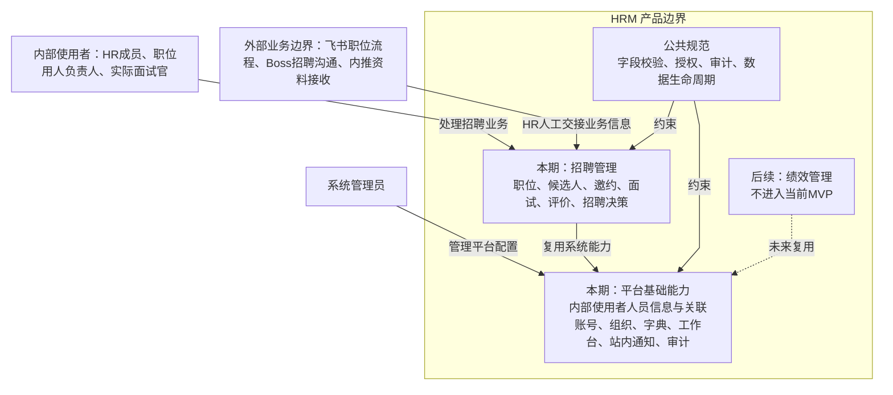
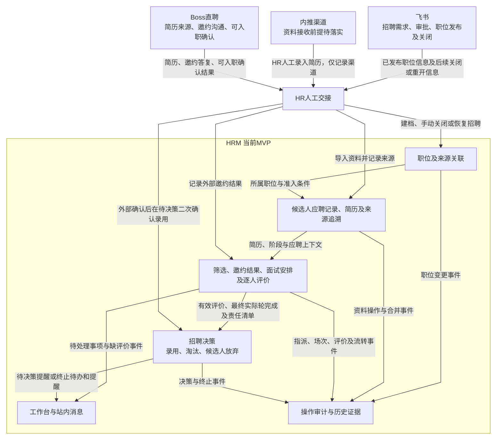

# 产品项目总览

- **版本／日期**：0.10／2026-10-13。
- **适用范围**：招聘管理MVP，技术部前端招聘试点。
- **状态**：需求基线，待研发／测试联合交接。

## 一、业务目标与用户价值

HRM集中管理职位发布后的招聘协作，解决候选人状态不透明、面试评价不及时、责任事项未推进的问题。本期覆盖职位建档至录用、淘汰或候选人放弃的完整闭环。

| 使用者 | 主要任务与价值 |
| --- | --- |
| HR成员 | 维护职位与应聘资料、记录邀约、安排面试、确认招聘结果，集中跟进候选人 |
| 职位用人负责人 | 完成初筛、配置流程与实际面试人员、处理评价及招聘决策事项 |
| 实际面试官 | 查看授权资料、参加具体场次并提交本人评价 |
| 系统管理员 | 管理内部人员、账号、部门、字典、审计与回收；平台角色本身不授予招聘内容访问权 |

## 二、本期范围与外部边界

| 领域 | 本期范围 |
| --- | --- |
| 招聘管理 | 职位、应聘资料、筛选、邀约、面试流程、场次、评价与招聘决策 |
| 支撑能力 | 内部人员及账号、部门、角色、字典、工作台、站内消息、审计及软删除恢复 |
| 后续范围 | 绩效、完整员工档案、Offer、合同、薪酬与入职办理，本期不实施 |

| 外部系统／来源渠道 | 业务职责与交接方式 |
| --- | --- |
| 飞书 | 招聘需求、审批、职位发布和关闭／重开；HR人工登记已发布职位并同步后续状态 |
| 内推 | HR人工录入内推简历，仅记录来源渠道；资料接收前提与后续确认方式待落实 |
| Boss直聘 | 简历取得、邀约沟通与可入职确认；HR人工导入资料、记录答复和确认结果 |
| HRM | 保存职位、应聘记录、面试协作与招聘结果，并生成业务待办、站内消息和审计 |

本期不接飞书／Boss API、不做日历同步、不向候选人或外部平台发送通知。录用结果止于招聘决策，不自动创建员工、Offer或入职记录。

## 三、人员身份、角色与责任

| 概念 | 产品定义 |
| --- | --- |
| 内部人员与账号 | 实际使用系统的内部人员一人一份信息、一个关联账号，由管理员一次创建 |
| 角色 | HR成员、面试官、系统管理员；同人可拥有多个角色，操作须完整满足相应角色的授权条件 |
| 部门 | 人员与职位的组织归属；部门本身不授予招聘业务权限，本期不提供员工岗位管理 |
| 职位用人负责人 | 从启用且具备面试官资格的人员中按职位指定；不是独立账号角色 |
| 场次指派 | 每场面试单独指定实际参与人和适用的完成责任人，职位负责人不自动成为实际面试官 |
| 历史作者 | 姓名、邮箱、角色或责任变化不改写历史作者；保留历史记录不表示保留当前访问权 |

账号可用性、角色资格与业务责任分别判断。账号禁用阻断访问，责任交接不改变候选人阶段、实际场次或历史评价。

## 四、业务架构与全局数据流转

### 4.1 业务架构图

本期由平台提供身份与通用支撑能力，由招聘管理完成业务闭环；绩效为后续范围。

### 4.2 全局数据流转图

飞书保留招聘需求、审批、发布和关闭事实；Boss提供其渠道的简历来源及外部沟通事实；内推资料由HR人工录入并记录渠道，接收前提与确认方式尚待落实；HRM记录内部业务流程与结果。外部来源、内部状态及实际操作证据分别保留。

## 五、平台与招聘职责

| 能力 | 平台职责 | 招聘职责 |
| --- | --- | --- |
| 身份与授权 | 登录、账号状态、角色及当前访问校验 | 职位负责人和场次实际人员的指派及动作准入 |
| 工作台 | 按当前权限聚合任务、显示责任和入口 | 产生筛选、邀约、安排、评价、决策等待处理事实，业务动作完成或取消任务 |
| 站内消息 | 投递、去重、阅读状态及授权跳转 | 决定提醒触发、收件人、周期及停止条件；消息已读不等于任务完成 |
| 字典 | 选项管理、停用与历史显示 | 使用招聘所需分类与初始值 |
| 附件及审计 | 文件安全、访问校验、操作及版本证据 | 保存简历、评价等业务证据，执行各自查看／下载／修改边界 |
| 删除与恢复 | 授权回收入口、恢复及审计 | 判断业务删除准入；恢复记录不恢复已终止招聘流程 |

## 六、需求与验收文档

- [基础资料管理PRD](基础资料管理PRD.md)：人员、账号角色、部门、字典及登录、工作台消息、审计回收页面需求。

- [招聘管理PRD](招聘管理PRD.md)：具体业务流程、字段、页面、按钮、配置与异常行为。
- [招聘管理验收附件](招聘管理验收附件.md)：需求追踪、测试步骤和预期结果。

## 七、质量与运行要求

| 要求 | 验收要求与待落实条件 |
| --- | --- |
| 访问与敏感信息保护 | 正向操作及越权拒绝均需验证，权限阻断达到既定100%门槛 |
| 并发与重试 | 同时提交或失败重试不产生重复业务事实，不覆盖历史版本 |
| 附件与通知 | 验证上传失败处理、授权拒绝、消息错发漏发及去重 |
| 使用规模与响应 | 试点人数、数据规模和响应目标待业务与研发联合评估 |
| 故障与恢复 | 备份恢复目标、失败补偿及验证方式待技术设计明确；记录恢复与系统恢复分别处理 |
| 数据生命周期 | 正式发布前确认敏感数据保留期限、主动删除、归档与法律保留的规则及操作授权 |

## 八、验收、试点与发布

首批试点为技术部前端招聘。发布须验证从职位建档至招聘终止的闭环、状态与异常处理、权限阻断、提醒和历史可追溯性，具体条件见招聘PRD及验收附件。

试点效果关注登记与录入成本、评价和阶段事项处理及时性，以真实样本对比同类流程基线。提醒正确性、权限阻断和业务证据完整性按功能验收执行；效率改善与功能通过分别记录。

## 九、招聘能力地图

下表说明招聘业务能力及其边界；具体页面展示和操作要求在模块PRD中定义。

| 业务能力 | 业务边界与处理结果 | 需求位置 |
| --- | --- | --- |
| 职位管理 | 登记已发布职位，维护资料、负责人及招聘状态；一个飞书申请对应一个职位 | [职位管理](招聘管理PRD.md#job-management) |
| 应聘资料 | 建立独立应聘记录，保存来源和简历版本，处理重复；不迁移跨职位流程 | [应聘资料](招聘管理PRD.md#candidate-management) |
| 筛选与邀约 | 记录资料推荐、初筛及外部邀约答复，决定面试安排准入 | [筛选与邀约](招聘管理PRD.md#fields-screen-invite) |
| 面试流程与场次 | 保存配置快照及实际指派、计划与实际时间，处理改期、取消、替代和完成 | [面试安排](招聘管理PRD.md#fields-session) |
| 评价与招聘决策 | 保存逐人评价及版本，判断最终评价门槛，记录HR沟通和终止结果 | [评价与招聘决策](招聘管理PRD.md#evaluation-progression) |
| 责任跟进 | 展示当前授权任务和提醒；阅读消息不完成任务、不推进阶段 | [工作台与提醒](招聘管理PRD.md#tasks) |

实施依赖：人员与账号授权 → 职位及应聘资料 → 筛选邀约 → 场次与评价 → 招聘决策，各批次接入工作台、消息及审计。真实Boss凭证形式仍需样例核实；无法取得时使用已定义的缺失原因分支。
