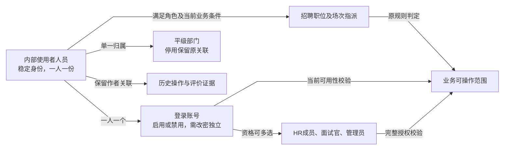

# 基础资料管理与平台能力PRD

## 1 文档信息

| 项目 | 内容 |
| --- | --- |
| 版本／日期 | 0.7／2026-10-14 |
| 目标读者 | 研发、测试、设计及业务评审参与者 |
| 状态 | 当前MVP需求基线，联合交接、视觉设计及实现验收待执行 |
| 交接责任 | 产品、管理员代表及研发／测试／设计承接；具体人员与时间由项目组落实 |

本文集中表达基础资料与当前平台支撑页面，字段、页面、操作与异常可连续阅读。详细执行步骤见验收附件，公共校验与授权引用共享规范。

## 2 目标与范围

让管理员统一维护招聘参与人的身份、账号资格、部门和可选值，让内部用户通过有效账号处理当前授权任务，避免同人多角色生成重复身份、错误授权和无痕变更。

| 类别 | 本期范围 |
| --- | --- |
| 基础资料 | 实际使用HRM的内部人员、每人一个关联账号、现有角色、平级部门、字典选项 |
| 平台支撑页面 | 登录及首次改密、工作台、本人站内消息、授权审计查询及软删除回收恢复 |
| 不包含 | 完整员工档案、岗位任职、身份证件、薪酬合同、无账号人员、外部面试官、单点登录／组织同步、自定义角色权限编辑器 |
| 业务边界 | 招聘职位负责人、场次实际指派、候选人阶段、评价及决策由招聘PRD定义；部门与管理员角色不自动授予业务访问权 |

成功标准：人员创建及角色维护不产生重复身份；账号失效阻断访问；部门／字典停用保留旧关联、阻止新关联；授权拒绝无敏感泄露。人员和账号变更均保留操作证据；越权测试全部阻断且不泄露敏感信息；任务与消息按对应业务触发及去重规则验收。

## 3 角色与权限

| 角色 | 页面范围与允许动作 | 禁止或限制 |
| --- | --- | --- |
| 系统管理员 | 人员、账号、角色、部门及字典管理；授权平台审计及回收恢复 | 平台角色不授予候选人、简历或评价访问；不能自禁用或使最后一个启用管理员失去管理资格 |
| HR成员 | 招聘授权任务与业务入口、本人消息、招聘审计；招聘权限另按招聘PRD | 不凭HR角色维护全公司人员账号和部门；不能替他人提交／修改评价 |
| 面试官／当前职位负责人 | 本人实际指派／负责职位对应任务与资料，本人消息、自身授权操作结果 | 同部门不自动授予业务权限；历史作者不保留当前访问权，不提供人员管理 |
| 当前登录用户 | 本人首次改密、授权工作台与本人消息 | 需改密时不能绕过；无自助人员资料编辑、修改他人密码或手工发消息 |

按钮显示及提交复核统一按[公共按钮规范](公共规范/权限与数据治理规范.md#34-按钮展示可用条件与提交校验d-023)执行，各页面只定义实际操作资格和业务条件。

## 4 业务概览

| 对象 | 表达的含义 |
| --- | --- |
| 人员 | 谁在使用系统，稳定身份 |
| 账号 | 如何登录 |
| 角色 | 具备哪些资格 |
| 部门 | 组织归属 |
| 招聘指派 | 具体业务责任 |

人员及账号一次创建，增加角色复用原身份。改名、改邮箱不替换历史作者；禁用不删除业务证据或自动完成责任。

### 4.1 人员、账号与责任关系

该图表达产品关系，不表示数据库拆表；部门归属不直接授权业务操作，历史作者不保留访问权。

### 4.2 角色交接与数据使用

1. 管理员维护身份与资格。
2. 招聘HR或负责人按当前有效资格指派业务。
3. 用户处理授权任务，业务模块更新事实与待办。
4. 平台展示消息及审计。

**资格失效**：账号禁用或移除资格立即改变当前访问。原业务责任由授权负责人在业务入口人工交接；平台只显示通用检查提示，不自动转交或泄露敏感任务。

## 5 功能需求

人员管理包含列表页、详情页及新增／编辑页；账号和角色操作位于人员详情页。部门与字典在各自列表页通过弹窗维护。

### 5.1 人员与账号

#### 5.1.1 人员列表页

系统管理员从人员管理进入。

**筛选项**

| 字段名 | 数据类型 | 控件 | 取值来源 | 默认值 | 筛选说明 |
| --- | --- | --- | --- | --- | --- |
| 所属部门 | 部门关联 | 单选下拉框 | 已保留部门，含有历史关联的停用部门 | 全部 | 按稳定部门关联精确筛选 |
| 角色 | 角色枚举 | 单选下拉框 | HR成员、面试官、系统管理员 | 全部 | 包含所选角色；同人多角色仍一行 |
| 账号可用性 | 枚举 | 单选下拉框 | 启用、禁用 | 全部 | 按当前账号状态筛选 |

**按钮**

| 按钮名称 | 所在位置 | 操作角色 | 业务条件 | 点击行为 | 确认要求 | 执行结果 | 拒绝或等待反馈 |
| --- | --- | --- | --- | --- | --- | --- | --- |
| 查询 | 人员列表页／筛选区 | 系统管理员 | 无额外业务条件 | 应用当前筛选 | 无需额外确认 | 刷新符合条件的授权记录 | 公共查询失败反馈 |
| 重置 | 人员列表页／筛选区 | 系统管理员 | 无额外业务条件 | 恢复本页默认条件 | 无需额外确认 | 刷新默认查询 | 不改变业务记录 |
| 新增 | 人员列表页／列表上方 | 系统管理员 | 无额外业务条件 | 进入人员新增页 | 无需额外确认 | 标题“新增人员”；输入为空，账号默认启用且需改密由保存产生 | 其他角色无入口 |

**展示字段**

| 字段名 | 数据类型 | 取值来源 | 展示规则 | 空值展示 | 操作说明 |
| --- | --- | --- | --- | --- | --- |
| 姓名 | 文本链接 | 人员当前姓名 | 一人员一行，显示当前姓名 | — | 点击进入该人员详情 |
| 邮箱 | 文本 | 关联账号当前登录邮箱 | 显示当前邮箱 | — | 只读 |
| 所属部门 | 文本 | 人员部门关联→名称 | 停用部门标记“已停用” | — | 只读 |
| 角色 | 文本集合 | 关联账号角色集合 | 展示全部当前角色 | — | 只读，不拆行 |
| 账号可用性 | 状态标签 | 关联账号当前状态 | 启用／禁用；需改密不替代可用性 | — | 只读 |

默认创建时间倒序，同时间按稳定人员引用升序；计数单位为人员。无记录“暂无人员”，筛选无结果“暂无符合条件的人员”。不提供人员删除、导出或列表直接改角色／状态。

#### 5.1.2 人员新增／编辑页

**按钮**

| 按钮名称 | 所在位置 | 操作角色 | 业务条件 | 点击行为 | 确认要求 | 执行结果 | 拒绝或等待反馈 |
| --- | --- | --- | --- | --- | --- | --- | --- |
| 保存 | 人员新增页／底部 | 系统管理员 | 姓名、邮箱、部门、至少一个角色和临时密码合法 | 整体创建人员及账号 | 无需额外确认 | 提示“新增成功”，进入新人员详情；账号启用且需首次改密 | 邮箱冲突拒绝，同名不自动合并；不留下半条人员或账号 |
| 保存 | 人员编辑页／底部 | 系统管理员 | 姓名、部门及邮箱合法；邮箱变化时原因必填 | 更新当前人员及关联账号邮箱 | 邮箱变化展示原、新值及原因后确认 | 提示“已保存”回原详情；改邮箱使目标会话失效，当前管理员修改本人邮箱则转登录页 | 邮箱已占用拒绝，保留合法输入；不重置密码、不解除禁用、不替换历史作者 |
| 取消 | 人员新增／编辑页／底部 | 系统管理员 | 无额外业务条件 | 离开当前页面 | 未保存修改按公共离开规则确认 | 新增回原列表，编辑回原详情；不保存 | 无跨会话草稿 |

**输入字段**

| 字段名 | 业务含义 | 数据类型 | 控件 | 取值来源 | 新增默认值 | 必填 | 业务校验 | 修改与历史 |
| --- | --- | --- | --- | --- | --- | --- | --- | --- |
| 姓名 | 人员显示名 | 文本 | 文本输入框 | 管理员输入 | 无 | 是 | 公共姓名校验，同名允许 | 编辑回填并可更正，稳定身份不变 |
| 邮箱 | 账号登录标识 | 邮箱 | 邮箱输入框 | 管理员输入 | 无 | 是 | 公共邮箱格式和唯一比较；不得占用其他账号邮箱 | 编辑回填；更正需原因及原新值确认 |
| 所属部门 | 组织归属 | 部门关联 | 单选下拉框 | 启用部门 | 无 | 是 | 单一部门；原停用值可保留，新选择须启用 | 编辑回填，不改变业务指派或授权 |
| 角色 | 账号资格 | 角色集合 | 多选框 | HR成员、面试官、系统管理员 | 无 | 新增至少一个 | 不提供自定义授权角色 | 编辑只读；在人员详情编辑角色 |
| 临时密码 | 首次登录认证 | 秘密文本 | 密码输入框 | 管理员输入 | 无 | 新增是 | 公共密码规范，允许粘贴，不裁剪首尾空格 | 编辑不显示、不回填；由详情重置密码 |
| 邮箱更正原因 | 更正依据 | 备注 | 多行文本框 | 管理员输入 | 无 | 编辑且邮箱变化时是 | 公共备注校验 | 保存原因与前后值，不写入密码 |

编辑时回填当前姓名、邮箱和部门；标题“编辑人员”，稳定人员引用不可编辑。临时密码不在详情、审计或日志回显。

#### 5.1.3 人员身份与账号关系

人员身份引用由系统生成且不可编辑；姓名、邮箱或部门变化均保持同一身份及历史作者。同名允许，不能按姓名自动合并人员。每人仅一个关联账号，登录邮箱使用人员新增／编辑页同一输入，不维护第二份独立邮箱。

本期不维护员工岗位及完整任职状态机；招聘职位、岗位分类和权限角色不能替代员工岗位。离职访问通过账号禁用处理，禁用不等同离职、启用不等同复职。账号可用性与下次登录需改密分别保存，需改密不作为人员任职状态。

#### 5.1.4 人员详情页及账号／角色操作

系统管理员查看所选人员，平台管理权不授予候选人或评价正文访问。

**按钮**

| 按钮名称 | 所在位置 | 操作角色 | 业务条件 | 点击行为 | 确认要求 | 执行结果 | 拒绝或等待反馈 |
| --- | --- | --- | --- | --- | --- | --- | --- |
| 编辑 | 人员详情页／资料区 | 系统管理员 | 目标人员存在 | 进入人员编辑页，回填当前资料 | 无需额外确认 | 姓名、邮箱、部门可编辑，角色只读、密码不显示 | 提交仍复核当前管理资格 |
| 重置密码 | 人员详情页／账号区 | 系统管理员 | 启用、禁用账号均可 | 打开临时密码弹窗 | 填写合法临时密码后保存 | 目标会话失效，下次登录需改密；不解除禁用 | 密码不回显、不进日志；重置本人后转登录页 |
| 禁用 | 人员详情页／账号区 | 系统管理员 | 目标启用；不是本人且不会禁用最后一个启用管理员 | 打开禁用确认弹窗 | 目标、访问影响、原因及二次确认 | 目标无法登录、当前会话失效；显示检查未完成责任提示 | 自禁用或最后管理员保护拒绝；不强制先交接，不自动转移任务 |
| 启用 | 人员详情页／账号区 | 系统管理员 | 目标禁用 | 打开启用确认弹窗 | 确认目标 | 保留角色、需改密标记；须重新登录 | 不恢复旧会话、已交接指派或终止业务 |
| 编辑角色 | 人员详情页／角色区 | 系统管理员 | 目标人员存在，含禁用账号 | 打开现有角色多选弹窗，回填当前角色 | 至少一个角色；不得移除最后启用管理员资格 | 保存后刷新角色及当前授权，原作者不变；不解除禁用 | 不增加人员；失去当前管理资格转授权工作台 |
| 返回列表 | 人员详情页／导航区 | 系统管理员 | 无额外业务条件 | 回人员列表 | 无需额外确认 | 恢复原查询；无来源回授权人员列表 | 无权限不继续显示详情 |

**展示字段**

| 字段名 | 数据类型 | 取值来源 | 展示规则 | 空值展示 | 操作说明 |
| --- | --- | --- | --- | --- | --- |
| 姓名 | 文本 | 人员资料 | 显示当前姓名 | — | 只读 |
| 邮箱 | 文本 | 关联账号 | 显示当前登录邮箱 | — | 只读 |
| 所属部门 | 文本 | 部门关联→名称 | 停用值加标识 | — | 只读 |
| 角色 | 文本集合 | 当前账号角色 | 展示当前全部角色 | — | 只读 |
| 账号可用性 | 状态标签 | 账号状态 | 启用或禁用 | — | 只读 |
| 下次登录需改密 | 布尔标识 | 创建／重置及改密结果 | 显示是／否，与可用性独立 | — | 只读 |

弹窗“保存”执行对应动作并关闭、刷新原区；“取消”关闭且不修改。失败保留合法输入，密码不回显。账号及角色输入仅包含临时密码、禁用原因、现有角色选择，分别按公共密码、备注及角色至少一个校验；不提供人员删除／恢复、下载、导出或自助资料编辑。

#### 5.1.5 账号变化对业务历史的影响

账号禁用、姓名／部门／角色变化不删除历史作者、不自动转移未完成责任、不取消场次或改变候选人阶段。管理员仅看到检查未完成责任的通用提示；招聘负责人在授权业务入口人工交接，平台不展示无权访问的候选人和评价详情。

### 5.2 部门管理

#### 5.2.1 部门列表页与新增／编辑弹窗

系统管理员使用；不提供删除、独立详情页。

**按钮**

| 按钮名称 | 所在位置 | 操作角色 | 业务条件 | 点击行为 | 确认要求 | 执行结果 | 拒绝或等待反馈 |
| --- | --- | --- | --- | --- | --- | --- | --- |
| 新增 | 部门列表页／列表上方 | 系统管理员 | 无额外业务条件 | 打开新增部门弹窗 | 无需额外确认 | 名称为空，默认启用 | 不创建空记录 |
| 编辑 | 部门列表页／记录操作区 | 系统管理员 | 目标存在 | 打开编辑部门弹窗并回填 | 无需额外确认 | 仅修改名称，稳定关联不变 | 不能占用已有名称 |
| 停用 | 部门列表页／记录操作区 | 系统管理员 | 目标启用 | 打开停用确认弹窗 | 确认目标、保留历史及禁止新关联的影响，二次确认 | 禁止新关联，原关联和业务权限保留 | 不删除历史、不关闭业务 |
| 启用 | 部门列表页／记录操作区 | 系统管理员 | 目标停用 | 打开启用确认弹窗 | 确认目标 | 恢复新选择资格 | 不恢复已终止流程 |
| 保存 | 部门新增／编辑弹窗／底部 | 系统管理员 | 名称合法且不重复 | 新增创建、编辑更新当前对象 | 无需额外确认 | 关闭弹窗并刷新原列表；新记录不符合原查询时提示已保存 | 同名或版本冲突拒绝，留合法输入，不部分保存 |
| 取消 | 部门新增／编辑弹窗／底部 | 系统管理员 | 无额外业务条件 | 关闭弹窗 | 未保存修改按公共离开规则确认 | 留在原列表，不修改 | — |

**展示字段**

| 字段名 | 数据类型 | 取值来源 | 展示规则 | 空值展示 | 操作说明 |
| --- | --- | --- | --- | --- | --- |
| 名称 | 文本 | 部门当前保存名称 | 展示当前名称 | — | 只读 |
| 状态 | 状态标签 | 部门当前状态 | 启用／停用 | — | 只读 |

创建时间倒序，同时间按稳定引用升序；计数单位为部门，空态“暂无部门”。本期部门列表不设筛选区。

**输入字段**

| 字段名 | 业务含义 | 数据类型 | 控件 | 取值来源 | 新增默认值 | 必填 | 业务校验 | 修改与历史 |
| --- | --- | --- | --- | --- | --- | --- | --- | --- |
| 名称 | 部门显示名称 | 文本 | 文本输入框 | 管理员输入 | 无 | 是 | 公共单行文本；在全部保留部门中不重复 | 编辑回填，重命名保持原关联 |

#### 5.2.2 部门字段与启停约束

本期部门仅作为人员和职位归属、选择与检索的基础信息，采用平级部门列表，每人一个所属部门。本期不提供部门层级、跨部门兼职或部门负责人授权。

| 字段 | 业务定义与来源 | 默认／必填／校验 | 修改及历史 |
| --- | --- | --- | --- |
| 部门身份引用 | 系统产生的稳定单值关联 | 保存成功即有，无人工默认 | 不可编辑；重命名不新建部门，人员／职位引用保持 |
| 部门名称 | 管理员输入的显示名称 | 必填，无默认，引用公共单行文本；去首尾空白后在所有保留部门中不重复 | 管理员可改，不能占用已有部门名称；变更审计，不重写原业务证据 |
| 部门状态 | 启用／停用，管理员动作产生 | 创建默认启用 | 停用不删除历史；可重新启用 |

##### 5.2.2.1 动作与状态

- 管理员可查看、创建、修改、停用及重新启用部门；本期不提供删除／恢复部门入口，以免破坏人员和职位历史关联。
- 新人员及新职位必须选择启用部门；已关联停用部门的人员和职位保留归属且可继续原有授权业务，不因停用而禁用账号、关闭职位或终止招聘。
- 停用前显示影响提示并二次确认。可停用正在使用部门，不要求先清空关联；重新指派部门时只能选择启用部门，不能静默批量迁移。
- 既有记录编辑其他字段时，保留原停用部门合法；不能因保存其他字段要求重新选择部门。新关联和原值保持是不同校验场景。
- 空列表引导管理员建部门；普通用户无配置入口。部门选择只表达归属，不能改变招聘授权逻辑。

共性规则引用[公共组织基线](公共规范/权限与数据治理规范.md#21-部门归属与生命周期d-024)。

**验收示例（尚未执行）**：新部门创建并被人员、职位引用→停用→原人员继续处理原面试→新人员／职位不能选择该部门→管理员重命名／启用。每一步核对关联、授权及历史；任何停用导致自动退出招聘或历史丢失均不符合部门规则。

### 5.3 字典管理

#### 5.3.1 字典列表页与新增／编辑弹窗

系统管理员使用；不提供删除、独立详情页。

字典列表左侧选择已有分类，右侧仅展示该分类选项；切换分类清空名称／状态查询并回第1页，重置保留当前分类。

**筛选项**

| 字段名 | 数据类型 | 控件 | 取值来源 | 默认值 | 筛选说明 |
| --- | --- | --- | --- | --- | --- |
| 名称 | 文本 | 文本输入框 | 管理员输入 | 空 | 当前分类内名称包含关键词 |
| 状态 | 枚举 | 单选下拉框 | 启用、停用 | 全部 | 按选项当前状态筛选 |

**按钮**

| 按钮名称 | 所在位置 | 操作角色 | 业务条件 | 点击行为 | 确认要求 | 执行结果 | 拒绝或等待反馈 |
| --- | --- | --- | --- | --- | --- | --- | --- |
| 查询 | 字典列表页／筛选区 | 系统管理员 | 无额外业务条件 | 应用当前筛选 | 无需额外确认 | 刷新符合条件的授权记录 | 公共查询失败反馈 |
| 重置 | 字典列表页／筛选区 | 系统管理员 | 无额外业务条件 | 恢复本页默认条件 | 无需额外确认 | 刷新默认查询 | 不改变业务记录 |
| 新增 | 字典选项列表页／列表上方 | 系统管理员 | 已选择分类 | 打开新增字典选项弹窗 | 无需额外确认 | 名称为空，默认启用；排序默认分类末尾下一位，分类固定 | 不创建空记录 |
| 编辑 | 字典选项列表页／记录操作区 | 系统管理员 | 目标存在 | 打开编辑字典选项弹窗并回填 | 无需额外确认 | 仅修改名称及排序，不跨分类移动 | 不能占用已有名称或替换既定业务语义 |
| 停用 | 字典选项列表页／记录操作区 | 系统管理员 | 目标启用 | 打开停用确认弹窗 | 确认目标、保留历史及禁止新关联的影响，二次确认 | 禁止新关联，原关联和业务权限保留 | 不删除历史、不关闭业务 |
| 启用 | 字典选项列表页／记录操作区 | 系统管理员 | 目标停用 | 打开启用确认弹窗 | 确认目标 | 恢复新选择资格 | 不恢复已终止流程 |
| 保存 | 字典选项新增／编辑弹窗／底部 | 系统管理员 | 名称合法且不重复，排序为正整数 | 新增创建、编辑更新当前对象 | 无需额外确认 | 关闭弹窗并刷新原列表；新记录不符合原查询时提示已保存 | 同名或版本冲突拒绝，留合法输入，不部分保存 |
| 取消 | 字典选项新增／编辑弹窗／底部 | 系统管理员 | 无额外业务条件 | 关闭弹窗 | 未保存修改按公共离开规则确认 | 留在原列表，不修改 | — |

**展示字段**

| 字段名 | 数据类型 | 取值来源 | 展示规则 | 空值展示 | 操作说明 |
| --- | --- | --- | --- | --- | --- |
| 名称 | 文本 | 字典选项当前保存名称 | 展示当前名称 | — | 只读 |
| 排序 | 正整数 | 选项排序值 | 升序；相同按稳定引用升序 | — | 只读 |
| 状态 | 状态标签 | 字典选项当前状态 | 启用／停用 | — | 只读 |

排序升序，同排序按稳定引用升序；计数单位为当前分类选项，空态“暂无符合条件的字典选项”。名称、排序输入及语义约束在字典字段定义。

#### 5.3.2 字典字段及业务语义约束

| 字段名 | 业务含义 | 数据类型 | 控件 | 取值来源 | 新增默认值 | 必填 | 业务校验 | 修改与历史 |
| --- | --- | --- | --- | --- | --- | --- | --- | --- |
| 字典分类 | 选项所属业务类别 | 字典分类关联 | 只读 | 列表当前选择的已有分类 | 当前分类 | 是 | 不任建分类或业务状态机 | 编辑不可跨分类移动 |
| 选项名称 | 选项显示名称 | 文本 | 文本输入框 | 管理员输入 | 无 | 是 | 公共单行文本；同分类全部保留选项名称不重复 | 编辑回填，不得把通过改成不通过等替换业务语义 |
| 排序 | 分类内显示顺序 | 正整数 | 数字输入框 | 管理员输入 | 当前分类末尾下一位 | 是 | 同排序按稳定引用升序 | 编辑回填，不改变历史选择或阶段 |

选项稳定引用、启用状态及变更操作人／时刻由系统记录，不提供普通字段编辑；新选项默认启用，启停通过列表按钮操作。已使用选项不删除，重命名保持稳定引用及原业务证据；[字典停用值的历史编辑](公共规范/字段与表单校验规范.md#字典停用值的历史编辑d-030)沿公共规范。

管理员在设置中选分类、搜索名称、创建／编辑／排序／启停；本期不提供物理删除。面试结论、推荐结果等已承载规则的类别只维护已定义语义及展示，不能新增未定义结果触发自动流程；需要新语义走需求变更。风险无与其他互斥沿评价规则。每分类没有启用选项时提示管理员启用，业务表单拒绝新增，不自动降级自由文本；历史旧值显示与编辑沿公共字典编辑规则。

#### 5.3.3 本期招聘字典初始值

以下选项一期作为系统字典，由管理员维护；本期所有选项统一不提供物理删除，允许启停且不替换已承载的业务语义。

| 字典 | 默认初始值 |
| --- | --- |
| 职位类型 | 全职、实习、兼职、外包/合同、其他 |
| 办公方式 | 现场办公、远程、混合办公 |
| 招聘角色 | 前端、后端、客户端、测试、数据、DevOps、产品、设计、运营、其他 |
| 面试职级 | P2、P3-1、P3-2、P3-3、P4、P5；初级／潜力、中级／骨干、高级／专家为分组说明，其他职级不在本期默认流程内，出现真实需求时另行确认 |
| 面试结论 | 通过、不通过、待定/需补充 |
| 候选人来源渠道 | Boss直聘、内推 |
| 推荐结果 | 推荐、不推荐、待补充 |
| 风险项 | 无、技术能力、经验匹配、沟通协作、稳定性、薪资/到岗时间、其他 |
| 淘汰原因 | 能力不匹配、经验不足、面试表现、薪资不匹配、到岗时间不匹配、职位调整、其他 |
| 候选人放弃原因 | 公司取消、候选人取消、未到场、已接受其他机会、不再求职、薪资原因、时间安排、失联、个人原因、其他 |

来源渠道包含Boss直聘、内推。内推只记录渠道，不记录推荐人或推荐说明，不要求Boss来源凭证。内推资料接收前提及录用确认方式保留为对应业务实施依赖，详见[招聘PRD内推流程与依赖](招聘管理PRD.md#内推渠道录入依赖)。新增分类或新的流程语义需先补充相应业务规则，不通过字典维护绕过产品范围。

### 5.4 登录与首次改密

#### 5.4.1 登录页与首次改密页

##### 5.4.1.1 登录页

| 按钮名称 | 所在位置 | 操作角色 | 业务条件 | 点击行为 | 确认要求 | 执行结果 | 拒绝或等待反馈 |
| --- | --- | --- | --- | --- | --- | --- | --- |
| 登录 | 登录页／输入区底部 | 内部用户 | 邮箱和密码必填 | 提交账号认证 | 无需额外确认 | 有效账号需改密则进入首次改密页，否则进入授权工作台 | 禁用账号拒绝，失败不展示业务资料；密码不回显 |

**输入字段**

| 字段名 | 业务含义 | 数据类型 | 控件 | 取值来源 | 新增默认值 | 必填 | 业务校验 | 修改与历史 |
| --- | --- | --- | --- | --- | --- | --- | --- | --- |
| 登录邮箱 | 账号标识 | 邮箱 | 邮箱输入框 | 用户输入 | 无 | 是 | 公共邮箱格式 | 不更改人员资料 |
| 密码 | 认证秘密 | 秘密文本 | 密码输入框 | 用户输入 | 无 | 是 | 公共密码规则，不裁剪空格 | 不回显、不写日志 |

##### 5.4.1.2 首次改密页

| 按钮名称 | 所在位置 | 操作角色 | 业务条件 | 点击行为 | 确认要求 | 执行结果 | 拒绝或等待反馈 |
| --- | --- | --- | --- | --- | --- | --- | --- |
| 保存 | 首次改密页／底部 | 需改密的当前用户 | 当前账号启用且本人认证有效，新密码合法 | 保存本人新密码 | 无需额外确认 | 解除需改密标记，进入授权工作台 | 失败留在改密页；需改密时不能绕过进入业务页 |

**输入字段**

| 字段名 | 业务含义 | 数据类型 | 控件 | 取值来源 | 新增默认值 | 必填 | 业务校验 | 修改与历史 |
| --- | --- | --- | --- | --- | --- | --- | --- | --- |
| 新密码 | 本人后续登录秘密 | 秘密文本 | 密码输入框 | 当前用户输入 | 无 | 是 | 公共密码规则 | 不更改他人密码、不回显 |

### 5.5 工作台与站内消息

#### 5.5.1 工作台页

工作台展示当前授权待处理任务，不提供手工完成任务、任务删除或导出。招聘任务的筛选、按钮、列、排序与跳转在[招聘任务列表](招聘管理PRD.md#560-工作台页的招聘任务展示)完整定义；本页直接使用该阅读单元。平台管理员无业务角色时不显示招聘任务。空态“暂无待处理事项”，业务处理后返回恢复原查询并刷新。任务完成／取消由业务成功事件决定；已读消息不完成任务。

#### 5.5.2 任务字段与责任

| 字段 | 业务含义、来源／类型 | 默认／校验与变更 |
| --- | --- | --- |
| 任务引用、业务类型、来源事件 | 系统生成稳定任务、类别及业务对象／事件关联 | 同一来源与责任不重复任务；不由用户新建任意任务 |
| 应聘／场次／评价责任关联 | 业务模块提供对象与必要上下文 | 按任务类型适用，有实际对象才生成；字段不作为查看授权 |
| 任务标题、当前阶段、必要摘要 | 从业务事实生成展示 | 不复制简历、评价正文、完整联系方式；有当前权限才显示业务信息 |
| 当前责任人员、角色／责任身份 | 从当前有效指派计算，可一人或多人 | 交接变责任不重置任务起点；同人多角色入口去重，历史责任留审计 |
| 生成时刻、原计时起点、截止 | 系统事件与业务规则提供 | 区分计划时刻与评价／指标到期；没有业务期限时空值，不造统一SLA |
| 任务状态 | 待处理／已完成／已取消，系统判定 | 无手工完成按钮；页面访问／消息已读不改任务状态，业务成功后刷新 |
| 逾期／等待配置标识 | 业务条件推导 | 不是候选人阶段；规则及解除条件由业务模块维护 |
| 处理入口、最新结果证据 | 业务模块路由及成功事件关联 | 打开和提交再次校验授权，失权不泄露历史详情 |

工作台默认当前授权待处理，逾期优先、同组按原起点升序；筛选类型、职位、本人负责／授权范围、逾期标记。HR全公司视图与本人责任切换，负责人本人职位，面试官实际指派。平台管理员无招聘业务卡片。空状态“暂无待处理事项”，失去责任后原待办不继续可见；HR仍可看全局有效记录但不获得评价代交权。已完成／取消仅通过授权业务历史查看，不提供任务删除／导出。

#### 5.5.3 站内消息列表与只读抽屉

仅当前用户本人消息。

**筛选项**

| 字段名 | 数据类型 | 控件 | 取值来源 | 默认值 | 筛选说明 |
| --- | --- | --- | --- | --- | --- |
| 类型 | 枚举 | 单选下拉框 | 终面缺评价、待决策长期未推进、面试逾期、无人配置 | 全部 | 按消息业务类型筛选 |
| 阅读状态 | 枚举 | 单选下拉框 | 未读、已读 | 全部 | 按本人阅读状态筛选 |

**按钮**

| 按钮名称 | 所在位置 | 操作角色 | 业务条件 | 点击行为 | 确认要求 | 执行结果 | 拒绝或等待反馈 |
| --- | --- | --- | --- | --- | --- | --- | --- |
| 查询 | 站内消息列表页／筛选区 | 当前用户 | 无额外业务条件 | 应用当前筛选 | 无需额外确认 | 刷新符合条件的授权记录 | 公共查询失败反馈 |
| 重置 | 站内消息列表页／筛选区 | 当前用户 | 无额外业务条件 | 恢复本页默认条件 | 无需额外确认 | 刷新默认查询 | 不改变业务记录 |
| 标记已读 | 站内消息列表页／记录操作区 | 本人收件人 | 消息未读 | 更新阅读状态 | 无需额外确认 | 保存阅读时刻，刷新本人未读数；当前筛选不匹配时移出结果 | 不停止业务提醒或完成任务 |
| 处理 | 消息详情抽屉／操作区 | 本人且具有目标业务访问权 | 事项未结束且目标当前可访问 | 跳转对应业务区域 | 无需额外确认 | 目标页按实际资格展示业务动作 | 已结束无处理入口；失权隐藏摘要及入口，仅通用不可访问提示 |
| 关闭 | 消息详情抽屉 | 当前用户 | 无额外业务条件 | 关闭抽屉 | 无需额外确认 | 返回原消息查询 | — |

**展示字段**

| 字段名 | 数据类型 | 取值来源 | 展示规则 | 空值展示 | 操作说明 |
| --- | --- | --- | --- | --- | --- |
| 类型 | 文本 | 消息业务类型 | 显示对应类型 | — | 只读 |
| 标题 | 文本链接 | 消息生成标题 | 有当前权限才展示业务信息 | 通用不可访问提示 | 点击打开只读详情抽屉；授权消息打开即标已读 |
| 摘要 | 文本 | 消息必要摘要 | 不展示简历、评价正文或敏感附件地址 | — | 只读；失权隐藏 |
| 生成时间 | 日期时间 | 消息生成时刻 | 公共业务时区 | — | 只读 |
| 阅读状态 | 状态标签 | 本人消息阅读事实 | 未读／已读 | — | 只读 |
| 阅读时间 | 日期时间 | 本人标记已读的记录时刻 | 详情抽屉展示 | 未读显示“—” | 只读 |

生成时间倒序，同时间按稳定引用升序，计数单位为本人可见消息；无消息“暂无站内消息”，筛选无结果“暂无符合条件的消息”。抽屉同时展示事项已结束或不可访问提示，业务解除不抹去已发历史。不提供正文编辑、手工发送、指定收件人、删除或导出。

#### 5.5.4 消息字段及阅读状态

| 字段 | 含义／来源 | 默认、更新与限制 |
| --- | --- | --- |
| 消息引用、类型、来源对象／任务、提醒日期 | 系统按业务规则生成 | 类型包括缺评价、长期未推进、已有无人配置告警及已确认逾期面试提醒；按业务去重，不用标题去重 |
| 接收人员 | 触发时当前有效责任人，单条一收件人 | 不广播全公司HR，不把平台管理员作为默认业务收件人 |
| 标题、摘要、生成时间 | 系统必要上下文 | 不附原简历、评价正文或敏感附件地址；多类型显示独立标记 |
| 阅读状态、阅读时间 | 未读／已读；本收件人更新 | 初始未读，打开授权消息或点击标记已读更新；不完成任务、不停止应发提醒 |
| 已失效提示、处理入口 | 最新业务状态及权限推导 | 已完成／终止旧消息显示事项已结束；失权显示通用不可访问，不保留越权正文或可用入口 |

仅本人查看本人消息、标记已读；不提供用户修改正文、指定收件人、删除／导出或手工发送。按时间倒序，筛选类型／已读；空状态“暂无站内消息”。业务解除不抹去已发记录，未读数只计本人当前可见消息；失权消息只保留通用历史提示，不作为仍欠业务的证据。消息投递成功、失败与去重按实际通知记录验收。

### 5.6 审计与回收

#### 5.6.1 审计查询、详情抽屉及回收列表

##### 5.6.1.1 审计查询页

管理员限平台审计，HR限招聘审计，其他参与人限自身授权操作结果；审计只读，无编辑、删除、下载或导出。

首次进入默认选择今天及前6天；重置按执行当天重新计算，查询、翻页及详情返回保留已选日期。例如2026年10月14日进入，显示10月8日至10月14日，查询范围为北京时间10月8日00:00（含）至10月15日00:00（不含）。

**筛选项**

| 字段名 | 数据类型 | 控件 | 取值来源 | 默认值 | 筛选说明 |
| --- | --- | --- | --- | --- | --- |
| 操作时间 | 日期区间 | 起止日期选择器 | 用户选择 | 今天及前6天 | 北京时间；开始日00:00包含，结束日次日00:00不包含；开始日期不得晚于结束日期 |
| 操作者 | 人员关联 | 可搜索单选框 | 当前审计授权范围内操作者 | 全部 | 按稳定人员关联筛选 |
| 操作类型 | 枚举 | 单选下拉框 | 公共审计定义的登录、资料、状态、配置、查看、下载、删除、恢复、合并及失败事件 | 全部 | 按实际记录类型筛选 |
| 操作结果 | 枚举 | 单选下拉框 | 成功、失败／拒绝 | 全部 | 按实际结果筛选，不合并为成功 |
| 对象标识 | 标识 | 文本输入框 | 用户输入的目标稳定引用 | 空 | 按对象引用精确筛选 |

**按钮**

| 按钮名称 | 所在位置 | 操作角色 | 业务条件 | 点击行为 | 确认要求 | 执行结果 | 拒绝或等待反馈 |
| --- | --- | --- | --- | --- | --- | --- | --- |
| 查询 | 审计查询页／筛选区 | 当前授权用户 | 无额外业务条件 | 应用当前筛选 | 无需额外确认 | 刷新符合条件的授权记录 | 公共查询失败反馈 |
| 重置 | 审计查询页／筛选区 | 当前授权用户 | 无额外业务条件 | 恢复本页默认条件 | 无需额外确认 | 刷新默认查询 | 不改变业务记录 |
| 关闭 | 审计详情抽屉 | 当前授权用户 | 无额外业务条件 | 关闭只读抽屉 | 无需额外确认 | 返回原查询 | — |

**展示字段**

| 字段名 | 数据类型 | 取值来源 | 展示规则 | 空值展示 | 操作说明 |
| --- | --- | --- | --- | --- | --- |
| 操作时间 | 日期时间 | 公共审计 | 公共业务时区 | — | 只读 |
| 操作者 | 人员名称 | 公共审计操作人关联 | 展示实际操作者 | — | 只读 |
| 作用角色 | 文本 | 公共审计作用角色 | 展示本次实际授权身份 | — | 只读 |
| 操作类型 | 文本 | 公共审计 | 显示实际动作 | — | 只读 |
| 结果 | 文本 | 公共审计结果 | 显示成功或安全失败原因 | — | 只读 |
| 目标引用 | 标识 | 公共审计目标 | 仅显示安全对象引用 | — | 只读 |
| 必要摘要 | 文本 | 公共审计变更摘要 | 不显示无权候选人、联系方式、简历或评价原文 | — | 点击记录打开只读审计详情抽屉 |

详情抽屉展示该条安全摘要和变更证据；业务详情入口仅在具备当前业务权限时开放，返回恢复原审计查询。操作时间倒序，同时间按稳定引用升序，计数单位为审计记录，空态“暂无符合条件的记录”。

##### 5.6.1.2 回收列表页

仅获相应恢复授权的管理员进入，不因此获得招聘内容查看权。

**筛选项**

| 字段名 | 数据类型 | 控件 | 取值来源 | 默认值 | 筛选说明 |
| --- | --- | --- | --- | --- | --- |
| 对象类型 | 枚举 | 单选下拉框 | 当前授权可恢复的职位、应聘记录等对象类型 | 全部 | 不包含不提供软删除的人员、部门、字典或审计 |
| 删除时间 | 日期时间区间 | 起止时间选择器 | 用户输入 | 不限定 | 按合法时间区间筛选 |
| 对象引用 | 标识 | 文本输入框 | 用户输入 | 空 | 精确筛选稳定对象引用 |

**按钮**

| 按钮名称 | 所在位置 | 操作角色 | 业务条件 | 点击行为 | 确认要求 | 执行结果 | 拒绝或等待反馈 |
| --- | --- | --- | --- | --- | --- | --- | --- |
| 查询 | 回收列表页／筛选区 | 获恢复授权的管理员 | 无额外业务条件 | 应用当前筛选 | 无需额外确认 | 刷新符合条件的授权记录 | 公共查询失败反馈 |
| 重置 | 回收列表页／筛选区 | 获恢复授权的管理员 | 无额外业务条件 | 恢复本页默认条件 | 无需额外确认 | 刷新默认查询 | 不改变业务记录 |
| 恢复 | 回收列表页／记录操作区 | 获该对象恢复授权的管理员 | 目标仍软删除且在恢复范围内 | 打开安全目标及恢复原因弹窗 | 原因必填、展示影响并二次确认 | 关闭弹窗，记录移出回收列表，原关联及审计保留 | 过期版本拒绝，留原因；不重开招聘、不恢复终止流程、不派发任务 |
| 取消 | 恢复确认弹窗 | 当前用户 | 无额外业务条件 | 关闭弹窗 | 无需额外确认 | 留在原列表，不恢复 | — |

**展示字段**

| 字段名 | 数据类型 | 取值来源 | 展示规则 | 空值展示 | 操作说明 |
| --- | --- | --- | --- | --- | --- |
| 对象类型 | 文本 | 软删除证据 | 展示授权对象类别 | — | 只读 |
| 对象引用 | 标识 | 软删除证据 | 显示稳定引用，不展示越权正文 | — | 只读 |
| 删除人 | 人员名称 | 删除证据操作人 | 显示实际操作人 | — | 只读 |
| 删除时间 | 日期时间 | 删除证据时刻 | 公共业务时区 | — | 只读 |
| 删除原因 | 文本 | 删除证据原因 | 安全必要说明 | — | 只读 |

删除时间倒序，同时间按稳定引用升序，计数单位为可恢复记录，空态“暂无符合条件的回收记录”。恢复原因使用多行文本框，无默认、必填，按公共备注校验；不提供永久清除或批量导出。

审计记录的追加保存及敏感摘要遵循[公共审计规范](公共规范/权限与数据治理规范.md#六审计基线)；本页列定义不增加业务内容访问权。

## 6 共用异常与交互

### 6.1 加载、提交、查询分页与返回

| 情况 | 页面反馈与处理 |
| --- | --- |
| 授权判定 | 入口、查看、编辑和提交分别鉴权；无权限隐藏操作，有权限但业务条件不足时禁用并说明原因，直接请求仍须拒绝。 |
| 提交中／提交失败 | 提交期间防重复；失败保留合法输入，认证秘密不回显。 |
| 版本冲突 | 提示刷新当前事实。 |
| 加载失败 | 提供重试，不显示为无数据。 |
| 敏感动作 | 说明目标、影响及是否可恢复；成功后更新当前事实。 |

#### 6.1.1 列表查询与返回

按[公共规范：列表查询、分页与返回](公共规范/字段与表单校验规范.md#list-query-return)执行；各页面定义自己的筛选项、排序、业务计数及特殊交互。

### 6.2 资格变更与管理连续性

启用账号不恢复旧会话或已交接指派；移除角色不改写原作者。管理员移除本人管理资格后不继续显示无权页面，邮箱更正或重置密码使本人会话失效时转登录页。人员与账号不存在删除／恢复、下载或批量导出入口；禁用不是员工离职办理，启用不是复职。

敏感操作失败不写入部分结果、不重发业务任务。部门、字典停用不撤销原业务权限，不强迫编辑其他字段时替换历史停用值。恢复回收记录不恢复终止招聘流程。

## 7 数据与依赖

平台保存稳定人员、账号、部门、角色及字典引用；招聘保存职位负责人和场次指派，事件提供任务、消息及审计上下文。密码不在人员详情、业务正文或日志回显；名单和角色本身不是查看业务资料的授权。

| 必读共享配套 | 适用内容 |
| --- | --- |
| [字段与表单校验](公共规范/字段与表单校验规范.md#公共规则)、[通用交互](公共规范/字段与表单校验规范.md#通用交互要求) | 格式、密码、时间、附件、错误反馈与重试 |
| [账号组织](公共规范/权限与数据治理规范.md#二账号与组织基线)、[授权判定](公共规范/权限与数据治理规范.md#32-授权判定与多角色合并) | 稳定身份、角色与当前授权校验 |
| [审计](公共规范/权限与数据治理规范.md#六审计基线)、[生命周期](公共规范/权限与数据治理规范.md#五软删除与数据生命周期) | 操作证据、敏感摘要、保留及恢复 |
| [招聘工作台业务规则](招聘管理PRD.md#tasks)、[招聘页面与流程](招聘管理PRD.md#features) | 任务／提醒的业务触发、收件人、停止、指派与责任交接；仅相关承接者必读 |
| [指标口径](指标与试点基线.md#二核心指标) | 消息应发项核对及越权测试口径；试点效果采集不作为本模块功能验收条件 |

基础部门和有效管理员需先具备，人员／账号供招聘选人使用；字典按本期类别初始化。初始管理员配置方式、实际名单及部署环境由技术设计与联合交接落实，不能因此提供未授权自助注册或默认泄露密码。

### 7.1 审计时间筛选

审计时间默认值及日期边界在审计查询页定义；时间均采用公共业务时区，筛选日期不扩大审计查看范围。

## 8 非功能要求

服务端复核授权和当前版本；创建人员账号及身份关联整体成功，失败不留下半条身份。邮箱更正、禁用和重置密码执行会话失效；并发更新及重试不产生重复身份／通知。审计追加保留必要证据，不暴露密码、完整简历或评价原文。

[可点击原型](prototype/index.html)用于演示页面；真实认证、服务端鉴权、通知与完整历史治理仍按本PRD实施。视觉布局、浅深主题、辅助技术及文件预览需设计和真实操作验证。试点规模、响应目标、备份恢复及敏感数据保留期限尚需业务与技术评估，属于实施／发布依赖，不用虚构数值替代。

## 9 验收与交付

| 能力 | 核心验收预期 |
| --- | --- |
| 人员与多角色 | 一人一份身份及一个账号，增加角色不建新人，新增初始化、编辑回填及字段限制与保存结果一致 |
| 账号与管理员保护 | 禁用阻断访问，变更使会话失效；禁止自禁用和移除最后启用管理员资格；启用不恢复旧指派 |
| 部门 | 改名保持稳定关联，停用保留原关系和授权，只禁止新关联；无删除入口 |
| 字典 | 同分类名称不重复，排序确定，停用保留历史；不得用改名／新值替换既定业务语义 |
| 工作台与消息 | 当前授权、去重和责任起点正确，已读不完成任务；失权不泄露，业务终止停止适用提醒 |
| 审计与回收 | 摘要不越权，审计只读；恢复原因及二次确认，恢复不复活终止流程 |
| 页面交互 | 保存、取消、失败、拒绝、分页与返回上下文分别验证；无数据与加载失败区分 |

详细步骤和现有追踪统一使用[招聘管理验收附件](招聘管理验收附件.md#page-interaction-acceptance)中的人员、账号、部门、字典及平台场景。执行时记录版本、数据、结果及复测证据；越权测试全部阻断且无敏感泄露。当前仅需求输出，联合交接、实现测试和真实试点尚未执行。

## 版本与变更记录

| 版本／日期 | 变更与交付影响 |
| --- | --- |
| 0.7／2026-10-14 | 确认审计默认包含今天的7个自然日期，明确日期边界及重置、翻页行为。 |
