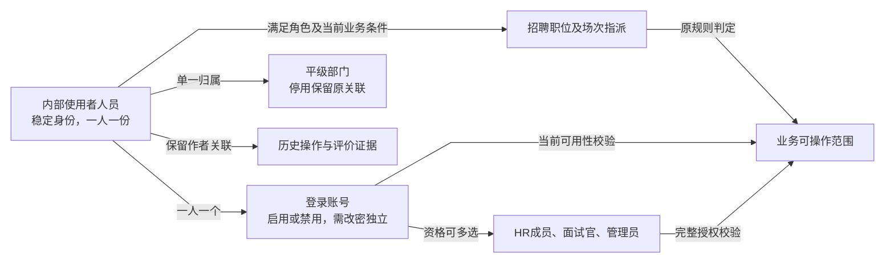

# 基础资料管理与平台能力PRD

## 1 文档信息

| 项目 | 内容 |
| --- | --- |
| 版本／日期 | 0.5／2026-10-13 |
| 目标读者 | 研发、测试、设计及业务评审参与者 |
| 状态 | 当前MVP需求基线，联合交接、视觉设计及实现验收待执行 |
| 交接责任 | 产品、管理员代表及研发／测试／设计承接；具体人员与时间由项目组落实 |

本文集中表达基础资料与当前平台支撑页面，字段、页面、操作与异常可连续阅读。详细执行步骤见验收附件，公共校验与授权引用共享规范。

## 2 目标与范围

让管理员统一维护招聘参与人的身份、账号资格、部门和可选值，让内部用户通过有效账号处理当前授权任务，避免同人多角色生成重复身份、错误授权和无痕变更。

| 类别 | 本期范围 |
| --- | --- |
| 基础资料 | 实际使用HRM的内部人员、每人一个关联账号、现有角色、平级部门、字典选项 |
| 平台支撑页面 | 登录及首次改密、工作台、本人站内消息、授权审计查询及软删除回收恢复 |
| 不包含 | 完整员工档案、岗位任职、身份证件、薪酬合同、无账号人员、外部面试官、单点登录／组织同步、自定义角色权限编辑器 |
| 业务边界 | 招聘职位负责人、场次实际指派、候选人阶段、评价及决策由招聘PRD定义；部门与管理员角色不自动授予业务访问权 |

成功标准：人员创建及角色维护不产生重复身份；账号失效阻断访问；部门／字典停用保留旧关联、阻止新关联；授权拒绝无敏感泄露。人员和账号变更均保留操作证据；越权测试全部阻断且不泄露敏感信息；任务与消息按对应业务触发及去重规则验收。

## 3 角色与权限

| 角色 | 页面范围与允许动作 | 禁止或限制 |
| --- | --- | --- |
| 系统管理员 | 人员、账号、角色、部门及字典管理；授权平台审计及回收恢复 | 平台角色不授予候选人、简历或评价访问；不能自禁用或使最后一个启用管理员失去管理资格 |
| HR成员 | 招聘授权任务与业务入口、本人消息、招聘审计；招聘权限另按招聘PRD | 不凭HR角色维护全公司人员账号和部门；不能替他人提交／修改评价 |
| 面试官／当前职位负责人 | 本人实际指派／负责职位对应任务与资料，本人消息、自身授权操作结果 | 同部门不自动授予业务权限；历史作者不保留当前访问权，不提供人员管理 |
| 当前登录用户 | 本人首次改密、授权工作台与本人消息 | 需改密时不能绕过；无自助人员资料编辑、修改他人密码或手工发消息 |

同人多角色分别执行完整授权，不拼接角色间的数据范围与操作权限。页面进入、查看、按钮和提交分别鉴权；无权限隐藏，有资格但条件不足禁用并说明原因，直接请求仍须拒绝。操作时复核当前账号、角色、范围、状态和版本。

## 4 业务概览

| 对象 | 表达的含义 |
| --- | --- |
| 人员 | 谁在使用系统，稳定身份 |
| 账号 | 如何登录 |
| 角色 | 具备哪些资格 |
| 部门 | 组织归属 |
| 招聘指派 | 具体业务责任 |

人员及账号一次创建，增加角色复用原身份。改名、改邮箱不替换历史作者；禁用不删除业务证据或自动完成责任。

### 4.1 人员、账号与责任关系

该图表达产品关系，不表示数据库拆表；部门归属不直接授权业务操作，历史作者不保留访问权。

### 4.2 角色交接与数据使用

1. 管理员维护身份与资格。
2. 招聘HR或负责人按当前有效资格指派业务。
3. 用户处理授权任务，业务模块更新事实与待办。
4. 平台展示消息及审计。

**资格失效**：账号禁用或移除资格立即改变当前访问。原业务责任由授权负责人在业务入口人工交接；平台只显示通用检查提示，不自动转交或泄露敏感任务。

## 5 功能需求

人员管理包含列表页、详情页及新增／编辑页；账号和角色操作位于人员详情页。部门与字典在各自列表页通过弹窗维护。

### 5.1 人员与账号

#### 5.1.1 人员列表页

- **角色与入口**：系统管理员从人员管理进入；HR或面试官仅有业务角色时不开放人员管理入口。
- **展示与查询**：姓名、邮箱、部门、角色和账号可用性；可按部门、角色、启用状态筛选。人员一人一行，多角色不拆成多人。默认创建时间倒序，同时间按稳定人员引用排序；分页按第6.1.1节。
- **操作**：“新增”进入人员新增／编辑页的新增模式；选定记录进入人员详情页。列表不直接更改角色或账号状态，不提供人员删除和导出。
- **反馈与验收**：无人员显示“暂无人员”；筛选无结果与加载失败分别展示。新增成功后可从列表看到同一人员及关联账号，不重复身份。

#### 5.1.2 人员新增／编辑页

人员新增和编辑采用同一独立页及人员信息表单，字段定义如下；页面标题分别显示“新增人员”或“编辑人员”。

| 字段 | 新增模式 | 编辑模式 |
| --- | --- | --- |
| 姓名 | 必填，无默认 | 回填，可编辑 |
| 邮箱 | 必填，格式正确且唯一 | 回填，可更正；变更须原因及原新值确认，使目标会话失效 |
| 所属部门 | 必选启用部门 | 回填，可改；原停用部门可保留，新关联只用启用部门 |
| 角色 | 至少选一个，无默认 | 只读展示，修改通过详情“编辑角色”弹窗 |
| 临时密码 | 必填，按公共密码规范 | 不显示、不回填；重置通过详情“重置密码”弹窗 |

新增成功进入新人员详情，取消回原人员列表；编辑成功或取消回原人员详情，变更本人邮箱导致会话失效时转登录页。两种模式失败均保留合法输入，秘密不回显，有修改离开确认放弃。

- **入口与角色**：管理员在人员列表页点击“新增”。
- **输入**：人员信息表单填写姓名、邮箱、所属部门、角色和临时密码；均按[人员与账号字段](#person-fields)校验，角色至少一个，新部门关联须启用。
- **操作与反馈**：“保存”一次创建人员和关联账号，账号默认启用且下次登录需改密；邮箱冲突拒绝，不保留半条人员记录；同名不自动合并。“保存”成功后提示“新增成功”，进入新人员详情页；“取消”不创建记录，返回人员列表页并恢复原查询条件。
- **验收**：成功后显示一份人员与一个账号；字段失败可修正后重试，密码不写日志或在详情回显。首次改密由新账号登录时执行，不阻断管理员保存人员。

##### 5.1.2.1 编辑模式差异

- **载体与入口**：独立页，管理员在人员详情页点击“编辑”；人员信息表单展示原姓名、邮箱、部门，稳定人员引用不可修改。
- **保存条件**：姓名和部门按字段定义校验；改邮箱须确认原新值、填写原因且新邮箱未被占用。原停用部门可保留，新关联只能选择启用部门。
- **结果**：“保存”更新同一人员，保持历史作者关联；改邮箱使原会话失效，旧邮箱不能再登录，不重置密码或解除禁用。“保存”成功提示“已保存”并返回原人员详情页；“取消”回原人员详情页不保存。若此次操作更正了当前登录管理员邮箱，按会话失效规则转登录页，不继续返回受保护详情。
- **验收**：邮箱冲突或字段错误保留合法输入；提交时复核管理员身份。取消有修改时确认放弃，保存失败仍在编辑页。

#### 5.1.3 人员字段含义与校验

表中类型为业务类型，来源说明人工／系统产生，不预定数据库列名。人员资料与账号管理权限见[公共账号与人员权限](公共规范/权限与数据治理规范.md#22-人员资料与账号状态d-025)。

| 字段 | 含义／类型 | 来源、默认与必填 | 修改与业务校验 |
| --- | --- | --- | --- |
| 人员身份引用 | 区分自然人的稳定标识；单值标识 | 系统生成，无人工默认；创建成功即存在 | 身份引用不可编辑；姓名和邮箱变更保持引用，不能按姓名自动合并人员 |
| 姓名 | 人员显示名；文本 | 管理员输入，创建必填，无默认 | 使用公共姓名校验；管理员维护；按人员账号操作规则修改并刷新资料，记录历史；同名允许，不能作为唯一身份 |
| 邮箱 | 本期账号登录邮箱；文本 | 管理员输入，创建必填，无默认 | 格式及唯一比较引用公共规范；管理员按人员账号操作规则确认前后值和原因后更正邮箱，禁止占用另一账号邮箱，不变更人员关联 |
| 所属部门 | 人员组织归属；单一部门关联 | 管理员选择，创建必填，无默认 | 部门规则确认每人一个部门，新关联选择启用部门；停用保留原关联与业务权限；创建仍必填，不提供无部门创建 |
| 员工岗位 | 自身任职岗位；本期不提供 | 无输入、无默认 | 暂无招聘参与人管理的必要使用证据；需要时再确认，不能复用招聘职位或岗位分类替代 |
| 人员任职状态 | 在职／离职等人事状态；本期不提供完整状态机 | 不提供员工生命周期表单 | 沿用现有离职用户不得登录约束；人员账号操作规则在禁用原因中记录离职并阻断访问，不自行等同“禁用=离职” |

部门采用平级列表，管理员可新增、编辑名称、停用和启用，不提供删除。具体字段与动作见[部门与账号规则](#department-management)和[部门页面](#department-management)。

#### 5.1.4 账号与角色字段

| 字段 | 含义／类型 | 来源、默认与必填 | 修改、校验与权限依据 |
| --- | --- | --- | --- |
| 关联人员 | 账号对应的人员身份；单一关联 | 按内部人员身份规则随创建表单关联，必有，无人工默认 | 同一人的身份与账号关系不能被角色维护改绑另一人；管理员新增角色应使用已有人员 |
| 登录邮箱 | 使用人员字段中的邮箱，不另存一份“人员邮箱”供本期独立修改 | 同一输入，一次校验 | 唯一性按公共规则；变更使当前会话失效，不自动重置密码或解除禁用，按人员账号操作规则 |
| 初始／重置密码 | 认证输入；秘密文本 | 管理员创建／重置时设置，必填，无固定默认 | 完全引用公共密码规则和首次改密流程，不是人员可见资料；不得在详情或日志回显 |
| 下次登录需改密 | 是否必须先改密；布尔业务条件 | 创建／重置后系统设置，修改成功后解除 | 不提供普通编辑开关；条件与改密行为引用公共规范第2节 |
| 账号可用性 | 可登录或已禁用；状态条件 | 由管理员管理动作产生 | 禁用后禁止登录及访问；重新启用引用公共用户恢复能力。禁用账号允许配置角色但不解除禁用，按人员账号操作规则 |
| 角色集合 | HR成员、面试官、管理员等现有资格；多选关联 | 管理员创建／配置，创建至少一个；不默认赋予角色 | 按公共规范完整授权合并；不增加用人负责人同名角色；移除后按当前资格校验 |
| 创建／变更证据 | 操作人、时间、对象及前后变更；审计关联 | 系统记录，无人工编辑 | 统一引用公共审计字段和追加保存机制，不复制审计模型，不包含密码 |

本期使用现有角色集合，不增加“自定义角色权限编辑器”。角色名称是显示值，角色授权由公共及模块权限矩阵确定，不能仅更名就改变授权。

#### 5.1.5 人员详情页及账号／角色操作

- **入口与范围**：管理员从人员列表选定记录进入，查看该人员的基础资料、账号可用性及角色；不凭平台权限展示候选人、评价和业务任务详情。
- **基础资料区**：姓名、邮箱、部门只读展示，“编辑”进入人员新增／编辑页的编辑模式。
##### 5.1.5.1 账号区操作

| 按钮 | 输入／确认 | 成功结果与限制 |
| --- | --- | --- |
| 重置密码 | 打开密码输入弹窗，填写合法临时密码 | 原会话失效，下次登录须改密；启用和禁用账号均可重置，不顺带启用。 |
| 禁用 | 打开确认弹窗，确认目标及阻断访问影响，填写原因 | 禁止自我禁用和禁用最后一个启用管理员。 |
| 启用 | 仅对禁用账号开放，通过确认弹窗执行 | 保留角色与需改密条件，不恢复旧会话或已交接指派。 |

##### 5.1.5.2 角色与交接

- **角色区**：“编辑角色”打开角色编辑弹窗，选择现有角色，至少保留一个；不得移除最后一个启用管理员的管理员资格；“保存”成功关闭弹窗并刷新角色区，“取消”关闭不修改，失败保留选择。移除面试资格后当前授权失效，原作者和历史证据保留。
- **交接提示**：禁用或移除资格后显示“请由业务负责人检查未完成责任”；不自动转交任务，不以交接完成作为禁用门槛。

##### 5.1.5.3 返回与操作反馈

- **返回与反馈**：“返回列表”恢复人员列表原查询条件；直接链接返回人员列表。账号动作成功关闭弹窗、更新对应区域；操作使当前登录账号会话或管理资格失效时转登录页或授权工作台，不继续显示无权详情。取消关闭弹窗不修改账号事实；失败不改变当前账号／角色事实。越权请求拒绝，不提供人员恢复、下载、导出及自助编辑。

#### 5.1.6 账号状态与变更结果

账号可用性与需改密条件分开，避免“待改密”被实现为一种离职或禁用状态。动作如下：

| 动作／状态 | 准入与输入 | 结果及反馈 | 历史和任务影响 |
| --- | --- | --- | --- |
| 创建 | 管理员按内部人员身份规则一次创建；部门、角色及密码合法 | 账号默认启用，需改密=true；首次认证只能改密，成功后可用 | 无重复人员或账号，遵循公共审计 |
| 禁用 | 管理员确认目标及原因；原因引用公共备注校验 | 账号改为禁用，当前会话失去访问能力，不能继续提交 | 不取消场次、不改变候选人阶段、不删除原作者；未完成责任按现有指派规则人工处理 |
| 重新启用 | 管理员确认已禁用目标 | 改为启用，保留当前角色和需改密标记，旧会话不恢复，重新登录 | 不自动恢复已交接指派、不恢复终止流程，不表示员工复职 |
| 重置密码 | 管理员设置合法临时密码，启用及禁用账号均可执行 | 设置需改密=true，使已有会话失效；不将禁用账号顺带启用 | 保留身份、角色和历史；改密后仍需账号启用才可进入业务 |
| 更正登录邮箱 | 管理员输入合法且未占用邮箱，确认新旧值及原因；可对启用／禁用账号操作 | 人员及账号不变，邮箱更正使会话失效，旧邮箱不能登录；不自动重置密码或解除禁用 | 保留稳定身份与历史；通知不新增外部渠道 |
| 修改姓名／部门／角色 | 管理员；角色仍至少一个，部门按本节部门规则 | 字段保存后按当前资格判断；角色增删不创建新人员 | 不重写历史作者，不自动转移责任；部门变更不新增职位访问权 |

##### 5.1.6.1 管理连续性与离职约束

- 不允许管理员禁用自己；也不允许禁用或移除最后一个启用管理员的管理员角色。其他管理员可处理目标账号，结果说明不能让平台失去可管理账号。
- 仍保留角色为至少一个；禁用账号可先配置角色以准备重新启用，但角色保存不能解除禁用。
- 离职不建设独立人事流程，建议管理员在禁用原因中记录“离职”，先立即阻断访问，再人工交接未完成责任；重新启用是否符合人员实际资格由管理员核实，不自动认定复职。
- 本期由管理员维护人员基础资料；其他角色无全公司人员详情与资料编辑入口，但可按原招聘授权查看所需人员显示名及指派信息。人员基础页不显示越权候选人或评价内容。
- 不提供人员物理删除、人员恢复、资料下载／批量导出、自助资料编辑；账号启用不等于人员恢复。资料期限仍按公共规则，不自行承诺永久保留。

共性认证与生命周期规则引用[公共人员与账号基线](公共规范/权限与数据治理规范.md#22-人员资料与账号状态d-025)。

### 5.2 部门管理

#### 5.2.1 部门列表页与新增／编辑弹窗

- **入口与展示**：管理员在组织设置查看平级部门列表，展示名称及启用／停用状态；不提供层级与部门负责人授权。默认创建时间倒序，同时间按稳定引用；分页按第6.1.1节。
- **列表动作**：“新增”打开新增部门弹窗中的部门信息表单；单条“编辑”打开编辑部门弹窗修改名称；“停用”二次确认保留原人员／职位关联、仅禁止新关联；“启用”确认后恢复新关联资格。不提供删除。
- **输入与反馈**：名称必填且不重复；稳定部门关联不随改名变化。“保存”成功关闭弹窗、刷新原查询列表并提示结果，新增记录不符合原筛选时提示其当前状态；“取消”关闭弹窗留在列表，不变更。失败保留输入。无结果显示“暂无符合条件的部门”，同名拒绝且不改变原记录。
- **验收**：停用不撤销原业务权限，原关联可显示；提交时复核名称与状态。停用／启用均在确认弹窗执行，成功刷新原列表；部门无独立详情或编辑页。

#### 5.2.2 部门字段与启停约束

本期部门仅作为人员和职位归属、选择与检索的基础信息，采用平级部门列表，每人一个所属部门。本期不提供部门层级、跨部门兼职或部门负责人授权。

| 字段 | 业务定义与来源 | 默认／必填／校验 | 修改及历史 |
| --- | --- | --- | --- |
| 部门身份引用 | 系统产生的稳定单值关联 | 保存成功即有，无人工默认 | 不可编辑；重命名不新建部门，人员／职位引用保持 |
| 部门名称 | 管理员输入的显示名称 | 必填，无默认，引用公共单行文本；去首尾空白后在所有保留部门中不重复 | 管理员可改，不能占用已有部门名称；变更审计，不重写原业务证据 |
| 部门状态 | 启用／停用，管理员动作产生 | 创建默认启用 | 停用不删除历史；可重新启用 |

##### 5.2.2.1 动作与状态

- 管理员可查看、创建、修改、停用及重新启用部门；本期不提供删除／恢复部门入口，以免破坏人员和职位历史关联。
- 新人员及新职位必须选择启用部门；已关联停用部门的人员和职位保留归属且可继续原有授权业务，不因停用而禁用账号、关闭职位或终止招聘。
- 停用前显示影响提示并二次确认。可停用正在使用部门，不要求先清空关联；重新指派部门时只能选择启用部门，不能静默批量迁移。
- 既有记录编辑其他字段时，保留原停用部门合法；不能因保存其他字段要求重新选择部门。新关联和原值保持是不同校验场景。
- 空列表引导管理员建部门；普通用户无配置入口。部门选择只表达归属，不能改变招聘授权逻辑。

共性规则引用[公共组织基线](公共规范/权限与数据治理规范.md#21-部门归属与生命周期d-024)。

**验收示例（尚未执行）**：新部门创建并被人员、职位引用→停用→原人员继续处理原面试→新人员／职位不能选择该部门→管理员重命名／启用。每一步核对关联、授权及历史；任何停用导致自动退出招聘或历史丢失均不符合部门规则。

### 5.3 字典管理

#### 5.3.1 字典列表页与新增／编辑弹窗

- **角色与入口**：管理员从设置进入字典列表页。
- **类型选择**：左侧选择已有字典分类，右侧只展示当前类型的选项。切换类型清空名称／状态查询并回第一页；查询重置保留当前类型。
- **展示与排序**：按当前类型和名称查询选项；展示名称、排序、启用状态，排序升序，同排序按稳定引用次序；分页按第6.1.1节。
- **新增归属**：新增弹窗固定当前类型，不跨类型移动选项。
- **操作**：“新增”打开新增字典选项弹窗，填写名称及排序，默认启用；“编辑”打开编辑字典选项弹窗，修改允许的名称／排序；“停用”“启用”通过确认弹窗改变新选择资格。无物理删除，不提供任建业务状态机。
- **输入与结果**：同分类所有保留选项名称不重复；排序为正整数，默认分类末尾下一位，同排序按稳定引用顺序展示。名称修改不得替换“通过／不通过”等业务语义；历史含义和原选择保留。
- **反馈与验收**：保存成功关闭弹窗、刷新原分类查询列表，取消关闭回原列表不修改；失败保留输入；无启用项提示启用，业务表单不能自动退化为自由文本。字典无独立详情／编辑页，输入依据见[字典字段](#dictionary-fields)。

#### 5.3.2 字典字段及业务语义约束

| 字段 | 含义／来源 | 默认与校验 | 管理动作 |
| --- | --- | --- | --- |
| 字典分类 | 已定义业务类别，系统提供 | 管理员选已有类别，不能任建新业务状态机 | 初始类别和值见招聘范围，不扩展未知职级自动模板 |
| 选项稳定引用 | 系统生成且语义不随重命名改变 | 不是管理员随意改的推进逻辑 | 已使用选项不删除；历史业务证据保存当时含义 |
| 选项名称 | 管理员输入公共单行文本 | 必填，同分类所有保留选项名称不重复 | 可更名，但不能把通过改成不通过等替换业务语义 |
| 排序 | 管理员正整数 | 必填，默认当前分类末尾下一位；重复排序按稳定引用次序展示 | 变排序不改历史选择或阶段 |
| 启用状态 | 启用／停用 | 创建默认启用 | 启用／停用留审计；新关联与历史保留见[字典停用值的历史编辑](公共规范/字段与表单校验规范.md#字典停用值的历史编辑d-030) |
| 变更操作人／时刻 | 系统记录 | 不手填 | 原值、结果及公共审计不删 |

管理员在设置中选分类、搜索名称、创建／编辑／排序／启停；本期不提供物理删除。面试结论、推荐结果等已承载规则的类别只维护已定义语义及展示，不能新增未定义结果触发自动流程；需要新语义走需求变更。风险无与其他互斥沿评价规则。每分类没有启用选项时提示管理员启用，业务表单拒绝新增，不自动降级自由文本；历史旧值显示与编辑沿公共字典编辑规则。

#### 5.3.3 本期招聘字典初始值

以下选项一期作为系统字典，由管理员维护；本期所有选项统一不提供物理删除，允许启停且不替换已承载的业务语义。

| 字典 | 默认初始值 |
| --- | --- |
| 职位类型 | 全职、实习、兼职、外包/合同、其他 |
| 办公方式 | 现场办公、远程、混合办公 |
| 招聘角色 | 前端、后端、客户端、测试、数据、DevOps、产品、设计、运营、其他 |
| 面试职级 | P2、P3-1、P3-2、P3-3、P4、P5；初级／潜力、中级／骨干、高级／专家为分组说明，其他职级不在本期默认流程内，出现真实需求时另行确认 |
| 面试结论 | 通过、不通过、待定/需补充 |
| 候选人来源渠道 | Boss直聘、内推 |
| 推荐结果 | 推荐、不推荐、待补充 |
| 风险项 | 无、技术能力、经验匹配、沟通协作、稳定性、薪资/到岗时间、其他 |
| 淘汰原因 | 能力不匹配、经验不足、面试表现、薪资不匹配、到岗时间不匹配、职位调整、其他 |
| 候选人放弃原因 | 公司取消、候选人取消、未到场、已接受其他机会、不再求职、薪资原因、时间安排、失联、个人原因、其他 |

来源渠道包含Boss直聘、内推。内推只记录渠道，不记录推荐人或推荐说明，不要求Boss来源凭证。内推资料接收前提及录用确认方式保留为对应业务实施依赖，详见[招聘PRD内推流程与依赖](招聘管理PRD.md#内推渠道录入依赖)。新增分类或新的流程语义需先补充相应业务规则，不通过字典维护绕过产品范围。

### 5.4 登录与首次改密

#### 5.4.1 登录页与首次改密页

##### 5.4.1.1 登录页

- **登录页**：内部用户输入登录邮箱和密码；禁用账号拒绝访问，不展示业务资料。有效账号需改密时先进入首次改密页，不能通过导航绕过。

##### 5.4.1.2 首次改密页

当前用户按公共密码规则设置本人新密码；成功解除需改密条件后进入授权工作台。失败可修正重试，不提供更改他人密码或自助人员资料编辑入口。
- **验收**：邮箱更正、重置密码或禁用后原会话失效；重新启用不恢复旧会话。身份不因重新登录新增。

### 5.5 工作台与站内消息

#### 5.5.1 工作台页

- **展示**：默认当前授权待处理任务，显示标题、业务类型、当前责任、原计时起点、逾期／等待配置标识及处理入口；不复制简历、评价正文或完整联系方式。
- **筛选与顺序**：类型、职位、本人负责／授权范围、逾期标记；逾期优先，同组按原起点升序。HR可切换全公司视图与本人责任；负责人仅本人职位，面试官仅实际指派；平台管理员不默认显示招聘卡片。
- **操作与反馈**：点击任务跳转已授权业务区域，再次鉴权；没有手工“完成任务”按钮。业务处理成功后刷新，失权不继续显示原待办；空状态“暂无待处理事项”。分页按第6.1.1节；从业务页回工作台恢复原查询并刷新任务。
- **验收**：同人多角色入口去重，责任交接不重置计时；已读不完成业务任务。招聘触发与停止条件见[招聘待办规则](招聘管理PRD.md#tasks)。

#### 5.5.2 任务字段与责任

| 字段 | 业务含义、来源／类型 | 默认／校验与变更 |
| --- | --- | --- |
| 任务引用、业务类型、来源事件 | 系统生成稳定任务、类别及业务对象／事件关联 | 同一来源与责任不重复任务；不由用户新建任意任务 |
| 应聘／场次／评价责任关联 | 业务模块提供对象与必要上下文 | 按任务类型适用，有实际对象才生成；字段不作为查看授权 |
| 任务标题、当前阶段、必要摘要 | 从业务事实生成展示 | 不复制简历、评价正文、完整联系方式；有当前权限才显示业务信息 |
| 当前责任人员、角色／责任身份 | 从当前有效指派计算，可一人或多人 | 交接变责任不重置任务起点；同人多角色入口去重，历史责任留审计 |
| 生成时刻、原计时起点、截止 | 系统事件与业务规则提供 | 区分计划时刻与评价／指标到期；没有业务期限时空值，不造统一SLA |
| 任务状态 | 待处理／已完成／已取消，系统判定 | 无手工完成按钮；页面访问／消息已读不改任务状态，业务成功后刷新 |
| 逾期／等待配置标识 | 业务条件推导 | 不是候选人阶段；规则及解除条件由业务模块维护 |
| 处理入口、最新结果证据 | 业务模块路由及成功事件关联 | 打开和提交再次校验授权，失权不泄露历史详情 |

工作台默认当前授权待处理，逾期优先、同组按原起点升序；筛选类型、职位、本人负责／授权范围、逾期标记。HR全公司视图与本人责任切换，负责人本人职位，面试官实际指派。平台管理员无招聘业务卡片。空状态“暂无待处理事项”，失去责任后原待办不继续可见；HR仍可看全局有效记录但不获得评价代交权。已完成／取消仅通过授权业务历史查看，不提供任务删除／导出。

#### 5.5.3 站内消息列表与只读抽屉

- **范围与展示**：仅本人消息；展示类型、标题、必要摘要、生成时间及阅读状态，按时间倒序，可筛选类型／已读。
- **操作**：打开授权消息或点击“标记已读”更新本人的阅读状态；处理入口跳转业务页面并再次鉴权。不提供修改正文、指定收件人、手工发送、删除或导出。
- **反馈与验收**：事项结束显示已结束；失权只显示通用不可访问提示，隐藏敏感摘要和处理入口；空状态“暂无站内消息”。分页按第6.1.1节；打开消息采用只读消息详情抽屉，关闭返回原查询列表，从业务处理页返回恢复原消息上下文。已读不停止应发提醒、不改变候选人阶段。

#### 5.5.4 消息字段及阅读状态

| 字段 | 含义／来源 | 默认、更新与限制 |
| --- | --- | --- |
| 消息引用、类型、来源对象／任务、提醒日期 | 系统按业务规则生成 | 类型包括缺评价、长期未推进、已有无人配置告警及已确认逾期面试提醒；按业务去重，不用标题去重 |
| 接收人员 | 触发时当前有效责任人，单条一收件人 | 不广播全公司HR，不把平台管理员作为默认业务收件人 |
| 标题、摘要、生成时间 | 系统必要上下文 | 不附原简历、评价正文或敏感附件地址；多类型显示独立标记 |
| 阅读状态、阅读时间 | 未读／已读；本收件人更新 | 初始未读，打开授权消息或点击标记已读更新；不完成任务、不停止应发提醒 |
| 已失效提示、处理入口 | 最新业务状态及权限推导 | 已完成／终止旧消息显示事项已结束；失权显示通用不可访问，不保留越权正文或可用入口 |

仅本人查看本人消息、标记已读；不提供用户修改正文、指定收件人、删除／导出或手工发送。按时间倒序，筛选类型／已读；空状态“暂无站内消息”。业务解除不抹去已发记录，未读数只计本人当前可见消息；失权消息只保留通用历史提示，不作为仍欠业务的证据。消息投递成功、失败与去重按实际通知记录验收。

### 5.6 审计与回收

#### 5.6.1 审计查询、详情抽屉及回收列表

##### 5.6.1.1 审计查询页

- **展示**：操作者／作用角色、时间、操作、结果、目标引用及必要摘要。
- **查询**：默认近7自然日；可按时间、人员、操作类型、结果及对象标识过滤。操作时间倒序，同时间按审计稳定引用；分页按第6.1.1节。
- **查看范围**：管理员仅平台审计，HR仅招聘审计，普通参与人仅自身授权操作结果；业务详情跳转再次校验权限，不显示管理员无权访问的敏感原文。
- **详情与返回**：单条必要摘要在只读审计详情抽屉查看，关闭返回原列表；从业务详情返回保留审计查询条件。
- **限制与空状态**：审计只读，无编辑、删除、下载或导出；无结果显示“暂无符合条件的记录”。

##### 5.6.1.2 回收列表页

- **入口与范围**：仅授权恢复范围内的管理员进入。
- **展示与查询**：对象类型／引用、删除人、时间和原因；按删除时间倒序，可筛类型、时间与引用；分页按第6.1.1节。
- **恢复输入**：“恢复”打开确认弹窗，展示安全必要的目标与影响，原因必填、二次确认。
- **成功结果**：关闭弹窗，从回收列表移出，保留原关联和审计。恢复不重新开启招聘、恢复终止流程或自动派发任务。
- **取消与失败**：取消关闭弹窗留在原列表，不恢复；失败保留原因，过期版本拒绝。
- **操作限制**：不提供永久清除及批量导出。

#### 5.6.2 审计与回收展示字段

审计记录的字段、追加保存与敏感摘要要求见[公共审计规范](公共规范/权限与数据治理规范.md#六审计基线)。

| 页面信息 | 来源及用途 | 查询／动作边界 |
| --- | --- | --- |
| 操作者／作用角色、时间、操作／结果、目标引用、必要摘要 | 公共审计记录 | 按时间范围、人员、操作类型、结果、对象标识过滤；默认近7自然日，可改范围，时间有效性沿公共规范 |
| 授权业务详情入口 | 当前业务权限校验 | 管理员平台审计可见对象引用及必要操作摘要，不显示简历／联系方式／评价原文；HR仅招聘审计，普通参与人自身授权操作结果 |
| 回收对象类型／引用、删除人／时间／原因 | 公共删除证据 | 仅获授权恢复范围的管理员，默认按删除时间倒序，可筛类型、时间及引用；不自动获得候选人内容权限 |
| 恢复动作及原因 | 公共恢复规则 | 原对象状态预览仅安全必要信息，原因必填、二次确认，成功保留关联和不可恢复终止边界；过期版本拒绝 |

审计无编辑／删除／下载导出入口，回收不提供永久清除或批量导出；查询空状态“暂无符合条件的记录”。恢复失败保留原因，未授权隐藏入口且直接请求拒绝；恢复后不自动执行招聘重开、邀约同意或任务重新派发。敏感数据保留期限及归档、法律保留要求须在正式发布前由业务与技术评估确认。

## 6 共用异常与交互

### 6.1 加载、提交、查询分页与返回

| 情况 | 页面反馈与处理 |
| --- | --- |
| 授权判定 | 入口、查看、编辑和提交分别鉴权；无权限隐藏操作，有权限但业务条件不足时禁用并说明原因，直接请求仍须拒绝。 |
| 提交中／提交失败 | 提交期间防重复；失败保留合法输入，认证秘密不回显。 |
| 版本冲突 | 提示刷新当前事实。 |
| 加载失败 | 提供重试，不显示为无数据。 |
| 敏感动作 | 说明目标、影响及是否可恢复；成功后更新当前事实。 |

#### 6.1.1 列表查询与返回

按[公共规范：列表查询、分页与返回](公共规范/字段与表单校验规范.md#list-query-return)执行；各页面定义自己的筛选项、排序、业务计数及特殊交互。

### 6.2 资格变更与管理连续性

启用账号不恢复旧会话或已交接指派；移除角色不改写原作者。管理员移除本人管理资格后不继续显示无权页面，邮箱更正或重置密码使本人会话失效时转登录页。人员与账号不存在删除／恢复、下载或批量导出入口；禁用不是员工离职办理，启用不是复职。

敏感操作失败不写入部分结果、不重发业务任务。部门、字典停用不撤销原业务权限，不强迫编辑其他字段时替换历史停用值。恢复回收记录不恢复终止招聘流程。

## 7 数据与依赖

平台保存稳定人员、账号、部门、角色及字典引用；招聘保存职位负责人和场次指派，事件提供任务、消息及审计上下文。密码不在人员详情、业务正文或日志回显；名单和角色本身不是查看业务资料的授权。

| 必读共享配套 | 适用内容 |
| --- | --- |
| [字段与表单校验](公共规范/字段与表单校验规范.md#公共规则)、[通用交互](公共规范/字段与表单校验规范.md#通用交互要求) | 格式、密码、时间、附件、错误反馈与重试 |
| [账号组织](公共规范/权限与数据治理规范.md#二账号与组织基线)、[授权判定](公共规范/权限与数据治理规范.md#32-授权判定与多角色合并) | 稳定身份、角色与当前授权校验 |
| [审计](公共规范/权限与数据治理规范.md#六审计基线)、[生命周期](公共规范/权限与数据治理规范.md#五软删除与数据生命周期) | 操作证据、敏感摘要、保留及恢复 |
| [招聘工作台业务规则](招聘管理PRD.md#tasks)、[招聘页面与流程](招聘管理PRD.md#features) | 任务／提醒的业务触发、收件人、停止、指派与责任交接；仅相关承接者必读 |
| [指标口径](指标与试点基线.md#二核心指标) | 消息应发项核对及越权测试口径；试点效果采集不作为本模块功能验收条件 |

基础部门和有效管理员需先具备，人员／账号供招聘选人使用；字典按本期类别初始化。初始管理员配置方式、实际名单及部署环境由技术设计与联合交接落实，不能因此提供未授权自助注册或默认泄露密码。

## 8 非功能要求

服务端复核授权和当前版本；创建人员账号及身份关联整体成功，失败不留下半条身份。邮箱更正、禁用和重置密码执行会话失效；并发更新及重试不产生重复身份／通知。审计追加保留必要证据，不暴露密码、完整简历或评价原文。

[可点击原型](prototype/index.html)用于演示页面；真实认证、服务端鉴权、通知与完整历史治理仍按本PRD实施。视觉布局、浅深主题、辅助技术及文件预览需设计和真实操作验证。试点规模、响应目标、备份恢复及敏感数据保留期限尚需业务与技术评估，属于实施／发布依赖，不用虚构数值替代。

## 9 验收与交付

| 能力 | 核心验收预期 |
| --- | --- |
| 人员与多角色 | 一人一份身份及一个账号，增加角色不建新人，新增／编辑共同字段及模式差异一致 |
| 账号与管理员保护 | 禁用阻断访问，变更使会话失效；禁止自禁用和移除最后启用管理员资格；启用不恢复旧指派 |
| 部门 | 改名保持稳定关联，停用保留原关系和授权，只禁止新关联；无删除入口 |
| 字典 | 同分类名称不重复，排序确定，停用保留历史；不得用改名／新值替换既定业务语义 |
| 工作台与消息 | 当前授权、去重和责任起点正确，已读不完成任务；失权不泄露，业务终止停止适用提醒 |
| 审计与回收 | 摘要不越权，审计只读；恢复原因及二次确认，恢复不复活终止流程 |
| 页面交互 | 保存、取消、失败、拒绝、分页与返回上下文分别验证；无数据与加载失败区分 |

详细步骤和现有追踪统一使用[招聘管理验收附件](招聘管理验收附件.md#page-interaction-acceptance)中的人员、账号、部门、字典及平台场景。执行时记录版本、数据、结果及复测证据；越权测试全部阻断且无敏感泄露。当前仅需求输出，联合交接、实现测试和真实试点尚未执行。

## 版本与变更记录

| 版本／日期 | 变更与交付影响 |
| --- | --- |
| 0.5／2026-10-13 | 精简字典与审计的维护用语，直接引用适用校验；页面行为不变。 |
