# HRM 人资管理系统——招聘管理模块 MVP 产品需求文档

- **面向读者／用途**：研发、测试与设计；招聘需求主入口。

## 交付说明与阅读目录

- **版本／日期**：0.12／2026-10-12。
- **面向读者**：研发、测试与设计。
- **状态**：招聘MVP产品需求基线；联合宣讲／交接与实现验收待执行。
- **范围**：技术部前端招聘试点。

本文件集中定义招聘业务，不需要拼接多份字段、图示和交互文件。公共校验、权限、审计及生命周期按链接查阅；人员账号等共用能力由平台需求承接。

| 阅读内容 | 本文入口 |
| --- | --- |
| 目标、角色与范围 | 第1至6节 |
| 数据、对象、角色泳道、状态与异常 | [业务视图](#diagrams) |
| 页面结构与按钮反馈、操作授权 | [页面与按钮](#ui)；G.1权限明细 |
| 职位资料、来源与负责人接任 | B；[职位字段及操作](#fields-job) |
| 应聘资料、简历版本与误建 | C；[候选人与简历](#fields-candidate) |
| 筛选邀约与活动流程准入 | D、D.1；[筛选邀约字段](#fields-screen-invite) |
| 模板、场次安排、开始与完成 | E；[模板场次字段](#fields-session)、[面试配置](#config) |
| 评价与招聘决策 | E；[评价决策字段](#fields-evaluation)，E.1至E.5 |
| 工作台、待办、逾期及消息触发 | F；[待办与提醒细则](#tasks) |
| 治理与共享规则 | G、H及公共规范引用 |
| 验收、依赖与发布门槛 | 第8节、[验收附件](招聘管理验收附件.md) |

字段类型为业务含义，不预定数据库或接口。业务细则中的“第N节”指该细则的本地小节；US／TS／RB编号沿用，便于追踪。

## 1. Summary

本项目建设 HRM 人资管理系统的招聘管理模块 MVP，承接飞书职位发布完成后的职位建档、候选人筛选、邀约、面试、评价和录用决策。飞书继续负责招聘需求创建、审批、职位发布和关闭，HRM 成为候选人及面试协作的管理系统。

一期通过 HR 人工登记职位和导入 Boss 直聘简历，验证技术部前端招聘的完整业务闭环。系统重点解决候选人状态不透明、面试评价不及时和招聘事项长期未推进的问题。

## 2. Contacts

| 参与方 | 项目或业务责任 | 参与内容 |
| --- | --- | --- |
| 业务负责人/老板 | 飞书招聘需求审批人 | 继续在飞书完成审批，不要求使用 HRM |
| HR成员/招聘专员 | 业务负责人、核心用户 | 建档、导入候选人、邀约、创建面试、确认录用和维护全局招聘数据 |
| 用人负责人 | 招聘协作负责人 | 初筛、指定面试官、维护面试决策和维护面试模板 |
| 面试官 | 评价提供者 | 查看被指派面试的授权简历、参加面试、提交本人结构化评价 |
| 系统管理员 | 平台管理员 | 管理用户、部门、角色、字典、软删除恢复和审计记录 |
| 前端团队 | 产品与研发团队 | 负责试点实施、验证和反馈收集 |

具体姓名、评审时间和设计稿链接待项目组补充。

### 2.1 业务角色与责任指派


- **HR成员**：系统业务角色。拥有该角色的用户可以按权限执行招聘管理操作，并查看全公司招聘数据。
- **HR负责人**：职位级责任字段。每个职位设置一名主责 HR，负责该职位的候选人跟进、邀约、面试创建并接收该职位的长期未推进提醒。最终录用由拥有 HR成员角色的授权用户确认，默认可由 HR负责人执行。
- HR负责人必须是 HR成员；HR成员不等于某个职位的 HR负责人。
- **职位用人负责人（简称用人负责人）**：从具备面试官角色的用户中按职位指定的主负责人，每个职位一名，不单独配置同名账号角色。负责该职位初筛、面试官安排、招聘决策及按权限修改评价；数据范围限定到负责职位，不默认拥有所属部门全部招聘数据。
- **面试官角色**：招聘业务角色，是被指定为职位用人负责人或本轮面试官的资格基础。账号角色列表包括 HR成员、面试官及平台系统管理员，不包含独立“用人负责人”角色。
- **本轮面试官**：面试级参与指派，在每一轮面试中单独指定，可以一次指定多人或临时更换；只有被指派用户可以提交自己的该轮评价。职位用人负责人不自动参与各轮面试，提交评价仍须有该轮指派。
- **终面完成责任面试官**：最后一轮中被指定的一名本轮面试官，负责点击完成终面，并作为该场面试负责人维护完成后的面试结果。
- **招聘角色**：用于面试模板匹配的岗位分类，如前端、后端；不属于用户授权角色。
- 一个用户可以拥有多个角色。角色、责任指派与实际操作人分别记录；多角色判定遵循公共规范第 3.2 节，不跨角色拼接数据范围与动作权限。

### 2.2 身份分配表

| 角色／责任身份 | 分配位置 | 资格与数量 | 授权依据 |
| --- | --- | --- | --- |
| 系统管理员 | 账号角色 | 平台管理角色 | 平台配置及审计授权，不自动访问招聘资料 |
| HR成员 | 账号角色 | 招聘业务角色 | 全公司查看及明确授予的业务操作范围 |
| 面试官 | 账号角色 | 招聘业务角色 | 具备职位负责人及轮次参与资格；未指派时不自动获得候选人访问权 |
| 职位 HR负责人 | 职位 | 每个职位一名，必须具备 HR成员角色 | 该职位跟进、待办与提醒责任，不新增独立角色 |
| 职位用人负责人 | 职位 | 每个职位一名，从面试官中指定 | 负责职位资料查看、初筛、面试官安排、招聘决策和评价修改；不授予部门级范围 |
| 本轮面试官 | 具体面试轮次 | 可指定多名面试官 | 该轮授权资料查看及本人评价提交；职位负责人须单独指派才可参与 |
| 终面完成责任面试官 | 最后一轮业务面试（不含 HR沟通） | 从本轮面试官中指定一名 | 完成终面及该场完成后的面试结果修改 |

## 3. Background

### 3.1 现状

- 招聘需求创建、审批和职位发布已经在飞书运行，老板不方便切换到新的审批平台。
- 候选人简历来自 Boss 直聘，HR成员需要把简历和候选人信息录入可持续维护的系统。
- 面试评价目前主要以文案记录，候选人阶段、面试安排和后续决策不够集中。
- HR、用人负责人和面试官需要看到不同范围的招聘信息，但目前缺少统一的待办入口。

### 3.2 为什么现在做

团队希望通过真实业务实践全栈能力，公司也缺少招聘管理系统。招聘流程已有稳定的飞书前置流程，适合把范围收敛到“职位发布后到录用决策”的完整闭环。

### 3.3 约束

- 一期不复制飞书审批，不建设自建审批流。
- 一期不接入飞书 API、飞书日历、飞书消息和 Boss 直聘 API。
- 一期没有历史数据迁移。
- 简历和面试评价仍属于敏感人事数据，必须落实权限、审计和软删除。
- 面试时间以 HRM 记录为准；HR 负责在飞书日历发生变化后更新 HRM。

## 4. Objective

### 4.1 产品目标

在不改变飞书招聘前置流程的前提下，让 HRM 成为技术部前端招聘的唯一协作入口，完整追踪候选人从导入到录用、淘汰或放弃的过程。

### 4.2 试点结果

以下结果作为 MVP 验收结果，正式效率指标后置：

1. 试点职位都能关联飞书审批申请链接，并包含完整的职位必填信息。
2. 试点新增候选人都能关联一个职位，记录来源、简历、导入人和导入时间。
3. 候选人只能按授权状态流转，关键操作均能追溯到操作人和时间。
4. 每场面试都能在 HRM 中记录时间、轮次、面试官和结构化评价。
5. HR、用人负责人和面试官能在工作台看到自己需要处理的事项。
6. 长期未推进候选人按规则提醒职位 HR负责人和用人负责人，且不会提醒未参加过面试的候选人。
7. 试点验收中的越权查看、下载、修改和录用操作全部被系统阻止。

### 4.3 后续观察指标

试点阶段建立基础指标基线，同时保留审计和业务操作日志；指标口径、采集方式和一期通过门槛见[指标与试点基线](../product/指标与试点基线.md)。正式埋点体系、独立看板和跨模块经营指标不属于一期范围。

## 5. Market Segment(s)

本产品服务的是需要共同推进内部招聘的人，而不是外部候选人。

| 用户 | 核心任务 | 主要约束 |
| --- | --- | --- |
| HR成员 | 把已发布职位和 Boss 直聘候选人建档，推动流程并确认最终录用 | 需要全局视角，不能重复维护飞书云盘和表格 |
| 用人负责人 | 判断候选人是否进入面试，安排面试官并做招聘决策 | 需要看到负责职位的招聘数据和完整简历 |
| 面试官 | 在面试前了解候选人，在面试后快速提交评价 | 只能处理授权范围内的面试和评价 |
| 系统管理员 | 维护账号、组织、字典、权限和审计 | 不因平台管理员身份自动获得全部业务数据 |
| 老板 | 审批招聘需求和查看飞书流程 | 一期不需要登录 HRM |

## 6. Value Proposition(s)

### 6.1 对 HR

- 一个位置查看全局职位、候选人、待评价和逾期事项。
- 简历直接进入 HRM，不再以飞书云盘作为中转。
- 状态、邀约、面试和录用记录集中保存，减少重复追问。

### 6.2 对用人负责人

- 直接查看负责职位的候选人和完整简历。
- 从工作台处理初筛、待决策和逾期事项。
- 用结构化评价和面试模板降低决策遗漏。

### 6.3 对面试官

- 从工作台直接进入自己的面试和候选人详情。
- 使用少量固定字段加文字补充提交评价。
- 在允许范围内查看同部门、同职位的其他评价。

### 6.4 相比当前做法的改善

HRM 不替代飞书审批，而是补齐发布职位后的协作空白。它把招聘主状态、面试安排和评价从分散文案变成可追踪记录，并用提醒推动责任人处理阻塞事项。

## 7. Solution

### 7.1 UX / 用户流程

#### 端到端流程与数据视图

系统整体架构与外部交接见[产品总览](产品项目总览.md)。下方业务视图表达招聘数据、角色、状态和异常，权限仍以G.1为准。

#### 主要页面

1. 登录、首次改密和账号状态页。
2. 角色工作台：待办、逾期面试、待评价和长期未推进候选人。
3. 职位列表与职位详情：来源、状态、负责人和候选人进度。
4. 候选人列表与详情：简历、阶段、邀约、面试、评价和变更记录。
5. 面试模板和字典配置页。
6. 用户、部门、角色和审计记录管理页。

轮次配置页、当前轮按钮与自动流转按本文面试配置执行；空列表展示引导创建，无权限仅反馈拒绝，关闭职位阻止新增，重复候选人展示对比确认，取消／未到场保留原场次并提供 HR替代安排入口，缺交评价展示独立待办。视觉稿可后续补充，不自行改变业务授权。

<a id="diagrams"></a>

### 招聘数据、角色与业务状态

箭头表示业务数据传递或条件成立后的动作，角色泳道表示责任交接，不替代G.1授权判断。对象关系表达业务概念，不定义数据库、接口或存储结构。指标引用统计口径，验收见附件；本节不另设指标口径。

<a id="diagrams-图型选择与阅读索引"></a>

### 图型选择与阅读索引

| 要回答的问题 | 表达类型 | 本文位置 |
| --- | --- | --- |
| 数据来自哪里，经过哪些业务处理，产出什么？ | 数据流图，箭头标注数据与条件 | 第一节 |
| 哪些对象关联，一份还是多份，历史保留在哪里？ | 概念关系图 | 第二节 |
| 谁在哪个阶段执行，交给谁，携带什么信息？ | 角色协作时序泳道＋阶段责任对照 | 第三节 |
| 哪些状态能转换，满足什么条件？ | 状态图＋独立状态对照 | 第四节 |
| 异常触发后如何判断、等待、终止或继续？ | 条件分支流程图 | 第五至七节及专项子图 |

不同图型各自回答一个问题；同一业务规则只在权威正文维护，图示引用并随其同步。

<a id="diagrams-一模块数据流转"></a>

### 一、模块数据流转

<a id="diagrams-11-招聘业务数据主链"></a>

#### 1.1 招聘业务数据主链

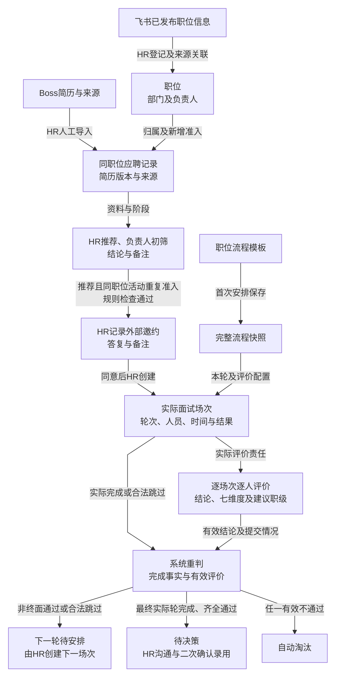

下一轮的待安排事项不自动创建场次，HR沿主链场次安排入口继续执行。手动淘汰／放弃仍按当前阶段责任授权。

<a id="diagrams-12-待办与历史证据的数据去向"></a>

#### 1.2 待办与历史证据的数据去向

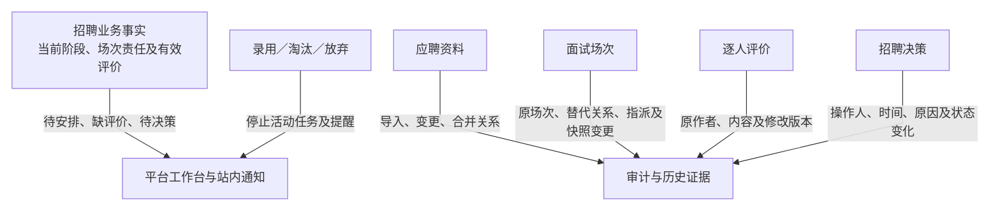


最终实际轮通常为配置终面；负责人确认 CTO不参与时，按第六节引用前一有效实际轮承接最终评价。图中“下一轮待安排”不等于自动创建面试场次。建议职级只作为评价信息，不改变原流程快照。手动淘汰／放弃仍按当前阶段责任人授权，录用由 HR在待决策完成外部确认后二次确认。

<a id="diagrams-二业务对象关系"></a>

### 二、业务对象关系

本图采用概念关系图：`||`表示一份，`o{`表示零至多份，`o|`表示零或一份。描述业务关联与多值性，字段与修改准入见[字段字典](#fields)，不作为数据库设计。

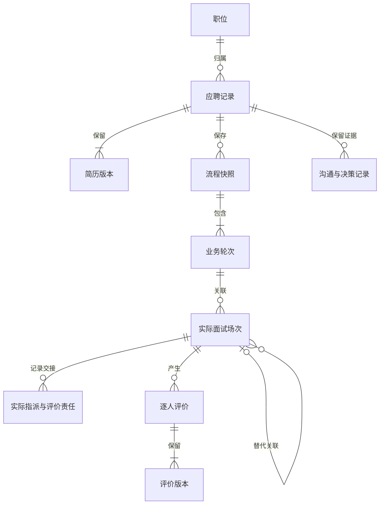

同一人在不同职位分别建立应聘记录和流程，不跨职位合并。同职位合法合并另保留主／旧记录关系，不销毁旧证据。图中简历版本包括保留的旧版本；当前简历只有一个引用，上传成功后自动设为当前。实际参与人不等于模板可选名单；评价责任换人规则见第5.3节，不用关系线推导重复评价义务。历史保留不代表原参与人持续有权访问。

<a id="diagrams-三角色协作时序泳道"></a>

### 三、角色协作时序泳道

从上往下阅读阶段推进；每条竖线是一类责任主体，横向箭头标明交接的数据或动作。HRM泳道中的校验和自动判断为系统动作。此图展示正常通过路径，评价与结束可分别发生；异常见第五至七节。

<a id="diagrams-建档与初筛"></a>

#### 建档与初筛

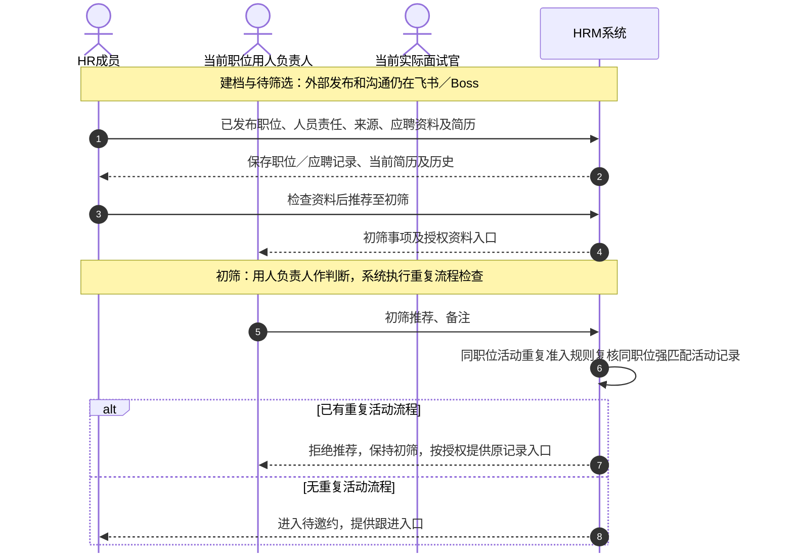

<a id="diagrams-邀约与场次安排"></a>

#### 邀约与场次安排

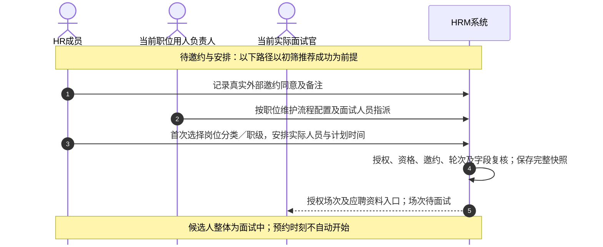

<a id="diagrams-面试评价与招聘决策"></a>

#### 面试评价与招聘决策

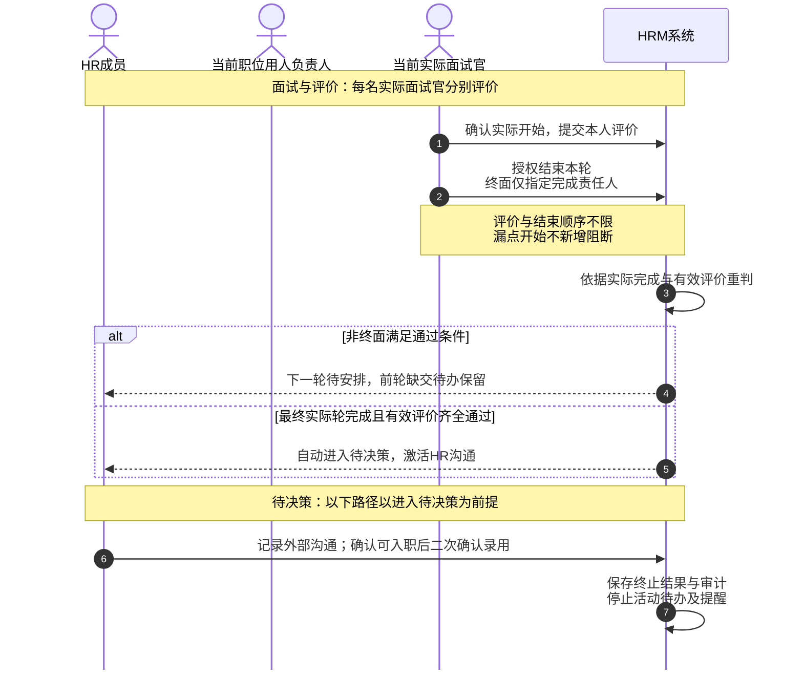

角色表示操作时的有效责任身份，同一个人可能兼任多条泳道。负责人没有实际场次指派时不能点击开始或替他人提交评价；HR安排时引用既有指派，不因此新增指派权。所有动作须复核PRD G.1授权，系统反馈箭头表示业务入口／状态结果，不承诺新增站内通知。

<a id="diagrams-31-阶段角色与数据使用对照"></a>

#### 3.1 阶段、角色与数据使用对照

此表是阅读索引，授权仍以[PRD G.1](招聘管理PRD.md)及[按钮矩阵](#buttons)为准。“系统产出”不表示对所有角色可见。

| 阶段 | HR成员使用／产出 | 当前职位用人负责人使用／产出 | 当前实际面试官使用／产出 | 系统使用／产出 |
| --- | --- | --- | --- | --- |
| 待筛选 | 导入及维护应聘资料、来源、简历；检查后推荐 | 按负责职位查看资料，不代HR维护基础资料 | 仅有部门或角色不获得该候选人访问权 | 保存应聘记录、版本与阶段历史，提示重复 |
| 初筛 | 查看处理进度；按既有权限记录放弃 | 阅读资料，填写初筛结论和备注 | 无初筛职责；另有业务身份时按该身份执行 | 推荐时检查重复活动流程；产生待邀约或保留初筛 |
| 待邀约 | 使用联系方式外部沟通，记录邀约结果；同意后安排 | 维护负责职位流程及人员指派 | 获得有效实际指派后按范围查看资料 | 保存安排与首次快照；创建场次后整体面试中 |
| 面试中 | 维护计划及非评价事实；查看评价，不凭HR角色修改或下载评价 | 按职位查看、授权修改评价；处理前轮待定 | 按实际指派阅读资料；记录开始、本人评价和授权完成 | 保存实际证据及有效责任，判断下一轮、待决策或淘汰 |
| 待决策 | 使用最终轮事实，记录沟通并二次确认录用 | 按授权查看证据及处理事项，不代HR录用 | 按当前授权查看；历史作者身份不自动保留访问权 | 维护提醒、状态与审计；终止后停止活动任务 |

简历查看与下载、评价查看与修改是不同授权。HR可按既有权限下载非评价资料；负责人和面试官查看简历不获得下载权，HR查看评价不获得修改及下载权。平台管理员仅有平台角色时不获得招聘数据权限。阶段表只说明该阶段的典型职责，不扩大其他阶段依法存在的查看权。

<a id="diagrams-四候选人阶段与独立状态"></a>

### 四、候选人阶段与独立状态

<a id="diagrams-41-候选人阶段"></a>

#### 4.1 候选人阶段

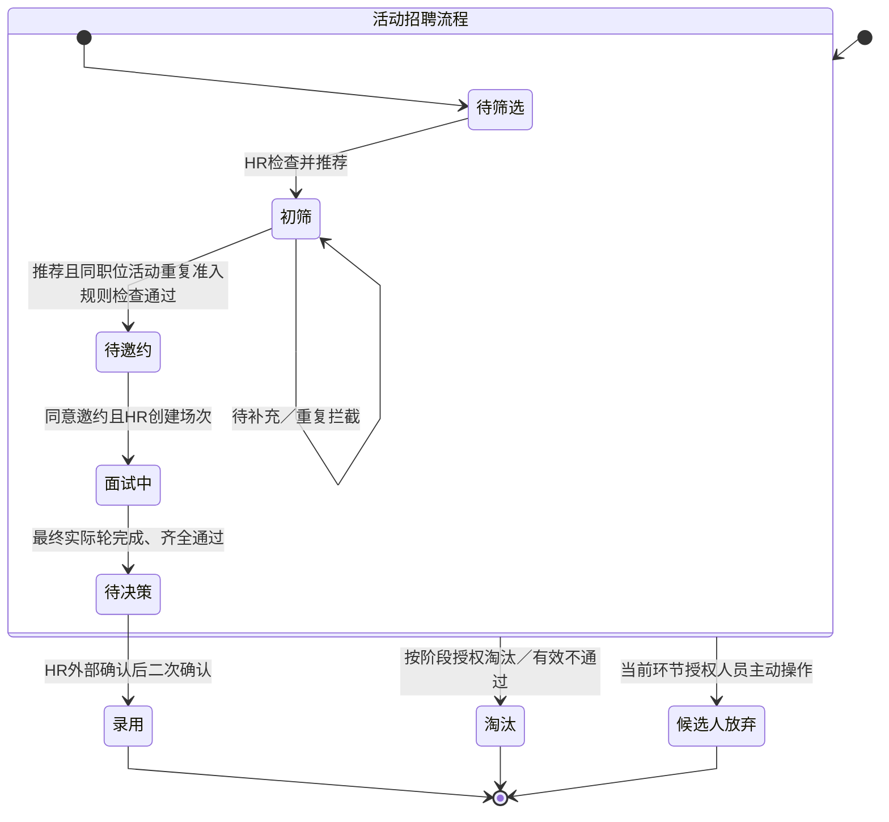

图中活动流程的公共终止出口用于合并重复连线，不表示任意角色可在任意阶段操作。待筛选／待邀约由HR主动淘汰，初筛由用人负责人不推荐；面试中／待决策的有效不通过按评价流转与最终承接规则自动淘汰，手动终止仍按阶段授权。有效不通过只适用于已经产生有效评价的流程。

终止状态不回退；修改历史评价、恢复软删除或重开职位不恢复终止流程。阶段动作的逐项角色以 PRD D、G.1 为准。

<a id="diagrams-42-邀约轮次场次分别表达"></a>

#### 4.2 邀约、轮次、场次分别表达

| 状态维度 | 取值／节点 | 对候选人阶段的影响 |
| --- | --- | --- |
| 邀约 | 待邀约、邀约中、同意、拒绝、失联 | 同意是创建面试前置条件；拒绝／失联不自动放弃或淘汰 |
| 业务轮次展示 | 未开始、待面试、面试进行中、已结束待评价、评价已齐、已跳过 | 完成、评价及跳过按第五／六节决定是否推进，不凭节点名称直接改阶段 |
| 面试场次 | 待面试、面试进行中、已完成、公司取消、候选人取消、未到场 | 取消／未到场保留场次结果，可创建同轮替代场次，不自动终止候选人 |

邀约再联系与更正已按筛选与邀约规则定义，见[筛选邀约字段](#fields-screen-invite)及文末筛选与邀约规则及计划与实际场次规则子图；最新非同意阻断新建或替代场次，但不取消已存在场次、不回退整体阶段。

<a id="diagrams-五非常规面试链路"></a>

### 五、非常规面试链路

<a id="diagrams-51-评价不通过待定缺交与通过门槛"></a>

#### 5.1 评价不通过、待定、缺交与通过门槛

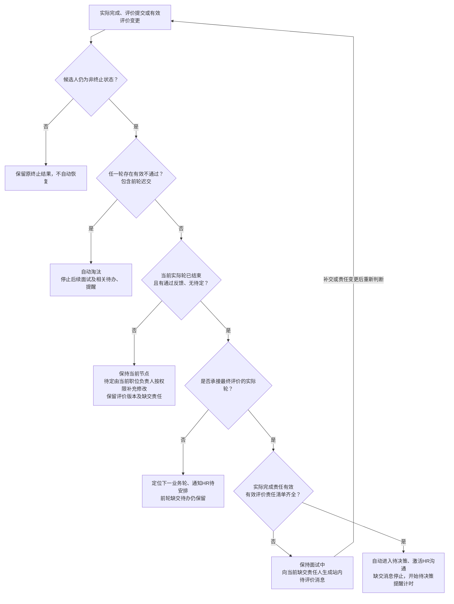

此图适用于实际面试，合法跳过走下一子图。终面缺交消息频率见最小配置第6节；进入待决策后的长期未推进提醒按 PRD F 执行，两类提醒分别验收。评价通过不自动录用，HR沟通结果不额外阻断进入待决策。

<a id="diagrams-511-前轮迟交待定"></a>

#### 5.1.1 前轮迟交待定

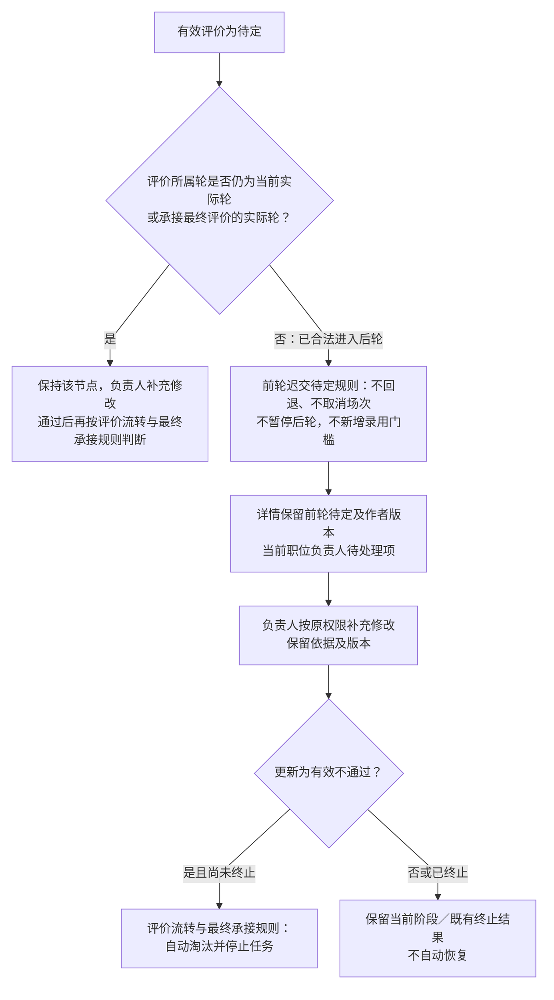

该分支依据前轮迟交待定规则、PRD E.5及TS-LATE-021；不把前轮待定显示为已通过。终止后停止活动待办，历史证据保留，不新增终止后补交权。

<a id="diagrams-52-一面跳过与非终面合法跳过"></a>

#### 5.2 一面跳过与非终面合法跳过

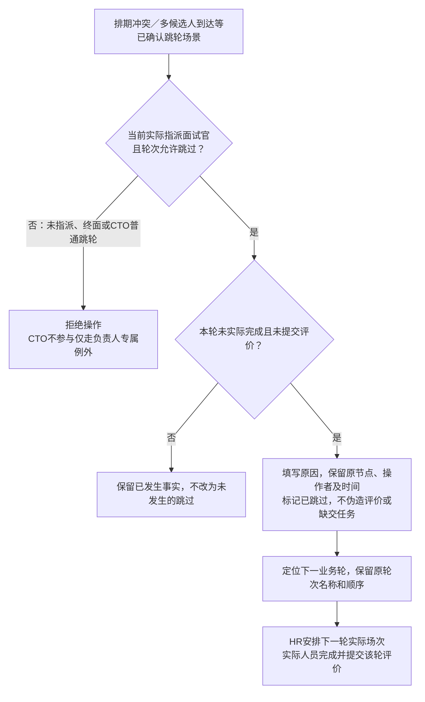

一面直接从二面开始的人员指派及无人兜底仍受 公共校验与授权规则及场次责任与历史处理规则 限制，不因“直接开始”免除授权。各职级实际终面定义见 PRD E.1，CTO不参与另见第六节。

<a id="diagrams-53-取消未到场后的替代场次与同场换人"></a>

#### 5.3 取消／未到场后的替代场次与同场换人

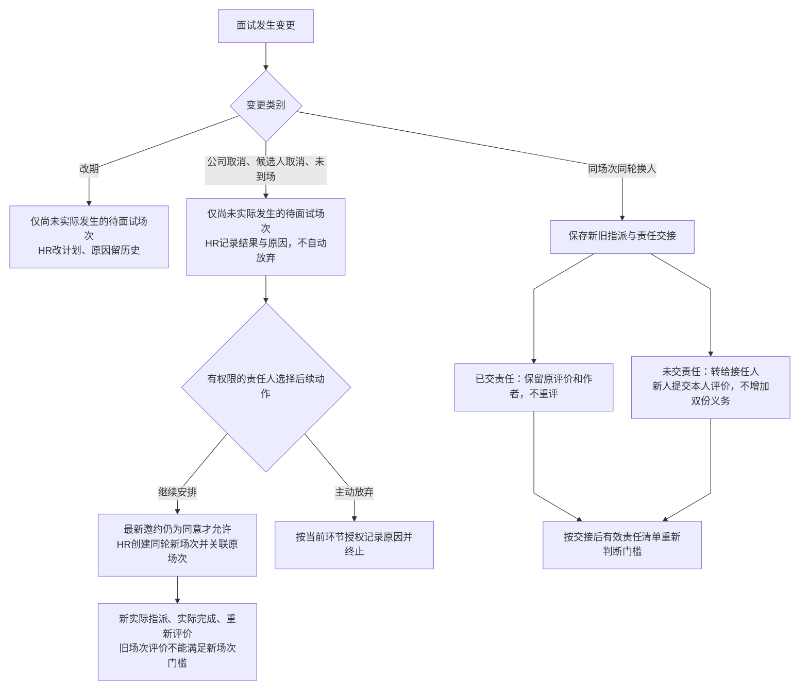

改期、取消／未到场不覆盖已发生事实；误点开始先按计划与实际场次规则限定条件纠错。最新邀约非同意禁止新建／替代，但不撤销已有场次。详见[场次字段](#fields-session)及TS-PLAN-037／TS-ACTUAL-037。

<a id="diagrams-54-本轮无人账号无效与责任交接"></a>

#### 5.4 本轮无人、账号无效与责任交接

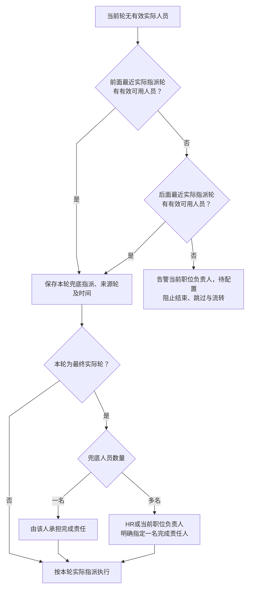

来源只取有效实际指派，不取可选名单；停用账号、已撤销角色和无效指派不作为来源。负责人不自动成为面试官。职位负责人变更按 PRD G.3、轮次换人按第五节交接；历史操作者不改写，解除指派后的访问按当前授权判断。HR负责人解除及重新指定按 TS-JOB-002 验收，一期不增设账号禁用专属业务流程。

<a id="diagrams-六cto不参与与最终评价承接"></a>

### 六、CTO不参与与最终评价承接

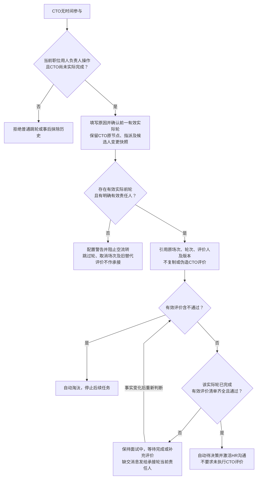

变更只作用于该候选人流程，标准模板和原始快照保留；CTO未执行部分停止待办，不产生重复缺交消息。CTO正常参加则走标准终面完成与评价门槛。进入待决策不等于录用，后续仍由HR完成外部确认及二次确认。

<a id="diagrams-七其他异常入口与验收索引"></a>

### 七、其他异常入口与验收索引

下表补充跨越多个图示的异常入口。链接指向现有测试文档；编号可在该文档检索，对应 PRD／配置章节为业务规则入口。

| 链路 | 触发、责任动作与数据去向 | 规则依据 | 验收场景 |
| --- | --- | --- | --- |
| 初筛重复推荐拦截 | 服务端检查同职位待邀约／面试中／待决策强匹配记录，有则保持初筛；同时推荐最多一条成功 | 同职位活动重复准入规则；PRD重复流程准入 | TS-DUP-020 |
| 初筛待补充／不推荐 | 用人负责人待补充时停留初筛；不通过进入淘汰，保留结果和原因 | 候选人阶段规则；PRD D | TS-FLOW-001 |
| 邀约拒绝／失联 | HR记录结果与备注，不允许创建面试；只有当前环节授权责任人主动终止才改变候选人终止状态 | 邀约规则及取消与终止规则；PRD D | TS-FLOW-002 |
| 职位关闭／重开 | HR依据飞书结果手动更新；关闭阻止新增，应聘记录原有流程继续；重开复用原职位 | 职位与外部系统边界；PRD B | TS-JOB-001 |
| 同职位重复／合并 | HR判断并确认主记录和当前简历版本，旧简历、评价和历史以合并关系保留；跨职位独立处理 | 应聘资料治理规则及场次责任与历史处理规则；PRD C | TS-CAND-002、TS-DUP-018 |
| 判重时间边界 | 未面试不应用一年期限；实际面试后以最近实际结束时间起算一年，不用计划时间替代 | 场次责任与历史处理规则；PRD C | TS-DUP-018 |
| 缺配置／本轮无人 | 无匹配流程先补配置；无人按第5.4节兜底，无有效来源则负责人告警并阻断 | 人员配置规则及场次责任与历史处理规则；配置第2、6节 | TS-INT-001、TS-READY-001、TS-ALIGN-018 |
| 一面跳过及直接二面 | 当前轮授权参与人保留跳过原因；下一轮实际人员独立完成和评价 | 一面跳过规则及公共校验与授权规则；配置第4节 | TS-INT-006、TS-READY-001 |
| 取消／未到场与替代 | HR保留原场次、新建同轮关联场次；新场次重新评价，不自动放弃 | 取消与终止规则及评价流转与最终承接规则；配置第7节 | TS-INT-004、TS-ALIGN-021 |
| 改期与同场换人 | 改期保留时间历史；同场换人保留已交作者、交接未交责任，不重写旧证据 | 公共校验与授权规则及场次责任与历史处理规则；配置第2、6节 | TS-INT-002、TS-ALIGN-018、TS-ALIGN-021 |
| 已结束但无通过／有待定 | 留在当前节点，当前职位负责人按权限修改评价并保留版本；不凭结束按钮推进 | 评价流转与最终承接规则；配置第7节 | TS-ALIGN-020 |
| 前轮迟交待定 | 已合法进入后轮后不回退或暂停，不新增录用门槛；详情保留事实，当前职位负责人补充修改；当前实际轮／最终承接轮待定仍阻断该轮 | 前轮迟交待定规则；PRD E.5 | TS-LATE-021 |
| 前轮缺交／迟交不通过 | 正常通过时缺交待办保留，可继续下一轮；迟交有效不通过终止尚未终止流程 | 场次责任与历史处理规则及评价流转与最终承接规则；配置第4、7节 | TS-DEC-003、TS-ALIGN-020 |
| 终面缺交与重判 | 实际完成后仍面试中；有效清单补齐且通过后自动待决策，重复处理只流转一次 | 场次责任与历史处理规则及评价流转与最终承接规则；配置第6节 | TS-DEC-001、TS-MSG-018、TS-ALIGN-020 |
| CTO不参与 | 当前职位负责人确认，前一有效实际轮承接；无有效前轮阻断，缺评价等待；保留引用与快照 | 评价流转与最终承接规则；PRD E.4、配置第7节 | TS-ALIGN-022 |
| 面试发现职级差异 | 实际评价人只记录建议职级，原安排职级和流程快照不变 | 评价流转与最终承接规则；配置第7节 | TS-ALIGN-021 |
| 主动淘汰／放弃与录用 | 当前环节授权人主动终止并记录原因；HR仅在待决策外部确认后二次确认录用 | 相关业务规则；PRD D、G.1 | TS-FLOW-001、TS-DEC-002 |
| 负责人变更／解除角色 | 当前责任关系更新，未完成任务待重新指派，历史操作人保留；不以历史身份继续授权 | 职位责任指派规则及公共校验与授权规则；PRD G.3 | TS-JOB-002、TS-AUTH-002、TS-READY-002 |
| 软删除与恢复 | 候选人仅未进入流程可删除；职位无进行中流程才可删除；管理员恢复不恢复候选人终止阶段 | 场次责任与历史处理规则；PRD G.1、文末删除准入 | TS-DELETE-018、TS-GOV-002 |
| 权限拒绝／失效账号／越界 | 使用公共授权与错误处理，不产生未授权业务变化，不新增平行权限规则 | 公共规范；PRD G.1、G.4 | TS-AUTH-001、TS-AUTH-002、TS-GOV-003 |
| 校验失败／重复提交／并发过期／附件失败 | 直接引用公共字段规范的公共规则、通用交互及追加验收，不在模块复制通用失败机制 | 公共字段规范 | TS-READY-003；该场景引用的公共规则逐条验证 |

<a id="diagrams-职位责任与来源补充d-026027"></a>

### 职位责任与来源补充

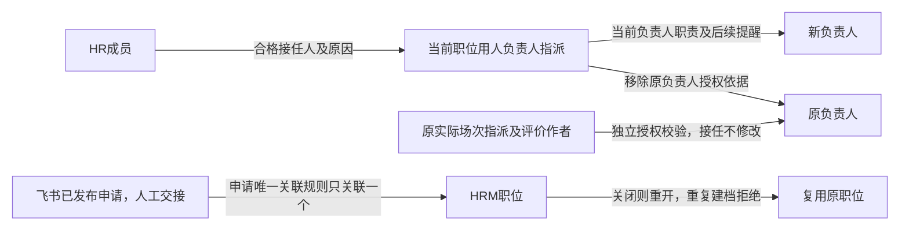

接任不重置任务起点、不修改完成责任或历史快照；平台管理员无HR业务角色不能接任。相同来源重复拒绝，异形链接同申请由HR核实，不宣称有外部API身份校验。验收见TS-OWNER-026、TS-SOURCE-027，均待执行。

<a id="diagrams-职位字段更正链路d-028"></a>

### 职位字段更正链路

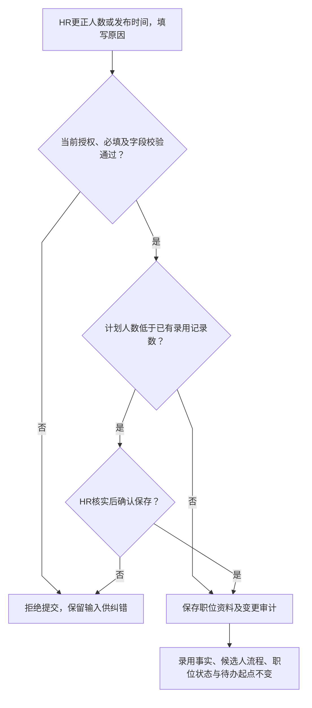

未来发布时间在字段校验时拒绝；办公方式只统一标签并沿用原值。状态动作及负责人接任分别走既有独立链路。提交复核当前事实，校验与审计的共性机制引用公共规范。

<a id="diagrams-同一职位资料与来源纠错d-029030"></a>

### 同一职位资料与来源纠错

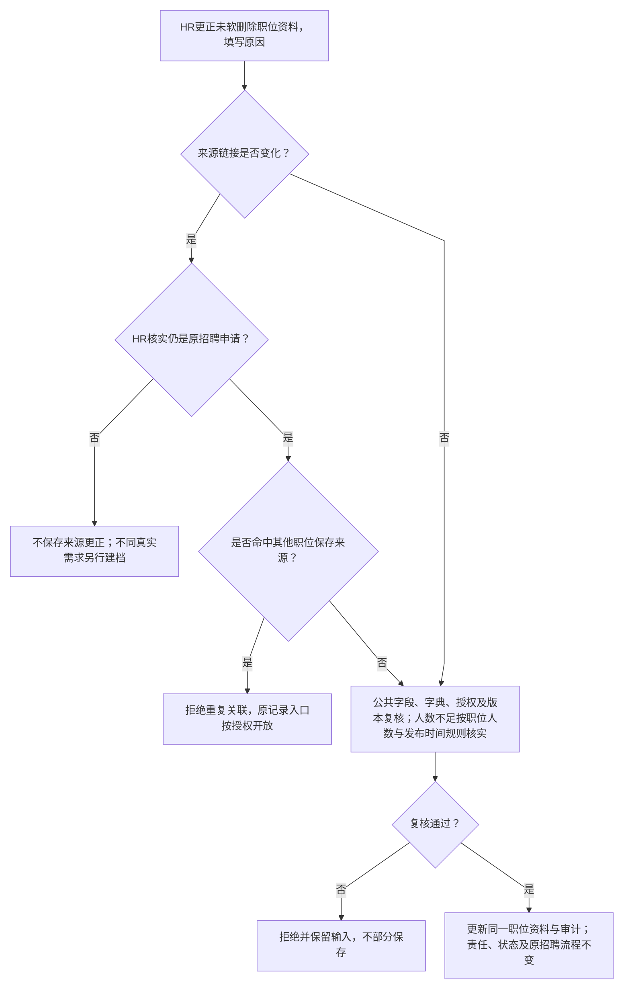

异形链接由HR在飞书人工核实，本图不表示自动外部身份校验；公共字典机制只引用公共字段规范公共字典编辑规则。

<a id="diagrams-候选人导入版本与误建d-031至034"></a>

### 候选人导入、版本与误建

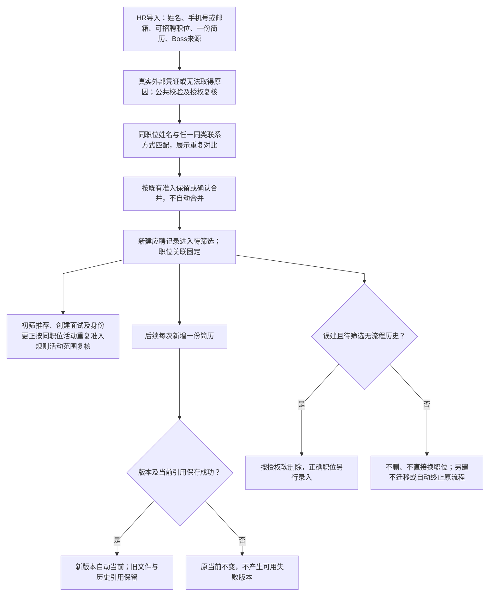

图中强匹配按联系方式强匹配规则，两条活动流程不拼接；来源缺失原因不等于外部授权状态。上传当前更新与流程历史分别保留；下载按既有HR授权。其他校验失败与过期版本拒绝引用公共规范，不把图中顺序当正式接口事务设计。

<a id="diagrams-单场开始主链路与整体阶段d-035"></a>

### 单场开始主链路与整体阶段

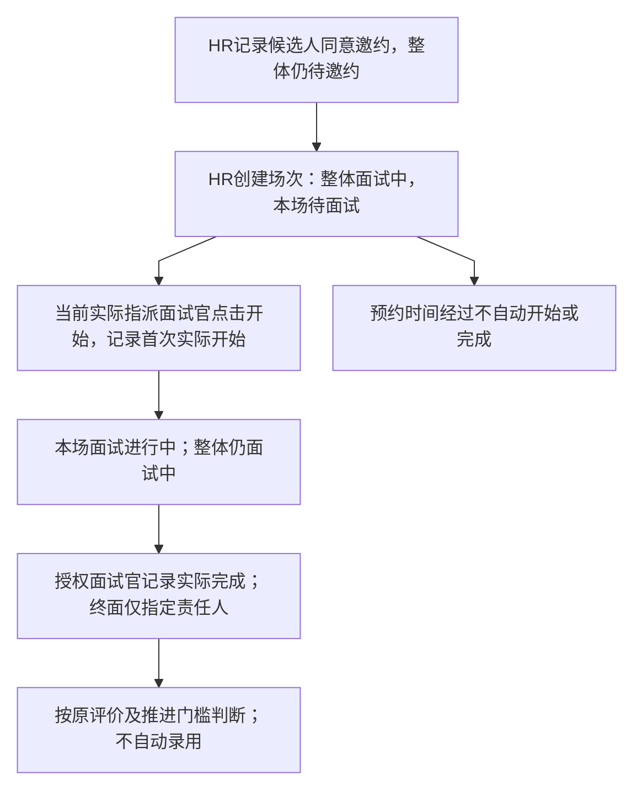

图为正常开始主链路，不新增“点开始是评价或完成必备条件”的门槛。轮间等待时整体仍面试中，场次／轮次等待分别展示；多人开始只保存首次证据，取消／未到场、终止及未来轮不允许开始。漏点开始补录及误点作废按计划与实际场次规则与[场次字段](#fields-session)执行，不用预约时刻推算实际开始。

<a id="diagrams-邀约再联系记录纠错与场次事实d-036037"></a>

### 邀约再联系、记录纠错与场次事实

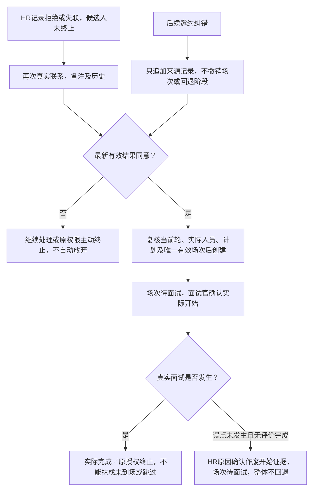

最新非同意阻断新或替代场次，不撤销历史实际事实；漏点开始不阻断既有评价／完成，补录与原操作者分别保留。开始时钟不自动推断真实发生。

<a id="diagrams-任务消息与指标分别使用业务事件d-039040"></a>

### 任务、消息与指标分别使用业务事件

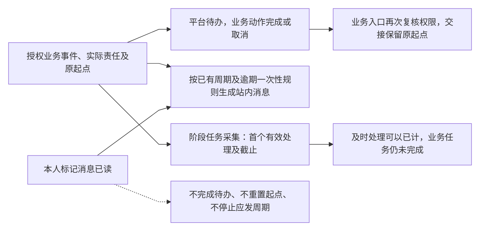

共性字段、阅读、字典及审计维护于平台／公共文档，招聘仅提供触发与解除。逾期严格晚于计划结束，不自动改阶段；M-004统计不生成新通知或业务时限门槛。

<a id="ui"></a>

### 页面交互与按钮操作

<a id="interaction"></a>

<a id="ui-关键页面交互"></a>

### 关键页面交互

- **性质**：已确认需求的文字交互结构，用于研发与产品评审；不是视觉定稿，不新增业务规则。
- **依据**：[PRD D、D.1、E.4、G.1](招聘管理PRD.md)、[最小配置](#config)、应聘资料治理规则及前轮迟交待定规则。公共校验和错误反馈只引用公共规范。
- **范围**：候选人详情、当前轮操作、重复处理、职位表单、筛选邀约、评价决策及按钮授权；平台简单表单见平台页面基线，视觉定稿和真实操作验证后续执行。

<a id="ui-1-候选人详情与当前轮操作"></a>

#### 1. 候选人详情与当前轮操作

入口：授权职位的候选人列表、工作台待办或已有权限的直接链接。页面、附件及动作权限分别校验，不因为打开详情就开放全部按钮。

```text
候选人详情
├─ 业务摘要：候选人、应聘职位、候选人阶段、当前负责人
├─ 简历与来源：当前简历版本、来源渠道／标识、导入记录
├─ 流程时间线：原轮次顺序、当前节点、跳过及不参与原因
├─ 当前轮操作区：实际场次、人员与责任、时间、缺交情况
│  ├─ 本人评价入口
│  ├─ 当前授权结束／跳过／安排及变更入口
│  └─ 自动流转门槛说明和待处理提示
├─ 逐轮证据：场次与替代关系、逐人评价、版本及历史人员
├─ HR沟通与招聘决策：沟通结果、决策动作及二次确认
└─ 历史记录：按当前权限查看；不开放无痕修改或删除
```

| 场景 | 页面行为及交接依据 |
| --- | --- |
| HR安排面试 | 首次选岗位分类／职级并保存完整快照；后续只选快照轮次；人员及时间按最小配置填写，终面指定完成责任人 |
| 非终面当前参与人 | 展示本人评价、结束及合法跳过入口，是否允许按最小配置第4节及PRD G.1；不显示未来轮或历史轮结束／跳过 |
| 终面普通参与人 | 仅提交本人评价，不代替指定完成责任人结束 |
| 终面完成责任人 | 提交本人评价及结束终面；结束后缺交显示已结束待评价，不显示手动推进待决策 |
| 等待评价／待定 | 显示当前轮缺失的有效责任或已提交待定，指向授权处理入口；保持规则规定的节点，已合法进入后轮的前轮待定按前轮迟交待定规则标记为负责人待补充项，不暂停后轮或新增录用阻断 |
| 已结束前轮 | 原评价人仍有当前有效指派时可补交本人评价；查看其他证据和修改评价分别按PRD授权 |
| 待决策 | HR沟通与决策区可用；录用只向有权限HR开放并二次确认，淘汰／放弃按当前阶段授权；不自动录用 |
| 终止状态 | 显示结果和历史，不提供恢复流程、后续安排或重新推进入口 |
| 无权限 | 采用公共拒绝反馈，不泄露记录内容；管理员平台权限不直接开放此页面 |

验收引用TS-READY-001、TS-READY-002、TS-INT-003、TS-DEC-001、TS-DEC-002；当前轮每个动作具体允许条件以PRD与最小配置为准。

<a id="ui-2-重复提示记录对比与初筛推荐拦截"></a>

#### 2. 重复提示、记录对比与初筛推荐拦截

<a id="ui-21-导入重复提示及资料对比"></a>

##### 2.1 导入重复提示及资料对比

入口：HR导入候选人触发同职位判重，使用既有姓名／联系方式及期限规则，不仅凭同名认定重复。

```text
重复记录对比
├─ 提示类型：强重复／联系方式相同姓名不同需核实
├─ 当前导入资料 ↔ 已有应聘记录
│  ├─ 姓名、联系方式、应聘职位、当前阶段
│  ├─ 简历版本与来源／导入记录
│  └─ 最近实际面试结束时间及适用的历史判重期限
├─ HR选择：继续保留，或按既有准入确认合并
└─ 合并确认：选择主记录、当前简历版本，填写原因并确认
```

- 不自动合并或覆盖旧资料，不提供跨职位合并入口。
- 合并按PRD C保留主旧记录关系、原简历、面试、评价与历史审计，选当前简历不改历史评价作者。
- “继续保留”不意味着允许两条活动流程；后续初筛推荐仍执行同职位活动重复准入规则。
- 现有阶段冲突合并边界不在本交互说明中自行设定；出现需处理的真实案例时先确认业务规则，不由界面默认拼接、恢复或终止流程。
- 待筛选且无流程历史的误建记录，可由HR在既有软删除入口处理；进入初筛后不因重复提示新增删除权限。

验收引用TS-CAND-002、TS-DUP-018、TS-DELETE-018。

<a id="ui-22-初筛推荐被d-020拒绝"></a>

##### 2.2 初筛推荐被同职位活动重复准入规则拒绝

入口：当前职位用人负责人在初筛提交推荐。服务端先校验完整授权，再检查同职位其他强匹配活动记录。

| 情况 | 提示与后续 |
| --- | --- |
| 原记录待邀约 | “该候选人在当前职位已有进行中的招聘流程（当前阶段：待邀约），请勿重复推荐” |
| 原记录已安排面试 | “该候选人在当前职位已有进行中的招聘流程，已安排面试，请勿重复推荐” |
| 原记录待决策 | 展示正在招聘处理中及实际待决策阶段，不用“已安排面试”代替当前阶段 |
| 可以查看原记录 | 提供原记录入口；跳转仍校验当前权限 |
| 本次被拒绝 | 保持初筛，不生成邀约、面试或下游待办，不改变原记录；原因反馈及合法输入保留遵循公共规范 |

并发推荐最多一条成功；重复记录不自动合并，也不提供“忽略警告继续推荐”的绕过入口。验收引用TS-DUP-020。

<a id="ui-3-cto不参与确认与前轮承接"></a>

#### 3. CTO不参与确认与前轮承接

入口：具备面试官角色且被有效指派为当前职位用人负责人的用户，在该候选人CTO尚未实际完成时操作；普通面试官、仅HR角色用户无此专属入口。

```text
CTO不参与确认
├─ 目标候选人与职位
├─ 原CTO节点及指派：保留原始事实
├─ 变更原因：填写后确认
├─ 最终评价承接信息
│  ├─ 前一有效实际业务轮、实际场次与完成情况
│  ├─ 明确有效责任人与当前评价责任清单
│  └─ 原评价作者／版本及通过、待定、缺交情况
└─ 结果提示：可自动待决策／等待完成或评价／配置警告
```

- 无有效前轮、只有跳过轮或取消场次时，按评价流转与最终承接规则告警并阻止空流转，不提供手工勾选“已通过”替代事实的入口。
- 原轮实际完成、有效责任明确、评价清单齐全且通过后自动待决策；缺交显示承接轮当前缺交责任，待定按既有评价修改规则处理，不通过按评价流转与最终承接规则自动淘汰。
- 已实际完成的CTO轮不能通过不参与操作抹去历史；变更仅作用于本候选人，不批量改标准模板。
- 保留原节点和候选人流程变更快照，引用原评价版本，不复制成CTO评价；原未执行CTO任务停止，不重复发送缺交消息。

验收引用TS-ALIGN-022、TS-MSG-018；确认成功不等于录用，后续仍由HR按既有流程确认。

按钮的逐项展示、可用条件及提交反馈见[按钮权限矩阵](#buttons)，公共机制按按钮展示与授权规则及公共权限规范第3.4节维护。

<a id="ui-4-交互评审边界"></a>

#### 4. 交互评审边界

本文件提供已确认业务的入口、页面结构与结果反馈。研发可据此讨论布局和实现，产品复核按钮及状态条件。指标任务口径已按阶段任务统计规则定义；真实双活动流程合并仍不新增为本期要求，不因页面示意扩大合并范围。视觉稿、真实用户操作验证和实际功能测试仍需分别完成。

<a id="ui-职位字段更正交互d-028"></a>

#### 职位字段更正交互

HR从职位详情更正人数、发布时间，表单显示现值和必填更正原因；负责人和招聘状态使用各自独立按钮。办公方式标签与字典统一，原三种值不变。人数格式沿公共规范，未来发布时间拒绝并保留输入供修改，提示“发布时间不能晚于当前时刻”。

人数低于该职位已有录用记录数时显示“计划人数低于已有录用记录，请核实”，提供返回修改或确认保存；取消不写入，确认后保存计划及审计，不改录用事实和活动流程。最终提交复核当前授权、字段及已有录用数量；若复核发现人数不足但尚未核实，返回核实提示，不静默保存。成功刷新字段并提示“已保存”，不自动关闭职位或重置待办起点。失败保留输入，不产生成功记录。无编辑权依公共按钮规范隐藏；服务端拒绝越权，不以页面查看权代替修改权。场景TS-JOB-028待执行。

<a id="ui-同一职位资料与来源更正d-029030"></a>

#### 同一职位资料与来源更正

同一RB-01A编辑表单提供名称、部门、类型、办公方式、人数、发布时间和来源，原值可对比，原因必填；可招聘与已关闭职位均适用，软删除先授权恢复。改部门不自动改人员部门、负责人、实际指派或权限。状态、负责人通过独立按钮处理。

来源变化额外显示旧新链接，HR在飞书核实后明确确认“新链接仍对应本职位原有的招聘申请”；未确认拒绝保存。重复链接拒绝，只有授权允许才提供原记录入口；换真实招聘需求提示另行建档，不提供迁移候选人按钮。人数不足仍按职位人数与发布时间规则核实。成功刷新当前资料，旧新值及原因按公共审计留存；失败保留输入，不部分保存。过期版本、当前角色失效均按公共规范拒绝。

类型与办公方式的历史编辑、停用提示及新选择提交复核引用公共字段规范公共字典编辑规则。HR负责人解除后显示“HR负责人未指定”，授权配置入口可重新指定；不自动找替代人员，也不收回全公司HR业务权限。其他角色只获得其已有授权的安全提示。正式场景TS-JOB-029、TS-DICT-030；HR负责人既有动作沿TS-JOB-002。

<a id="ui-候选人来源录入与维护d-031"></a>

#### 候选人来源录入与维护

导入表单来源渠道默认Boss直聘，选项沿公共字典准入；外部凭证类型为外部ID／来源链接／无法取得。前两项显示必填真实值，无法取得显示必填缺失原因；切换类型时只按最终类型提交对应内容，不把残留隐藏值当有效凭证。校验沿公共规范，失败保留输入。

成功后详情区分外部来源与内部应聘标识；缺失状态显示“来源凭证未取得”及原因，不伪造外部标识。HR可补充或纠正同一候选人来源，确认前展示原值、新值及更正原因；保存留历史，原导入人／时间不变，缺失标识按当前凭证更新，旧缺失原因仍可在授权历史中追溯。实际面试官和负责人按授权查看，平台管理员无独立招聘资料维护权。来源链接使用公共安全跳转，不宣称自动核验Boss身份或链接有效。

正式场景TS-SOURCE-031；手机号／邮箱、版本及应聘职位固定已分别按联系方式强匹配规则及应聘职位固定规则确认，见下节。

<a id="ui-候选人联系方式版本与职位固定d-032至034"></a>

#### 候选人联系方式、版本与职位固定

导入表单手机号与邮箱分列，各一个、至少一项，标准化按公共规范。姓名相同且任一同类联系方式匹配时展示强重复，并突出另一项差异；姓名不同、联系方式相同仍HR核实。导入可保留重复不等于可重复推进，初筛推荐、创建面试及姓名／联系方式更正共用同职位活动重复准入规则活动范围及联系方式强匹配规则匹配，身份更正冲突拒绝保存原值不变。只有姓名相同或没有任何同类联系方式匹配不自动认定同人。

首次及后续每次上传一份简历，确认按钮提示“上传成功后将设为当前简历”。成功展示新版本和当前标记，原文件及历史保留；失败保持原当前，重试不重复生成版本。列表区分文件名、类型／大小、上传人／时间及版本序号；授权参与人可预览当前与历史，下载独立按HR授权。HR既有选择当前版本入口展示目标版本，保存留审计；合并仍要求明确选当前，不用最新上传替代确认。公共并发版本规则适用于上传与当前切换，不从过期页面覆盖当前结果。

应聘职位导入时可选、保存后只读，不提供换职位按钮。误建且待筛选无流程历史可走既有软删除，在正确可招聘职位重新录入；已进入流程不删、不直接换关联，不自动终止或迁移旧流程。需要终止旧流程由其当前授权动作执行，恢复误建记录不换原职位。正式场景TS-CONTACT-032、TS-RESUME-033、TS-POSITION-034待执行。

<a id="ui-场次待面试与实际开始d-035"></a>

#### 场次待面试与实际开始

候选人摘要仍显示整体阶段“面试中”，当前场次卡片独立显示“待面试”或“面试进行中”，计划开始与实际开始分别展示。预约时间到了但未点击开始，保持待面试，不以时钟伪造实际状态或新增逾期阈值。

当前有效实际指派面试官看到“开始面试”，提示确认已实际开始，成功刷新本场为面试进行中并显示首次开始时间／操作者；开始记录不是评价、完成或下一轮推进。多人中后续用户看到同一结果，无重复开始或覆盖入口。只有HR、只有职位负责人及名单中未实际指派者没有开始权，终面普通参与人开始后仍不能完成终面。

取消、未到场、已完成、已跳过场次和候选人终止不提供可执行开始，未来轮不能提前开始；提交角色或版本已变化时按公共规范拒绝并刷新。场次结束及评价仍按原门槛执行，后续轮待安排／待面试时整体不回退。实际开始补录及开始后安排变更政策按计划与实际场次规则场次字段定义，不擅自推算开始时间。TS-START-035待执行。

<a id="ui-f-05至08收口入口d-036至040"></a>

#### F-05至08收口入口

- 初筛待补充、再次判断和邀约再联系／纠错：详情独立初筛、邀约记录区，原记录对比与备注必填；具体转换、责任及终止边界见[筛选与邀约字段定义](#fields-screen-invite)。已创建场次后改邀约不取消场次或回退候选人。
- 模板配置、安排与实际时间：计划开始、时长、只读结束及可选会议链接；人员配置按本轮当前指派权限独立。实际开始与原记录、补录时间及录入人分别显示，作废误点必须确认事实和原因，无评价／完成才可操作；其他边界见[场次字段](#fields-session)。
- 评价／决策：本人七维度、结论、推荐和风险，不自动填通过；负责人修改保留作者及修改原因，HR沟通不生成评价，终止纠错仅追加说明；附件与风险其他规则见[评价字段](#fields-evaluation)。
- 工作台／消息：按当前任务和责任聚合，已读不完成业务；逾期高亮指向安全原因与当前授权动作，计划时间不能证明实际发生。字段与空状态见[平台字段](../product/平台基础能力/待办消息字典与审计字段定义.md)和[页面基线](../product/平台基础能力/页面与交互基线.md)，业务触发见[招聘触发规则](#tasks)。

开始补录及开始后改期／取消／跳过按计划与实际场次规则执行：真实发生不能改成未到场／跳过，误点可按限定条件追加纠错；不新增评价／完成的开始按钮门槛。字段格式、失败、并发及审计沿公共规范；此处只维护入口与反馈关联。


<a id="buttons"></a>

<a id="ui-按钮授权与操作矩阵"></a>

### 按钮授权与操作矩阵

- **日期／状态**：2026-10-12；已确认操作授权的交互映射，展示机制按按钮展示与授权规则及公共规范。不新增角色或业务门槛，不代表实际测试通过。
- **目标用户与价值**：HR、当前职位用人负责人及实际面试官从同一业务页面准确识别可执行动作，减少越权、错误流转及重复提交。
- **权威依据**：[PRD D、E、G.1](招聘管理PRD.md)、[最小配置](#config)、[关键交互](#interaction)及[公共权限规范](../product/公共规范/权限与数据治理规范.md)第3.4节。

<a id="ui-一页面与动作"></a>

#### 一、页面与动作

编号只作需求追踪。每一行按权威业务条款判断当前角色、记录范围、指派与状态；无权限隐藏，有权限但当前条件未满足时禁用并展示安全原因。非当前轮和已终止流程不提供后续推进动作，仍可查看授权历史。

| 编号／页面按钮 | 授权与业务条件引用 | 确认／成功反馈 | 拒绝或等待反馈 | 故事／主要场景 |
| --- | --- | --- | --- | --- |
| RB-01 职位列表／建档 | HR成员；PRD B、G.1，飞书已发布 | 打开必填表单；提交成功显示职位 | 字段／来源不满足拒绝；申请唯一关联规则重复申请拒绝并按授权引导原记录，不伪造飞书审批 | US-101；TS-JOB-001 |
| RB-01A 职位详情／更正资料及来源 | HR成员；职位人数与发布时间规则及同一职位资料与来源更正规则及PRD B、G.1；未软删除职位含已关闭；字典引用公共规范公共字典编辑规则 | 显示原值、填写原因；来源更正对比旧新链接并核实原申请；人数不足核实确认；保存留历史，不改责任、状态或流程 | 非法字段、未来时间、缺原因、未核实来源或重复来源拒绝；公共字典按公共字典编辑规则；管理员无HR角色隐藏；提交复核授权、当前事实与版本 | US-101；TS-JOB-028、TS-JOB-029、TS-DICT-030 |
| RB-02 职位详情／关闭、恢复招聘 | HR成员；PRD B、G.1 | 关闭确认说明禁止新增但保留已有流程；恢复填写既有原因 | 已关闭不重复关闭；恢复招聘不等于恢复软删除记录 | US-102；TS-JOB-001 |
| RB-03 职位详情／更换HR负责人 | HR成员或管理员；PRD A、B及US-002 | 选择合格人员，记录变更原因后刷新责任 | 无资格人员不可选；管理员仅在授权配置入口操作，不能据此进入候选人资料 | US-002、101；TS-JOB-002 |
| RB-03A 职位配置／更换用人负责人 | HR成员；用人负责人接任规则，目标有效职位含已关闭，新人员启用且具面试官资格 | 原／新负责人和影响提示，原因确认后一次替换，历史和任务起点不变 | 原资格失效仍可接任；平台管理员无此操作；不改实际面试及评价责任 | US-002、101；TS-OWNER-026 |
| RB-04 职位／候选人列表／导入 | HR成员；职位可招聘，PRD C、G.1 | 打开资料及简历表单，来源凭证规则输入真实来源或缺失原因，成功显示应聘记录 | 职位关闭禁用新增；重复提示进入既有对比流程 | US-201；TS-CAND-001、TS-JOB-001、TS-SOURCE-031、TS-CONTACT-032、TS-RESUME-033、TS-POSITION-034 |
| RB-05 详情／修改基础资料、上传及选择简历版本 | HR成员；PRD C、G.1及同职位活动重复准入规则身份变更复核 | 保留版本与审计，显示当前资料；来源凭证规则来源维护留原因，简历自动当前规则上传成功自动当前、失败不切换；既有版本可由HR选择 | 负责人或面试官仅有查看不显示修改；联系方式强匹配规则身份更正复核不能制造重复活动流程；应聘职位固定规则应聘职位固定 | US-201、203；TS-DUP-020、TS-SOURCE-031、TS-CONTACT-032、TS-RESUME-033、TS-POSITION-034 |
| RB-06 重复对比／确认合并 | HR成员；PRD C及关键交互2.1 | 选择主记录和当前简历、原因后确认，显示合并关系 | 跨职位不提供合并；真实阶段冲突先业务确认，不显示绕过处理 | US-202；TS-CAND-002、TS-DUP-018 |
| RB-07 待筛选详情／推荐至初筛 | HR成员；PRD D阶段表 | 成功显示初筛及责任人 | 非待筛选不重复推荐，不产生重复待办 | US-301；TS-FLOW-001 |
| RB-08 初筛详情／推荐、不推荐、待补充 | 当前职位用人负责人；PRD D、D.1 | 显示对应结果；通过须执行同职位活动重复准入规则检查 | 重复活动记录时保持初筛、提示实际阶段，权限允许才给原记录入口 | US-301；TS-FLOW-001，对应验收TS-DUP-020 |
| RB-09 详情／记录邀约结果 | HR成员；PRD D、G.1 | 保存状态及必填备注，刷新安排准入 | 筛选与邀约规则再联系／纠错留历史，已创建场次不随邀约更正自动取消或回退；终止仅追加说明 | US-302；TS-FLOW-002 |
| RB-10 当前轮／安排面试 | HR成员；邀约同意，PRD D、E、最小配置 | 首次完整快照、后续快照轮次；成功显示场次 | 邀约未同意、重复准入不满足时拒绝，无下游记录；计划与实际场次规则计划开始／时长必填、会议链接可选，引用已确认实际指派 | US-402；TS-INT-001、002，对应验收TS-DUP-020 |
| RB-11 当前轮／指派、换人 | 当前职位用人负责人；PRD G.1、场次责任与历史处理规则 | 明确实际指派；显示已交保留、未交转接的结果 | 名单不等于实际参与；不符合资格拒绝；不新增HR面试官指派权 | US-402；TS-ALIGN-018 |
| RB-12 场次／改期、取消、未到场 | HR成员；PRD D、E及US-402 | 取消、未到场确认目标及原因；保存状态／时间与历史 | 不覆盖评价，不自动转为候选人放弃；计划与实际场次规则仅尚未实际发生的待面试可改期、取消／未到场；实际发生不改预约覆盖 | US-402；TS-INT-002、004 |
| RB-13 原场次／创建替代面试 | HR成员；PRD D及最小配置 | 新场次关联原场次，重新指派及评价 | 不能复用原评价作为新场次通过依据；同轮当前有效场次不重复建替代 | US-402；TS-INT-004、TS-ALIGN-021 |
| RB-14A 当前待面试场次／开始面试 | 当前有效实际指派面试官；场次实际开始规则，当前场次待面试且候选人流程未终止 | 确认已实际开始，保存首次时间／操作者；场次面试进行中，整体面试中不变 | HR或负责人无实际指派隐藏；非当前轮、取消／未到场／已完成／已跳过不可开始；预约时刻不触发，多人／重试不覆盖首次记录 | US-402；TS-START-035 |
| RB-14 当前轮／完成面试 | 非终面为当前实际参与人，终面为指定完成责任人；最小配置 | 确认实际发生，记录实际完成；按既有门槛自动判断 | 未指定终面完成责任人不可执行；评价未齐不阻止记录实际完成，但不得流转待决策 | US-402、404；TS-DEC-001、TS-READY-001 |
| RB-14B 场次／补录或更正开始、作废误点 | 计划与实际场次规则；HR全公司，当前有效实际参与人本场补录／更正；作废误点仅HR | 原值与证据对比、必填原因；补录真实开始不晚于当前／完成，作废确认实际未发生且无评价／完成，原日志保留 | 终止历史仅HR，不恢复流程；已发生不能清成未到场；越权／过期版本拒绝 | US-402；TS-ACTUAL-037 |
| RB-15 当前非终面／跳过 | 当前实际指派面试官；PRD E.3、G.1 | 填原因后确认，保留轮次和快照 | 终面、CTO面不向普通面试官提供跳过；非当前轮无操作入口；计划与实际场次规则实际发生后不跳过 | US-402；TS-INT-006 |
| RB-16 CTO节点／不参与 | 当前职位用人负责人；PRD E.4、关键交互3 | 原因确认；保留节点，反馈承接及等待结果 | 普通面试官、仅HR无入口；无有效前轮或CTO已完成不能绕过 | US-404；TS-ALIGN-022 |
| RB-17 场次评价／提交本人评价 | 有效实际指派面试官；PRD G.1、E | 保存作者、场次与结论，按既有规则判断流转 | HR全局可见不可代交；历史补交仍需当前授权，不按作者身份开放 | US-403；TS-INT-003、TS-ALIGN-020 |
| RB-18 评价版本／修改 | 当前职位用人负责人；PRD G.1 | 修改原因及前后版本留存，刷新业务结果 | 本人作者、HR或其他职位负责人无此修改权；前轮待定不新增录用门槛 | US-403；TS-LATE-021 |
| RB-19 详情／记录HR沟通结果 | HR成员；PRD G.1 | 保存操作者、时间及结果 | 不生成结构化评价，不新增待决策门槛 | US-404；TS-DEC-003 |
| RB-20 待决策／录用 | HR成员；PRD D、G.1及最终实际轮规则 | 外部确认可入职后二次确认，成功显示录用、停止活动待办 | 无实际完成或评价条件不满足禁用；不得新增前轮缺交／迟交待定阻断 | US-404；TS-DEC-002、TS-LATE-021 |
| RB-21 活动阶段／淘汰、候选人放弃 | 按PRD D逐阶段授权，不能以HR全局可见推导任意终止权 | 终止确认目标、原因及不可恢复后果，停止后续活动任务 | 无当前环节权限隐藏；已终止不提供恢复或推进；系统不通过淘汰非人工按钮 | US-301、404；TS-FLOW-001、TS-ALIGN-020 |
| RB-22 附件区／下载 | HR成员；非评价资料及附件，PRD G.1 | 权限校验后交付附件并审计 | 评价／附件／版本下载无授权；面试官及负责人仅查看时不显示下载 | US-203；TS-GOV-003 |
| RB-23 列表／软删除 | HR成员；场次责任与历史处理规则删除准入、PRD G.1 | 原因及二次确认；从普通列表移除，不物理清理历史 | 已进入流程候选人或有进行中流程职位禁用并说明原因 | US-602；TS-DELETE-018 |
| RB-24 授权回收入口／恢复 | 获恢复授权的管理员；PRD G.1及公共规范 | 原因确认，恢复软删除记录，记录前后状态 | 不授予简历查看／下载，不恢复终止候选人阶段 | US-602；TS-GOV-002、003 |
| RB-25 模板页／创建、保存 | HR全公司或负责人本人负责职位；PRD E、G.1 | 保存配置供后续首次安排使用 | 修改不改变既有流程快照，候选人员名单不自动产生面试授权 | US-401；TS-INT-001、TS-READY-001 |

业务数据批量导出本期禁止，不提供按钮。自动下一轮、自动待决策、评价不通过自动淘汰均为系统判断结果，不增加“手动推进”“忽略警告”按钮。

<a id="ui-二提交与反馈"></a>

#### 二、提交与反馈

确认框只确认动作和后果，不能代替外部事实、授权或业务门槛。提交后刷新当前记录和按钮条件；前轮待定、换人、职位关闭等结果分别按权威规则呈现，不把所有禁用原因都写成“无权限”。

页面打开后角色／指派／状态变化，服务端仍重新判定；拒绝时保留合法输入，并刷新安全的权限与状态，不泄露越权记录。相同操作重试、并发修改及审计遵循公共规范。

<a id="ui-三验收与缺口"></a>

#### 三、验收与缺口

新增TS-BTN-023／024统一验证展示、禁用、服务端校验及反馈，逐项业务规则继续由表中现有场景验证。字段与邀约更正已按筛选与邀约规则及任务消息与治理规则收口，

### 7.2 Key Features

#### 7.2.0 公共规则引用

本模块遵循[字段与表单校验规范](../product/公共规范/字段与表单校验规范.md)、[权限与数据治理规范](../product/公共规范/权限与数据治理规范.md)。本 PRD 只记录招聘管理特有的字段、流程和例外，不重复维护跨模块规则。

#### A. 平台能力引用与招聘责任指派

账号创建、登录、首次改密、重置、禁用及多角色授权统一引用[公共权限规范](../product/公共规范/权限与数据治理规范.md)第2、3节，由[平台基础能力](../product/平台基础能力/README.md)承载，不在招聘模块维护另一套账号规则。

招聘模块只维护业务责任关系：用人负责人是具备面试官角色的用户在职位上的指派身份；职位 HR负责人必须具备 HR成员角色。HR成员或管理员可解除并重新指定职位 HR负责人；变更影响后续待办、提醒和操作责任，不改写历史操作人。具体授权和指派变更后的任务处理以本 PRD G.1、G.3及职位责任指派规则及公共校验与授权规则为准。

#### B. 职位建档与状态

下方集中定义职位字段、来源、修改历史与更正规则；业务依据用人负责人接任规则及公共字典编辑规则。

HR成员只能为飞书职位发布完成后的职位建档。必填字段如下：

| 字段 | 规则 |
| --- | --- |
| 职位名称 | 必填 |
| 部门 | 必填，记录职位所属部门；不因同部门自动授予招聘数据权限，授权按G.1、G.3判断 |
| 招聘人数 | 必填，正整数 |
| 用人负责人 | 必填，每个职位一名，从具备面试官角色的用户中选择 |
| HR 负责人 | 必填，每个职位一名主责 HR成员 |
| 职位类型 | 必填，使用字典 |
| 办公方式 | 必填，使用字典 |
| 飞书审批申请链接 | 必填，作为来源凭证和追溯入口 |
| 发布时间 | 必填，飞书实际发布时刻，不晚于当前业务时刻；职位人数与发布时间规则 |

用人负责人接任按用人负责人接任规则由HR成员在职位配置一次更换，接任人须启用账号和面试官资格、填写原因；不修改实际面试责任、评价作者、快照或任务起点。仅平台管理员不能执行；关闭职位仍可接任。来源关系按申请唯一关联规则每个飞书申请只对应一个职位，重复拒绝并复用／重开原记录；软删除来源按恢复授权处理，不重复建档。同一职位资料和来源纠错按同一职位资料与来源更正规则及字段文档第6节执行，公共字典编辑引用公共规范公共字典编辑规则。

人数、发布时间更正及办公方式按职位人数与发布时间规则执行，具体准入、原因留痕和人数不足核实见[职位字段定义](#fields-job)第5.2节；不触发自动关闭或候选人终止，负责人及状态操作独立。

HRM 职位状态包括“可招聘”和“已关闭”。飞书关闭职位后，HR成员手动将 HRM 职位调整为已关闭，禁止新增候选人，但不影响已有候选人的面试、评价、待决策和录用。飞书重新打开后，HR成员手动恢复 HRM 职位为可招聘。

职位 HR负责人可以被管理员解除并重新指定，不在招聘模块内设计“HR负责人账号被禁用”的特殊流程。负责人变更只影响后续待办、提醒和可操作责任，必须记录解除和指定的操作人、时间及原因。

<a id="fields"></a>

<a id="fields-job"></a>

<a id="fields-职位字段与更正规则"></a>

##### 职位字段与更正规则

- **用户与价值**：HR人工登记飞书已发布职位，为应聘记录提供来源、归属、负责人及新增准入；用人负责人按职位承担业务责任。


<a id="fields-一输入字段"></a>

###### 一、输入字段

通用长度、链接、数值、时间、选项校验引用[公共字段规范](../product/公共规范/字段与表单校验规范.md)，权限和审计引用[公共治理规范](../product/公共规范/权限与数据治理规范.md)。无默认值代表HR需输入或选择，不能自动替其确认飞书事实。

| 字段 | 业务含义／类型 | 来源、默认、必填 | 业务校验／关系 | 修改与历史 |
| --- | --- | --- | --- | --- |
| 职位名称 | 正在招聘的职位名称；单行文本 | HR按已发布职位输入；无默认，必填 | 不是人员自身岗位、权限角色或模板岗位分类；名称相同不等于同职位 | 同一职位资料与来源更正规则由HR更正同一招聘需求的名称，填写原因；不同需求另行建档 |
| 所属部门 | 职位组织归属；部门关联 | HR选择；无默认，必填 | 部门不授予职位权限；部门规则新关联只能用启用部门；停用保留既有归属，编辑其他字段可保留原值 | 不改变负责人指派即不能改变其授权范围；部门重命名不应冒充新职位 |
| 招聘人数 | 招聘计划人数；正整数 | HR输入；无默认，必填 | 上限与格式引用公共规范；不是已录用人数或实时剩余名额 | 已有HR业务维护范围；职位人数与发布时间规则更正原因必填；低于已有录用记录数提示核实，确认后可保存，不自动关闭或终止流程 |
| 用人负责人 | 对本职位负责的人员；单一人员指派 | HR建档时选择；无默认，必填一人 | 具备面试官角色；不是部门负责人，不自动参加实际面试；按当前账号与资格校验 | 用人负责人接任规则由HR一次替换，启用账号及面试官资格、原因必备；原资格失效显示并由HR接任；历史作者不变 |
| HR负责人 | 主责HR；单一人员指派 | HR建档选择；无默认，必填一人 | 具备HR成员角色；全公司HR查看权限不要求被逐职位指派 | HR成员或管理员可解除／重新指定；原因、操作人及时间留存，不改原历史；解除到再指定期间显示“HR负责人未指定”，不自动指定替代人；不影响既有全公司HR权限 |
| 职位类型 | 职位分类；单个字典值 | HR选择；无默认，必填 | 使用对应启用字典，初始值引用范围说明；历史停用值不能用于新选择 | 同一职位资料与来源更正规则同一职位更正需原因；原停用值保留按公共规范公共字典编辑规则，换值只用启用项 |
| 办公方式 | 职位办公方式；单个字典值 | HR选择；无默认，必填 | 既有初始值为现场办公、远程、混合办公，尚非城市／地址。不能自行增加地址字段或将办公方式当具体面试地点 | 职位人数与发布时间规则已改为“办公方式”，沿用原值；资料更正记录原因与历史 |
| 飞书审批申请链接 | 外部职位来源凭证及追溯入口；链接 | HR输入；无默认，必填 | 已发布事实来自飞书，HRM不通过链接自动验证审批或同步；申请唯一关联规则同一申请不重复关联，重复反馈按授权展示 | 申请唯一关联规则一申请一职位；同一职位资料与来源更正规则由HR核实原申请并填写原因后纠错，旧新值留审计，链接不代替外部身份核实 |
| 发布时间 | 外部职位发布时间；日期时间 | HR按飞书事实录入；无默认，必填 | 使用公共时区及格式，不是HRM建档时间；不自动取当前时间代替 | 职位人数与发布时间规则创建及更正均不得晚于当前业务时刻；HR更正需原因，系统建档时间、候选人阶段和待办计时不变 |

<a id="fields-二系统结果动作与历史"></a>

###### 二、系统结果、动作与历史

| 字段／事实 | 含义及生成 | 修改与使用条件 | 依据 |
| --- | --- | --- | --- |
| 职位记录引用 | 系统在建档成功后产生稳定关联，供应聘记录使用 | 不因改名、重开或负责人更换替换既有引用；具体标识展示方式由交互决定 | 职位与外部系统边界复用原职位及模块对象关系 |
| 招聘状态 | 可招聘／已关闭；初始可招聘 | HR人工按飞书关闭／重开操作；关闭仅阻断新候选人，原流程继续；不自动根据招聘人数关闭 | PRD B、US-101／102 |
| 关闭／重开原因及操作证据 | 状态动作的原因、实际操作人、时间及变化 | 非自由修改状态字段；由关闭／重开动作产生，恢复招聘与软删除恢复不同 | TS-JOB-001、PRD G.1 |
| 建档与变更审计 | 按公共审计记录操作者、时间、对象、结果和必要摘要 | 时间系统产生，不用发布时间替代；不允许无痕修改历史 | 公共规范第6节 |
| 负责人变更历史 | 记录解除、指定及原因，保留当时人员关联 | 责任变更影响后续操作／任务／提醒，不改原操作作者；指派人员引用内部人员身份规则同一身份 | PRD B、G.3、TS-JOB-002 |
| 软删除状态及恢复 | 通过已授权删除／恢复动作产生 | 无进行中流程才可软删；不级联销毁历史；管理员授权恢复，不代替招聘重开 | 场次责任与历史处理规则、TS-DELETE-018 |
| 候选人阶段概览 | 从本职位应聘记录聚合的展示结果 | 不作为可手填字段；概览不扩大数据授权 | 范围说明职位列表、公共授权规则 |

<a id="fields-三页面与操作映射"></a>

###### 三、页面与操作映射

创建页提供九项业务输入；创建与保存条件按US-101及公共规范。详情区分外部发布时间、内部建档证据、状态与负责人；不把所有字段都提供成可直接编辑的状态输入框。

HR可查看／维护职位资料，负责人及面试官按PRD授权查看。管理员仅通过已有授权的负责人配置／回收入口操作，不因平台管理权限进入招聘敏感详情。查看、修改、删除、恢复及附件下载分别判断，字段表不额外授权。

按钮映射见[RB-01至04、RB-23／24](#buttons)；故事为US-101／102及US-002责任变更；验收引用TS-JOB-001、TS-JOB-002、TS-DELETE-018和TS-BTN-023。补充验收TS-JOB-028、TS-JOB-029、TS-DICT-030及对应追踪；场景均待实际执行。

<a id="fields-四定义收口与规则归属"></a>

###### 四、规则依据


<a id="fields-五业务操作与验收案例"></a>

###### 五、业务操作与验收案例

<a id="fields-51-用人负责人接任d-026"></a>

###### 5.1 用人负责人接任

由具备HR成员角色的用户在职位配置入口更换用人负责人；新负责人须账号启用且具备面试官角色，填写变更原因，原／新人员、操作人和时间留审计。一次提交从原负责人切换到新负责人，不主动保存空负责人；原负责人禁用或资格被移除时，保留历史指派并显示当前资格失效，HR在同一入口指定接任人。

原负责人资格有效时不要求其额外审批，以免无法处理离职／无法响应的接任；管理员只有同时具备HR业务角色才能执行本方案。现有HR负责人由管理员维护的权限不扩展成管理员可修改用人负责人或查看候选人。

接任结果：新负责人按当前职位范围查看资料、处理未完成初筛、前轮待定及负责人事项，后续长期提醒使用当前有效负责人。未完成业务任务的起点不重置。原负责人失去基于该职位负责人身份的权限；若仍另有实际面试指派，则仍按该独立关系操作。接任不改模板快照、场次实际参与人、完成责任人、评价作者或已交评价，不自动让接任人参加面试或代交评价。

职位已关闭也可接任以继续原有流程；软删除职位不在普通入口更换，先按授权恢复处理。提交时校验当前资格与记录版本；过期页面拒绝覆盖，不将两个接任操作顺序不明地叠加。

**理由**：HR已有职位建档和资料维护职责，接任执行人已按用人负责人接任规则明确为HR；该操作，以便处理负责人失效，同时保持平台权限与业务访问分离。该方案按用人负责人接任规则确认，已修改PRD G.1及按钮授权，不能从全局查看直接推导。

<a id="fields-52-职位资料更正规则d-027至030已确认"></a>

###### 5.2 职位资料更正规则

- **职位人数与发布时间规则已确认**：招聘人数沿公共正整数范围，允许计划调整但不触发自动关闭、淘汰或新增录用限制；低于已有录用数量时提示“计划人数低于已有录用记录，请核实”，允许确认后保存，不修改已录用事实。本期不新增人数审批流。
- **职位人数与发布时间规则已确认**：发布时间是飞书已发生的发布事实，创建及更正不得晚于当前业务时刻，HR更正原因必填；更正不改HRM建档时间、候选人阶段或任务起点。
- **职位人数与发布时间规则已确认**：“工作地点”本期统一显示为“办公方式”，沿用现场办公／远程／混合办公，不新增城市、办公地址或面试地点字段。

同一职位资料与来源更正规则由HR在同一招聘需求的现有职位更正资料，填写原因并留存历史；部门按部门规则，字典选择与历史编辑引用公共规范公共字典编辑规则。负责人变更独立使用责任操作，招聘状态独立使用关闭／重开按钮，不并入普通编辑。

- 名称、部门、类型和办公方式可按同一职位的外部真实信息更正；不能把已有职位改造成另一招聘需求或自动迁移候选人。
- 来源链接仅可更正为同一实际职位的来源凭证；不自动抓取验证飞书。更正说明由HR确认仍为同一职位；换招聘需求应新建真实职位，不在旧记录替换历史。

**来源关联**：每个飞书申请只对应一个职位。建档或更正来源时，发现其他职位已关联同一申请则拒绝；当前职位自身不构成重复。授权允许才提供原职位入口。同一职位复用，关闭后重开；软删除记录使用授权恢复，不新建替代。并发同来源建档不能产生第二条关联，不因重试新增记录。

本期人工交接，无飞书API；相同保存链接执行重复检查，异形链接是否同一申请须HR核实，不能以URL字符串验证承诺所有外部数据均不重复。来源纠错按第6节同一职位资料与来源更正规则执行，格式沿公共规范；不推导额外API或自动异形链接识别。

**业务约束**：人数更正不自动终止招聘；一个飞书申请只对应一个职位。资料更正维持HR业务授权，来源重复拒绝提交。关联US-101／102及编辑、建档验收。

<a id="fields-53-交接案例与验收待执行"></a>

###### 5.3 交接案例与验收（待执行）

| 案例 | 预期及确认依据 | 应同步位置 |
| --- | --- | --- |
| 负责人从甲接任为乙，甲另有一场实际指派 | 甲失去负责人权限，仍可按实际场次资格参与；乙只接负责人职责，不接甲本人评价责任 | F-02、PRD G.1、按钮矩阵、接任验收 |
| 原负责人禁用，职位已关闭 | HR可指定合格接任者；原候选人继续，新候选人仍被关闭限制 | PRD B、G.3、任务显示及场景 |
| HR修改人数低于已录用数 | 职位人数与发布时间规则核实提示后更正计划，既有录用及其他活动流程不自动变化 | 字段与编辑表单、计划更正验收 |
| 已发布职位填未来发布时间 | 职位人数与发布时间规则拒绝并保留输入供纠错，不用当前时间静默替换外部事实 | 字段表与建档／编辑验收 |
| 链接相同且HR确认同一职位 | 引导原记录，不提交第二个职位；关闭则依既有流程重开 | 重复提示与US-101 |
| 链接相同并尝试声称不同职位继续建档 | 申请唯一关联规则仍拒绝，一申请只一个职位，无继续绕过入口 | 来源对比及TS-SOURCE-027 |

用人负责人接任规则及公共字典编辑规则及对应正式验收追踪已形成；字段定义完成不代表实现测试通过。

<a id="fields-六资料与来源更正k1k2按d-029确认k3按d-030归公共规范"></a>

###### 六、资料与来源更正（K1／K2按同一职位资料与来源更正规则确认，K3按公共字典编辑规则归公共规范）

本节定义资料与来源更正边界；人数、时间、授权及申请唯一关系沿用人负责人接任规则及公共字典编辑规则。

<a id="fields-k1来源链接纠错不更换真实招聘需求"></a>

###### K1：来源链接纠错，不更换真实招聘需求

- HR在职位资料编辑中更正来源链接，填写原因并明确确认“新链接仍对应本职位原有的招聘申请”；显示旧、新链接供对比，按公共审计留存变化。
- 允许修正误粘贴、失效分享入口或同一申请的另一有效入口；本期由HR在飞书人工核实，不接API，不自动判断链接可访问或审批完成。沿公共链接格式和申请唯一关联规则已保存来源重复检测，不随意删URL参数以免破坏申请身份。
- 新链接命中其他职位保存的来源时拒绝，不允许通过确认绕过；不同形式指向同一申请仍需人工核实，URL检查不等于外部身份校验。
- 如核实是另一项真实招聘需求，不在原职位换申请：为另一份已发布申请另行建档；原候选人、实际面试、评价和任务不迁移。旧职位状态需要变更时另走关闭动作。
- 纠正此前误贴的链接不将旧链接声明为本职位的真实申请；旧值仅保留为审计证据，新值作为当前来源。不自动合并两个职位或迁移候选人；若两条现有职位实际对应同一申请，应先人工核实处置，不提供重复关联绕过。

**价值／影响**：容纳人工输入错误，保持职位身份与一申请一职位；影响来源编辑确认、重复反馈和审计，保留手工核实的能力边界。

<a id="fields-k2同一职位可更正资料责任与状态独立"></a>

###### K2：同一职位可更正资料，责任与状态独立

- HR可更正名称、所属部门、职位类型及办公方式，填写原因；只允许反映同一招聘需求的纠错或真实资料更新，不允许把原职位改作另一招聘需求。
- 修改部门只调整职位归属，不调整人员自身部门、用人负责人／HR负责人、实际面试指派及数据权限。新增部门选择和保留停用部门沿部门规则；不因部门变化推导流程模板或权限变化。
- 可招聘和已关闭的未软删除职位均可更正，关闭职位仍不能新增候选人；软删除职位先走既有授权恢复。查看权不产生编辑权，平台管理员无HR业务角色不能执行。
- 人数、发布时间沿职位人数与发布时间规则；负责人沿各自独立指派动作，状态沿关闭／重开动作。资料更正不改稳定职位引用、候选人阶段、实际场次、评价作者、快照或任务起点；并发及审计沿公共规范。

**价值／影响**：把HR既有业务维护权落到明确字段和状态，避免改部门隐含转权限或改名称替换真实职位。

<a id="fields-k3公共字典编辑引用"></a>

###### K3：公共字典编辑引用

停用字典值保留、换值及提交状态复核统一引用[公共字段规范](../product/公共规范/字段与表单校验规范.md)“字典停用值的历史编辑”，模块不复制共性规则。职位类型、办公方式适用；部门按部门规则，人员指派资格仍按各自责任规则。

<a id="fields-六例交接预期已确认验收未执行"></a>

###### 六例交接预期（已确认，验收未执行）

| 案例 | 已确认预期 | 正式覆盖 |
| --- | --- | --- |
| HR误贴链接，核实新链接才是该招聘需求原申请 | 原记录纠错，原因及旧新值留审计，不新建候选人或迁移流程 | 来源编辑及唯一关联 |
| 改成另一份真实招聘需求的申请链接 | 不通过原职位资料编辑替换真实需求，另行建档 | 职位身份边界 |
| 更正链接命中另一职位已保存来源 | 拒绝并按授权引导原记录，不能确认绕过 | 申请唯一关联规则及编辑反馈 |
| 已关闭职位名称纠错或同一需求部门调整 | HR可更正，关闭状态与候选人、负责人、实际指派和授权不变 | 字段、按钮及审计 |
| 旧职位类型已停用，HR只更正名称 | 类型保留并标停用；新记录不能选该值 | 公共字典编辑 |
| 新选字典值提交前被管理员停用 | 拒绝新关联并提示重选，不保存半条修改 | 公共提交复核 |

**收口证据**：K1／K2／K3已形成同一职位资料与来源更正规则及公共字典编辑规则，字段、PRD、RB-01A、交互、流程图、故事及TS-JOB-029／TS-DICT-030与对应追踪同步。指标与业务价值沿US-101／102及既有追踪，不新增成功门槛。

#### C. 候选人和简历

候选人来源、联系方式、简历版本及应聘职位约束见[候选人与简历字段定义](#fields-candidate)。

候选人由 HR成员从 Boss 直聘取得后直接人工导入 HRM，不经过飞书云盘。Boss 直聘侧授权是 HRM 接收数据前的外部前置事实，HRM 不重复建设或核验授权、告知、撤回和授权状态，HR 只负责把具体招聘数据落地到 HRM。必填字段为姓名、联系方式、简历、来源渠道和应聘职位。每份候选人应聘记录只关联一个职位，同一人可在不同职位分别建立独立应聘记录，跨职位不合并。

系统记录来源标识、导入人、导入时间和状态历史。来源默认Boss直聘；HR记录真实外部ID或链接，无法取得则填写原因，允许录入并标识缺失；后续可补充同一候选人来源并留审计。详细字段与准入按来源凭证规则及[候选人与简历字段定义](#fields-candidate)，不以内部编号冒充来源凭证。没有联系方式不能录入。导入时按标准化后的姓名和联系方式提示重复：联系方式强匹配规则标准化姓名相同且任一同类联系方式相同为强重复，另一项不同或缺失不取消强匹配；仅姓名相同不判重；联系方式相同但姓名不同提示 HR 判断。仅同职位判重和合并；未面试时先按姓名及联系方式判重，不应用一年期限；实际面试结束后，以最近一次实际面试结束时间起算一年。

HR 确认合并后，系统建立主记录与旧记录的合并关系。旧简历、面试安排、面试评价和状态历史不得被覆盖或销毁；当前使用的简历版本由 HR 明确选择，合并操作人、时间、原因和前后记录标识写入审计。

**F-04补充依据**：手机号及邮箱各至多一项、至少一项按联系方式强匹配规则；同职位判重及同职位活动重复准入规则活动复核使用任一同类匹配。简历每次上传一份，成功自动当前、失败不切换且历史保留按简历自动当前规则，合并仍HR明确选择。应聘职位建档后固定，误建及另建按应聘职位固定规则，不迁移原流程。字段及页面入口见[候选人与简历字段定义](#fields-candidate)。

<a id="fields-candidate"></a>

<a id="fields-候选人与简历字段"></a>

##### 候选人与简历字段

- **目标角色／价值**：HR人工录入招聘资料，负责人及实际面试官在授权范围内查看完整证据，避免将候选人等同员工或内部登录人员。


<a id="fields-一业务输入"></a>

###### 一、业务输入

| 字段 | 含义／类型及来源 | 默认与必填 | 修改、准入及历史 |
| --- | --- | --- | --- |
| 候选人姓名 | 当前应聘人的显示姓名，HR从招聘资料录入；文本 | 无默认，必填 | 公共姓名校验；HR资料维护，同名不自动认定同人；判重与身份更正按同职位活动重复准入规则复核 |
| 手机号 | 联系候选人的电话；HR录入，单值 | 无默认；手机号／邮箱至少一项 | 联系方式强匹配规则各至多一个，公共电话标准化；同类匹配，不套账号唯一约束 |
| 邮箱 | 候选人联系邮箱；HR录入，单值 | 无默认；手机号／邮箱至少一项 | 联系方式强匹配规则公共邮箱格式／标准化；和电话不跨类型比较，身份更正复核活动重复 |
| 应聘职位 | 本次应聘归属，选择HRM职位；单一关联 | 从职位入口可带入，保存仍校验；必填一个 | 职位须可招聘；跨职位另建独立应聘记录，不跨职位合并；应聘职位固定规则建档后职位固定；误建按既有删除／另建处理，不迁移流程 |
| 简历附件 | HR从Boss取得并上传的简历证据 | 必填，无默认文件 | 类型、大小及安全检查只引用公共规范；新版本不得覆盖旧文件及历史关联；简历自动当前规则上传成功自动设当前；HR既有选择及合并选择沿PRD C |
| 来源渠道 | 资料来源，HR录入并由字典承载 | 必填；来源凭证规则本期默认Boss直聘，初始来源值为Boss直聘，不开放其他渠道业务 | 不增加其他渠道范围；历史停用值保留及新关联复核引用公共规范公共字典编辑规则 |
| 来源凭证类型 | HR选择；外部ID／来源链接／无法取得 | 必选，无虚构默认 | 来源凭证规则，按实际可取得情况选择，不等于候选人授权状态 |
| 外部来源凭证值 | HR填写真实ID或链接；文本 | 类型为ID／链接时必填，否则不要求 | 对应格式引用公共规范；不是内部应聘编号，不作唯一键或判重替代；HR补充／纠错留原因与历史 |
| 来源缺失原因 | HR说明无法取得外部凭证的原因；备注 | 类型为无法取得时必填；无默认 | 来源凭证规则允许有原因录入并标识缺失；后续补充保留原缺失说明的历史 |

候选人不直接上传，不建设候选人登录账号、授权状态、告知或撤回流程；沿用已确认外部前置事实，不因此增加身份证或员工任职字段。

<a id="fields-二系统与历史事实"></a>

###### 二、系统与历史事实

| 字段／对象 | 来源及业务用途 | 修改与治理依据 |
| --- | --- | --- |
| 应聘记录引用 | 成功录入后系统产生，关联一个职位及后续流程 | 不因姓名或联系方式更正替换引用；跨职位使用独立记录 |
| 导入人／导入时间 | 系统记录实际操作人及内部录入时间 | 不手工冒充外部简历时间，不无痕修改；审计引用公共规范 |
| 候选人阶段及历史 | 初始待筛选，随后按PRD D的授权动作及自动规则产生 | 不提供普通编辑下拉框绕过流转；终止不恢复 |
| 简历版本及当前使用版本 | 上传及HR选择产生版本／引用 | 简历自动当前规则每次一份，成功自动设当前，失败不切换；旧版本和引用保留，不新增总数上限 |
| 最近实际面试结束时间 | 从实际完成事实取得，供场次责任与历史处理规则一年历史判重 | 不由HR录入假结束日期；未实际面试不套一年期限 |
| 合并主旧关系／原因／操作者／时间 | HR确认合并后产生 | 同职位、保留证据，不能拼接两个活动流程；真实阶段冲突另评审 |
| 活动重复流程判断 | 初筛推荐、创建面试及身份更正时按同职位活动重复准入规则复核 | 排除本记录，待邀约／面试中／待决策强匹配活动记录拦截；跨职位独立 |
| 软删除及恢复证据 | 已授权业务动作产生 | 待筛选且无流程历史才可删除；进入流程不删，恢复不恢复终止阶段 |

<a id="fields-三权限页面与验收"></a>

###### 三、权限、页面与验收

HR创建及维护非评价资料，下载非评价附件；负责人和面试官按PRD G.1查看，不据查看开放修改或下载。人员账号体系只提供操作人和参与人引用，不把候选人导入内部人员库。

导入页包括姓名、联系方式、职位、简历、来源渠道及来源凭证规则来源凭证类型／值或缺失原因；联系方式及版本按联系方式强匹配规则及简历自动当前规则定义，正式实现和完整交接仍待验证；详情区分当前简历与历史版本，姓名／联系方式更正触发活动重复复核。上传失败保留合法输入、无孤立附件；重复提示跳授权对比入口，不自动合并。

关联US-201／202／203、RB-04至06／22／23及TS-CAND-001／002、TS-DUP-018／020、TS-GOV-003、TS-DELETE-018。补充TS-SOURCE-031、TS-CONTACT-032、TS-RESUME-033、TS-POSITION-034，覆盖来源、多联系方式、版本及职位固定政策，不以原场景替代新增验收。

<a id="fields-四收口状态与证据边界"></a>

###### 四、来源验证依赖

本期来源、联系方式、简历版本及职位固定规则见下方L1至L4，依据来源凭证规则及应聘职位固定规则。

Boss实际ID／链接形式须用真实样例核实；无法取得时填写缺失原因，允许按已定义分支录入。

<a id="fields-五对象边界与字段使用"></a>

###### 五、对象边界与字段使用

本期直接管理“应聘记录”：一份记录关联一个职位和一条招聘流程，同一人跨职位形成独立记录。候选人身份信息不是内部人员账号，不新建独立的跨职位候选人主档案，也不因同名或同一联系方式自动合并身份。系统应聘标识只用于内部关联，外部来源凭证只用于追溯。

```mermaid
%%{init: {"flowchart":{"curve":"linear","nodeSpacing":30,"rankSpacing":45,"diagramPadding":16,"wrappingWidth":200},"sequence":{"mirrorActors":false,"actorMargin":45,"messageMargin":30,"noteMargin":12,"wrap":false},"er":{"diagramPadding":16,"minEntityWidth":130,"minEntityHeight":45}}}%%
flowchart LR
    B["Boss资料，HR人工取得"] --> A["应聘记录：姓名、联系方式、来源"]
    J["一个HRM职位"] -->|记录只属一个职位| A
    A --> R["简历版本与当前版本引用"]
    A --> F["该记录的阶段、场次与评价历史"]
    U["内部人员及账号"] -->|操作人、当前授权及指派| A
    A -->|同职位、既有准入、HR确认| M["主旧记录合并关系；证据不覆盖"]
```

<a id="fields-已确认事实与页面责任"></a>

###### 已确认事实与页面责任

| 信息 | 页面与生成责任 | 变更及使用 |
| --- | --- | --- |
| 姓名、联系方式 | HR导入／资料编辑；姓名与联系方式校验引用公共规范 | 不供候选人自行修改；更正不改变应聘记录引用，活动重复复核按同职位活动重复准入规则 |
| 应聘职位 | 从职位列表进入导入可带入，仍在提交校验可招聘 | 应聘职位固定规则关联固定，误建沿既有删除／另建，不允许直接调岗 |
| 简历附件 | HR上传，提交前必须有合法简历 | 查看／下载分别授权，文件校验沿公共规范；版本具体动作见L3 |
| 来源渠道、外部凭证 | HR录入来源事实；本期Boss人工导入 | 不是飞书职位申请链接、会议链接或应聘编号；缺失策略按来源凭证规则，见L1 |
| 招聘目的 | 由本次招聘管理业务场景确定为招聘，不设置HR手填授权或撤回状态 | 追溯依据应聘资料治理规则；不扩展为员工档案或其他用途 |
| 导入人员、导入时间 | 成功保存时系统记录实际操作人及时间 | 当前编辑人不能覆盖原导入人；后续修改证据沿公共审计 |
| 阶段、最近实际完成时间 | 流程动作与实际完成事实产生 | 资料编辑不能直接修改，历史判重起点不采用录入或计划时间 |
| 版本引用、合并与软删除证据 | 按上传、HR选择、合法合并及删除动作产生 | 历史按场次责任与历史处理规则、PRD C保留；进入流程不可删，不拼接双活动流程 |

<a id="fields-六f-04已确认业务规则d-031至034"></a>

###### 六、F-04已确认业务规则

上传成功自动设为当前简历；流程准入、历史判重期限及授权沿用场次责任与历史处理规则及同职位活动重复准入规则，多联系方式匹配按联系方式强匹配规则执行。

<a id="fields-l1来源默认boss真实凭证按可取得情况记录d-031已确认"></a>

###### L1：来源默认Boss，真实凭证按可取得情况记录

来源凭证规则确认本期导入来源渠道默认Boss直聘，沿已确认范围，不开放新增渠道业务。外部来源凭证由HR录入：选择“外部ID”或“来源链接”并填写真实值；确实无法取得时选择“无法取得”并填写原因，允许导入，详情明确标识来源凭证缺失。系统记录原导入人／时间和后续补充审计，不以内部编号、姓名或随意生成值冒充外部凭证。

ID按公共单行文本、链接按公共链接校验；不自动抓取Boss，不把凭证当候选人唯一键或判重替代。已有流程也可由HR纠正／补充同一候选人真实来源，原因留历史；不得借改来源迁移流程或变更为另一候选人。实际能否取得ID／链接仍需一个脱敏样例验证；方案不声明Boss一定提供稳定ID或永久链接。

**理由**：系统应诚实记录来源可追溯程度，避免因平台资料缺失强迫HR虚构数据。本期不要求外部凭证唯一，也不新增来源授权状态。

<a id="fields-l2手机号邮箱分列及任一同类强匹配d-032已确认"></a>

###### L2：手机号／邮箱分列及任一同类强匹配

联系方式强匹配规则本期手机号、邮箱两个独立输入，各至多一个，至少填一项；标准化沿公共规范。仅比较同类字段，不将手机号和邮箱互相比较。相同标准化姓名且手机号或邮箱至少一项相同，视为强匹配；另一联系方式缺失或不同仍提示差异，但不取消强匹配。姓名不同而有联系方式相同继续由HR核实，只有姓名相同不判重。

导入提示与同职位活动重复准入规则活动流程复核共享该口径；范围仍同职位、排除当前记录，导入不自动合并，活动阶段与判重期限保持原规则。姓名／联系方式更正提交前使用更正后值复核，冲突则拒绝更正，保留原值及活动流程。不新增“强匹配忽略继续推荐”按钮。

**匹配原因**：新增另一项联系方式不应使原有强匹配失效；同名且任一同类联系方式相同即匹配。

<a id="fields-l3每次一份上传成功自动设为当前d-033已确认"></a>

###### L3：每次一份，上传成功自动设为当前

首次成功上传一份简历后产生初始当前版本；后续每次新增一份，成功保存后自动设为当前，不再提供“上传但默认不设当前”的默认行为。HR仍可在已保存版本列表选择当前版本并留审计，合并时仍由HR明确选择。系统版本序号、时间不替代HR的合并选择，本期不设置版本总数上限。

每个版本记录版本引用、文件名、文件类型／大小、上传人和上传时间；系统版本序号仅作显示，不作为外部简历日期。详情提供当前和历史预览入口，下载仍仅HR既有授权。切换只影响当前使用版本，不覆盖旧文件、旧评价、流程历史或既有版本引用；合并时仍由HR明确选当前版本。普通编辑不删除旧版本，失败不增加可用版本或切换引用；新增版本与自动当前引用须整体成功才生效。

**结果边界**：按用户选择简化后续上传操作；自动当前只更新当前引用，历史证据保留，不代表覆盖原简历或改写已完成流程。

<a id="fields-l4应聘职位固定误建沿删除另建d-034已确认"></a>

###### L4：应聘职位固定，误建沿删除／另建

应聘职位固定规则不开放修改已保存记录的应聘职位。误选且待筛选、无推荐／邀约／面试／评价历史时，HR可按场次责任与历史处理规则软删除误建记录，在正确且可招聘职位重新录入；进入流程后按既有终止规则处理需要结束的原流程，为另一个职位另建独立记录，不自动终止旧流程、不迁移阶段、面试、评价或待办。

记录建立后职位固定，与同一候选人跨职位独立应聘兼容；不是不允许同一人参加另一职位。恢复误建记录仍保留其原职位，不因另建而修改审计关系。

**理由**：复用现有删除及跨职位独立记录规则，避免本期增设候选人转岗、历史搬迁和权限重算流程。

<a id="fields-八例走查已确认预期尚未实际执行"></a>

###### 八例走查（已确认预期，尚未实际执行）

| 案例 | 已确认预期／对应政策 |
| --- | --- |
| HR有Boss候选人ID或资料链接 | 保存真实凭证，不用应聘编号代替；L1 |
| 简历可取得，但HR无法取得ID或链接 | 填缺失原因可录入，详情如实标识，后续可补充；L1 |
| 同姓名同手机，邮箱从无变有或两条邮箱不同 | 同职位强匹配；已有活动流程仍按同职位活动重复准入规则阻止重复推进；L2 |
| 同姓名，A只有手机、B只有邮箱，无法建立同类匹配 | 不仅凭同名判重，不自动认定同人；L2 |
| 手机相同但姓名不同 | HR核实提示，不自动认定同人或合并；L2 |
| 后续简历上传成功 | 自动设新版本为当前，旧文件与历史引用保留；简历自动当前规则 |
| 后续上传失败 | 原当前引用不变，无可用失败版本；简历自动当前规则 |
| 误选职位后已推荐初筛 | 不可删、不可直接换职位；需要另一职位则另建独立记录；L4 |

<a id="fields-页面及按钮映射"></a>

###### 页面及按钮映射

导入页：姓名、手机号／邮箱、应聘职位、简历、Boss来源及真实凭证／缺失原因；成功仍进入待筛选。详情：当前资料、来源可追溯情况、版本列表及当前标记，流程证据沿既有授权。

RB-04导入、RB-05资料编辑／新增版本和当前选择、RB-06合并、RB-22下载、RB-23删除沿既有授权；对应验收见TS-SOURCE-031、TS-CONTACT-032、TS-RESUME-033、TS-POSITION-034及追踪矩阵。

<a id="fields-七版本元数据维护及验收索引"></a>

###### 七、版本元数据、维护及验收索引

| 系统字段 | 业务含义／类型与生成 | 默认、修改及展示 |
| --- | --- | --- |
| 版本引用／序号 | 每次成功新增简历产生稳定引用及显示序号 | 不由HR输入，不当作BossID或外部简历日期；旧版本引用不因当前切换改变 |
| 文件名、类型、大小 | 文件上传结果的必要元数据 | 文件校验沿公共规范；列表展示供区分，不凭同文件名覆盖 |
| 上传人、上传时间 | 系统记录本次上传实际操作者及内部时间 | 原上传证据不修改；不是候选人编辑简历时间 |
| 当前简历引用 | 首次上传或后续成功上传自动更新，HR既有手动选择／合并选择也可产生 | 始终指向本应聘记录合法版本；新版本保存失败不切换，不删旧引用及历史证据 |
| 当前来源可追溯情况 | 从当前外部凭证类型和值展示为已记录ID／链接或凭证未取得 | 不手工编辑授权状态；后续补充可更新当前展示，缺失原因历史保留 |

正常创建、失败输入、身份更正冲突、上传成功／失败、授权拒绝及误建处理分别覆盖TS-SOURCE-031、TS-CONTACT-032、TS-RESUME-033、TS-POSITION-034；既有合并、下载、删除及流程范围继续引用TS-CAND-002、TS-GOV-003、TS-DELETE-018，对应验收TS-DUP-020。业务价值及指标沿US-201至203及原追踪，不新增自动身份识别、跨职位合并或录用门槛。

#### D. 候选人阶段和邀约

候选人阶段只允许正向推进，不允许回退。淘汰和候选人放弃不可恢复。最终实际业务轮未完成、有效评价责任清单未齐全或存在待定时，候选人保持“面试中”。任一轮有效评价不通过则自动淘汰，停止后续面试，不要求补齐终面评价。候选人放弃由当前招聘环节列出的责任人员主动点击产生，不设置自动时限；公司取消、候选人取消、未到场、拒绝和失联均可作为放弃原因。

| 当前阶段 | 下一阶段 | 可执行角色／责任身份 | 关键条件 |
| --- | --- | --- | --- |
| 待筛选 | 初筛、淘汰、候选人放弃 | HR成员 | HR成员完成资料检查并推荐，或主动点击终止按钮并选择原因 |
| 初筛 | 待邀约、淘汰、候选人放弃 | 用人负责人；HR成员可主动记录候选人放弃 | 用人负责人初筛通过且通过同职位活动重复准入规则重复流程检查后进入待邀约；不通过进入淘汰；待补充仍停留在初筛 |
| 待邀约 | 面试中、淘汰、候选人放弃 | HR成员 | 招聘平台答复为同意后创建面试；其他终止结果需主动操作 |
| 面试中 | 待决策、淘汰、候选人放弃 | 用人负责人、面试官、HR成员 | 终面面试官点击完成面试，且该轮换人后的有效评价责任清单齐全且通过时自动进入待决策；任一轮有效评价不通过自动淘汰，或当前环节责任人员主动点击终止按钮 |
| 待决策 | 录用、淘汰、候选人放弃 | HR成员、用人负责人、面试官；录用仅 HR成员 | HR与候选人在 Boss 直聘确认可入职后，HR成员二次确认录用 |
| 录用、淘汰、候选人放弃 | 无 | 无 | 终止状态 |

筛选与邀约字段、可更正范围及拒绝／失联后再联系见[筛选与邀约字段定义](#fields-screen-invite)。邀约状态为待邀约、邀约中、同意、拒绝、失联。HRM 只记录 HR成员在招聘平台上的邀约结果；状态变更必须填写备注。只有“同意”才能创建面试。

面试记录需要区分“待面试、面试进行中、已完成、公司取消、候选人取消、未到场”等状态或结果。场次实际开始规则明确候选人整体“面试中”表示进入面试流程；HR记录候选人同意后创建场次，其初始为待面试，当前实际指派面试官点击开始才变为面试进行中并记录实际开始，预约时刻不自动开始。具体授权与异常边界见[最小配置第9节](#config)。终面面试官点击“完成面试”后才算实际完成，并记录操作人、实际完成时间和面试结果；完成后HR成员或该场面试负责人可以修改非评价面试结果，修改必须记录前后值、操作人、时间和原因。公司取消面试时保留候选人面试中阶段并记录公司取消原因；HR 可以基于原邀约直接创建同一轮次的替代面试，不重新发起邀约。候选人取消或未到场时，分别记录原因和备注，也可以创建同一轮次的替代面试。公司取消、候选人取消、未到场、拒绝和失联都可以作为“候选人放弃”的原因；当前招聘环节责任人员都可以主动点击按钮变更，不设置自动时限。替代面试视为一次新的实际面试，创建新记录并关联原面试，重新指派、完成和评价；旧场次评价不能满足新场次门槛，也不能覆盖原面试证据。

#### D.1 初筛推荐的重复流程准入

用人负责人从初筛推荐进入待邀约前，服务端检查同职位其他有效应聘记录：按联系方式强匹配规则标准化姓名相同且任一同类联系方式相同，且已有记录处于待邀约、面试中或待决策时，拒绝推荐。排除自身；待筛选／初筛不占用准入位置，终止记录不按进行中拦截；跨职位仍独立。活动流程检查不使用一年期限，历史判重仍按场次责任与历史处理规则执行。

被拒绝记录保持初筛，不生成邀约、面试或下游待办，不变更原流程。提示已有流程当前阶段，只有确有面试安排才写“已安排面试”，原记录入口按当前权限开放。同时推荐最多一条成功，创建面试及修改候选人身份资料时复核，遵循公共并发、授权和审计规范。详见同职位活动重复准入规则，对应验收TS-DUP-020。

<a id="fields-screen-invite"></a>

<a id="fields-筛选与邀约字段"></a>

##### 筛选与邀约字段

- **用户与价值**：HR检查资料并记录外部邀约，当前用人负责人判断初筛；每次处理有事实和责任，避免邀约答复与招聘阶段混用。指标沿M-004／006／007。
- **共性**：字段长度、字典、时区、并发和错误反馈引用[公共字段规范](../product/公共规范/字段与表单校验规范.md)，权限／历史引用[公共治理规范](../product/公共规范/权限与数据治理规范.md)。


<a id="fields-一字段"></a>

###### 一、字段

| 字段 | 含义、来源／类型 | 默认／必填及校验 | 修改及历史 |
| --- | --- | --- | --- |
| 资料推荐记录 | HR检查后推荐进入初筛；应聘记录关联 | 推荐前阶段待筛选；系统记录，无自动推荐 | 实际HR操作人和时间留存，不提供撤回到待筛选 |
| 初筛结果 | 用人负责人选择；推荐／不推荐／待补充 | 初筛提交必填，无默认替用户决定；与PRD通过／不通过对应 | 待补充仍初筛；推荐执行同职位活动重复准入规则及联系方式强匹配规则，失败不写成功结论；不推荐淘汰 |
| 初筛备注 | 本次判断或补充要求；备注 | 每次初筛提交必填；待补充写具体待补项 | 同一候选人保留历次判断、原人员和时间；不覆盖旧结论 |
| 初筛操作人／时间 | 系统记录实际人员及操作时刻 | 不手填 | 接任不改原作者；当前用人负责人可继续处理待补充 |
| 邀约状态 | HR回填平台处理结果；待邀约／邀约中／同意／拒绝／失联 | 进入待邀约初始为待邀约；变更必填，无自动同意 | 不是HR审批；只有最新有效同意才能创建新面试 |
| 邀约备注 | 外部联系结果、重试或纠错说明；备注 | 每次状态变更必填 | 保留旧新状态及备注，不追加候选人授权字段 |
| 邀约操作人／记录时间 | 系统实际HR身份与操作时间 | 系统产生 | 不冒充外部平台答复时间；本期不新增手填平台答复时间 |
| 当前有效记录及历史引用 | 系统关联最新成功初筛／邀约事件和旧事件 | 无手填；状态与备注整体成功才生效 | 失败不产生有效事件；重试不重复生成阶段或待办 |

<a id="fields-二动作与状态矩阵"></a>

###### 二、动作与状态矩阵

| 当前事实 | 授权动作 | 结果及异常 |
| --- | --- | --- |
| 待筛选 | HR推荐 | 进入初筛，指向当前用人负责人；失效负责人显示待配置，不把HR当初筛责任人 |
| 初筛待补充 | 当前用人负责人再次判断 | 追加记录，仍可待补充或推荐／不推荐；资料补充由HR既有资料维护权处理，不新增退回阶段 |
| 初筛推荐但有同职位强匹配活动记录 | 拒绝本次推荐 | 保持初筛，不创建邀约与待办，不通过改备注绕过 |
| 邀约待邀约／邀约中 | HR回填实际结果 | 可直接记录同意／拒绝／失联，允许不经过邀约中；每次变更有备注 |
| 邀约拒绝／失联但候选人未终止 | HR再次联系 | 可记录邀约中或同意，保留前次历史；不按时钟自动终止 |
| 尚未创建场次且结果录错 | HR纠错 | 可把当前邀约状态更正为五种之一，备注说明，留旧新值；候选人阶段不回退 |
| 已创建场次后发现邀约记录错误 | HR纠正外部事实 | 只改邀约历史／当前结果，不取消场次、抹去实际面试或回退面试中；需要取消／放弃走独立合法动作；最新结果不是同意则不能创建新或替代场次 |
| 候选人已录用／淘汰／放弃 | 授权HR更正历史备注 | 仅追加说明，不重新打开邀约或恢复流程；已推进初筛结论同样不能改结论反向重放 |

状态重复保存不新建处理事件；确需补充同状态说明可追加备注历史，不重复阶段和任务。初筛推进后原结论为历史证据，当前负责人可追加纠错说明，不能借更正撤销阶段；候选人身份、资料及评价修改分别走原权限。

<a id="fields-三页面权限与验收"></a>

###### 三、页面、权限与验收

候选人详情显示当前初筛／邀约结果与历次记录。HR推荐、当前负责人初筛、HR邀约按钮分别授权；无权隐藏，有权前置不足禁用并按公共规范提交复核。待补充显示要求和责任人，不当作流程终止；邀约重试显示前次结果，对拒绝／失联不显示自动放弃倒计时。

场次创建前复核最新同意；过期页面、终止流程及重复准入冲突拒绝并保留输入。成功刷新阶段／记录和待办，失败不部分写入。

关联US-301／302，RB-07／08／09／10，TS-SCREEN-036／TS-INVITE-036及TR-FLOW-036；原阶段、重复、终止场景继续有效。定义完成不等于实际外部沟通、实现测试或交接评审通过。

#### E. 面试与评价

模板与场次字段、计划／实际时间及异常补录见[流程模板与面试场次字段定义](#fields-session)；评价与最终决策字段见[评价与招聘决策字段定义](#fields-evaluation)。逐轮可选人员、评价默认字段及交互按钮见[面试流程与评价最小配置](#config)。本节允许当前实际指派人员结束或跳过非终面；终面不可跳过。一面跳过、多轮评价、通过／淘汰及CTO不参与按下方对应规则执行。

- 面试由 HR成员创建，用人负责人指定本轮面试官。
- 面试轮次按首次安排时选择的招聘角色和面试职级匹配完整流程，后续沿用快照；招聘角色和面试职级不是职位必填字段。
- 面试模板由职位用人负责人维护负责职位、HR维护全公司职位；轮次包含名称、顺序、角色/职级、默认时长、评价模板和是否必经。
- 首次安排面试时必须选择招聘角色和面试职级，后续仅选择流程快照中的轮次；系统保存匹配模板、评价模板和关键配置快照，后续模板修改不改变已创建面试的历史。
- 单个职位允许按业务规则调整轮次，但不能移除职级必经环节；P4及以上标准流程为四环节，符合 一面跳过规则 时可跳过一面，CTO正常参加时保留该轮；负责人可按 评价流转与最终承接规则 确认其不参与。面试官按轮次指定，可以一次指定多人，也可以临时更换。
- 最后一轮业务面试（不含 HR沟通）可以指定多名面试官，但必须指定一名终面完成责任面试官；只有该面试官可以点击“完成面试”，并作为该场终面负责人维护完成后的面试结果。
- 改期只更新 HRM 中的面试时间；面试官更换只更新面试官；一期不与飞书日历同步。
- 终面面试官在面试实际发生后点击“完成面试”；计划时间经过或打开页面不能自动完成面试。
- 各场次按有效评价责任清单独立提交本人评价；同场次同轮换人复用已交责任，不要求新旧双方重评；评价包含面试结论、七项文字评价维度（基础能力、项目经验、技术栈、工程化、沟通能力、契合度、AI实践能力）、是否推荐、风险项和文字补充；各轮默认采用同一七维度框架，具体字段及脱敏示例见最小配置第3节；不计算总分，建议职级不自动改变流程。
- 同部门、同职位的面试官可以查看其他面试评价，但不能修改或冒用他人评价；评价本人不提供修改权限，职位用人负责人可在权限范围内修改所属职位的评价，提交后的修改必须审计。

<a id="fields-session"></a>

<a id="fields-模板与面试场次字段"></a>

##### 模板与面试场次字段

- **用户与价值**：HR安排与维护计划，用人负责人实际指派，面试官记录事实；计划、实际、取消、替代及历史可分辨。指标沿M-003／006／007。
- **共性**：格式、长度、时间、附件、字典及并发引用[公共字段规范](../product/公共规范/字段与表单校验规范.md)，授权和审计引用[公共治理规范](../product/公共规范/权限与数据治理规范.md)。


<a id="fields-一模板与快照字段"></a>

###### 一、模板与快照字段

| 字段 | 含义／类型、来源 | 默认、必填和校验 | 修改与历史 |
| --- | --- | --- | --- |
| 模板名称 | 文本，配置人输入 | 必填，无默认，公共单行文本 | HR全公司／负责人本人职位；模板编辑留历史 |
| 所属职位 | HRM职位关联 | 必填，配置入口带入且校验 | 模板不跨职位静默移动 |
| 招聘角色、职级组 | 字典关联，配置人选择 | 必填，无默认；按最小配置支持组，未知职级不能静默套模板 | 每职位每组合一个当前有效模板，旧版本留历史 |
| 轮次名称、序号 | 配置文本、正整数顺序 | 必填且顺序唯一，公共轮次范围；HR沟通独立环节 | 使用后改模板不重写候选人快照；不移除必经环节 |
| 环节类型、终面标记、可跳过 | 业务面试／HR沟通及业务规则标记 | 业务轮恰好一个终面且为最后业务轮；终面／CTO普通面试官不可跳过 | CTO例外沿评价流转与最终承接规则，不当作字典任选取消必经 |
| 默认时长、评价模板引用 | 模板分钟数及评价配置 | 业务轮必填，默认最小配置矩阵；HR沟通不要求评价模板 | 同一快照留对应配置版本，无自动重新匹配 |
| 本轮可选人员 | 启用面试官人员列表，可多选 | 允许空但警告，兜底按场次责任与历史处理规则；列表不授予实际权限 | 修改只作用于新流程，不变已有实际指派 |
| 模板版本、完整流程快照 | 系统生成稳定引用、配置版本及内容 | 首次安排保存完整快照；后续使用同一快照轮次 | 原始快照不改写，合法跳过／CTO不参与／换人追加变化证据 |

<a id="fields-二场次计划与实际字段"></a>

###### 二、场次计划与实际字段

| 字段 | 含义／来源类型 | 默认、必填和校验 | 修改、授权及历史 |
| --- | --- | --- | --- |
| 应聘记录、快照轮次 | HR选择关联 | 必填；首次另选招聘角色及具体职级，后续快照固定；当前轮才能执行 | 不直接换候选人、职位或轮次；误建未发生场次取消后按原规则处理 |
| 计划开始时间 | HR录入日期时间 | 必填，无当前时刻替代；创建新场次不得早于提交时刻 | 只表示预约，待面试可改期，原因必填；历史旧值保留 |
| 计划时长 | HR输入分钟 | 必填，默认对应轮次；公共时长范围 | 待面试可调整，原因必填；不推算实际时长 |
| 计划结束时间 | 系统由开始加时长生成 | 只读；越日按公共业务时区展示 | 改计划刷新该值，不更改实际完成时间 |
| 会议链接 | HR录入预约入口，链接 | 可选；沿公共链接格式，无虚构默认 | 无链接可安排，联系手段沿外部流程；待面试可更正，留原因与历史，不当作飞书日历同步 |
| 实际面试参与人 | 用人负责人按本场指派，一人或多人 | 开始／完成需要有效实际人员；名单、负责人身份不是实际指派 | HR创建安排不新增直接换人权；无人员先按场次责任与历史处理规则配置／兜底，不生成可执行假场次 |
| 终面完成责任人 | 从本场实际参与人指定单一人员 | 终面必填一个有效人；非终面不新增独占结束责任人 | 权限沿原规则，人员替换保留已交、转未交；HR及负责人依既有终面责任配置规则处理 |
| 场次状态／结果 | 系统动作产生 | 初始待面试；进行中由实际面试官开始；完成／取消／未到场动作独立 | 不提供随意状态下拉，不按时间自动开始或完成 |
| 实际开始时间、开始操作人 | 场次实际开始规则系统记录首次开始确认时刻及人员 | 开始成功产生，不要求创建时填；漏点可空 | 不能用预约补造；补录／更正见第3节，原首次操作证据仍保留 |
| 实际完成时间、完成人 | 合法实际完成操作产生 | 系统记录完成确认时刻和实际人员；终面仅指定责任人 | 原完成证据不可直接覆盖；非评价结果更正追加审计，不把改时间当重放流转 |
| 结果备注／异常原因 | 执行动作人填写备注 | 取消、未到场、改期、跳过、补录及更正必填；普通完成可选说明 | 候选人放弃原因与场次异常分别记录；不自动终止候选人 |
| 原场次／替代关系 | HR创建替代场次关联 | 替代时必填原记录，同一候选人快照同轮；新人员、时间及评价 | 原记录不覆盖；同轮已有当前有效场次时不重复建替代，提交并发复核 |
| 创建人／时间、变更版本 | 系统记录 | 不手填，不因改期换人重置历史 | 公共审计、冲突及重试规则；替代新场次独立引用 |

当前轮同一候选人只有一个有效待面试／进行中场次；原场次取消或未到场后才可替代，不把已完成有效场次再创建替代以绕过评价。补排历史已发生面试不通过“过去时间创建新预约”冒充正常安排，本期不新增历史批量导入。

<a id="fields-三开始后与漏点开始的处理"></a>

###### 三、开始后与漏点开始的处理

| 情况 | 明确处理 |
| --- | --- |
| 待面试改期 | HR更改计划开始／时长，填写原因；已有指派及候选人阶段不变，新计划不得早于提交时刻 |
| 已进行中或已完成改期 | 不改本场预约来覆盖已发生事实；开始误操作先按下一行纠错，真实中断按结果备注与合法完成／终止处理，不新增暂停／恢复状态 |
| 开始误点，但实际未发生 | HR核实并填写原因，追加“开始记录作废”证据，原开始日志不删，本场回到待面试；这是场次事实纠错，不回退候选人阶段；已有评价或完成证据时禁止作废开始 |
| 漏点开始 | 不阻断既有本人评价／授权完成。HR或该场当前有效实际参与人可补录真实开始时间，原因必填；时间不晚于当前且有完成时不晚于实际完成。补录人／录入时间与实际开始分别展示，不能冒用原始开始操作人 |
| 更正开始时间 | HR或该场当前有效实际参与人填写原因追加更正；不得晚于当前／已有完成时刻。原值及原操作证据保留，不回退阶段、不重算提醒或评价截止 |
| 取消／未到场 | HR只能对尚未实际发生的待面试场次记录。已开始但未发生先纠错；实际已发生则完成或按当前环节合法终止，不能将事实抹成未到场 |
| 跳过 | 当前非终面实际面试官沿场次责任与历史处理规则及评价流转与最终承接规则，只限未实际发生且无评价／完成证据；进行中不能当未发生跳过；误点先合法纠错，不绕过终面／CTO限制 |
| 替代 | 沿原同意邀约创建新当前场次，旧取消／未到场证据保留；不复用旧评价，新场重新完成与评价 |
| 终止或资格失效 | 停止当前业务执行，证据保留；历史开始补录／纠错仅HR非评价资料维护，不能重新激活流程；已解除参与人无原关系编辑权 |

这不是新增“必须开始才能完成”的门槛，保持场次实际开始规则；实际完成、前轮缺交、迟交待定、CTO承接仍沿原决策。面试已实际发生与尚未发生由有权操作人确认，系统不会从时钟推断；虚假补录按审计可追溯，不宣称自动核验真实线下面试。

<a id="fields-四页面与验收"></a>

###### 四、页面与验收

安排页显示候选人、当前轮、快照与计划；人员配置独立授权，HR不能在自己的保存动作中夹带无权指派。当前场次卡片显示计划／实际两组时间和原记录、补录、纠错标记；完成责任人突出，开始不会授予终面完成权。

更正、作废开始、取消、未到场、替代均提示影响并保留原因；失败保留输入、不部分写入；已终止场次不出现业务恢复按钮。关联US-401／402，RB-10至17、RB-14B，TS-PLAN-037／TS-ACTUAL-037及TR-SESSION-037；原US-403／404与异常场景继续验证。

<a id="config"></a>

##### 面试流程、评价配置与轮次操作

<a id="config-1-最小流程模板"></a>

##### 1. 最小流程模板

本期提供默认流程与文字评价配置，复杂题库、加权评分和共享模板管理不纳入本期。

| 职级组 | 第1轮 | 第2轮 | 第3轮 | 后续沟通 |
| --- | --- | --- | --- | --- |
| P2／P3-1 | 业务一面，45分钟，基础评价，可跳过 | 主面试官二面，45分钟，复核评价，终面不可跳过 | 无 | HR沟通，30分钟，只记录结果 |
| P3-2／P3-3 | 主面试官一面，60分钟，核心能力评价，可跳过 | 负责人二面，45分钟，综合评价，终面不可跳过 | 无 | HR沟通，30分钟，只记录结果 |
| P4／P5 | 高级开发一面，60分钟，深度评价，可跳过 | 负责人二面，45分钟，综合评价，非终面可跳过 | CTO三面，45分钟，战略评价；普通面试官不可跳过，负责人可配置不参与例外 | HR沟通，30分钟，只记录结果 |

时长为默认值，可在公共范围内调整。截图中的三类职责是选人要求，不生成新的账号角色。未覆盖职级一期不能自动套用模板，须先配置完整流程。

<a id="config-2-配置页"></a>

##### 2. 配置页

入口：职位详情 → 面试流程配置。按招聘岗位分类和职级组维护，每职位每组合一个有效版本。职位用人负责人维护本人负责职位配置，HR可维护所有职位配置；面试官仅凭面试官角色不能编辑配置。

| 配置字段 | 最小规则 |
| --- | --- |
| 模板名称、岗位分类、职级组 | 必填；每职级明确对应流程 |
| 轮次名称、顺序 | 必填，顺序唯一；保存后展示完整流程预览 |
| 环节类型 | 业务面试／HR沟通 |
| 本轮可选面试官 | 业务轮可配置启用且具备面试官角色的用户名单；空轮次给警告并按 场次责任与历史处理规则 最近实际指派兜底，整个流程无人时向负责人告警并阻止执行；同人可出现多轮 |
| 实际参与人 | 安排具体场次时从本轮可选名单选择一人或多人；可选名单本身不授予候选人访问权 |
| 默认时长、评价模板 | 业务轮必填，HR沟通不需要评价模板 |
| 是否终面、能否跳过 | 恰好一个终面，且为最后业务轮；普通面试官不可跳过终面或CTO面；CTO无时间由职位负责人按第7节变更不参与，其他非终面可跳过 |
| 终面完成责任人 | 具体场次从实际参与人中指定一名，不自动由职位负责人承担 |

初始时使用匿名人员示例，真实账号由管理员建立后再配置。候选人首次安排保存完整模板快照；后续场次使用该快照的轮次。模板修改只影响新流程，不覆盖已开始候选人的人员、评价及历史快照。实际人员变更记录前后指派及评价责任交接，新人不继承原人的评价身份；同轮已交评价不要求重评，未交责任转给接任人。

<a id="config-3-最小评价表"></a>

##### 3. 最小评价表

各实际场次每位面试官独立保存一份本人评价，不按候选人总表覆盖。

| 字段 | 默认配置 |
| --- | --- |
| 结论 | 必填：通过／不通过／待定需补充 |
| 是否推荐 | 必填：推荐／不推荐／待补充；与结论不做强制映射 |
| 七项评价维度 | 基础能力、项目经验、技术栈、工程化、沟通能力、契合度、AI实践能力；分别填写文字判断，不设置数值评分或总分 |
| 综合说明 | 可选，补充跨维度判断，引用公共备注长度 |
| 建议职级 | 可选，选择启用的具体职级，如 P3-2；与本次安排职级分别保留，不自动修改后续流程 |
| 风险项 | 必填：无或一个／多个公共风险字典项；无不能与其他项同选 |
| 场次、轮次、评价人、版本、提交时间 | 系统记录，不允许手填冒用 |

<a id="config-七项维度与脱敏示例"></a>

###### 七项维度与脱敏示例

以下按用户提供的现行评价截图整理。示例是观察结论，不是统一标准答案、默认值或自动判级规则；不保存截图姓名、工作年限等候选人身份背景。

| 维度 | 填写内容 | 现行评价的脱敏示例 |
| --- | --- | --- |
| 基础能力 | 基础知识及完成岗位任务的能力 | 基础中等，能满足基本开发 |
| 项目经验 | 项目实践、实际职责及交付经验 | 项目经验中等，能满足基本开发 |
| 技术栈 | 岗位相关技术、原理理解及使用经验 | React基础及其原理理解中等 |
| 工程化 | 基础建设、开发流程及产研落地能力 | 对基础建设具有主动性，具备产研落地能力 |
| 沟通能力 | 表达、理解及协作中的具体观察 | 表达及理解力中上 |
| 契合度 | 与岗位职责和团队工作方式的匹配依据 | 中等 |
| AI实践能力 | AI工具实际使用方式及实践深度 | AI工具仅限使用 |

各轮默认使用同一七维度框架，原“基础／复核／核心能力／综合／深度／战略评价”名称可作为轮次模板名称保留，不再代表六套不同的两维度字段。具体职级和轮次影响关注重点，不自动填入评价结论。MVP默认七项均需有文字判断；本轮未覆盖的维度可明确填写“本轮未观察”，不强迫面试官猜测或用上一轮结果代填。每项按公共备注字段上限校验，可另加综合说明。

截图末尾 P3-2 作为建议职级示例，暂不推断自动定级算法；建议职级不改变职位指派、面试轮次或既有终面门槛。各轮建议职级可以不同，分别保存。

有效评价不通过自动淘汰并停止后续面试；评价通过不自动录用，实际轮结束且有通过反馈、无不通过或待定反馈才继续矩阵。当前实际轮待定保持该节点；前轮迟交待定按第8节处理，未提交责任按既有规则保留。本人提交后不凭本人身份修改，职位当前用人负责人按既有规则修改并保留版本；HR不能修改、下载或删除评价。HR沟通仅填写沟通结果（已沟通／待跟进／不再继续）及备注，不自动改变招聘状态。

<a id="config-4-当前轮次交互"></a>

##### 4. 当前轮次交互

候选人详情提供：轮次时间线、当前轮操作区、逐轮人员及评价列表、HR沟通记录、历史快照。业务轮展示为未开始／待面试／面试进行中／已结束待评价／评价已齐／已跳过；未开始表示尚无当前安排，待面试表示已安排尚未确认实际开始，面试进行中由场次实际开始规则场次开始动作产生；场次取消、未到场及替代场次另外保留，不等同于跳过轮次。

| 状态／身份 | 功能按钮 | 结果 |
| --- | --- | --- |
| 当前轮未安排，HR | 安排面试 | 从本轮名单选参与人及时间，终面另指定完成责任人 |
| 当前轮待面试，HR | 改期、取消、记录未到场、调整人员 | 保留历史；取消及未到场不自动进入下一轮 |
| 当前轮待面试，实际指派面试官 | 开始面试；既有评价／完成／合法跳过准入不因新增开始动作自动收紧 | 场次实际开始规则记录首次实际开始，不按预约时刻自动开始；例外补录及开始后改期／取消／跳过按计划与实际场次规则与场次字段定义 |
| 当前轮面试进行中，实际指派的非终面面试官 | 提交本人评价、结束本轮 | 实际结束且通过条件满足才流转，开始本身不推进 |
| 当前终面，普通实际参与人 | 提交本人评价 | 不代替终面完成责任人点击完成 |
| 当前终面，指定完成责任人 | 提交本人评价、结束终面 | 不提供跳过；缺有效评价责任则显示已结束待评价；通过且齐全才进待决策，不通过直接淘汰 |
| 已结束的前轮，原评价人仍有有效指派 | 补交本人评价 | 待办保留，补交不回退轮次或覆盖终面评价 |
| HR沟通，HR | 记录沟通结果 | 不生成结构化评价、不新增待决策门槛 |

非终面实际结束、已有通过评价且无不通过或待定反馈，或合法跳过后，自动定位下一业务轮，并给 HR生成待安排事项；不自动生成无人员／无时间的面试场次。非终面评价未齐不阻止下一轮；已提交评价的轮次不能当作未发生而跳过。多人同轮任何当前参与人可结束非终面，操作只成功一次，每人评价仍独立待提交。

最终实际业务轮完成、换人后的有效评价责任清单齐全且通过后，候选人自动进入HR沟通及待决策，HR沟通在同一详情内继续记录；若评价最后补齐，系统重新判断并完成一次流转。末轮完成与评价门槛始终在服务端判定；并发点击不重复推进。后续未开始轮不能提前提交评价或结束，历史补交仅开放对应记录，不显示历史轮的跳过／结束按钮。

<a id="config-5-最小验收"></a>

##### 5. 最小验收

1. 按职级得到相应轮次及本轮可选名单，名单成员未实际指派时无法访问候选人。
2. 非当前参与人不能结束或跳过；普通面试官无终面及 CTO跳轮权限；负责人 CTO不参与操作另按第7节验收。
3. 非终面实际结束且有通过反馈、无不通过或待定，或合法跳过后，只推进一次，定位下一轮并生成待安排事项，不要求前轮评价齐全。
4. 最终实际业务轮完成但有效责任清单有缺评价时停留面试中；补齐并通过后自动进入HR沟通及待决策，HR沟通未记录不阻断。
5. 七项维度逐项保存文字观察，空白不能提交，“本轮未观察”可以提交；无数值评分或总分，建议职级不自动改变流程。每轮每人评价独立；HR修改其他业务资料不能修改评价、删除历史或以结果修改绕过终面门槛。
6. 人员改派与配置修改不改变旧快照；解除指派后原参与人失去该关系下的历史访问，当前HR及当前职位负责人仍按范围查看。


<a id="config-6-d-018-异常处理与消息"></a>

##### 6. 场次责任与历史处理规则 异常处理与消息

- 当前轮无实际人员时，从前面最近的已实际指派轮取有效人员；前面无则从后面最近的已实际指派轮取人，保存本轮实际指派、来源轮及时间。停用账号、已撤销角色或无效指派不能作为来源，可选名单本身不是实际指派。没有任何可用来源时展示待配置警告并通知当前职位负责人，不能提供可执行的结束／跳过按钮。
- 终面单人兜底时该人承担完成责任，多人则需HR或职位负责人明确指定责任人。终面不得因空名单被跳过，CTO正常参加时仍按该轮完成与评价门槛；不参与需按第7节由负责人明确变更。
- 同场次同轮换人保留已交评价及原作者；已交责任不新建重复待评价，未交责任交接至新实际人员，新人只提交自己的评价。终面以保留有效评价加接任责任清单计算齐全，不把换人当作新一轮，也不要求原已交人员重新评价。
- 最终实际业务轮完成、有效评价责任清单齐全且通过后自动进入HR沟通节点，候选人阶段为待决策；HR记录沟通结果并执行录用／淘汰／放弃，不设“手动推进到待决策”。HR沟通仍不产生结构化评价。
- 终面完成但缺评价，立即给缺交责任人站内消息；工作日每日最多一次，补齐、终止或任务取消停止。消息只展示必要的职位、轮次、待评价入口，须验证接收人当前权限。多人缺交按责任逐人去重，换人更新接收人；业务流转及消息处理重复执行不得产生重复记录。
- 所有缺交及配置警告在负责人工作台呈现。长期未推进提醒继续只从自动进入待决策后起算每3个工作日，与终面缺交提醒分开。


<a id="config-7-d-019-通过替代面试及-cto不参与交互"></a>

##### 7. 评价流转与最终承接规则 通过、替代面试及 CTO不参与交互

| 场景 | 当前操作与结果 |
| --- | --- |
| 任一有效评价不通过 | 自动淘汰，停止后续场次及待办／提醒；不再补齐终面，保留原证据 |
| 实际轮结束且存在通过反馈，无不通过／待定 | 非终面自动到下一业务轮，缺交待办保留；终面还须有效评价责任齐全 |
| 已交评价待定需补充，或无通过反馈 | 保持当前节点，提示补充反馈；结束动作本身不代表通过 |
| 同场次换人 | 已交评价复用，不换作者；未交责任接任，不重复增加评价任务 |
| 取消／未到场后的替代场次 | 新实际面试，重新评价；旧评价不能直接满足新场次门槛 |
| 面试发现职级差异 | 只填写评价建议职级和说明，不修改当前流程快照 |
| CTO无时间，当前职位用人负责人 | 点击“CTO不参与”，填写原因并确认前一有效实际轮；不是普通跳轮按钮，不能批量修改标准模板 |
| 前轮承接最终评价 | 展示原场次、轮次、作者及评价版本引用，检查实际完成、有效责任人、清单齐全及通过；满足后自动进入HR节点，否则保留等待或配置警告 |

CTO不参与后原节点显示“负责人确认不参与，由第N轮承接最终评价”，原已安排CTO场次及变更历史保留，未执行部分停止待办；若CTO已实际完成则不能用不参与操作抹去历史。最终评价承接仅引用有效实际前轮，不能以跳过轮次的空评价、取消场次或旧替代场次评价流转。承接后缺评价消息改发前轮有效责任人，不为未执行CTO重复发消息；已完成通过后由HR记录沟通结果及确认录用。

首次安排固定岗位分类、职级与完整流程快照，后续仅选择该快照的轮次；CTO不参与及人员变更记录为候选人流程变更快照，不重写原始模板。已终止状态不因修改评价或配置自动恢复。

<a id="config-8-前轮迟交待定d-021"></a>

##### 8. 前轮迟交待定

“待定保持当前节点”针对当前实际轮；前轮已合法结束并进入后轮后，其迟交待定不暂停后续安排／结束、不回退阶段、不新增待决策或录用门槛。详情及当前职位负责人工作台展示该评价待补充，负责人按原权限修改，保留作者、依据与版本。当前轮／最终承接轮待定仍阻断该轮通过；迟交不通过仍按评价流转与最终承接规则淘汰尚未终止流程。终止后活动待办停止，原证据保留；不新增评价补交或HR修改权限。验收引用TS-LATE-021。

<a id="config-9-单场面试实际开始d-035"></a>

##### 9. 单场面试实际开始

候选人整体面试中是招聘阶段，包含安排后等待、实际面试、轮间等待及缺评价；场次待面试／面试进行中表达本场是否实际开始。HR记录的是候选人同意邀约，不是HR自己批准同意；同意尚无场次时仍待邀约，HR创建后进入整体面试中且本场待面试。

当前实际指派的有效面试官点击“开始面试”，确认已实际开始；系统保存首次操作人、操作时间及场次变化，显示实际开始时间。多人共用一次场次开始，不按每人建立独立开始状态；预约时间到达、超过预约结束或人员换人都不自动开始、完成或重置开始事实。候选人及场次状态、当前轮和资格提交时复核，过期版本按公共规范拒绝，成功重试不覆盖原开始证据。

终面普通实际参与人可以开始，结束仍仅终面完成责任人；HR或用人负责人只有同时具备该场实际指派及面试官资格才可开始。取消、未到场、已完成或已跳过场次、候选人已终止、非当前轮禁止开始。

开始不生成有效评价或满足结束／流转门槛。既有评价和完成权限继续有效，本次不增加漏点开始时的评价或完成阻断，不用系统推算开始时间。实际开始补录／更正、开始后改期／取消／跳过按计划与实际场次规则与场次字段定义收口；不自动清除开始证据或重置候选人阶段。验收TS-START-035，场景设计不等于已执行测试。

**字段交接补充**：计划与实际场次规则的[模板与场次字段](#fields-session)明确计划／实际时间、会议链接、开始纠错及替代；评价与决策字段规则的[评价与决策字段](#fields-evaluation)补附件、风险其他、HR沟通及最终结果记录。自动推进、终面门槛与迟交规则保持原权威。

<a id="fields-evaluation"></a>

<a id="fields-评价与招聘决策字段"></a>

##### 评价与招聘决策字段

- **用户／价值**：实际面试官独立评价、当前用人负责人处理授权修改、HR记录沟通和最终招聘决策；结果、作者及历史版本可追溯。指标M-003／006／007。
- **共性**：文本、附件、字典和错误反馈引用[公共字段规范](../product/公共规范/字段与表单校验规范.md)，审计及保留引用[公共治理规范](../product/公共规范/权限与数据治理规范.md)。


<a id="fields-一本人评价字段"></a>

###### 一、本人评价字段

| 字段 | 含义／来源、类型 | 默认／必填及校验 | 修改与历史 |
| --- | --- | --- | --- |
| 应聘记录、实际场次、快照轮次 | 系统从评价入口带入关联 | 必填，不可手改为别人的场次；当前实际参与人或有权历史补交 | 一实际场次每个有效责任独立本人评价，不按候选人总表覆盖 |
| 评价结论 | 本人选择，通过／不通过／待定需补充 | 必填，无默认；公共字典引用稳定业务含义 | 不通过自动淘汰未终止流程；待定规则按前轮迟交待定规则；不能通过字典编辑制造新推进分支 |
| 是否推荐 | 推荐／不推荐／待补充 | 必填，无默认；不强制和结论对应 | 不单凭推荐值自动改变结论或职级 |
| 七项维度 | 基础能力、项目经验、技术栈、工程化、沟通、契合度、AI实践；七个文字字段 | 每项必填，备注格式；未观察明确写本轮未观察，无默认结论 | 不计算分数或总分，不复制其他轮结果 |
| 综合说明 | 本人补充；备注 | 可选，无默认 | 随版本留历史 |
| 建议职级 | 启用具体职级，单值关联 | 可选，无默认 | 不改安排职级、后续快照或录用门槛 |
| 风险项 | 字典多选 | 必填，无默认；无与其他风险互斥 | 选择其他时综合说明必填具体描述；不新增薪资字段 |
| 评价附件 | 可选PDF／DOC／DOCX证据，多份逐个上传 | 每份按公共简历附件同等格式／安全／大小限制；不接受图片或可执行文件作为新增格式 | 只属本份评价；查看沿评价授权，HR不得下载评价附件，本人也不凭作者身份获下载权；随评价版本留历史 |
| 评价作者、首次提交时间 | 系统记录实际本人和时间 | 提交生成，不可冒用；草稿本期不单独建设跨会话保存 | 空白提交失败不生成有效评价；已交不允许本人修改 |
| 版本、修改人／时刻、原因 | 当前用人负责人修改产生 | 修改原因必填，仍满足完整有效评价校验 | 保留原作者及所有版本，实际修改人独立显示；HR不能改评价 |

业务轮实际已发生后才能提交有效评价，不把未来轮或未发生／已跳过场次当本人评价。是否点过开始不作为实际发生的替代或硬门槛；终止后既有历史补交／修改仅保留证据，不恢复结果、任务或流程。

<a id="fields-二hr沟通与最终决策字段"></a>

###### 二、HR沟通与最终决策字段

| 字段 | 含义／来源、类型 | 默认与必填 | 修改及影响 |
| --- | --- | --- | --- |
| HR沟通结果 | 已沟通／待跟进／不再继续 | HR填写，提交必填，无默认 | 不生成评价、不自动淘汰或阻断待决策；修改留历史 |
| HR沟通备注 | 业务说明；备注 | 每次沟通记录必填 | 不填薪资、Offer或入职办理详情，本期只招聘闭环 |
| 当前招聘结果 | 候选人阶段动作产生录用／淘汰／放弃 | 不手填或随意下拉改状态 | 终止不可回退；不通过触发的系统淘汰不新增人工审批 |
| 录用确认 | HR二次确认已在Boss外部确认可入职 | 待决策且既有终面门槛满足才可操作；显式确认必需 | 记录HR身份／时刻，备注可选；无新增薪酬、合同、入职日期或前轮缺交门槛 |
| 淘汰／放弃原因、备注 | 当前阶段授权人选择字典原因及说明 | 原因必填；其他时具体备注必填；其他原因备注可选 | 系统评价不通过淘汰记录触发评价与结论，不要求手工伪造原因 |
| 决策操作人／时间、触发证据 | 实際授权动作或系统规则产生 | 系统生成，不手改 | 人工决策与系统触发分开，版本变更不改既有终止结果 |
| 终止后纠错说明 | HR维护非评价结果说明；评价修改另有授权 | 原因／说明必填 | 仅追加说明，不替换终止阶段或重新分发活动任务；不得把不通过改通过当自动恢复 |

<a id="fields-三页面权限及验收"></a>

###### 三、页面、权限及验收

本人评价表显示场次及本人身份，提交前确认实际面试发生；当前用人负责人有修改入口并必须给原因，原作者与修改人同时可见。结论和风险等空状态不自动预填，以免虚假通过；版本列表只读原证据。评价附件查看与非评价简历下载分别鉴权。

待决策区显示终面完成与有效评价门槛、HR沟通和决策动作；HR沟通待跟进不另加录用阻断。录用二次确认展示目标与结果，淘汰／放弃提示不可恢复；失败和过期版本沿公共规范。

关联US-403／404、RB-17至21，TS-EVAL-038／TS-DECISION-038、TR-DECISION-038；评价流转与最终承接规则及前轮迟交待定规则迟交、替代、CTO承接场景仍须执行。无真实测试证据不得标已验收。

#### E.1 按职级配置的现行招聘流程矩阵

以下为脱敏转录，参考用户提供的[已脱敏截图](../product/模块/招聘管理/参考资料/招聘流程矩阵-2026-10-10.png)。环节数量包含 HR沟通，不等于业务面试轮数或评价份数。匿名编号仅用于说明当前选人参考，不保留姓名映射，实际轮次必须单独指派；不能据截图推断人员拥有系统权限或负责人身份。

| 面试职级 | 流程环节数 | 业务面试顺序与职责 | 匿名人员安排 | 最后环节 |
| --- | --- | --- | --- | --- |
| P2／P3-1（初级／潜力） | 2–3 | 业务一面（基础／笔试）→主面试官二面（复核）；排期冲突时主面试官直接面试，跳过一面 | 人员01、人员02、人员03；主面试官需把关 | HR沟通，只记录结果 |
| P3-2／P3-3（中级／骨干） | 3 | 主面试官一面（核心能力）→负责人二面 | 人员04、人员05为主面试官；截图负责人二面为人员06 | HR沟通，只记录结果 |
| P4／P5（高级／专家） | 4 | 高级开发一面（深度）→负责人二面→CTO三面（战略） | 人员07为高级开发；截图负责人二面为人员06；CTO人员待实际指定 | HR沟通，只记录结果 |

截图备选面试官为人员08、人员09，按实际需要补位；补位需更新具体轮次指派，不自动继承全部职位权限。P4及以上标准流程为四环节且包含 CTO面；一面符合 一面跳过规则 可跳过，普通面试官不得跳过 CTO面；负责人可按 评价流转与最终承接规则 确认 CTO不参与并由前一有效实际轮承接最终评价；截图未列出的更高职级具体评价模板及人员安排待配置确认。面试职级使用 P2、P3-1、P3-2、P3-3、P4、P5 等具体编码，初级／中级等为分组说明，不能因分组相同丢失具体职级。

“主面试官”“高级开发”“CTO”“负责人二面”用于选人和评价关注点；负责人二面是否由职位用人负责人参加需按实际轮次指派，不能把职责名称当作账号权限角色。

#### E.2 多轮面试与评价归属

**业务价值**：保留不同轮次、不同人员的独立判断，支持职位负责人和 HR追溯招聘依据。**目标用户**：本轮面试官、职位用人负责人及有权限的 HR成员。**成功指标**：各轮评价可定位到具体场次、轮次及评价人，按 M-006 验证可追溯性。

- 候选人有多轮业务面试，每轮可以有一个或多个实际面试场次；取消后的替代面试是新场次，关联原场次。
- 每个需要评价的实际场次中，每名被指派面试官分别提交本人评价；同一人参与两轮产生两份评价，同轮两人分别产生两份评价。评价展示场次、轮次、评价人、评价模板快照、提交时间、状态和修改版本。
- 不用一个候选人级评价字段覆盖多轮评价；负责人修改某份评价不改变其他轮次或其他人员的评价与原提交人。
- 候选人详情按流程顺序展示各轮面试及独立评价，再展示 HR沟通结果；待评价按“场次＋轮次＋评价人”列出，已提交前轮评价不会因下一轮开始而丢失。
- HR沟通由有权限的 HR成员记录结果和必要备注，保留实际操作人及时间；不生成结构化面试评价，不直接修改其他人员评价或代替最终录用确认。
- **终面为最后一轮业务面试**：P3-2／P3-3 的负责人二面、P4／P5 的 CTO三面均为对应流程的终面；HR沟通不是终面。P2／P3-1 主面试官二面为终面，即使跳过一面也不改变该轮身份。
- **待决策门槛仍仅检查终面**：终面明确完成且该场终面换人后的有效评价责任清单齐全且通过（CTO不参与按 E.4 承接）；前轮缺交评价保留待办，不阻断进入待决策，也不新增安排下一轮前必须评价齐全的限制。不得把 HR沟通当作终面完成动作或新增阻断条件。
- 具体职级仅在首次面试安排时选择，匹配完整轮次流程并保存快照后按轮次安排；不得因每轮独立选模板丢失前轮、无记录删除流程环节或无记录绕过 CTO面，负责人不参与例外按 评价流转与最终承接规则 留痕；一面跳过按 E.3 保留例外记录。已创建场次及评价快照不随后续模板修改变化。

#### E.3 一面跳过与直接从二面开始

当一面人员无可用时间或多个候选人同时到达时，可由原二面对应人员直接承担实际面试。例外应用于目标候选人，不修改标准模板；按 公共校验与授权规则 由当前场次实际指派的面试官执行，仅非终面可跳过。

| 职级 | 标准路径 | 一面跳过后的实际路径 | 实际评价 |
| --- | --- | --- | --- |
| P2／P3-1 | 业务一面→主面试官二面→HR沟通 | 主面试官二面→HR沟通 | 主面试官提交本人二面评价，以亲自面试与反馈完成把关 |
| P3-2／P3-3 | 主面试官一面→负责人二面→HR沟通 | 负责人二面→HR沟通 | 实际二面人员提交本人二面评价 |
| P4／P5 | 高级开发一面→负责人二面→CTO三面→HR沟通 | 负责人二面→CTO三面→HR沟通 | 二面与 CTO面各参与人分别提交评价，CTO正常参加时仍执行该轮；不参与时按 评价流转与最终承接规则 承接前一有效实际轮评价 |

- 一面保留原节点及编号，明确标记“已跳过”，填写原因、实际操作人、操作时间及后续承接轮次；二面实际人员仍需单独指派，不自动继承原一面人员身份。
- 未发生的一面不生成评价或缺交待办；若一面原有安排，其历史安排保留并显示跳过原因，原一面待办停止。若已经完成一面，则不得事后跳过或删除其评价。
- 实际面试反馈归属于实际二面场次和人员，不代原一面人员提交，不将二面重新编号为一面；候选人详情区分“已跳过”与“已面试但评价未提交”。
- 不新增逐轮评价齐全才能安排后续轮次的门槛。低中职级二面完成且终面有效评价责任清单齐全并通过后自动待决策；高级职级正常参加 CTO时，二面结束不等于终面完成；负责人确认 CTO不参与时，按 评价流转与最终承接规则 将前一有效实际轮作为最终评价承接轮。
- HR沟通继续只记录结果。普通面试官不能跳过终面二面或 CTO面；负责人 CTO不参与例外按 评价流转与最终承接规则 执行；P4／P5 的非终面二面按 公共校验与授权规则 可跳过，不能省略终面完成与评价动作，也不改变邀约同意等安排前置条件。

#### E.4 通过流转、不通过终止与最终评价承接

实际业务轮结束后，存在通过反馈且无不通过／待定反馈才自动激活下一轮待安排；非终面缺交不阻断，合法跳过非终面另按例外执行。已提交待定保持当前节点，由有评价修改权限的当前职位负责人记录补充依据、更新评价版本，确认通过后再判断流转。任一轮有效评价不通过（包括前轮迟交）直接将尚未终止的流程置为淘汰，停止后续业务面试和相关待办／提醒，不再等待终面补评；修改历史评价不恢复终止状态。多人结论冲突时不通过优先。

CTO无时间参与时，仅当前职位用人负责人可以对该候选人点击“CTO不参与”并填写原因；保留原节点、原指派和变更快照。前一有效实际业务轮成为最终评价承接轮：必须已实际完成、有明确有效责任人、换人后的有效评价责任清单齐全且通过。以原评价版本建立引用，不复制或伪造CTO评价。缺评价则提醒该轮当前缺交责任人；没有有效前轮则警告负责人并阻止流转。满足条件自动激活HR沟通并进入待决策；未执行CTO待办停止。CTO已实际完成后不能用此操作抹去历史。

同场次同轮换人复用已提交评价、未交责任交接；取消／未到场后的替代面试属于新实际场次，重新完成并评价。面试发现职级不匹配仅记录建议职级及依据，不直接修改原安排职级或后续流程。

#### E.5 前轮迟交待定

以前轮迟交待定规则为准：已经合法进入后轮后，前轮迟交／授权修改为待定不回退阶段、不取消场次、不阻断后续安排或结束，不追加待决策及录用门槛。详情标明该轮待补充，当前职位用人负责人按已有权限补充修改并保留版本；工作台展示负责人待处理项，不新增外部通知或提醒频率。HR不获得评价修改权。

当前实际轮或CTO承接最终评价轮的待定仍按评价流转与最终承接规则阻断该轮通过；前轮不通过继续淘汰尚未终止流程。已终止流程不因历史评价变化恢复或切换终止结果，终止后停止活动待办，保留历史证据。验收见TS-LATE-021。

#### F. 工作台与提醒

业务触发、逾期和解除见[待办触发与逾期规则](#tasks)；平台聚合、已读、字典及审计字段见[平台字段定义](../product/平台基础能力/待办消息字典与审计字段定义.md)，按任务消息与治理规则维护各自权威，不复制共性审计。M-004见阶段任务统计规则及指标基线。

| 角色 | 工作台重点 |
| --- | --- |
| HR成员 | 全局招聘、待处理评价和逾期面试；职位 HR负责人负责跟进该职位的长期未推进候选人 |
| 职位用人负责人 | 本人负责职位的候选人、待初筛和待决策事项；被指派面试的待评价单独聚合 |
| 面试官 | 自己的面试、待评价事项和评价历史 |

工作台支持直接进入候选人详情、记录邀约、安排面试、补交评价和处理逾期事项。

候选人完成最后一轮面试且该轮换人后的有效评价责任清单齐全且通过、进入待决策后，开始计算长期未推进提醒。按东八区工作日每 3 个工作日提醒一次，通知该职位的 HR负责人和用人负责人；同一候选人每天最多提醒一次，状态操作不重置计算，待决策仍继续提醒。没有完成过任何面试的候选人不进入长期未推进提醒；终面缺评价另按 场次责任与历史处理规则 生成站内待评价消息，录用、淘汰和放弃后停止提醒。提醒只在 HRM 内产生。其他 HR成员可通过全局工作台查看，但不默认收到该职位的提醒。

<a id="tasks"></a>

##### 招聘待办与提醒细则

<a id="tasks-一任务来源责任及解除"></a>

##### 一、任务来源、责任及解除

| 任务 | 生成事实／原起点 | 当前责任及可见范围 | 完成／取消证据 |
| --- | --- | --- | --- |
| 待筛选 | 应聘录入成功，导入时刻 | 职位HR负责人主责，全公司HR可处理；无人显示待配置，不虚构人员 | 推荐初筛或合法终止／软删除；查看不完成 |
| 待初筛／待补充 | 进入初筛，阶段进入时刻 | 当前用人负责人，HR可全局查看不能替代初筛 | 推荐／不推荐／合法终止完成；待补充说明只算有效处理不完成任务，起点不重置 |
| 待邀约处理 | 进入待邀约，阶段进入时刻 | 职位HR负责人主责，其他HR可处理 | 候选人同意后创建场次或合法终止；邀约中／拒绝／失联是处理记录，不自动完成整个流程 |
| 待安排下一轮 | 原规则满足推进，定位下一轮事件时刻 | 职位HR负责人安排，当前用人负责人配置实际人员 | 创建合法当前场次；终止／合法跳过取消或定位后续，不造无时间场次 |
| 待面试／面试进行中 | 有效场次创建，预约计划为排期依据 | 本场当前有效实际面试官，HR全局和负责人负责范围查看 | 实际完成或合法取消／未到场／跳过／终止解除；开始只更新状态不算完成 |
| 待评价 | 已实际完成但对应有效评价责任未交，起点为实际完成确认时间 | 该责任当前实际面试官，其他授权人可看缺交；不得代交 | 本人有效提交完成；终止／合法责任取消停止；已交后换人不重复，未交交接不重置起点 |
| 负责人补充待定 | 前轮已合法推进后迟交待定或授权改待定事件 | 当前职位用人负责人 | 修改补充后解除该项；终止取消。不暂停后轮或增加录用门槛 |
| 待决策 | 最终实际轮及评价门槛满足进入待决策 | 职位HR负责人和当前用人负责人，HR全局；动作按原阶段权限 | 录用／淘汰／放弃解除；HR沟通待跟进不另设阻断 |
| 无人／失效责任配置 | 原业务准入发现无人或指派失效 | 当前职位用人负责人配置；HR主责失效显示可由授权配置入口重指定 | 有效指派到位解除，不自动找人或因平台禁用泄露资料 |

任务可见不等于操作权，责任交接和人员禁用沿人员账号操作规则及用人负责人接任规则；新的有效责任人接原起点，原关系失权。不同任务类型分别计数，不能把“候选人数”等同“任务数”，同人多角色同一任务入口去重。

<a id="tasks-二逾期标识"></a>

##### 二、逾期标识

面试逾期唯一口径：当前有效场次处于待面试／面试进行中，当前业务时刻严格晚于计划结束时间，且候选人未终止；等于结束时刻不标逾期。这是未记录实际完成／合法取消结果的异常，不证明真实面试仍在发生。

解除：实际完成、合法取消／未到场／跳过、流程终止；待面试合法改期后按新计划判断。换人、消息已读、补录开始不解除；不自动完成、淘汰、放弃或刷新阶段。无计划结束的历史异常展示“计划资料缺失待核实”，不猜结束时间。

评价逾期按实际完成后第1个后续工作日同一时刻且责任未交展示，工作日历引用公共规范，等于截止时刻不算逾期；不是自动淘汰或推进门槛。M-004及时处理观察和每3工作日长期未推进提醒分别按指标／原提醒规则，不混成统一任务SLA。

<a id="tasks-三消息触发收件与去重"></a>

##### 三、消息触发、收件与去重

| 类型 | 触发与频率 | 接收人／去重与停止 |
| --- | --- | --- |
| 终面缺评价 | 终面实际完成缺交立即一次，工作日每日一次，沿场次责任与历史处理规则 | 仍欠有效责任的当前实际面试官；每场每收件人每日最多一条，补交／终止／任务取消停止，换人不重置截止 |
| 待决策长期未推进 | 待决策进入后每3后续工作日同一时刻，沿原基线 | 职位HR负责人及当前用人负责人；同候选人每人当日最多一条，同人兼两责任只一条；有效人员变更用当前人不重置起点，录用／淘汰／放弃停止 |
| 面试逾期 | 场次首次满足逾期发一次，本期不新增周期催促 | 当前有效实际面试官及职位HR负责人；同场同收件人在该逾期发生事件去重，同人多身份一条。合法改期解除后再次到期是新逾期事件；开始／换人／已读不重置事件，不补发给新接任人，接任人在工作台查看 |
| 整个流程无人配置 | 原规则发现无人告警，不新增周期推送 | 当前用人负责人；同一配置缺口未解除时只生成一个告警，解除后新缺口为新事件 |

消息只发仍有效、有对应业务访问资格的收件人，无人或失效不发给平台管理员代替；任务继续在授权工作台显示待配置。生成前复核状态／责任，业务已解除不补发过期消息；失败重试按同一应发项去重，发送证据须实际测试验证。旧消息只保留历史，已读不停止应发后续周期。

上述逾期面试一次性通知细化US-502已有“逾期面试提醒”，不改变终面评价每日或待决策3工作日周期；不接飞书、短信、邮件。对轮间等待不定义新的逾期催促频率。

<a id="tasks-四页面与验收"></a>

##### 四、页面与验收

工作台卡片显示任务类别、职位／候选人安全必要信息、当前责任、预约或原起点、逾期／待配置原因及授权入口。HR全公司聚合不能代提交评价，负责人事项不意味着参与实际场次；失权即复核隐藏资料。

US-501／502，TS-WORK-039与原TS-MSG-018／TS-WORK-002；M-005按消息类型、对象、收件人和日期／逾期事件逐项核对。真实应发和实际发送清单分开，不用已读数替代正确命中。

#### G. 角色授权与操作权限

**目标角色／责任身份**：系统管理员、HR成员、面试官及从面试官中指定的职位用人负责人。**业务价值**：使招聘协作责任与敏感数据访问边界一致，避免因全局可见、多角色或负责人变更产生越权。**成功指标**：M-007 越权操作阻断率达到 100%，验证口径见[指标与试点基线](../product/指标与试点基线.md)。

本节遵循公共规范第 3 节的角色、操作权限、数据范围、责任指派和业务条件定义。下表为角色与责任身份授权概览，具体动作以 G.1 和候选人阶段表为准；“无”表示该角色未获授权，多角色用户仍需完整满足另一个角色的授权条件。

| 角色／责任身份 | 数据范围 | 查看 | 创建/修改 | 下载 | 导出 | 删除/恢复 | 配置与审计 |
| --- | --- | --- | --- | --- | --- | --- | --- |
| 系统管理员 | 用户、部门、角色、字典、审计和回收范围；不因平台权限自动获得招聘敏感数据 | 查看平台配置和审计；招聘数据需另有业务角色 | 维护用户、组织和字典；不能以管理员身份修改招聘业务记录 | 默认无简历下载权限 | 无 | 可在授权恢复范围内恢复；不能绕过业务数据权限查看内容 | 管理平台配置、查询审计 |
| HR成员 | 全公司招聘业务数据及历史 | 包含评价的授权查看 | 修改全公司招聘业务记录，面试官评价及不可变历史除外；状态动作仍按前置条件执行 | 下载非评价的招聘业务资料和附件；不下载评价及评价附件 | 无 | 非评价业务记录可软删除，不级联删除评价和历史；恢复由管理员执行 | 查看招聘相关审计，不修改或删除审计 |
| 职位用人负责人（面试官角色＋职位指派） | 本人负责职位及其候选人、面试和评价 | 查看完整候选人资料及授权范围内评价 | 初筛、面试官指派、面试模板、所属职位评价修改和当前环节候选人放弃；不能修改 HR 录入的候选人基础资料 | 一期无简历下载权限 | 无 | 无业务删除/恢复权限 | 查看自身操作结果 |
| 面试官 | 被分配面试的职位和候选人；同部门同职位的评价 | 查看授权范围内完整简历和评价 | 提交自己的评价、作为当前环节责任人员操作候选人放弃；不能仅凭面试官角色修改评价或冒用他人身份 | 一期无简历下载权限 | 无 | 无 | 查看自身面试与评价操作结果 |

- HR成员全公司查看不要求逐职位指派；面试官凭本轮指派查看候选人资料，职位用人负责人凭负责职位关系查看该职位资料。查看范围不等于操作范围，具体条件按 G.1 校验。
- 关闭职位后，已有候选人的授权查看、面试、评价和录用流程不因职位关闭自动失效；新增候选人被阻止。
- 业务数据统一软删除，普通页面不显示软删除记录；管理员恢复必须填写原因并写入审计。
- 简历、附件、评价和权限操作至少审计查看、下载、修改、状态变更、合并、删除、恢复和权限拒绝。
- 面试完成、公司取消、候选人取消、未到场和替代面试创建均需记录操作人、时间、原因和前后状态。

#### G.1 招聘操作权限明细

| 业务对象／操作 | 可执行角色／责任身份 | 数据范围或责任指派 | 业务条件与限制 |
| --- | --- | --- | --- |
| 职位、候选人、简历、面试及历史／查看 | HR成员 | 全公司招聘数据，不要求逐职位指派 | 普通入口不展示软删除记录 |
| 职位、候选人、简历、面试及评价／查看 | 职位用人负责人 | 面试官角色＋目标职位负责人指派 | 可查看完整简历，不因此获得下载或基础资料修改权 |
| 候选人及简历／查看 | 面试官 | 被指派面试对应的候选人 | 同部门身份本身不授予候选人资料访问权 |
| 其他面试官评价／查看 | 面试官 | 具备目标职位面试指派关系，且同部门、同职位 | 应聘资料治理规则 的评价共享规则不扩大到其他职位资料 |
| 职位／建档、关闭、恢复招聘 | HR成员 | 有权限的目标职位；建档时指定主责 HR 和用人负责人 | 飞书发布后建档；关闭不终止已有候选人流程；恢复招聘需填写原因；不等同于恢复软删除记录 |
| 职位资料／更正 | HR成员 | 全公司未软删除职位，含已关闭 | 同一职位资料与来源更正规则同一需求资料更正需原因，来源须人工核实原申请并检查重复；不变更责任、状态及原流程，公共字典按公共字典编辑规则 |
| 候选人／录入、基础资料维护、合并 | HR成员 | 有权限的目标职位及候选人 | 录入要求职位可招聘；合并保留历史证据及关系 |
| 邀约／记录；面试／创建及替代面试创建 | HR成员 | 有权限的目标候选人；职位 HR负责人承担日常跟进责任 | 创建面试前邀约为同意；替代面试关联原记录，不覆盖原证据 |
| 当前／历史场次非评价开始事实／补录、更正 | HR成员；当前有效实际参与人 | HR全公司，参与人为本场当前有效关系；终止历史维护仅HR | 计划与实际场次规则原因必填，实际时间不晚于当前／完成；保留原操作证据，不恢复流程；作废误点仅HR且未实际发生、无评价或完成 |
| 当前面试场次／开始面试 | 当前有效实际指派面试官 | 本人当前实际参与的待面试场次，候选人流程未终止 | 场次实际开始规则确认实际开始，记录首次操作人／时间；多人只成功一次，HR或负责人无实际指派不获开始权，终面开始权不产生完成权 |
| 职位用人负责人／接任 | HR成员 | 全公司有效招聘职位，含已关闭职位 | 用人负责人接任规则一次更换，接任人启用且具面试官资格；填写原因，不变更实际场次和评价责任，平台管理员无独立授权 |
| 候选人／初筛；面试官／指派 | 职位用人负责人 | 面试官角色＋目标职位负责人指派 | 初筛在初筛阶段执行，推荐须通过 D.1 重复流程准入；面试官按具体轮次指定；同部门非负责人不因此获得操作权 |
| 面试模板／创建、维护 | 职位用人负责人、HR成员 | 负责人为负责职位模板；HR为全公司职位模板 | 后续修改不改变已创建面试的配置快照 |
| 面试评价／提交 | 面试官 | 用户为该场次、该轮被指派面试官；评价归属于本人 | 不得代他人提交；提交后不凭评价本人身份取得修改权限 |
| 面试评价／修改 | 职位用人负责人 | 面试官角色＋目标职位负责人指派 | 修改范围为所属职位评价；记录修改前后内容和原因；HR成员不凭 HR角色修改评价 |
| HR沟通／结果记录 | HR成员 | 有权限的目标候选人 | 记录结果、操作者和时间，不产生结构化面试评价、不新增待决策阻断条件 |
| 当前非终面／结束、跳过 | 当前场次被指派面试官 | 本人当前实际指派的场次 | 跳过须原因，普通面试官不允许跳过终面及 CTO面；实际结束且有通过反馈、无不通过或待定后自动推进下一轮，缺评价待办保留 |
| CTO参与／变更为不参与 | 当前职位用人负责人 | 仅本人负责职位的目标候选人 | 填写原因，保留原节点和快照；前一有效实际轮已完成、有有效责任人、评价清单齐全且通过才自动流转；不得伪造CTO评价，详见 E.4 |
| 历史资料／查看 | HR成员、当前职位用人负责人 | HR全公司；负责人仅负责职位 | 保留快照，解除指派不保留原关系访问权；管理员仍无自动业务数据权 |
| 终面／完成 | 面试官 | 用户为该轮指定的终面完成责任面试官 | 实际面试已发生；评价齐全才可进入待决策 |
| 已完成面试结果／修改 | HR成员、该场面试负责人 | HR为全公司；面试负责人为实际负责场次 | 不修改评价，不替代终面完成动作，不绕过状态条件；保留变更审计及历史 |
| 候选人／阶段推进、淘汰、放弃 | 候选人阶段表列出的角色／责任身份 | 目标候选人操作范围及当前环节责任关系 | 按 D 节逐阶段判断；不得因具备角色而操作其他环节；终止状态不可回退 |
| 候选人／确认录用 | HR成员 | 有权限的目标候选人，默认由职位 HR负责人处理 | 候选人在待决策，终面完成且终面评价齐全；外部确认可入职后进行二次确认 |
| 非评价招聘资料及附件／下载 | HR成员 | 全公司招聘业务资料 | 面试官评价、评价附件及评价版本不获下载授权；批量导出仍关闭 |
| 招聘数据／批量导出 | 无 | 一期所有角色 | 禁止 |
| 招聘业务记录／软删除 | HR成员 | 全公司非评价业务记录，按 场次责任与历史处理规则 删除准入 | 候选人未进入流程才允许；职位无进行中流程才允许；不级联删除评价、审计或快照，终止状态不可恢复 |
| 软删除记录／恢复 | 获授恢复权限的系统管理员 | 授权回收范围 | 需填写原因；不因恢复权限获得简历查看或下载权；不将淘汰或放弃改回活动阶段 |
| 平台账号、部门、角色、字典／管理；审计／查询 | 系统管理员 | 平台配置及授权审计范围 | 不因此获得招聘业务内容访问权 |

#### G.2 敏感数据生命周期

软删除、恢复原因、审计追加保存、禁用后的访问及历史关联规则统一引用[公共权限与数据治理规范](../product/公共规范/权限与数据治理规范.md)第2、5、6节。

本模块的业务边界为：候选人、简历、评价及招聘过程记录本期不设置过期时间或自动清理任务，不作永久保留承诺；删除准入和管理员恢复范围按G.1及场次责任与历史处理规则执行，恢复不改变已终止候选人阶段；本期禁止批量导出。正式发布前须明确保留期限、归档、物理清理及相应操作授权。

#### G.3 已收口的责任与权限规则

以 公共校验与授权规则 为准，先前待明确项采用以下口径：

1. HR成员修改、下载及软删除范围为全公司招聘业务记录，排除评价、评价附件／版本、审计和不可变快照；平台账号管理仍由管理员承担。评价修改仅由当前职位用人负责人按职位授权执行。
2. 当前 HR和当前职位用人负责人可以查看对应范围内历史快照；原参与人解除指派后不能凭历史身份继续访问。负责人可跨部门被有效指派，但不扩大为部门权限；移除面试官角色使负责人资格授权失效，未完成任务显示待重新指派。
3. 面试模板按职位、岗位分类与职级组合维护；负责人维护负责职位，HR维护全公司。各轮在配置页提供候选人员名单，具体场次另行实际指派。
4. 最近实际人员兜底、同场次同轮换人及删除准入按 场次责任与历史处理规则 执行；当前实际指派面试官可结束非终面并跳过非终面；普通面试官禁止跳过终面及 CTO面；CTO不参与仅由当前职位负责人按 评价流转与最终承接规则 确认，终面结束由指定完成责任人执行。HR维护安排、改期、取消、未到场及非评价结果记录；所有状态操作仍受前置条件限制。
5. 各轮职责及状态按钮、终面反馈齐全后的自动流转，以[最小配置方案](#config)为实现与验收依据。

#### G.4 权限验收要求

按钮级交接见[按钮权限矩阵](#buttons)，按公共权限规范第3.4节执行展示与提交校验。该矩阵引用G.1及业务状态规则，不新增权限。TS-BTN-023／024验证按钮反馈与服务端一致性，均待执行。

验收入口见[招聘管理测试场景](招聘管理验收附件.md#tests)中的 TS-AUTH-001、TS-AUTH-002、TS-INT-003、TS-INT-006 和 TS-GOV-003。至少覆盖管理员无业务角色、角色正确但记录越界、未被指派、状态不允许、查看但不能下载、多角色授权完整性，以及负责人或指派变更后的当前授权校验。通用审计字段和拒绝反馈遵循公共规范；本模块额外验证评价修改与面试结果修改互不替代、职位关闭不阻止已有候选人授权流程、恢复软删除不恢复终止候选人阶段。G.3 对应场景按 公共校验与授权规则 和最小配置方案的预期验收。

#### H. 字典

职位类型、办公方式、招聘角色、面试职级、候选人来源渠道、面试结论、推荐结果、风险项、淘汰原因和候选人放弃原因均为可维护字典。候选人放弃原因至少包括公司取消、候选人取消、未到场、已接受其他机会、不再求职、薪资原因、时间安排、失联、个人原因和其他。已被业务记录使用的选项只能停用，不能直接删除；历史编辑、换值及提交复核统一引用公共字段规范公共字典编辑规则。

### 7.3 Technology

本 PRD 不规定具体前后端技术栈。实现必须满足以下产品约束：

- 状态变更、权限判断和审计记录需要在服务端生效，不能只依赖前端按钮隐藏。
- 简历附件访问需要进行授权校验并记录下载审计。
- 工作日提醒统一按东八区计算。
- 后续接入飞书 API 时，职位来源字段与 HRM 招聘协作字段需要支持分权维护，不能覆盖已有候选人流程。

### 7.4 Assumptions

| 假设 | 当前处理 | 需要验证 |
| --- | --- | --- |
| HR 愿意把新增职位和候选人迁移到 HRM | 以 HRM 作为后续招聘协作入口 | 试点建档成本和切换阻力 |
| 用人负责人会维护初筛和决策状态 | 设置责任人、工作台和逾期提醒 | 状态责任是否清晰 |
| 面试官愿意填写结构化评价 | 保留文字补充，结构化字段保持少量 | 填写时长和完成率 |
| 公司允许 HRM 保存简历和评价 | 一期避开更敏感的薪酬、合同和档案数据 | 权限和合规评审 |
| 工作台能减少跨表格跟进 | 优先聚合待评价、逾期和长期未推进 | 试点使用行为 |

## 8. Release

### 8.1 第一阶段：基础能力

完成独立账号、首次改密、用户和部门、角色、字典、基础权限、审计框架和软删除能力。

### 8.2 第二阶段：招聘闭环

完成职位建档、职位关闭/恢复、候选人导入、重复提示、候选人阶段、邀约状态、面试模板、面试安排、评价和录用决策。

### 8.3 第三阶段：工作台与试点

完成角色工作台、待评价和逾期面试、长期未推进提醒、权限验收和技术部前端招聘试点。试点通过后再决定是否扩展到其他团队。

### 8.4 后续版本

- 飞书 API 同步职位和职位状态。
- Boss 直聘或其他招聘平台 API 接入。
- 受控批量导出和更完整的数据保留策略。
- 飞书消息或其他通知渠道。
- 绩效管理正式流程。
- 正式效率指标和数据看板。

### 8.5 发布门槛

- 关键业务流程可从职位建档走到录用、淘汰或候选人放弃；录用前置条件是 HR 与候选人在 Boss 直聘确认可入职。
- G.3 与 公共校验与授权规则 的已确认权限及默认配置同步到测试预期；角色权限和简历下载权限通过正向及越权用例。
- 候选人阶段不可回退，终止状态不可恢复。
- 重复候选人、关闭职位、面试完成、公司取消、候选人取消、未到场、替代面试和长期未推进提醒规则通过验收。
- 审计记录能够还原关键数据操作，且不能通过普通界面删除。

## 非阻塞待补充事项

以下事项不阻塞手工招聘 MVP，也不改变已确认的业务流程；在正式生产发布或建设对应能力前补充确认：

1. M-001至M-007及M-004详细口径已定义；首批试点真实基线、样本和负责人尚待采集落实，见[指标与试点基线](../product/指标与试点基线.md)。
2. 正式生产发布前须专项确认敏感数据保留期限、法律依据、主动删除、归档及法律保留规则；当前沿用一期不自动过期清理、软删除、管理员恢复和审计政策，不承诺永久保留，权威见公共治理规范。


## 场次责任与历史处理规则 异常规则与自动流转对齐

以 场次责任与历史处理规则及[最小配置第6节](#config)为准：某轮无人优先取前面最近有效实际指派，无则取后面最近实际指派；整个流程无人则警告职位负责人并阻止流转。同场次同轮换人保留已有评价，不重评，未交责任转给接任人；终面须明确完成责任人且有效评价责任齐全并通过，自动进入HR沟通节点及待决策，不提供HR手动推进动作。终面缺评价有站内消息，与待决策后每3工作日提醒分开。

候选人仅未进入流程时可软删除，准入为待筛选、无推荐／邀约／面试／评价流程历史；进入流程后即使终止也不可删除。职位存在进行中流程时不可删除，无进行中时可软删除并保留关联历史，管理员可恢复。判重及合并仅同职位内，未面试先判重，实际面试结束后起算一年；跨职位建立独立应聘记录，不合并。

## 版本与变更记录

| 版本／日期 | 变更与研发影响 |
| --- | --- |
| 0.11／2026-10-12 | 字段、页面与按钮、业务图示、面试配置、待办提醒迁入本PRD对应章节，详细验收合并为附件；原独立文件取消并修复引用。仅交付形式整理，本期范围及阶段任务统计规则、US／TS／RB编号及业务政策不变；联合交接与实现验收仍待执行。此前变化由Git追溯。 |
| 0.12／2026-10-12 | 精简旧图示／交互整理历史、文档维护要求与重复确认说明；保留业务规则、异常与实施依赖。 |
