# HRM 招聘管理模块MVP产品需求文档

## 1 文档信息

| 项目 | 内容 |
| --- | --- |
| 版本／更新时间 | 0.48／2026-10-14 |
| 目标读者 | 研发、测试、设计及业务评审参与者 |
| 状态 | 当前版本需求定义 |
| 首批试点 | 技术部前端招聘 |
| 责任与交接 | HR、用人负责人参与业务评审，研发／测试／设计承接实施 |

正文按业务功能连续定义，详细测试步骤放在验收附件。字段类型表达业务含义；本PRD不预定数据库或接口。

| 阅读内容 | 章节 |
| --- | --- |
| 为什么做、做哪些 | [目标与范围](#goals-scope) |
| 谁能看、谁能操作 | [角色与权限](#roles-permissions) |
| 对象、主链和阶段 | [业务概览](#business-overview) |
| 字段、页面、操作和局部异常 | [功能需求](#features) |
| 跨功能失败与治理 | [共用异常](#shared-exceptions) |
| 来源、共享配套及实施依赖 | [数据与依赖](#data-dependencies) |
| 安全、运行和可用性 | [非功能要求](#nonfunctional) |
| 验收、发布及剩余事项 | [验收与交付](#acceptance-delivery) |

## 版本与变更记录

| 版本／日期 | 变更与交付影响 |
| --- | --- |
| 0.48／2026-10-14 | 提醒正确性直接表达为触发、收件人及去重要求；清单比对与命中率计算由验收和指标配套承接。 |

<a id="goals-scope"></a>

## 2 目标与范围

本项目建设 HRM 人资管理系统的招聘管理模块 MVP，承接飞书职位发布完成后的职位建档、候选人筛选、邀约、面试、评价和录用决策。飞书继续负责招聘需求创建、审批、职位发布和关闭，HRM 成为候选人及面试协作的管理系统。

一期通过HR人工登记职位并录入Boss直聘或内推简历，验证技术部前端招聘的完整业务闭环。系统重点解决候选人状态不透明、面试评价不及时和招聘事项长期未推进的问题。

### 2.1 产品目标

在不改变飞书招聘前置流程的前提下，让HRM集中承载技术部前端招聘的内部协作，完整追踪候选人从导入到录用、淘汰或放弃的过程。

### 2.2 成功标准

以下标准用于检验本期功能是否满足业务要求；招聘效率和使用效果通过真实试点另行评估：

1. 试点职位都能关联飞书审批申请链接，并包含完整的职位必填信息。
2. 试点新增候选人都能关联一个职位，记录来源、简历、导入人和导入时间。
3. 候选人只能按授权状态流转，关键操作均能追溯到操作人和时间。
4. 实际面试场次保留计划与实际时间、轮次、人员及相应评价证据；取消、未到场、合法跳过分别保留原因，不要求生成未发生面试的评价。
5. HR、用人负责人和面试官能在工作台看到自己需要处理的事项。
6. 长期未推进候选人按规则提醒职位 HR负责人和用人负责人，且不会提醒未参加过面试的候选人。
7. 试点验收中的越权查看、下载、修改和录用操作全部被系统阻止。

### 2.3 业务效果验证与统计边界

业务效果关注职位登记与简历录入成本、评价提交及时性，以及初筛、邀约和决策事项的处理及时性。试点通过同类流程基线与实际使用结果比较，评价是否减少重复维护和跨角色追问；实际改善程度在试点结束后评估。

一期提供业务记录、状态历史、工作台和提醒，不建设独立指标看板、正式埋点体系或跨模块经营分析。功能验收按本PRD及验收附件执行；试点采集与效果评估使用《指标与试点基线》，其效率目标不作为功能测试通过条件。

### 2.4 本期范围

本期面向内部招聘协作：职位建档与维护、应聘资料及简历版本、同职位重复处理、筛选与邀约、流程模板与实际场次、逐人评价与招聘决策、工作台与站内提醒。依赖内部人员账号、部门、角色、字典及审计／回收能力。外部候选人不登录HRM。

### 2.5 范围排除与外部约束

- 一期不复制飞书审批，不建设自建审批流。
- 一期不接入飞书 API、飞书日历、飞书消息和 Boss 直聘 API。
- 一期没有历史数据迁移。
- 简历和面试评价仍属于敏感人事数据，必须落实权限、审计和软删除。
- 面试时间以 HRM 记录为准；HR 负责在飞书日历发生变化后更新 HRM。

绩效、完整员工档案、Offer、合同、薪酬及入职办理不进入本期；录用止于招聘决策，不自动创建员工或入职记录。

### 2.6 使用者与业务价值

本产品服务的是需要共同推进内部招聘的人，而不是外部候选人。

| 用户 | 核心任务 | 主要约束 |
| --- | --- | --- |
| HR成员 | 登记已发布职位，录入Boss直聘或内推应聘资料，推动流程并确认最终录用 | 需要全局视角，不能重复维护飞书云盘和表格 |
| 用人负责人 | 判断候选人是否进入面试，安排面试官并做招聘决策 | 需要看到负责职位的招聘数据和完整简历 |
| 面试官 | 在面试前了解候选人，在面试后快速提交评价 | 只能处理授权范围内的面试和评价 |
| 系统管理员 | 维护账号、组织、字典、权限和审计 | 不因平台管理员身份自动获得全部业务数据 |
| 招聘需求审批人 | 在飞书审批招聘需求并查看审批流程 | 本期不需要登录HRM |

#### 2.6.1 对 HR

- 一个位置查看全局职位、候选人、待评价和逾期事项。
- 简历直接进入 HRM，不再以飞书云盘作为中转。
- 状态、邀约、面试和录用记录集中保存，减少重复追问。

#### 2.6.2 对用人负责人

- 直接查看负责职位的候选人和完整简历。
- 从工作台处理初筛、待决策和逾期事项。
- 用结构化评价和面试模板降低决策遗漏。

#### 2.6.3 对面试官

- 从工作台直接进入自己的面试和候选人详情。
- 使用少量固定字段加文字补充提交评价。
- 在允许范围内查看同部门、同职位的其他评价。

#### 2.6.4 相比当前做法的改善

HRM 不替代飞书审批，而是补齐发布职位后的协作空白。它把招聘主状态、面试安排和评价从分散文案变成可追踪记录，并用提醒推动责任人处理阻塞事项。

<a id="27-版本计划后续范围"></a>

### 2.7 版本计划：后续范围

- 飞书 API 同步职位和职位状态；外部职位来源与内部招聘协作数据分别维护，同步不覆盖已有候选人流程。
- Boss 直聘或其他招聘平台 API 接入。
- 人才库：利用保留的候选人简历及招聘历史，为HR评估再次邀约提供参考；具体页面和操作纳入后续版本定义。
- 受控批量导出和更完整的数据治理能力。
- 飞书消息或其他通知渠道。
- 绩效管理正式流程。
- 正式效率指标和数据看板。

<a id="roles-permissions"></a>

## 3 角色与权限

| 参与方 | 项目或业务责任 | 参与内容 |
| --- | --- | --- |
| 招聘需求审批人 | 飞书招聘需求审批人 | 继续在飞书完成审批，不要求使用 HRM |
| HR成员/招聘专员 | 业务负责人、核心用户 | 建档、导入候选人、邀约、创建面试、确认录用和维护全局招聘数据 |
| 用人负责人 | 招聘协作负责人 | 初筛、指定面试官、维护面试决策和维护面试模板 |
| 面试官 | 评价提供者 | 查看被指派面试的授权简历、参加面试、提交本人结构化评价 |
| 系统管理员 | 平台管理员 | 管理用户、部门、角色、字典、软删除恢复和审计记录 |
| 前端团队 | 产品与研发团队 | 负责试点实施、验证和反馈收集 |

### 3.1 业务角色与责任指派

预置HR成员、面试官、系统管理员提供下方初始职责配置，均允许调整权限及数据范围，也允许新增自定义角色。正文中的HR／面试官描述业务分工；具体操作必须取得[对应权限](#recruitment-permission-catalog)，不能检查角色名称或仅凭初始配置放行。负责人和实际场次参与人仍为独立责任关系。

- **HR成员**：系统业务角色。初始配置包含招聘操作及全公司查看权限；调整后只按当前所选权限及范围执行，不因仍绑定该角色保留旧权限。
- **HR负责人**：职位级责任字段。每个职位设置一名主责 HR，负责该职位的候选人跟进、邀约、面试创建并接收该职位的长期未推进提醒。最终录用由具备录用确认权限并满足目标范围的授权用户确认，默认可由 HR负责人执行。
- HR负责人按权限目录的HR承接资格选择；绑定HR成员名称角色不是充分条件，业务权限不等于具体职位的HR责任。
- **职位用人负责人（简称用人负责人）**：从符合权限目录承接资格的用户中按职位指定的主负责人，每个职位一名，不单独配置同名账号角色。负责该职位初筛、面试官安排、招聘决策及按权限修改评价；数据范围限定到负责职位，不默认拥有所属部门全部招聘数据。
- **面试官角色**：招聘业务角色，初始包含负责人及面试参与的相关权限，实际承接资格按当前权限目录判断。账号可绑定预置角色及自定义角色；承接用人负责人及实际面试参与资格按权限目录判断，不要求建立同名负责人角色。
- **本轮面试官**：面试级参与指派，在每一轮面试中单独指定，可以一次指定多人或临时更换；只有被指派用户可以提交自己的该轮评价。职位用人负责人不自动参与各轮面试，提交评价仍须有该轮指派。
- **终面完成责任面试官**：最后一轮中被指定的一名本轮面试官，负责点击完成终面，并作为该场面试负责人维护完成后的面试结果。
- **招聘角色**：用于面试模板匹配的岗位分类，如前端、后端；不属于用户授权角色。
- 一个用户可以拥有多个角色。角色、责任指派与实际操作人分别记录；多角色判定遵循公共规范第 3.2 节，不跨角色拼接数据范围与动作权限。

### 3.2 身份分配表

| 角色／责任身份 | 分配位置 | 资格与数量 | 授权依据 |
| --- | --- | --- | --- |
| 系统管理员 | 账号角色 | 平台管理角色 | 平台配置及审计授权，不自动访问招聘资料 |
| HR成员 | 账号角色 | 招聘业务角色 | 全公司查看及明确授予的业务操作范围 |
| 面试官 | 账号角色 | 招聘业务角色 | 具备职位负责人及轮次参与资格；未指派时不自动获得候选人访问权 |
| 职位 HR负责人 | 职位 | 每个职位一名，必须满足HR承接资格 | 该职位跟进、待办与提醒责任，不新增独立角色 |
| 职位用人负责人 | 职位 | 每个职位一名，按用人负责人承接资格指定 | 负责职位资料查看、初筛、面试官安排、招聘决策和评价修改；不授予部门级范围 |
| 本轮面试官 | 具体面试轮次 | 可指定多名面试官 | 该轮授权资料查看及本人评价提交；职位负责人须单独指派才可参与 |
| 终面完成责任面试官 | 最后一轮业务面试（不含 HR沟通） | 从本轮面试官中指定一名 | 完成终面及该场完成后的面试结果修改 |

<a id="responsibility-rules"></a>

### 3.3 授权概览

**目标角色／责任身份**：系统管理员、HR成员、面试官及按用人负责人承接资格指定的职位用人负责人。**业务价值**：使招聘协作责任与敏感数据访问边界一致，避免因全局可见、多角色或负责人变更产生越权。**成功指标**：M-007 越权操作阻断率达到 100%，验证口径见[指标与试点基线](指标与试点基线.md)。

本节遵循公共规范第 3 节的角色、操作权限、数据范围、责任指派和业务条件定义。下表为预置角色初始配置与责任身份授权概览，具体动作以 操作权限 和候选人阶段表为准；“无”表示初始配置未授予，管理员可在系统目录内调整，多角色用户仍需完整满足另一个角色的授权条件。

| 角色／责任身份 | 数据范围 | 查看 | 创建/修改 | 下载 | 导出 | 删除/恢复 | 配置与审计 |
| --- | --- | --- | --- | --- | --- | --- | --- |
| 系统管理员 | 用户、部门、角色、字典、审计和回收范围；不因平台权限自动获得招聘敏感数据 | 查看平台配置和审计；招聘数据需另有业务角色 | 维护用户、组织和字典；不能以管理员身份修改招聘业务记录 | 默认无简历下载权限 | 无 | 可在授权恢复范围内恢复；不能绕过业务数据权限查看内容 | 管理平台配置、查询审计 |
| HR成员 | 全公司招聘业务数据及历史 | 包含评价的授权查看 | 修改全公司招聘业务记录，评价、评价附件／版本、审计及不可变快照除外；状态动作仍按前置条件执行 | 下载非评价的招聘业务资料和附件；不下载评价及评价附件 | 无 | 非评价业务记录可软删除，不级联删除评价和历史；恢复由管理员执行 | 查看招聘相关审计，不修改或删除审计 |
| 职位用人负责人（当前权限＋职位指派） | 本人负责职位及其候选人、面试和评价 | 查看完整候选人资料及授权范围内评价 | 初筛、面试官指派、面试模板、所属职位评价修改和当前环节候选人放弃；不能修改 HR 录入的候选人基础资料 | 一期无简历下载权限 | 无 | 无业务删除/恢复权限 | 查看自身操作结果 |
| 面试官 | 被分配面试的职位和候选人；同部门同职位的评价 | 查看授权范围内完整简历和评价 | 提交自己的评价、作为当前环节责任人员操作候选人放弃；不能仅凭面试官角色修改评价或冒用他人身份 | 一期无简历下载权限 | 无 | 无 | 查看自身面试与评价操作结果 |

- 初始HR成员的全部数据查看不要求逐职位指派，调整后按当前范围判断；面试官凭本轮指派查看候选人资料，职位用人负责人凭负责职位关系查看该职位资料。查看范围不等于操作范围，具体条件按 操作权限 校验。
- 关闭职位后，已有候选人的授权查看、面试、评价和录用流程不因职位关闭自动失效；新增候选人被阻止。
- 面试完成、公司取消、候选人取消、未到场和替代面试创建均需记录操作人、时间、原因和前后状态。

<a id="permissions"></a>

### 3.4 页面授权适用方式

角色与数据范围见上方授权概览。具体页面能查看哪些内容、可操作哪些按钮及其前置条件，在第5章对应页面中定义；第6章仅说明跨页面共同异常，恢复入口见平台回收页。按钮展示与提交校验使用[公共按钮规范](公共规范/权限与数据治理规范.md#34-按钮展示可用条件与提交校验)。

<a id="recruitment-permission-catalog"></a>

### 3.5 招聘可选权限与预置初始配置

角色名称只表达初始职责，不作为鉴权条件。下表每个权限项可独立勾选，初始授予列表示系统首次建立预置角色时的配置；管理员后续编辑后，以当前保存配置为准。自定义角色从未选权限开始，也可复制现有角色配置，不因同名而继承权限。

“招聘范围”指全部数据、本部门、本人负责职位、本人实际指派记录；归属及组合按[公共范围规则](公共规范/权限与数据治理规范.md#configurable-data-scope)判断。除新增职位仅全部／本部门外，各项可从适用招聘范围选择；查看权限是相应操作的同角色依赖。责任条件和状态条件分别校验，选全部数据不能代替负责人或本人参与身份。

| 权限项 | 页面／实际动作 | 适用范围 | 预置初始授予及范围 | 不可绕过的业务条件 |
| --- | --- | --- | --- | --- |
| 招聘职位查看 | 职位列表、详情、筛选及计数 | 招聘范围 | HR成员：全部数据；面试官：本人负责职位＋本人实际指派记录 | 仅查看范围内职位及非敏感摘要 |
| 招聘职位新增 | 职位新增页保存 | 全部数据、本部门 | HR成员：全部数据 | 按对应页面字段、状态及并发条件执行 |
| 招聘职位编辑 | 职位详情编辑、编辑页保存 | 招聘范围 | HR成员：全部数据 | 按对应页面字段、状态及并发条件执行 |
| 招聘职位关闭 | 关闭招聘 | 招聘范围 | HR成员：全部数据 | 按对应页面字段、状态及并发条件执行 |
| 招聘职位重开 | 恢复招聘 | 招聘范围 | HR成员：全部数据 | 按对应页面字段、状态及并发条件执行 |
| 招聘职位删除 | 职位列表删除 | 招聘范围 | HR成员：全部数据 | 按对应页面字段、状态及并发条件执行 |
| 职位HR负责人配置 | 更换HR负责人 | 招聘范围 | HR成员：全部数据；系统管理员：全部数据 | 新人员满足HR承接资格；管理员可用安全责任配置入口，不因配置权获得业务原文 |
| 职位用人负责人配置 | 更换用人负责人 | 招聘范围 | HR成员：全部数据 | 新人员满足用人负责人承接资格，保留历史和场次责任 |
| 候选人查看 | 候选人列表、详情、重复对比、招聘任务必要资料 | 招聘范围 | HR成员：全部数据；面试官：本人负责职位＋本人实际指派记录 | 不含简历文件、评价内容及下载，分别检查对应查看权限 |
| 候选人新增 | 导入候选人、新增页保存、继续保留 | 招聘范围 | HR成员：全部数据 | 按对应页面字段、状态及并发条件执行 |
| 候选人资料编辑 | 资料编辑、来源更正、编辑页保存 | 招聘范围 | HR成员：全部数据 | 按对应页面字段、状态及并发条件执行 |
| 候选人合并 | 确认合并 | 招聘范围 | HR成员：全部数据 | 按对应页面字段、状态及并发条件执行 |
| 候选人删除 | 候选人列表删除 | 招聘范围 | HR成员：全部数据 | 按对应页面字段、状态及并发条件执行 |
| 简历查看 | 预览当前及历史简历 | 招聘范围 | HR成员：全部数据；面试官：本人负责职位＋本人实际指派记录 | 须同时有对应候选人查看权，文件与版本按当前授权 |
| 简历上传 | 上传简历并设为当前 | 招聘范围 | HR成员：全部数据 | 按对应页面字段、状态及并发条件执行 |
| 简历版本切换 | 设为当前 | 招聘范围 | HR成员：全部数据 | 按对应页面字段、状态及并发条件执行 |
| 简历下载 | 下载非评价招聘附件 | 招聘范围 | HR成员：全部数据 | 须同角色具有对应查看权；评价及评价附件、版本仍不得下载 |
| 资料推荐 | 推荐至初筛 | 招聘范围 | HR成员：全部数据 | 按对应页面字段、状态及并发条件执行 |
| 负责人初筛 | 推荐、不推荐、待补充 | 招聘范围 | 面试官：本人负责职位 | 须当前职位用人负责人，不因全部数据权限替他人初筛 |
| 邀约记录 | 记录／更正邀约结果 | 招聘范围 | HR成员：全部数据 | 按对应页面字段、状态及并发条件执行 |
| 面试安排 | 安排面试、创建替代面试 | 招聘范围 | HR成员：全部数据 | 按对应页面字段、状态及并发条件执行 |
| 面试官指派 | 指派、换人 | 招聘范围 | 面试官：本人负责职位 | 须当前职位用人负责人，新人员满足面试参与资格 |
| 面试改期 | 改期 | 招聘范围 | HR成员：全部数据 | 按对应页面字段、状态及并发条件执行 |
| 面试取消 | 取消场次 | 招聘范围 | HR成员：全部数据 | 按对应页面字段、状态及并发条件执行 |
| 面试未到场记录 | 记录未到场 | 招聘范围 | HR成员：全部数据 | 按对应页面字段、状态及并发条件执行 |
| 面试误点作废 | 作废误点 | 招聘范围 | HR成员：全部数据 | 按对应页面字段、状态及并发条件执行 |
| 面试开始 | 开始面试 | 招聘范围 | 面试官：本人实际指派记录 | 须本场有效实际参与人，终面还须指定完成责任人 |
| 面试完成 | 完成面试 | 招聘范围 | 面试官：本人实际指派记录 | 非终面有效参与人，终面仅指定完成责任人；不自动代交评价 |
| 面试开始补录 | 补录／更正开始 | 招聘范围 | HR成员：全部数据 | 招聘业务事实维护，终止历史仍只追加合法纠错，不恢复流程 |
| 本人场次开始补录 | 补录／更正开始 | 招聘范围 | 面试官：本人实际指派记录 | 仅本场有效实际参与人，终止历史不开放 |
| 面试跳过 | 跳过非终面 | 招聘范围 | 面试官：本人实际指派记录 | 须当前有效实际参与人，轮次及未发生条件保留 |
| 面试结果纠错 | 修改已完成的非评价面试结果 | 招聘范围 | HR成员：全部数据 | 按对应页面字段、状态及并发条件执行 |
| 本人负责场次结果纠错 | 修改面试结果 | 招聘范围 | 面试官：本人实际指派记录 | 须该场完成责任人；不能改评价或恢复流程 |
| 面试流程配置 | 流程配置入口及保存 | 招聘范围 | HR成员：全部数据；面试官：本人负责职位 | 按目标职位范围，保留模板／流程快照和例外准入 |
| 评价查看 | 查看评价、附件预览及历史版本 | 招聘范围 | HR成员：全部数据；面试官：本人负责职位＋本人实际指派记录 | 含所参与场次关联的同部门同职位评价；负责职位范围含该职位评价，不产生下载权 |
| 本人评价提交 | 填写评价、提交 | 招聘范围 | 面试官：本人实际指派记录 | 须本人有效实际评价责任且实际发生，不得替他人提交 |
| 负责职位评价修改 | 修改评价、编辑保存 | 招聘范围 | 面试官：本人负责职位 | 须当前职位用人负责人，保留原作者、原因和版本 |
| CTO不参与确认 | CTO不参与 | 招聘范围 | 面试官：本人负责职位 | 须当前职位用人负责人，沿最终有效实际轮承接规则 |
| HR沟通记录 | 记录沟通结果 | 招聘范围 | HR成员：全部数据 | 按对应页面字段、状态及并发条件执行 |
| 录用确认 | 确认录用 | 招聘范围 | HR成员：全部数据 | 待决策、评价门槛及外部确认成立，二次确认，不能手动绕过推进门槛 |
| 人工淘汰 | 淘汰 | 招聘范围 | HR成员：全部数据；面试官：本人负责职位＋本人实际指派记录 | 须同时满足本章阶段流转规定的当前环节操作资格 |
| 候选人放弃 | 候选人放弃 | 招聘范围 | HR成员：全部数据；面试官：本人负责职位＋本人实际指派记录 | 须同时满足本章阶段流转规定的当前环节操作资格 |
| 终止结果纠错说明 | 终止后追加非评价纠错说明 | 招聘范围 | HR成员：全部数据 | 仅追加说明，不改终止结果或恢复流程 |
| 招聘审计查看 | 招聘审计查询及安全摘要 | 招聘范围 | HR成员：全部数据 | 按对应页面字段、状态及并发条件执行 |
| 招聘职位恢复 | 回收列表恢复职位 | 招聘范围 | 系统管理员：全部数据 | 只查看安全回收摘要；恢复不自动获得业务正文查看权 |
| 候选人恢复 | 回收列表恢复应聘记录 | 招聘范围 | 系统管理员：全部数据 | 只查看安全回收摘要；恢复不重开已终止流程 |

查看依赖：职位动作需招聘职位查看；候选人／简历／筛选／邀约／场次／决策动作需招聘职位查看和候选人查看；评价动作还需评价查看，简历动作还需简历查看。新增候选人同时需要简历上传，才能完成本期必填简历；新增职位不能用本人负责职位作为唯一范围。安全责任配置、审计及回收恢复仅展示其授权摘要，不强制授予业务正文查看。

**选人资格**不判断账号绑定的角色名称，所有接任人员均需启用账号。

| 责任 | 所需当前能力 |
| --- | --- |
| 职位HR负责人 | 候选人查看、邀约记录、面试安排及HR沟通记录 |
| 职位用人负责人 | 候选人查看、负责人初筛及面试官指派 |
| 实际面试官 | 候选人查看、评价查看及本人评价提交 |
| 终面完成责任人 | 实际面试官资格，另具面试开始及面试完成 |

每项能力须至少在一个角色内完整满足该目标的范围和查看依赖。

涉及本人负责或实际指派范围时按拟指派后的关系预检，保存后才产生实际关系，不以预检提前授权。缺资格时选项禁用并提示所缺业务能力；可跨部门选人，但本部门范围仍须匹配职位部门。

配置撤销或人员部门变化导致资格不足时，原责任及历史保留，停止其无权操作，按既有配置缺口与人工交接处理，不静默换人或重置任务起点。权限范围扩大只扩大可作用记录，不自动赋予负责人、场次参与人或评价作者身份。消息、工作台、列表计数、搜索和附件均按当前完整授权过滤；给他人分配角色不等于给自己授权。

<a id="business-overview"></a>

## 4 业务概览

### 4.1 招聘主流程

HR登记飞书已发布职位并录入应聘资料，检查资料后推荐至初筛；用人负责人初筛通过后，由HR记录邀约并安排面试，面试官完成实际面试及本人评价。最终实际业务轮完成且有效评价齐全、通过后，系统进入待决策；HR完成相应渠道的外部可入职确认，再二次确认录用。淘汰和候选人放弃按当前阶段的授权条件执行。

系统整体架构与外部交接见[产品总览](产品项目总览.md)，招聘对象、角色交接和状态流转在下方分别定义。

### 4.2 模块数据流转

#### 4.2.1 招聘业务数据主链

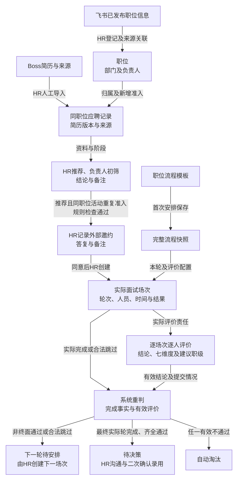

下一轮的待安排事项不自动创建场次，HR沿主链场次安排入口继续执行。手动淘汰／放弃仍按当前阶段责任授权。

### 4.3 业务对象关系

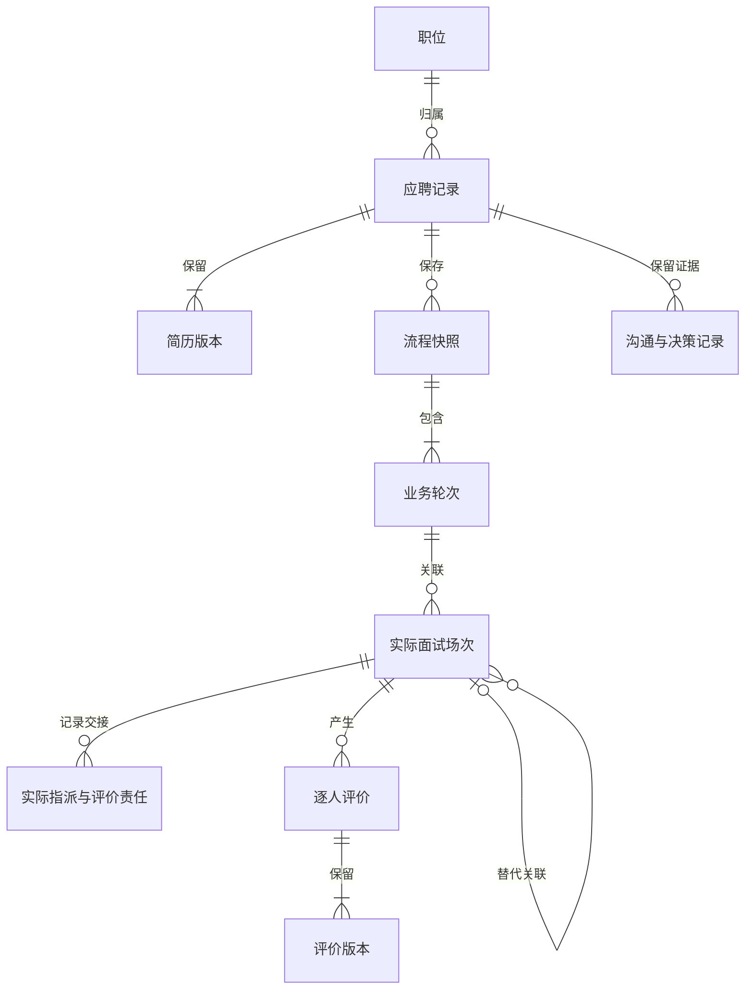

同一人在不同职位分别建立应聘记录和流程，不跨职位合并。同职位合法合并另保留主／旧记录关系，不销毁旧证据。图中简历版本包括保留的旧版本；当前简历只有一个引用，上传成功后自动设为当前。实际参与人不等于模板可选名单；评价责任换人规则见[人员交接](#547-面试人员缺失与重新指派)，不用关系线推导重复评价义务。历史保留不代表原参与人持续有权访问。

### 4.4 招聘正常流程时序图

#### 4.4.1 建档与初筛

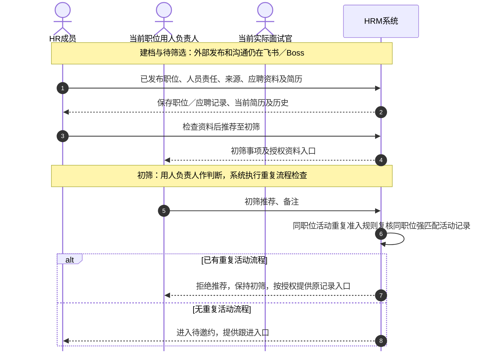

#### 4.4.2 邀约与场次安排

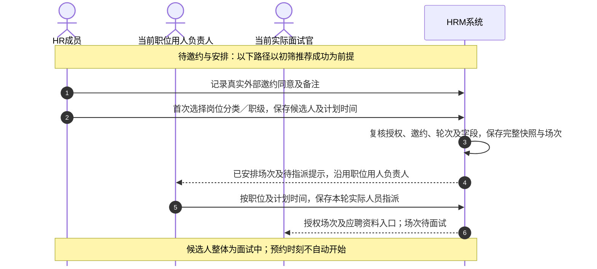

#### 4.4.3 面试评价与招聘决策

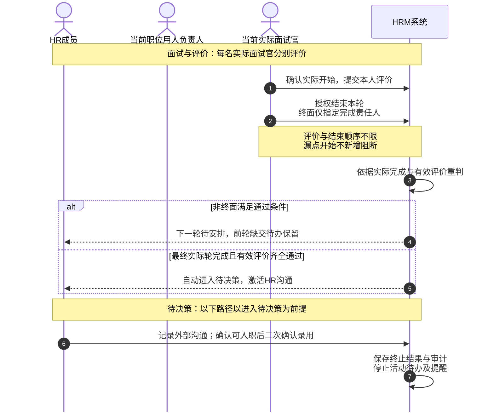

角色表示操作时的有效责任身份，同一个人可能兼任多条泳道。负责人没有实际场次指派时不能点击开始或替他人提交评价；HR安排时引用既有指派，不因此新增指派权。所有动作须复核[操作权限](#permissions)授权，系统反馈箭头表示业务入口／状态结果，不承诺新增站内通知。

#### 4.4.4 阶段、角色与数据使用对照

此表是阅读索引，授权仍以[操作权限](#permissions)及[按钮矩阵](#buttons)为准。“系统产出”不表示对所有角色可见。

| 阶段 | HR成员使用／产出 | 当前职位用人负责人使用／产出 | 当前实际面试官使用／产出 | 系统使用／产出 |
| --- | --- | --- | --- | --- |
| 待筛选 | 导入及维护应聘资料、来源、简历；检查后推荐 | 按负责职位查看资料，不代HR维护基础资料 | 仅有部门或角色不获得该候选人访问权 | 保存应聘记录、版本与阶段历史，提示重复 |
| 初筛 | 查看处理进度；按既有权限记录放弃 | 阅读资料，填写初筛结论和备注 | 无初筛职责；另有业务身份时按该身份执行 | 推荐时检查重复活动流程；产生待邀约或保留初筛 |
| 待邀约 | 使用联系方式外部沟通，记录邀约结果；同意后安排 | 维护负责职位流程及人员指派 | 获得有效实际指派后按范围查看资料 | 保存安排与首次快照；创建场次后整体面试中 |
| 面试中 | 维护计划及非评价事实；查看评价，不凭HR角色修改或下载评价 | 按职位查看、授权修改评价；处理前轮待定 | 按实际指派阅读资料；记录开始、本人评价和授权完成 | 保存实际证据及有效责任，判断下一轮、待决策或淘汰 |
| 待决策 | 使用最终轮事实，记录沟通并二次确认录用 | 按授权查看证据及处理事项，不代HR录用 | 按当前授权查看；历史作者身份不自动保留访问权 | 维护提醒、状态与审计；终止后停止活动任务 |

简历查看与下载、评价查看与修改是不同授权。HR可按既有权限下载非评价资料；负责人和面试官查看简历不获得下载权，HR查看评价不获得修改及下载权。平台管理员仅有平台角色时不获得招聘数据权限。阶段表只说明该阶段的典型职责，不扩大其他阶段依法存在的查看权。

### 4.5 候选人阶段与独立状态

#### 4.5.1 候选人阶段

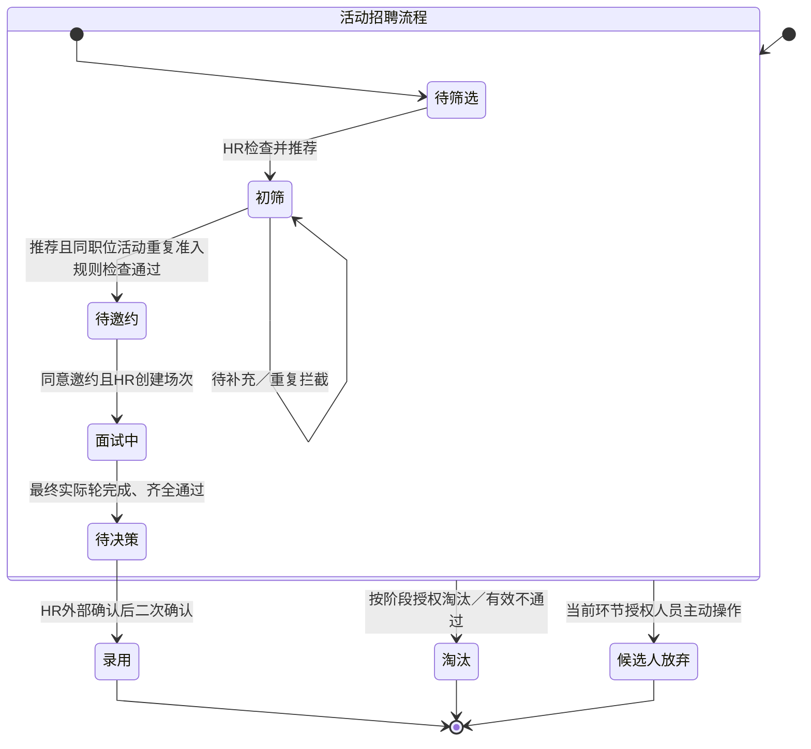

图中活动流程的公共终止出口用于合并重复连线，不表示任意角色可在任意阶段操作。待筛选／待邀约由HR主动淘汰，初筛由用人负责人不推荐；面试中／待决策的有效不通过按[评价结果与最终评价轮](#evaluation-progression)自动淘汰，手动终止仍按阶段授权。有效不通过只适用于已经产生有效评价的流程。

终止状态不回退；修改历史评价、恢复软删除或重开职位不恢复终止流程。阶段动作的逐项角色以 阶段流转、[操作权限](#permissions) 为准。

#### 4.5.2 邀约、轮次、场次分别表达

| 状态维度 | 取值／节点 | 对候选人阶段的影响 |
| --- | --- | --- |
| 邀约 | 待邀约、邀约中、同意、拒绝、失联 | 同意是创建面试前置条件；拒绝／失联不自动放弃或淘汰 |
| 业务轮次展示 | 未开始、待面试、面试进行中、已结束待评价、评价已齐、已跳过 | 完成、评价及跳过按[场次与面试规则](#fields-session)和[评价流转规则](#evaluation-progression)决定是否推进，不凭节点名称直接改阶段 |
| 面试场次 | 待面试、面试进行中、已完成、公司取消、候选人取消、未到场 | 取消／未到场保留场次结果，可创建同轮替代场次，不自动终止候选人 |

邀约再联系与更正已按筛选与邀约规则定义，见[筛选邀约字段](#fields-screen-invite)及[邀约纠错图](#536-邀约再联系记录纠错与场次事实)；最新非同意阻断新建或替代场次，但不取消已存在场次、不回退整体阶段。

<a id="stages"></a>

### 4.6 阶段流转与终止条件

#### 4.6.1 候选人阶段和邀约

候选人阶段只允许正向推进，不允许回退。淘汰和候选人放弃不可恢复。最终实际业务轮未完成、有效评价责任清单未齐全或存在待定时，候选人保持“面试中”。任一轮有效评价不通过则自动淘汰，停止后续面试，不要求补齐终面评价。候选人放弃由当前招聘环节列出的责任人员主动点击产生，不设置自动时限；公司取消、候选人取消、未到场、拒绝和失联均可作为放弃原因。

| 当前阶段 | 下一阶段 | 可执行角色／责任身份 | 关键条件 |
| --- | --- | --- | --- |
| 待筛选 | 初筛、淘汰、候选人放弃 | HR成员 | HR成员完成资料检查并推荐，或主动点击终止按钮并选择原因 |
| 初筛 | 待邀约、淘汰、候选人放弃 | 用人负责人；HR成员可主动记录候选人放弃 | 用人负责人初筛通过且通过同职位活动重复准入规则重复流程检查后进入待邀约；不通过进入淘汰；待补充仍停留在初筛 |
| 待邀约 | 面试中、淘汰、候选人放弃 | HR成员 | 招聘平台答复为同意后创建面试；其他终止结果需主动操作 |
| 面试中 | 待决策、淘汰、候选人放弃 | 用人负责人、面试官、HR成员 | 终面面试官点击完成面试，且该轮换人后的有效评价责任清单齐全且通过时自动进入待决策；任一轮有效评价不通过自动淘汰，或当前环节责任人员主动点击终止按钮 |
| 待决策 | 录用、淘汰、候选人放弃 | HR成员、用人负责人、面试官；录用仅 HR成员 | Boss渠道由HR与候选人在Boss确认可入职后二次确认录用；内推由HR在系统外确认候选人可入职意愿后，在待决策二次确认录用 |
| 录用、淘汰、候选人放弃 | 无 | 无 | 终止状态 |

### 4.7 候选人详情页面组成

#### 4.7.1 候选人详情页面分区

候选人详情包含业务摘要、应聘资料／简历、筛选邀约、流程／场次、逐轮评价、HR沟通／决策和历史证据。各区域按当前角色与状态展示，页面进入不开放全部动作。资料与返回见[候选人详情页](#candidate-detail-page)，具体业务操作分别在第5.3至5.5节定义；列表、详情与新增／编辑表单分别定义。

<a id="features"></a>

## 5 功能需求

列表查询、分页、刷新和返回按[公共规范](公共规范/字段与表单校验规范.md#list-query-return)执行；下文保留页面特有的筛选、排序、计数及交互要求。

<a id="buttons"></a>

页面／区域描述功能落点，不限定像素或视觉布局。候选人详情共用摘要、资料、初筛、邀约、流程场次、评价决策及历史区；各区按当前角色与状态呈现。工作台任务跳转到对应区并再次鉴权，不复制整套业务按钮。管理员更换HR负责人及恢复记录使用授权平台入口，不因此进入敏感业务详情。

<a id="job-management"></a>

### 5.1 职位管理

HR登记飞书已发布职位，维护职位资料、招聘状态及负责人。

<a id="job-list-page"></a>

#### 5.1.1 职位列表页

招聘管理→职位列表。HR查看全公司职位，用人负责人查看负责职位，实际面试官查看当前有效指派授权的职位；管理员仅有平台角色时不开放入口。列表包含已关闭职位，排除软删除记录。

##### 5.1.1.1 职位筛选项

| 字段名称 | 数据类型 | 控件类型 | 取值来源 | 默认值 | 筛选规则 |
| --- | --- | --- | --- | --- | --- |
| 职位名称 | 文本 | 文本输入框 | 用户输入，与职位记录的名称匹配 | 空 | 去除首尾空格后按名称包含关键词查询；空值不限制 |
| 所属部门 | 部门关联 | 单选下拉框 | 当前授权职位关联的部门；名称取部门资料 | 全部 | 按部门关联筛选；已停用但仍被授权职位引用的部门保留显示并标注“已停用” |
| 招聘状态 | 枚举 | 单选下拉框 | 职位招聘状态：可招聘、已关闭 | 全部 | 按当前状态精确筛选；软删除不作为招聘状态选项 |

##### 5.1.1.2 职位列表按钮

| 按钮名称 | 所在位置 | 操作权限 | 前置条件 | 点击行为 | 确认要求 | 成功结果 | 异常反馈 |
| --- | --- | --- | --- | --- | --- | --- | --- |
| 查询 | 职位列表页／筛选区 | 当前页用户 | 无额外业务条件 | 应用当前条件 | 无需额外确认 | 按公共查询规则执行 | 按公共加载失败反馈执行 |
| 重置 | 职位列表页／筛选区 | 当前页用户 | 无额外业务条件 | 恢复本页默认筛选 | 无需额外确认 | 名称清空，部门／状态回“全部” | 不改变业务记录 |
| 新增 | 职位列表页／列表上方 | 具备招聘职位新增权限的用户 | 目标在该权限配置范围内；无额外业务条件 | 进入职位新增页 | 无需额外确认 | 页面标题“新增职位”；九项业务字段初始为空 | 其他角色不显示入口；已发布事实及申请唯一性在新增保存时校验 |
| 删除 | 职位列表页／记录操作区 | 具备招聘职位删除权限的用户 | 目标在该权限配置范围内；职位无进行中的候选人流程 | 打开目标记录的删除确认弹窗 | 展示目标职位，填写原因并二次确认 | 成功移出普通列表、刷新当前查询 | 存在进行中流程时禁用并提示，关闭招聘不替代删除准入 |

##### 5.1.1.3 职位列表字段

一行对应一条职位记录，以下为列顺序。

| 字段名称 | 数据类型 | 取值来源 | 展示规则 | 空值展示 | 交互说明 |
| --- | --- | --- | --- | --- | --- |
| 职位名称 | 文本 | 职位资料／职位名称 | 显示职位当前名称；同名职位独立 | — | 点击进入本行职位详情，按职位关联跳转 |
| 所属部门 | 文本 | 职位所属部门关联→部门名称 | 显示关联部门名称；停用标识保留 | — | 只读；部门归属不扩大授权 |
| 招聘人数 | 整数 | 职位资料／招聘人数 | 显示计划人数，不扣已录用数，不表示剩余名额 | —，不补0 | 只读 |
| 招聘状态 | 枚举 | 职位当前招聘状态 | 可招聘、已关闭 | —，不默认成可招聘 | 只读；状态切换在详情操作 |
| HR负责人 | 人员名称 | 职位当前HR负责人指派→人员姓名 | 显示当前HR姓名；账号或角色失效标识“资格失效” | 未指定 | 只读；不自动指定替代人 |
| 用人负责人 | 人员名称 | 职位当前用人负责人指派→人员姓名 | 显示当前负责人姓名；资格失效保留姓名并标识 | — | 只读；更换在详情执行 |
| 发布时间 | 日期时间 | HR录入的飞书职位发布时间 | 按业务时区显示日期及时分；取飞书发布时间 | —，不补当前时间 | 只读 |
| 候选人阶段概览 | 分阶段计数 | 本职位未软删除、当前用户有权查看的应聘记录→当前阶段 | 按待筛选、初筛、待邀约、面试中、待决策、录用、淘汰、候选人放弃显示计数 | 无应聘记录时各阶段为0 | 只读，不编辑 |
| 操作 | 按钮 | 当前角色及记录业务条件 | 仅HR显示“删除”；条件不足禁用并说明原因 | 无资格时隐藏 | 删除当前职位 |

##### 5.1.1.4 职位列表排序与空态

| 项目 | 页面要求 |
| --- | --- |
| 默认排序 | 系统创建时间倒序 |
| 计数口径 | 当前筛选及授权范围内未软删除的职位记录数；已关闭职位仍计入 |
| 空态文案 | 无筛选且授权范围无职位：“暂无职位”；筛选无结果：“暂无符合条件的职位”；HR保留“新增”入口 |

<a id="job-form-page"></a>

#### 5.1.2 职位新增／编辑页

<a id="job-edit-page"></a>

##### 5.1.2.1 职位保存与取消

| 按钮名称 | 所在位置 | 操作权限 | 前置条件 | 点击行为 | 确认要求 | 成功结果 | 异常反馈 |
| --- | --- | --- | --- | --- | --- | --- | --- |
| 保存 | 职位新增页／底部 | 具备招聘职位新增权限的用户 | 目标在该权限配置范围内；九项字段合法，HR已确认飞书职位发布，对应申请尚未关联职位 | 校验并保存新增职位 | 无需额外确认 | 创建可招聘职位及建档记录；提示“新增成功”，进入新职位详情页 | 申请重复时拒绝，按当前授权提供原职位入口；已关闭记录复用并恢复招聘，软删除记录由授权管理员恢复，不另建。字段错误定位到对应输入，不创建部分记录；相同申请并发提交也只允许一条关联 |
| 保存 | 职位编辑页／底部 | 具备招聘职位编辑权限的用户 | 目标在该权限配置范围内；职位未软删除；七项可编辑资料合法，修改原因必填 | 校验修改内容并保存同一职位 | 展示修改项原、新值及原因。来源链接变化时，HR在飞书核实并确认“新链接仍对应本职位原有的招聘申请”；未确认不保存。计划人数低于提交时已有录用数量时，提示“计划人数低于已有录用记录，请核实”；“返回修改”关闭提示并保留输入，“确认保存”继续保存 | 更新同一职位，提示“已保存”并返回原详情页 | 缺原因、来源未核实或申请重复拒绝；重复时按当前授权提供原职位入口；保留合法输入，不部分保存。保存不变更职位引用、责任、招聘状态、候选人阶段、场次、评价、快照或待办起点 |
| 取消 | 职位新增／编辑页底部 | 当前页用户 | 无额外业务条件 | 关闭当前表单，按其返回规则处理未保存内容 | 未保存内容按公共离开规则确认 | 返回原列表（新增）或原详情页（编辑） | 放弃后不保存、不创建记录；不保存跨会话草稿 |

##### 5.1.2.2 输入字段

通用长度、链接、数值、时间、选项校验引用[公共字段规范](公共规范/字段与表单校验规范.md)，权限和审计引用[公共治理规范](公共规范/权限与数据治理规范.md)。

| 字段名称 | 业务含义 | 数据类型 | 控件类型 | 取值来源 | 默认值 | 必填条件 | 校验规则 | 修改与历史 |
| --- | --- | --- | --- | --- | --- | --- | --- | --- |
| 职位名称 | 正在招聘的职位名称 | 文本 | 文本输入框 | HR按飞书已发布职位录入 | 无 | 是 | 不是人员自身岗位、权限角色或模板岗位分类；名称相同不等于同职位 | 由HR更正同一招聘需求的名称，填写原因；不同需求另行建档 |
| 所属部门 | 职位组织归属 | 部门关联 | 单选下拉框 | 启用部门资料 | 无 | 是 | 部门不授予职位权限；部门选择及停用值保留使用公共部门规则 | 部门变更不改变人员所属部门、负责人指派、实际面试人员或业务授权 |
| 招聘人数 | 招聘计划人数 | 正整数 | 数字输入框 | HR按飞书招聘计划录入 | 无 | 是 | 1—9,999；正整数格式引用公共规范；不是已录用人数或实时剩余名额 | HR更正原因必填；低于已有录用记录数提示核实，确认后可保存，不自动关闭或终止流程 |
| 用人负责人 | 本职位业务负责人 | 人员关联 | 可搜索单选框 | 启用账号且满足用人负责人承接资格的人员；可跨部门选择 | 无 | 是，1人 | 账号启用且满足面试参与资格，允许跨部门指派；授权范围仍为负责职位，不扩大为部门范围；不自动参加实际面试 | 资料编辑时只读；由HR在职位详情页“更换用人负责人”一次替换，启用账号及面试官资格、原因必备；原资格失效显示并由HR接任；历史作者不变 |
| HR负责人 | 本职位主责HR | 人员关联 | 可搜索单选框 | 启用账号且满足HR承接资格的人员 | 无 | 是，1人 | 账号启用且满足HR承接资格；全公司HR查看权限不要求被逐职位指派 | 资料编辑时只读；HR成员或管理员通过“更换HR负责人”解除／重新指定；原因、操作人及时间留存，不改原历史；解除到再指定期间显示“HR负责人未指定”，不自动指定替代人；不影响既有全公司HR权限 |
| 职位类型 | 招聘职位的分类 | 字典关联 | 单选下拉框 | 启用的职位类型字典；初始全职、实习、兼职、外包／合同、其他 | 无 | 是 | 使用对应启用字典，初始值引用范围说明；历史停用值不能用于新选择 | 同一职位更正需原因；原停用值保留按公共字典规则，换值只用启用项 |
| 办公方式 | 职位办公方式 | 字典关联 | 单选下拉框 | 启用的办公方式字典；初始现场办公、远程、混合办公 | 无 | 是 | 初始值为现场办公、远程、混合办公；不表达城市、地址或具体面试地点 | HR资料更正需填写原因并保留历史 |
| 飞书审批申请链接 | 招聘申请来源凭证 | 链接 | 链接输入框 | HR从飞书申请复制 | 无 | 是 | 一申请仅关联一个职位；新增保存或编辑时来源链接变化均检查重复，编辑排除当前职位；命中其他职位已保存来源则拒绝。HR核实已发布事实及申请身份，系统不抓取飞书资料、不自动验证审批或链接有效性，不删除URL参数 | 可纠正误粘贴、失效分享入口或同一申请的另一有效入口；不同格式由HR核实，旧值保留为审计证据。不得替换为另一申请；两条已有职位实际对应同一申请时人工处置，本期不提供职位合并或候选人迁移 |
| 发布时间 | 飞书职位实际发布时间 | 日期时间 | 日期时间选择器 | HR按飞书发布事实录入 | 无 | 是 | 新增及编辑均不得晚于当前业务时刻，超出时提示“发布时间不能晚于当前时刻”，不保存；使用公共时区及格式，不是HRM建档时间；不自动取当前时间代替 | HR更正需原因，系统建档时间、候选人阶段和待办计时不变 |
| 修改原因 | 同一招聘需求的资料更正依据 | 备注 | 多行文本框 | HR输入 | 无 | 编辑是 | 公共备注校验 | 保存原、新值及操作证据，不改变业务阶段 |

##### 5.1.2.3 职位记录与历史

| 字段／事实 | 含义及生成 | 修改与使用条件 |
| --- | --- | --- |
| 职位记录引用 | 系统在建档成功后产生稳定关联，供应聘记录使用 | 不因改名、重开或负责人更换替换既有引用；具体标识展示方式由交互决定 |
| 招聘状态 | 可招聘／已关闭；初始可招聘 | HR人工按飞书关闭／重开操作；关闭仅阻断新候选人，原流程继续；不自动根据招聘人数关闭 |
| 关闭／重开原因及操作证据 | 状态动作的原因、实际操作人、时间及变化 | 非自由修改状态字段；由关闭／重开动作产生，恢复招聘与软删除恢复不同 |
| 建档与变更审计 | 按公共审计记录操作者、时间、对象、结果和必要摘要 | 时间系统产生，不用发布时间替代；不允许无痕修改历史 |
| 负责人变更历史 | 记录解除、指定及原因，保留当时人员关联 | 责任变更影响后续操作／任务／提醒，不改原操作作者；指派关联同一内部人员身份 |
| 软删除状态及恢复 | 通过已授权删除／恢复动作产生 | 无进行中流程才可软删；不级联销毁历史；管理员授权恢复，不代替招聘重开 |
| 候选人阶段概览 | 从本职位应聘记录聚合的展示结果 | 不作为可手填字段；概览不扩大数据授权 |

##### 5.1.2.4 职位资料修改流程

###### 5.1.2.4.1 职位资料编辑流程

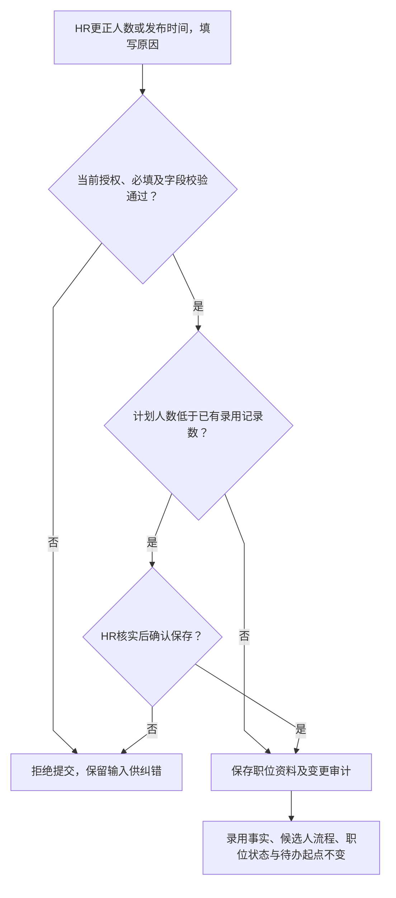

###### 5.1.2.4.2 职位资料与来源链接修改流程

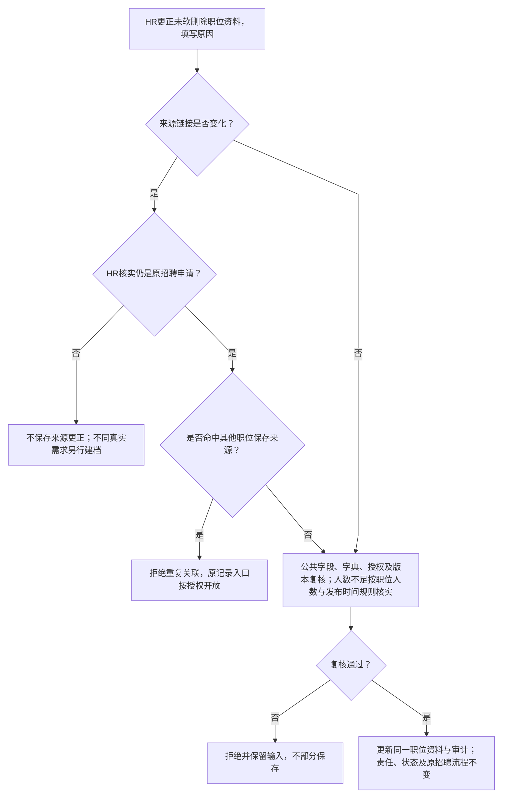

<a id="job-detail-page"></a>

#### 5.1.3 职位详情页

- **入口与角色**：从授权职位列表、工作台或直接链接进入；HR全公司、当前用人负责人负责职位、实际面试官按有效指派查看。平台管理员仅在授权责任配置入口维护HR负责人，不因此打开招聘详情。

**职位详情按钮**

| 按钮名称 | 所在位置 | 操作权限 | 前置条件 | 点击行为 | 确认要求 | 成功结果 | 异常反馈 |
| --- | --- | --- | --- | --- | --- | --- | --- |
| 查看全部 | 职位详情页／候选人区 | 当前用户有本职位候选人查看权限 | 无额外业务条件 | 进入候选人列表并带入当前职位 | 无需额外确认 | 进入候选人列表并带入本职位 | 列表仍限定当前授权范围 |
| 编辑 | 职位详情页／资料区 | 具备招聘职位编辑权限的用户 | 目标在该权限配置范围内；职位未软删除，含已关闭 | 进入职位编辑页 | 无需额外确认 | 页面标题“编辑职位”；回填当前资料，负责人只读；招聘状态及系统创建时间不可编辑 | 其他角色不显示编辑入口 |
| 面试流程配置 | 职位详情页／资料区 | 具备面试流程配置权限的用户 | 目标在该权限配置范围内；无额外业务条件 | 进入本职位面试流程配置页 | 无需额外确认 | 进入本职位面试流程配置页 | 普通面试官无配置编辑入口 |
| 导入候选人 | 职位详情页／候选人区 | 具备候选人新增权限的用户 | 目标在该权限配置范围内；职位可招聘 | 进入候选人新增页，职位入口带入当前职位 | 无需额外确认 | 页面标题“导入候选人”；按字段表初始化，带入当前职位 | 已关闭时禁用并提示不可新增；原候选人流程继续 |
| 关闭招聘 | 职位详情页／状态区 | 具备招聘职位关闭权限的用户 | 目标在该权限配置范围内；职位可招聘；依据飞书关闭事实操作 | 打开关闭招聘确认弹窗 | 展示目标职位，填写关闭原因并确认 | 职位变为已关闭，阻止新增候选人，已有流程继续 | 已关闭不重复关闭；关闭不终止候选人流程 |
| 恢复招聘 | 职位详情页／状态区 | 具备招聘职位重开权限的用户 | 目标在该权限配置范围内；职位已关闭；依据飞书重开事实操作 | 打开恢复招聘确认弹窗 | 展示目标职位，填写恢复原因并确认 | 原职位恢复可招聘，可继续新增候选人 | 不是软删除恢复；软删除记录须先按授权恢复 |
| 更换HR负责人 | 职位详情页／责任区 | 具备职位HR负责人配置权限的用户 | 目标在该权限配置范围内；HR成员在职位详情责任区操作；管理员在授权责任配置入口操作；新HR负责人须账号启用且满足HR承接资格 | 打开HR负责人选择及原因弹窗 | 选择解除或指定人员，原因必填 | 解除后显示“HR负责人未指定”；指定后更新后续任务／提醒责任，保留原起点及历史 | 无资格人员不可选；管理员仅在授权配置入口操作，不能据此进入候选人资料 |
| 更换用人负责人 | 职位详情页／责任区 | 具备职位用人负责人配置权限的用户 | 目标在该权限配置范围内；目标有效职位含已关闭，新人员启用且满足用人负责人承接资格 | 打开接任人员及原因弹窗 | 展示原、新负责人及交接影响，原因必填后确认 | 一次替换负责人；接任负责职位任务，历史作者及任务起点不变，实际面试另行指派 | 原资格失效仍可接任；仅平台初始权限而无职位用人负责人配置权限时无此操作；不改实际面试及评价责任 |

<a id="更换职位用人负责人"></a>

| 区域 | 字段／内容 | 类型与取值来源 | 操作说明 |
| --- | --- | --- | --- |
| 职位资料 | 职位名称、所属部门、招聘人数、职位类型、办公方式、发布时间 | 使用上方职位字段定义的类型和当前保存值 | 只读；HR通过“编辑”维护 |
| 来源凭证 | 飞书审批申请链接 | 链接；职位当前保存来源 | 点击在新窗口打开原链接；不展示系统自动审批校验结果 |
| 招聘状态 | 可招聘／已关闭 | 状态标签；当前招聘状态 | 状态变更使用关闭／恢复招聘操作 |
| 责任 | HR负责人、用人负责人及资格 | 人员名称；当前指派及账号／角色资格 | 未指定或资格失效分别提示；接任不通过资料编辑 |
| 候选人 | 下表列定义 | 本职位最近导入的前5条授权应聘记录 | 导入时间倒序，同时间按稳定引用升序；不在详情内分页，更多通过“查看全部”进入候选人列表 |
| 历史 | 创建、资料修改、状态与负责人变更 | 事件记录；本职位的业务历史 | 按发生时间倒序显示操作人、时刻、动作及变更内容；按当前授权只读 |

| 字段名称 | 数据类型 | 取值来源 | 展示规则 | 空值展示 | 交互说明 |
| --- | --- | --- | --- | --- | --- |
| 候选人姓名 | 文本 | 应聘记录／姓名 | 显示姓名链接 | — | 点击进入该应聘记录详情 |
| 候选人阶段 | 枚举 | 应聘记录当前阶段 | 以状态标签显示整体招聘阶段 | — | 只读 |
| 当前轮次 | 文本 | 流程快照的当前轮定位 | 显示当前轮，不取最近历史场次作为当前轮 | — | 只读 |
| 导入时间 | 日期时间 | 应聘记录首次导入时刻 | 公共业务时区，显示日期及时分 | — | 只读 |

- **状态与责任动作**：关闭招聘、恢复招聘、更换HR负责人及更换用人负责人均用弹窗，分别显示目标、输入原因、确认与取消，不使用资料编辑保存。关闭不终止原候选人流程；恢复招聘不等同软删除恢复。成功关闭弹窗并刷新对应区域，失败保留输入。
- **返回与验收**：“返回列表”恢复进入时列表条件；从工作台进入时“返回工作台”回原任务视图；直接链接无来源时返回授权职位列表。候选人区无结果显示“暂无候选人”，权限变化拒绝访问，不保留越权正文。

##### 5.1.3.1 更换职位用人负责人

由具备职位用人负责人配置权限且范围覆盖的用户在职位配置入口更换用人负责人；新负责人须账号启用且满足用人负责人承接资格，填写变更原因，原／新人员、操作人和时间留审计。一次提交从原负责人切换到新负责人，不主动保存空负责人；原负责人账号禁用或当前权限／范围不再满足承接资格时，负责人授权失效；保留历史指派并显示当前资格失效，未完成负责人任务待重新指派，HR在同一入口指定接任人。

原负责人资格有效时不要求其额外审批，以免无法处理离职／无法响应的接任；管理员须具备职位用人负责人配置权限且目标范围有效才能更换用人负责人。仅有职位HR负责人配置权限不能更换用人负责人或查看候选人；两个负责人配置及业务查看分别授权。

接任结果：新负责人按当前职位范围查看资料、处理未完成初筛、前轮待定及负责人事项，后续长期提醒使用当前有效负责人。未完成业务任务的起点不重置。原负责人失去基于该职位负责人身份的权限；若仍另有实际面试指派，则仍按该独立关系操作。接任不改模板快照、场次实际参与人、完成责任人、评价作者或已交评价，不自动让接任人参加面试或代交评价。

职位已关闭也可接任以继续原有流程；软删除职位不在普通入口更换，先按授权恢复处理。

##### 5.1.3.2 负责人变更与申请唯一性

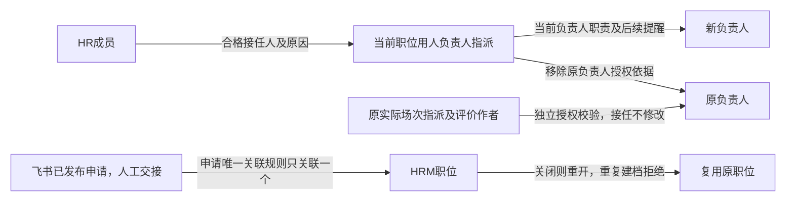

<a id="candidate-management"></a>

### 5.2 应聘资料管理

HR录入并维护应聘资料；每条应聘记录只属于一个职位，跨职位应聘分别建档。

<a id="candidate-list-page"></a>

#### 5.2.1 候选人列表页

招聘管理→候选人列表，或职位详情→“查看全部”。HR查看全公司应聘记录，用人负责人查看负责职位记录，面试官查看有效实际指派范围；列表排除软删除记录。同一候选人跨职位应聘分别展示。

##### 5.2.1.1 候选人筛选项

| 字段名称 | 数据类型 | 控件类型 | 取值来源 | 默认值 | 筛选规则 |
| --- | --- | --- | --- | --- | --- |
| 候选人姓名 | 文本 | 文本输入框 | 用户输入，与应聘记录的候选人姓名匹配 | 空 | 去除首尾空格后按姓名包含关键词查询；空值不限制 |
| 应聘职位 | 职位关联 | 可搜索的单选下拉框 | 当前用户可查看的未软删除职位；显示职位名称及所属部门 | 招聘管理入口为全部；职位详情入口带入原职位 | 以职位关联精确匹配；包含已关闭职位，查询历史应聘不要求职位可招聘；同名职位按部门辅助区分 |
| 候选人阶段 | 枚举 | 单选下拉框 | 招聘阶段：待筛选、初筛、待邀约、面试中、待决策、录用、淘汰、候选人放弃 | 全部 | 按应聘记录当前整体阶段精确筛选；场次“待面试”不是阶段选项 |

从职位详情带入的职位可在本页改选，选项和结果限定于当前授权范围。

##### 5.2.1.2 候选人列表按钮

| 按钮名称 | 所在位置 | 操作权限 | 前置条件 | 点击行为 | 确认要求 | 成功结果 | 异常反馈 |
| --- | --- | --- | --- | --- | --- | --- | --- |
| 查询 | 候选人列表页／筛选区 | 当前页用户 | 无额外业务条件 | 应用当前条件 | 无需额外确认 | 按公共查询规则执行 | 按公共加载失败反馈执行 |
| 重置 | 候选人列表页／筛选区 | 当前页用户 | 无额外业务条件 | 恢复本页默认筛选 | 无需额外确认 | 姓名清空，职位／阶段回“全部” | 职位带入条件也清空，不能扩大授权范围 |
| 导入候选人 | 候选人列表页／列表上方 | 具备候选人新增权限的用户 | 目标在该权限配置范围内；职位入口带入的职位须可招聘 | 进入候选人新增页，职位入口带入当前职位 | 无需额外确认 | 页面标题“导入候选人”；按字段表初始化，职位入口带入目标职位 | 带入已关闭职位时禁用并提示不可新增 |
| 删除 | 候选人列表页／记录操作区 | 具备候选人删除权限的用户 | 目标在该权限配置范围内；目标候选人为待筛选，且无推荐／邀约／面试／评价历史 | 打开目标记录的删除确认弹窗 | 原因及二次确认 | 从普通列表移除，不物理清理历史 | 不满足候选人删除条件时禁用，提示已存在的流程历史；已终止不恢复删除资格 |

##### 5.2.1.3 候选人列表字段

一行对应一条应聘记录，以下为列顺序。

| 字段名称 | 数据类型 | 取值来源 | 展示规则 | 空值展示 | 交互说明 |
| --- | --- | --- | --- | --- | --- |
| 候选人姓名 | 文本 | 应聘资料／候选人姓名 | 显示本条应聘资料姓名；同名不合并 | — | 点击进入本行应聘详情，按应聘记录关联跳转 |
| 应聘职位 | 文本 | 应聘记录→固定职位关联→职位名称 | 显示固定应聘职位名称；已关闭仍显示 | — | 只读，不在列表修改归属 |
| 所属部门 | 文本 | 应聘职位→所属部门关联→部门名称 | 显示职位归属部门，不是候选人或面试官部门 | — | 只读 |
| 候选人阶段 | 枚举 | 应聘记录当前整体阶段 | 待筛选、初筛、待邀约、面试中、待决策、录用、淘汰、候选人放弃 | —，不默认成待筛选 | 只读；终止结果不能在列表回退 |
| 当前轮次 | 文本 | 该应聘记录的流程快照及当前轮定位 | 显示快照当前业务轮或HR沟通节点，不取最近历史场次 | 未建立流程显示“—” | 只读 |
| 来源渠道 | 文本 | 应聘资料／来源渠道字典关联 | Boss直聘、内推；停用历史值保留显示 | —，不按新增默认值补Boss直聘 | 只读 |
| 来源凭证 | 标识 | 当前来源渠道、凭证类型及有效值 | Boss无法取得显示“来源凭证缺失”；有凭证显示“已记录”；内推显示“不适用” | Boss有凭证类型但缺有效值时显示“来源凭证缺失” | 只读；真实值及缺失原因在详情查看 |
| 导入人 | 人员名称 | 该应聘记录首次导入证据→操作人 | 显示首次导入操作人，不用最近修改人替代 | — | 只读 |
| 导入时间 | 日期时间 | 该应聘记录首次导入时刻 | 按业务时区显示首次导入日期及时分，不取简历更新时间 | —，不补当前时间 | 只读 |
| 操作 | 按钮 | 当前角色及记录业务条件 | HR显示“删除”；进入过流程的记录禁用并说明原因 | 无资格时隐藏 | 删除当前应聘记录 |

##### 5.2.1.4 候选人列表排序与空态

| 项目 | 页面要求 |
| --- | --- |
| 默认排序 | 导入时间倒序 |
| 计数口径 | 当前筛选及授权范围内未软删除的应聘记录数；同人跨职位分别计数，不按姓名去重 |
| 职位带入 | 从职位详情进入带入本职位；重置时清空该条件，恢复当前授权范围 |
| 空态文案 | 无筛选且授权范围无记录：“暂无候选人”；筛选无结果：“暂无符合条件的候选人” |

<a id="candidate-form-page"></a>

#### 5.2.2 候选人新增／编辑页

<a id="candidate-edit-page"></a>

##### 5.2.2.1 候选人保存与取消

| 按钮名称 | 所在位置 | 操作权限 | 前置条件 | 点击行为 | 确认要求 | 成功结果 | 异常反馈 |
| --- | --- | --- | --- | --- | --- | --- | --- |
| 保存 | 候选人新增页／底部 | 具备候选人新增权限的用户 | 目标在该权限配置范围内；职位可招聘，姓名、至少一种联系方式及一份简历必填；Boss凭证或缺失原因按类型填写，内推仅记录渠道 | 校验并保存新增应聘记录 | 无需额外确认 | 执行同职位重复检查；非重复或按对比结果继续保留时，整体保存待筛选记录、当前简历和导入证据，进入新候选人详情页 | 职位关闭拒绝；重复时保留待录入内容并进入重复记录对比页，不自动合并；字段／上传失败不创建半条记录或孤立附件 |
| 保存 | 候选人编辑页／底部 | 具备候选人资料编辑权限的用户 | 目标在该权限配置范围内；记录未软删除；姓名及至少一种联系方式合法，适用来源凭证完整；来源补充／更正原因必填 | 校验并保存同一应聘记录 | 无需额外确认 | 整体更新同一记录及资料历史，提示“已保存”，返回原详情资料区；引用、职位、阶段、原导入证据不变，已终止记录不恢复流程 | 姓名／联系方式变化时，排除本记录并按新值复核同职位强匹配活动记录；冲突拒绝，无忽略继续按钮；保留合法输入，不部分保存 |
| 取消 | 候选人新增／编辑页底部 | 当前页用户 | 无额外业务条件 | 关闭当前表单，按其返回规则处理未保存内容 | 未保存内容按公共离开规则确认 | 返回原列表（新增）或原详情页（编辑） | 放弃后不保存；不保存跨会话草稿 |

<a id="fields-candidate"></a>

##### 5.2.2.2 共用字段定义

| 字段名称 | 业务含义 | 数据类型 | 控件类型 | 取值来源 | 默认值 | 必填条件 | 校验规则 | 修改与历史 |
| --- | --- | --- | --- | --- | --- | --- | --- | --- |
| 候选人姓名 | 应聘人的显示姓名 | 文本 | 文本输入框 | HR从Boss或内推资料录入 | 无 | 是 | 公共姓名校验；同名不自动认定同人 | HR可更正；按同职位活动重复准入复核 |
| 手机号 | 候选人联系电话 | 电话号码 | 电话输入框 | HR从招聘资料录入 | 无 | 与邮箱至少一项 | 单值；公共电话标准化；同类匹配，不套账号唯一约束 | HR可更正；与姓名共同复核活动重复 |
| 邮箱 | 候选人联系邮箱 | 邮箱地址 | 邮箱输入框 | HR从招聘资料录入 | 无 | 与手机号至少一项 | 单值；公共邮箱格式／标准化；不与电话跨类型比较 | HR可更正；身份更正复核活动重复 |
| 应聘职位 | 本次应聘的归属职位 | 职位关联 | 可搜索单选框 | 当前可招聘且未软删除的HRM职位；显示名称及部门 | 职位入口带入目标；列表入口为空 | 新增必填1个；编辑只读 | 新增保存时须可招聘；未保存前可改选 | 建档后固定；待筛选无流程历史的误建可删除后重录，已进入流程另建；不迁移或跨职位合并 |
| 简历附件 | 本次应聘的简历证据 | 文件 | 文件上传控件 | HR从Boss或内推取得的简历 | 无 | 新增必传1份；编辑不更换 | 类型、大小及安全检查引用公共规范 | 上传成功设为当前；旧文件及历史关联保留；HR切换及合并选择按[应聘资料](#candidate-management) |
| 来源渠道 | 资料取得渠道 | 字典关联 | 单选下拉框 | 启用的候选人来源渠道字典；初始Boss直聘、内推 | Boss直聘 | 是 | 内推不填推荐人／推荐说明及Boss凭证；接收及邀约／可入职确认按下方内推流程执行 | 更正原因必填，保留来源历史；原停用值保留和新选择启用约束引用公共字典规则 |
| 来源凭证类型 | Boss来源凭证的形式 | 枚举 | 单选下拉框 | 外部ID、来源链接、无法取得 | 无 | Boss必填；内推不适用 | 内推隐藏且不提交；按实际取得情况选择；切换类型只提交最终类型对应值 | 来源补充／更正原因必填，原类型及凭证保留历史 |
| 外部来源凭证值 | 外部真实ID或链接 | 文本或链接 | 文本／链接输入框 | HR从外部来源取得 | 无 | Boss且类型为ID／链接时必填 | 按类型使用公共格式；不使用内部应聘编号，不作唯一键或判重替代 | HR补充／纠错原因必填，保留原凭证历史 |
| 来源缺失原因 | 无法取得Boss凭证的原因 | 多行文本 | 多行文本框 | HR输入 | 无 | Boss且类型为无法取得时必填 | 有原因允许录入，并标识来源凭证缺失；内推不适用 | 后续补充凭证保留原缺失说明历史 |
| 来源更正原因 | 来源资料变更依据 | 备注 | 多行文本框 | HR输入 | 无 | 编辑且渠道或来源凭证变化时是 | 公共备注校验 | 保留来源前后值和实际更正人／时间 |

<a id="candidate-detail-page"></a>

#### 5.2.3 候选人详情页：资料与简历

- **入口与授权**：从候选人列表、职位详情、工作台或已有权限直接链接进入；HR全公司、当前用人负责人负责职位、面试官有效实际指派范围分别鉴权。管理员仅有平台角色不能查看。

**资料与简历按钮**

| 按钮名称 | 所在位置 | 操作权限 | 前置条件 | 点击行为 | 确认要求 | 成功结果 | 异常反馈 |
| --- | --- | --- | --- | --- | --- | --- | --- |
| 编辑 | 候选人详情页／资料区 | 具备候选人资料编辑权限的用户 | 目标在该权限配置范围内；同一未软删除应聘记录；职位、阶段、原导入证据及简历版本只读 | 进入候选人编辑页 | 无需额外确认 | 页面标题“编辑候选人资料”；回填姓名、联系方式、来源渠道及适用凭证；应聘职位、阶段、导入人／时间及简历版本只读 | 姓名／联系方式更正命中同职位强匹配活动记录时拒绝；资料更正不换职位或恢复终止流程 |
| 上传简历 | 候选人详情页／简历区 | 具备简历上传权限的用户 | 目标在该权限配置范围内；每次一份，文件使用公共附件准入 | 打开单份简历上传弹窗 | 无需额外确认 | 明示上传成功自动设当前；保存后刷新版本列表及当前标记 | 失败不产生可用版本，原当前引用不变；旧文件及评价引用保留 |
| 设为当前 | 候选人详情页／简历区 | 具备简历版本切换权限的用户 | 目标在该权限配置范围内；选择本应聘记录的合法已保存版本 | 打开所选历史版本的切换确认弹窗 | 确认目标版本 | 成功只切换当前引用，保留切换历史 | 不提供版本删除；不能选择其他应聘记录的文件，也不覆盖旧评价引用 |
| 预览 | 候选人详情页／简历区 | 具备简历查看权限的用户 | 目标在该权限配置范围内；无额外业务条件 | 打开所选文件预览 | 无需额外确认 | 打开文件预览；关闭返回原版本区 | 查看权不包含下载权 |
| 下载 | 候选人详情页／简历区 | 具备简历下载权限的用户 | 目标在该权限配置范围内；非评价资料及附件，[操作权限](#permissions) | 执行当前文件的独立下载鉴权 | 无需额外确认 | 权限校验后交付附件并审计 | 评价／附件／版本下载无授权；面试官及负责人仅查看时不显示下载 |

| 字段名称 | 数据类型 | 取值来源 | 展示规则 | 空值展示 | 交互说明 |
| --- | --- | --- | --- | --- | --- |
| 候选人姓名 | 文本 | 应聘资料／姓名 | 显示当前保存的候选人姓名 | — | 只读；HR通过“编辑”更正 |
| 应聘职位 | 文本 | 该应聘记录的固定职位关联→名称 | 显示固定职位关联的名称 | — | 只读；资料编辑不能更换归属 |
| 候选人阶段 | 枚举 | 应聘记录当前阶段 | 显示招聘操作产生的当前阶段 | —，不默认成待筛选 | 只读，不提供状态下拉 |
| HR负责人、用人负责人 | 人员名称 | 应聘职位当前责任指派→人员姓名 | 分别显示当前HR及用人负责人姓名；资格失效独立标识 | 未指定；不以实际面试人员补位 | 只读；责任变更在职位详情执行 |
| 手机号 | 文本 | 应聘资料／手机号 | 显示当前联系电话 | — | 只读；HR通过“编辑”维护 |
| 邮箱 | 文本 | 应聘资料／邮箱 | 显示当前邮箱 | — | 只读；HR通过“编辑”维护，不作为候选人账号 |
| 来源渠道 | 文本 | 当前来源渠道字典关联 | 显示当前保存渠道；内推不显示推荐人 | —，不补新增默认值 | 只读；HR通过“编辑”更正 |
| 来源凭证 | 文本／链接 | 当前Boss凭证类型及值 | Boss ID显示文本、链接显示链接；无法取得显示“来源凭证缺失”；内推显示“不适用” | Boss有效凭证缺失显示“来源凭证缺失” | 来源链接在新窗口打开；ID及标识只读 |
| 缺失原因 | 多行文本 | 当前Boss来源缺失说明 | 仅Boss无法取得时显示缺失原因；内推不展示历史Boss凭证或原因 | 适用时无内容显示“—”；不适用时隐藏 | 只读 |
| 导入人、导入时间 | 人员名称／日期时间 | 首次导入证据 | 显示首次导入人及日期时间，按公共业务时区 | — | 只读；编辑不改变原导入证据 |

| 字段名称 | 数据类型 | 取值来源 | 展示规则 | 空值展示 | 交互说明 |
| --- | --- | --- | --- | --- | --- |
| 文件名 | 文本 | 该简历版本保存的文件名 | 显示本版本保存的文件名 | — | 只读；打开文件使用本行“预览” |
| 文件类型 | 文本 | 上传后保存的文件类型 | 显示实际PDF、DOC或DOCX | — | 只读 |
| 文件大小 | 文件大小 | 上传文件的实际大小 | 显示实际大小，单位KB／MB，不取上传前估计值 | —，不补0 | 只读 |
| 上传人 | 人员名称 | 本版本上传操作人 | 显示本版本上传操作人，不随HR负责人更换替换 | — | 只读 |
| 上传时间 | 日期时间 | 本版本成功保存时刻 | 按公共业务时区显示成功保存日期及时分 | — | 只读 |
| 当前版本 | 标识 | 应聘记录当前简历引用是否指向本版本 | 当前引用指向本版本显示“当前”，其余显示“历史” | 无当前引用时所有版本显示“历史” | 切换使用“设为当前”，不覆盖旧文件 |
| 操作 | 按钮 | 当前查看及HR资料操作授权 | 按查看及HR操作授权显示预览、下载、设为当前 | 无资格的按钮隐藏 | 预览、下载或设为当前 |

简历版本按上传时间倒序，无关键词筛选，总数按已保存版本计；当前标识独立显示。关闭预览或切换当前版本后保留所在页并刷新当前标识。
- **历史与返回**：旧文件、来源补充和合并关系按当前权限只读；不提供版本删除。返回来源列表／职位详情／工作台恢复原上下文；直接进入默认返回候选人列表。
- **验收预期**：授权改变时拒绝并清除越权正文；上传或版本切换不覆盖旧评价引用，不改变应聘职位和招聘阶段。

<a id="duplicate-compare-page"></a>

#### 5.2.4 重复记录对比页

- **载体与入口**：独立页，仅HR在新增保存触发重复提示后进入；保留本次未保存的录入内容及来源页。
- **内容**：并排显示当前录入资料与已有同职位授权记录，展示匹配原因、联系方式差异、实际阶段、来源、当前简历、导入证据及适用最近实际面试时间；数据受当前授权限制。
- **操作与返回**：“返回修改”回新增页并保留输入；“继续保留”按既有规则独立保存本次记录，进入其详情，但不豁免活动流程拦截；“确认合并”用弹窗选择主记录、当前简历及原因，复核准入后保存并进入主记录详情。取消合并弹窗留在对比页，不提交；取消整个录入返回原列表／职位详情。
- **失败与验收**：跨职位及两个活动流程不提供可执行合并；阶段冲突不由页面默认拼接或终止。冲突或权限失效拒绝，保留待录入内容及原因供合法修正。

**重复记录对比按钮**

| 按钮名称 | 所在位置 | 操作权限 | 前置条件 | 点击行为 | 确认要求 | 成功结果 | 异常反馈 |
| --- | --- | --- | --- | --- | --- | --- | --- |
| 确认合并 | 重复记录对比页 | 具备候选人合并权限的用户 | 目标在该权限配置范围内；同职位授权记录；不能合并两个活动流程；真实阶段冲突不执行 | 打开主记录、当前简历及原因选择确认弹窗 | 显式选择主记录和当前简历，原因必填后确认 | 保存主旧关联及证据，进入主记录详情；不覆盖原简历、场次、评价和历史 | 跨职位不提供合并；真实阶段冲突先业务确认，不显示绕过处理 |
| 返回修改 | 重复记录对比页／操作区 | HR成员 | 有本次未保存输入 | 返回候选人新增页 | 无需额外确认 | 保留本次输入，修改后重新校验 | 不创建记录 |
| 继续保留 | 重复记录对比页／操作区 | 具备候选人新增权限的用户 | 目标在该权限配置范围内；本次输入合法，HR选择独立保留 | 保存本次独立应聘记录 | 无需额外确认 | 进入新记录详情；仍须通过后续活动流程准入 | 不因继续保留允许双活动流程，不自动合并 |
| 取消 | 重复记录对比页／操作区 | HR成员 | 无额外业务条件 | 取消本次录入 | 未保存输入按公共离开规则确认 | 回原列表／职位详情，不创建记录 | 取消合并弹窗仅回对比页，不取消整个录入 |

| 字段名称 | 数据类型 | 取值来源 | 展示规则 | 空值展示 | 交互说明 |
| --- | --- | --- | --- | --- | --- |
| 匹配原因 | 文本 | 标准化姓名及同类联系方式匹配结果 | 显示姓名及手机号／邮箱等实际匹配原因，不自动认定同人 | — | 只读 |
| 姓名 | 文本 | 新增页输入／已有应聘资料 | 并排显示本次输入及已有姓名 | — | 只读；修改本次输入点击“返回修改” |
| 手机号、邮箱 | 文本 | 新增页输入／已有应聘资料 | 手机号、邮箱分别对比，不跨类型比较 | — | 只读 |
| 应聘职位 | 文本 | 本次选择／已有记录固定职位关联 | 显示职位名及部门 | — | 只读；不同职位不提供合并 |
| 候选人阶段 | 枚举 | 本次尚未保存／已有记录当前阶段 | 本次显示“未保存”；已有记录显示真实阶段 | 已有记录无阶段显示“—” | 只读 |
| 来源渠道、凭证／缺失原因 | 文本／链接 | 当前录入来源／已有记录当前来源 | 按各自渠道展示，内推不套Boss凭证要求 | 无值显示“—”；内推凭证显示“不适用” | 文本只读；有效来源链接可在新窗口打开 |
| 当前简历 | 文本 | 本次已上传文件／已有记录当前版本引用 | 显示本次上传文件名及已有当前版本文件名 | — | 合并时显式选择当前简历，不覆盖历史 |
| 导入人／时间 | 人员名称／日期时间 | 本次尚未生成／已有记录原导入证据 | 本次显示“未保存”，已有记录显示原导入人及时间 | 已有证据缺失显示“—”，不伪造 | 只读 |
| 最近实际面试时间 | 日期时间 | 已有记录合法实际面试事实 | 显示最近实际面试时间，不取预约时间；用于历史判重展示 | 无实际面试记录显示“—” | 只读 |

已有匹配记录逐条对比，总数按匹配应聘记录计。翻页保留本次未保存输入；合并只能提交显式选定的主记录，不能默认选当前页第一条。

##### 5.2.4.1 导入重复提示及资料对比

入口：HR导入候选人触发同职位判重，使用既有姓名／联系方式及期限规则，不仅凭同名认定重复。

```text
重复记录对比
├─ 提示类型：强重复／联系方式相同姓名不同需核实
├─ 当前导入资料 ↔ 已有应聘记录
│  ├─ 姓名、联系方式、应聘职位、当前阶段
│  ├─ 简历版本与来源／导入记录
│  └─ 最近实际面试结束时间及适用的历史判重期限
├─ HR选择：继续保留，或按既有准入确认合并
└─ 合并确认：选择主记录、当前简历版本，填写原因并确认
```

- 不自动合并或覆盖旧资料，不提供跨职位合并入口。
- 合并按[应聘资料](#candidate-management)保留主旧记录关系、原简历、面试、评价与历史审计，选当前简历不改历史评价作者。
- “继续保留”不意味着允许两条活动流程；初筛推荐仍执行[活动重复准入](#duplicate-admission)。
- 现有阶段冲突合并边界不在本交互说明中自行设定；出现需处理的真实案例时先确认业务规则，不由界面默认拼接、恢复或终止流程。
- 待筛选且无流程历史的误建记录，可由HR在既有软删除入口处理；进入初筛后不因重复提示新增删除权限。

#### 5.2.5 应聘记录字段与共用数据规则

<a id="5251-候选人和简历"></a>

##### 5.2.5.1 候选人和简历

候选人来源、联系方式、简历版本及应聘职位约束见[候选人与简历字段定义](#fields-candidate)。

候选人由HR成员从Boss直聘取得或按内推渠道人工录入HRM，不经过飞书云盘。内推只记录渠道，不记录推荐人或推荐说明；不要求Boss来源凭证。

**Boss接收前提**：Boss直聘侧授权是HRM接收数据前的外部前置事实，Boss渠道下HRM 不重复建设或核验授权、告知、撤回和授权状态，HR 只负责把具体招聘数据落地到 HRM。

**导入判重范围与期限**：只检查同职位记录；未实际面试时不应用一年期限；实际面试结束后，以最近一次实际面试结束时间起算一年。匹配口径见[联系方式填写与重复识别](#5255-联系方式填写与重复识别)。

**合并结果**：HR选择主记录和当前简历版本，系统保留主旧关系、原简历、实际场次、评价与状态历史，不覆盖旧证据；两条活动流程及真实阶段冲突的限制见[重复记录对比页](#duplicate-compare-page)。

##### 5.2.5.2 系统与历史事实

| 字段／对象 | 来源及业务用途 | 修改与治理依据 |
| --- | --- | --- |
| 应聘记录引用 | 成功录入后系统产生，关联一个职位及后续流程 | 不因姓名或联系方式更正替换引用；跨职位使用独立记录 |
| 导入人／导入时间 | 系统记录实际操作人及内部录入时间 | 不手工冒充外部简历时间，不无痕修改；审计引用公共规范 |
| 候选人阶段及历史 | 初始待筛选，随后按[阶段流转](#stages)的授权动作及自动规则产生 | 不提供普通编辑下拉框绕过流转；终止不恢复 |
| 简历版本及当前使用版本 | 上传及HR选择产生版本／引用 | 每次上传一份，成功自动设当前，失败不切换；旧版本和引用保留，不新增总数上限 |
| 最近实际面试结束时间 | 从实际完成事实取得，用于计算实际面试结束后的一年历史判重期限 | 不由HR录入假结束日期；未实际面试不套一年期限 |
| 合并主旧关系／原因／操作者／时间 | HR确认合并后产生 | 同职位、保留证据，不能拼接两个活动流程；真实阶段冲突另评审 |
| 活动重复流程判断 | 初筛推荐、创建面试及身份更正时按同职位活动重复准入规则复核 | 排除本记录，待邀约／面试中／待决策强匹配活动记录拦截；跨职位独立 |
| 软删除及恢复证据 | 已授权业务动作产生 | 待筛选且无流程历史才可删除；进入流程不删，恢复不恢复终止阶段 |

##### 5.2.5.3 对象边界与字段使用

本期直接管理“应聘记录”：一份记录关联一个职位和一条招聘流程，同一人跨职位形成独立记录。候选人身份信息不是内部人员账号，不新建独立的跨职位候选人主档案，也不因同名或同一联系方式自动合并身份。系统应聘标识只用于内部关联，外部来源凭证只用于追溯。

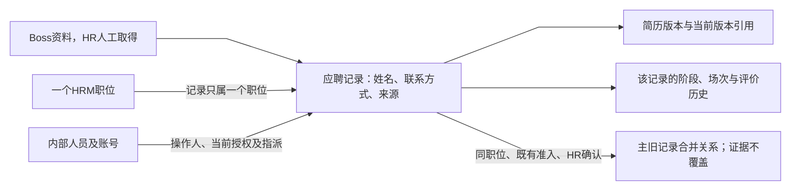

##### 5.2.5.4 录入候选人来源与凭证

<a id="source-evidence-rules"></a>

###### 内推渠道资料接收与招聘流程

来源渠道包含Boss直聘与内推。内推简历与Boss渠道沿用同一招聘主链，从HR初筛开始。

| 环节 | 内推处理规则 |
| --- | --- |
| 录入 | 只记录渠道，不记录推荐人或推荐说明。HR沿用姓名、至少一种联系方式、简历及可招聘职位等既有要求，不要求Boss外部ID／链接或缺失原因。 |
| 切换渠道 | 切换为内推隐藏并不提交Boss凭证字段；列表与详情显示真实渠道，不标记为Boss来源凭证缺失。 |
| 更正来源 | 须填写原因，保存渠道及原凭证变化的历史，保留原导入证据。 |
| HR初筛 | 录入后为待筛选，由HR初筛／资料筛选并推荐至初筛，不跳过HR筛选。 |
| 后续流程 | 当前用人负责人初筛后，沿用邀约、面试、评价与招聘决策规则。 |
| 共用门槛 | 渠道不改变初始状态、权限、判重、业务阶段、责任、待办或流程门槛。 |

**内推资料接收与沟通确认**

HR从公司认可的内部渠道接收简历，在系统外与候选人确认邀约及可入职意愿，再在HRM记录实际结果。系统不限定具体沟通工具；内推不要求Boss平台凭证，也不要求在Boss完成沟通。邀约只有实际同意才能安排面试；录用仍须满足最终评价及待决策条件，由HR确认可入职事实并二次确认。

来源渠道默认Boss直聘，可选择内推。下述外部凭证规则适用于Boss直聘；内推只记录渠道，不记录推荐人或推荐说明，不适用Boss外部凭证与缺失原因；接收及外部沟通按本节内推规则执行。外部来源凭证由HR录入：选择“外部ID”或“来源链接”并填写真实值；确实无法取得时选择“无法取得”并填写原因，允许导入，详情明确标识来源凭证缺失。系统保留原导入人、导入时间及后续来源变更审计。外部凭证须为真实ID或链接。

ID按公共单行文本、链接按公共链接校验；不自动抓取Boss，不把凭证当候选人唯一键或判重替代。已有流程也可由HR纠正／补充同一候选人真实来源，原因留历史；不得借改来源迁移流程或变更为另一候选人。不能取得真实ID／链接时填写缺失原因。

外部凭证不要求唯一；无法取得时记录原因，不生成虚构凭证。来源凭证完整性不等于候选人授权状态。

<a id="5255-联系方式填写与重复识别"></a>

##### 5.2.5.5 联系方式填写与重复识别

本期手机号、邮箱两个独立输入，各至多一个，至少填一项；标准化沿公共规范。仅比较同类字段，不将手机号和邮箱互相比较。相同标准化姓名且手机号或邮箱至少一项相同，视为强匹配；另一联系方式缺失或不同仍提示差异，但不取消强匹配。姓名不同而有联系方式相同继续由HR核实，只有姓名相同不判重。

导入提示与[同职位活动重复检查](#duplicate-admission)使用相同匹配口径；范围仍同职位、排除当前记录，导入不自动合并，活动阶段见[重复准入](#duplicate-admission)，历史期限见本节判重范围。姓名／联系方式更正提交前使用更正后值复核，冲突则拒绝更正，保留原值及活动流程。不新增“强匹配忽略继续推荐”按钮。

**匹配原因**：新增另一项联系方式不应使原有强匹配失效；同名且任一同类联系方式相同即匹配。

##### 5.2.5.6 上传简历与设置当前版本

首次上传成功后生成当前简历版本；后续每次上传一份，保存成功后自动设为当前版本。HR仍可在已保存版本列表选择当前版本并留审计，合并时仍由HR明确选择。系统版本序号、时间不替代HR的合并选择，本期不设置版本总数上限。

每个版本记录版本引用、文件名、文件类型／大小、上传人和上传时间；系统版本序号仅作显示，不作为外部简历日期。详情提供当前和历史预览入口，下载仍仅HR既有授权。切换只影响当前使用版本，不覆盖旧文件、旧评价、流程历史或既有版本引用；合并时仍由HR明确选当前版本。普通编辑不删除旧版本，失败不增加可用版本或切换引用；新增版本与自动当前引用须整体成功才生效。

##### 5.2.5.7 应聘职位不可变更与误建处理

已保存应聘记录的职位不可修改。误选且待筛选、无推荐／邀约／面试／评价历史时，HR可按场次责任与历史处理规则软删除误建记录，在正确且可招聘职位重新录入；进入流程后按既有终止规则处理需要结束的原流程，为另一个职位另建独立记录，不自动终止旧流程、不迁移阶段、面试、评价或待办。

记录建立后职位固定，与同一候选人跨职位独立应聘兼容；不是不允许同一人参加另一职位。恢复误建记录仍保留其原职位，不因另建而修改审计关系。

##### 5.2.5.8 应聘资料验收预期

| 案例 | 预期结果／对应政策 |
| --- | --- |
| HR有Boss候选人ID或资料链接 | 保存真实凭证，不用应聘编号代替 |
| 简历可取得，但HR无法取得ID或链接 | 填缺失原因可录入，详情如实标识，后续可补充 |
| 同姓名同手机，邮箱从无变有或两条邮箱不同 | 同职位强匹配；已有活动流程仍按同职位活动重复准入规则阻止重复推进 |
| 同姓名，A只有手机、B只有邮箱，无法建立同类匹配 | 不仅凭同名判重，不自动认定同人 |
| 手机相同但姓名不同 | HR核实提示，不自动认定同人或合并 |
| 后续简历上传成功 | 自动设新版本为当前，旧文件与历史引用保留 |
| 后续上传失败 | 原当前引用不变，无可用失败版本 |
| 误选职位后已推荐初筛 | 不可删、不可直接换职位；需要另一职位则另建独立记录 |

##### 5.2.5.9 简历版本信息与来源记录

| 系统字段 | 业务含义／类型与生成 | 默认、修改及展示 |
| --- | --- | --- |
| 版本引用／序号 | 每次成功新增简历产生稳定引用及显示序号 | 不由HR输入，不当作BossID或外部简历日期；旧版本引用不因当前切换改变 |
| 文件名、类型、大小 | 文件上传结果的必要元数据 | 文件校验沿公共规范；列表展示供区分，不凭同文件名覆盖 |
| 上传人、上传时间 | 系统记录本次上传实际操作者及内部时间 | 原上传证据不修改；不是候选人编辑简历时间 |
| 当前简历引用 | 首次上传或后续成功上传自动更新，HR既有手动选择／合并选择也可产生 | 始终指向本应聘记录合法版本；新版本保存失败不切换，不删旧引用及历史证据 |
| 当前来源可追溯情况 | 从当前外部凭证类型和值展示为已记录ID／链接或凭证未取得 | 不手工编辑授权状态；后续补充可更新当前展示，缺失原因历史保留 |

本期不自动核验候选人身份，不跨职位合并；来源、联系方式或简历维护不增加录用条件。

##### 5.2.5.10 候选人导入、版本与误建

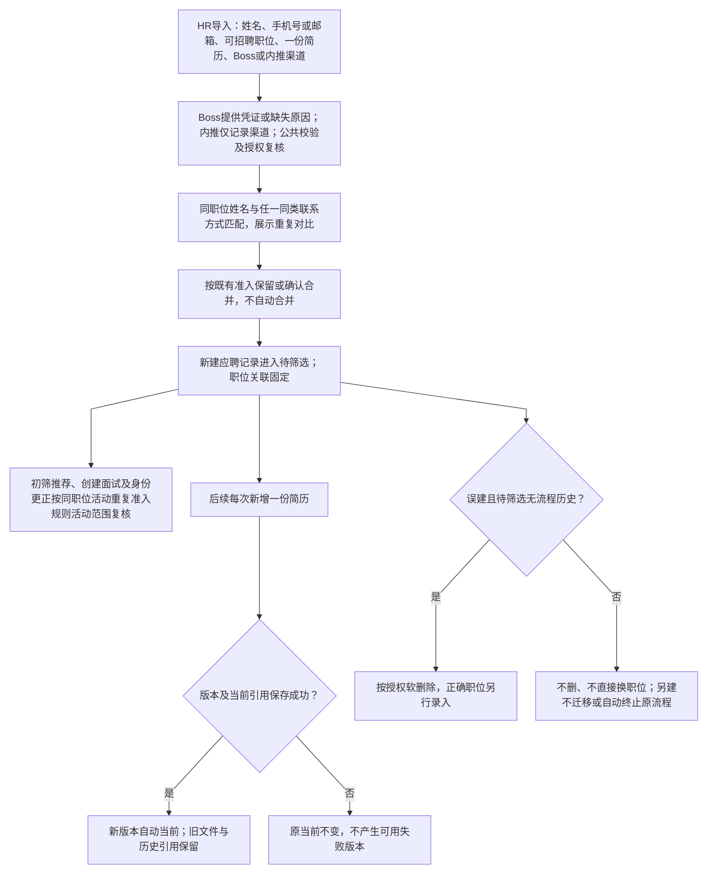

图中强匹配按联系方式强匹配规则，两条活动流程不拼接；来源缺失原因不等于外部授权状态。上传当前更新与流程历史分别保留；下载按既有HR授权。其他校验失败与过期版本拒绝引用公共规范，不把图中顺序当正式接口事务设计。

##### 5.2.5.11 异常处理与验收摘要

| 场景 | 触发、责任动作与数据去向 | 规则依据 |
| --- | --- | --- |
| 同职位重复／合并 | HR判断并确认主记录和当前简历版本，旧简历、评价和历史以合并关系保留；跨职位独立处理 | [应聘资料](#candidate-management) |
| 判重时间边界 | 未面试不应用一年期限；实际面试后以最近实际结束时间起算一年，不用计划时间替代 | [应聘资料](#candidate-management) |

### 5.3 候选人详情页：筛选与邀约

**使用者与用途**：HR检查资料、回填真实邀约，当前职位用人负责人执行初筛；减少重复推荐并区分答复与招聘阶段。

**入口**：候选人详情的初筛及邀约区。待筛选由HR推荐，初筛由当前负责人判断；每次结果记录按下方规则留痕。

筛选与邀约字段、可更正范围及拒绝／失联后再联系见[筛选与邀约字段定义](#fields-screen-invite)。邀约状态为待邀约、邀约中、同意、拒绝、失联。HRM记录HR在相应渠道的实际邀约结果；Boss渠道的沟通在Boss直聘完成，内推由HR在系统外与候选人沟通，按[内推资料接收与招聘流程](#source-evidence-rules)记录实际答复；状态变更必须填写备注。只有“同意”才能创建面试。

<a id="duplicate-admission"></a>

#### 5.3.1 筛选与面试指派边界

初筛区只执行筛选操作；面试人员指派在场次区执行。

<a id="candidate-screen-panel"></a>

#### 5.3.2 页面区域与操作载体

| 页面区域 | 展示内容 |
| --- | --- |
| 资料推荐区 | 待筛选资料及推荐记录 |
| 初筛区 | 当前结论、补充要求及历次备注、操作者和时间 |
| 邀约区 | 当前邀约结果及历次备注、操作者和时间 |
| 初筛／邀约弹窗反馈 | 保存成功关闭弹窗，刷新当前区及整体阶段；保存失败留在弹窗并保留输入 |

| 按钮名称 | 所在位置 | 操作权限 | 前置条件 | 点击行为 | 确认要求 | 成功结果 | 异常反馈 |
| --- | --- | --- | --- | --- | --- | --- | --- |
| 推荐至初筛 | 候选人详情页／资料推荐区 | 具备资料推荐权限的用户 | 目标在该权限配置范围内；候选人为待筛选，已检查应聘资料 | 打开资料推荐确认弹窗 | 确认推荐至当前职位用人负责人初筛 | 成功显示初筛及责任人 | 非待筛选不重复推荐，不产生重复待办 |
| 推荐 | 候选人详情页／初筛结果弹窗 | 具备负责人初筛权限的用户且为当前职位用人负责人 | 目标在该权限配置范围内；候选人为初筛；备注必填；检查同职位强匹配活动记录（待邀约／面试中／待决策） | 在初筛结果弹窗选择推荐结论并填写备注 | 无需额外确认 | 通过重复准入后进入待邀约 | 重复活动记录时保持初筛，提示实际阶段，原记录入口按授权显示 |
| 不推荐 | 候选人详情页／初筛结果弹窗 | 具备负责人初筛权限的用户且为当前职位用人负责人 | 目标在该权限配置范围内；候选人为初筛；结论及备注必填 | 在初筛结果弹窗选择不推荐并填写备注 | 无需额外确认 | 候选人进入淘汰 | 非初筛不执行，已终止不重复推进 |
| 待补充 | 候选人详情页／初筛结果弹窗 | 具备负责人初筛权限的用户且为当前职位用人负责人 | 目标在该权限配置范围内；候选人为初筛；结论及具体补充要求必填 | 在初筛结果弹窗选择待补充并填写具体要求 | 无需额外确认 | 保持初筛，展示补充要求 | 不进入待邀约，不生成下游待办 |
| 记录邀约结果 | 候选人详情页／邀约区 | 具备邀约记录权限的用户 | 目标在该权限配置范围内；待邀约或面试中的候选人可记录／更正外部邀约事实，状态及备注必填；终止后仅追加历史说明 | 打开邀约状态及备注弹窗，记录实际外部联系结果 | 无需额外确认 | 保存本次结果及历史；最新同意才允许创建新／替代场次；拒绝或失联可再联系，不自动放弃 | 再联系／纠错留历史，已创建场次不随邀约更正自动取消或回退；终止仅追加说明 |
| 更正邀约结果 | 候选人详情页／邀约区 | 具备邀约记录权限的用户 | 目标在该权限配置范围内；待邀约或面试中的候选人可记录／更正外部邀约事实，状态及备注必填；终止后仅追加历史说明 | 打开邀约状态及备注弹窗，回填现值并填写纠错说明 | 无需额外确认 | 保存本次结果及历史；最新同意才允许创建新／替代场次；拒绝或失联可再联系，不自动放弃 | 再联系／纠错留历史，已创建场次不随邀约更正自动取消或回退；终止仅追加说明 |
| 取消 | 候选人详情页／初筛／邀约弹窗底部 | 当前弹窗用户 | 无额外业务条件 | 关闭当前表单，按其返回规则处理未保存内容 | 无需额外确认 | 关闭弹窗，返回原区，不保存 | — |
| 淘汰 | 候选人详情页／业务摘要终止区 | 具备人工淘汰权限的用户 | 目标在该权限配置范围内；满足当前阶段的人工淘汰资格；流程未终止 | 打开人工淘汰确认弹窗 | 确认目标、原因及不可恢复后果 | 进入淘汰，停止后续活动任务 | 无环节资格隐藏；有效评价不通过已自动淘汰时不重复提交 |
| 候选人放弃 | 候选人详情页／业务摘要终止区 | 具备候选人放弃权限的用户 | 目标在该权限配置范围内；当前招聘环节授权人；流程未终止 | 打开候选人放弃确认弹窗 | 确认目标、原因及不可恢复后果 | 进入候选人放弃，停止后续活动任务 | 无环节资格隐藏；已终止不恢复或推进 |

#### 5.3.3 初筛推荐的活动重复准入

用人负责人从初筛推荐进入待邀约前，服务端检查同职位其他有效应聘记录：标准化姓名相同且任一同类联系方式相同，且已有记录处于待邀约、面试中或待决策时，拒绝推荐。排除自身；待筛选／初筛不占用准入位置，终止记录不按进行中拦截；跨职位仍独立。活动流程检查不使用一年期限，历史判重仍按[联系方式与判重期限](#5251-候选人和简历)执行。

被拒绝记录保持初筛，不生成邀约、面试或下游待办，不变更原流程。提示已有流程当前阶段，只有确有面试安排才写“已安排面试”，原记录入口按当前权限开放。同时推荐最多一条成功；创建面试及修改姓名／联系方式时也检查该活动重复条件。

<a id="fields-screen-invite"></a>

#### 5.3.4 筛选与邀约字段

- **共性**：字段长度、字典、时区、并发和错误反馈引用[公共字段规范](公共规范/字段与表单校验规范.md)，权限／历史引用[公共治理规范](公共规范/权限与数据治理规范.md)。

##### 5.3.4.1 字段

| 字段名称 | 业务含义 | 数据类型 | 控件类型 | 取值来源 | 默认值 | 必填条件 | 校验规则 | 修改与历史 |
| --- | --- | --- | --- | --- | --- | --- | --- | --- |
| 资料推荐记录 | HR资料检查后推荐事实 | 事件关联 | 只读 | 推荐至初筛成功事件 | 推荐前无 | 成功后生成 | 仅待筛选可推荐，无自动推荐 | 记录实际HR及时间，不撤回待筛选 |
| 初筛结果 | 负责人判断 | 字典关联 | 单选下拉框 | 推荐结果字典：推荐、不推荐、待补充 | 无 | 初筛提交是 | 推荐复核同职位活动强匹配；不推荐淘汰，待补充保持初筛 | 追加历次记录；推进后不改结论反向重放 |
| 初筛备注 | 判断依据或待补项 | 备注 | 多行文本框 | 当前用人负责人输入 | 无 | 每次提交是 | 待补充须具体说明；公共备注长度 | 保留历次判断，不覆盖旧记录 |
| 初筛操作人／时间 | 实际判断证据 | 人员关联／日期时间 | 只读 | 系统成功事件 | 无 | 成功后生成 | 不手填 | 接任不改作者，新负责人可继续处理 |
| 邀约状态 | 外部沟通实际结果 | 枚举 | 单选下拉框 | 待邀约、邀约中、同意、拒绝、失联 | 进入待邀约时为待邀约 | 变更是 | 仅最新同意允许新建／替代面试；可直接记录同意 | 更正保留原值；已建场次不随更正取消 |
| 邀约备注 | 实际联系结果或纠错依据 | 备注 | 多行文本框 | HR输入 | 无 | 每次状态变更是 | 公共备注校验 | 保存旧新状态及备注，不新增候选人授权字段 |
| 邀约操作人／记录时间 | HR记录证据 | 人员关联／日期时间 | 只读 | 系统成功事件 | 无 | 成功后生成 | 不是外部答复时刻，不提供手填平台答复时间 | 原事件保留 |
| 当前有效记录及历史引用 | 当前初筛或邀约事实关联 | 事件关联 | 只读 | 最新成功事件及历史 | 无 | 成功后生成 | 状态与备注整体成功才生效 | 失败不产生有效事件；重试不重复阶段或待办 |

##### 5.3.4.2 动作与状态矩阵

| 当前事实 | 授权动作 | 结果及异常 |
| --- | --- | --- |
| 待筛选 | HR推荐 | 进入初筛，指向当前用人负责人；失效负责人显示待配置，不把HR当初筛责任人 |
| 初筛待补充 | 当前用人负责人再次判断 | 追加记录，仍可待补充或推荐／不推荐；资料补充由HR既有资料维护权处理，不新增退回阶段 |
| 初筛推荐但有同职位强匹配活动记录 | 拒绝本次推荐 | 保持初筛，不创建邀约与待办，不通过改备注绕过 |
| 邀约待邀约／邀约中 | HR回填实际结果 | 可直接记录同意／拒绝／失联，允许不经过邀约中；每次变更有备注 |
| 邀约拒绝／失联但候选人未终止 | HR再次联系 | 可记录邀约中或同意，保留前次历史；不按时钟自动终止 |
| 尚未创建场次且结果录错 | HR纠错 | 可把当前邀约状态更正为五种之一，备注说明，留旧新值；候选人阶段不回退 |
| 已创建场次后发现邀约记录错误 | HR纠正外部事实 | 只改邀约历史／当前结果，不取消场次、抹去实际面试或回退面试中；需要取消／放弃走独立合法动作；最新结果不是同意则不能创建新或替代场次 |
| 候选人已录用／淘汰／放弃 | 授权HR更正历史备注 | 仅追加说明，不重新打开邀约或恢复流程；已推进初筛结论同样不能改结论反向重放 |

状态重复保存不新建处理事件；确需补充同状态说明可追加备注历史，不重复阶段和任务。初筛推进后原结论为历史证据，当前负责人可追加纠错说明，不能借更正撤销阶段；候选人身份、资料及评价修改分别走原权限。

##### 5.3.4.3 筛选与邀约记录展示

候选人详情分别显示当前结果和历次记录。初筛待补充显示具体要求与当前用人负责人；邀约拒绝／失联保留前次结果，HR可再次联系，不显示自动放弃倒计时。

#### 5.3.5 初筛推荐失败：已有进行中的应聘记录

入口：当前职位用人负责人在初筛提交推荐。服务端先校验完整授权，再检查同职位其他强匹配活动记录。

| 情况 | 提示与后续 |
| --- | --- |
| 原记录待邀约 | “该候选人在当前职位已有进行中的招聘流程（当前阶段：待邀约），请勿重复推荐” |
| 原记录已安排面试 | “该候选人在当前职位已有进行中的招聘流程，已安排面试，请勿重复推荐” |
| 原记录待决策 | 展示正在招聘处理中及实际待决策阶段，不用“已安排面试”代替当前阶段 |
| 可以查看原记录 | 提供原记录入口；跳转仍校验当前权限 |
| 本次被拒绝 | 保持初筛，不生成邀约、面试或下游待办，不改变原记录；原因反馈及合法输入保留遵循公共规范 |

并发推荐最多一条成功；重复记录不自动合并，也不提供“忽略警告继续推荐”的绕过入口。

<a id="536-邀约再联系记录纠错与场次事实"></a>

#### 5.3.6 邀约再联系、记录纠错与场次事实

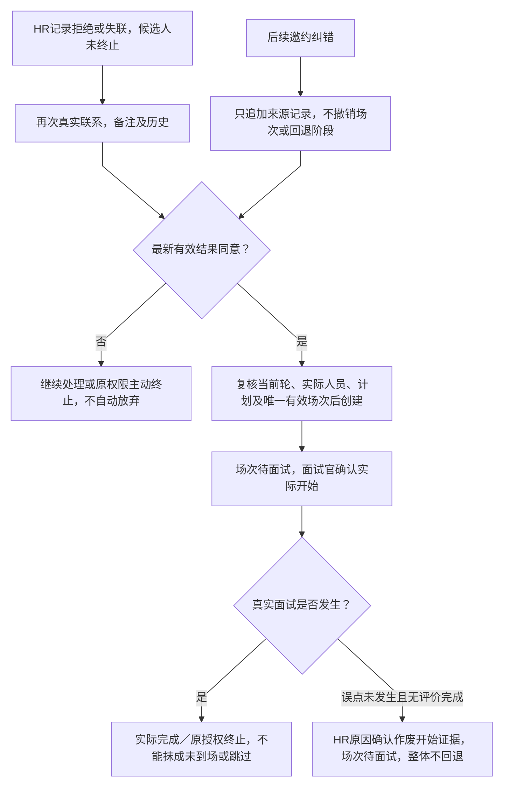

最新非同意阻断新或替代场次，不撤销历史实际事实；漏点开始不阻断既有评价／完成，补录与原操作者分别保留。开始时钟不自动推断真实发生。

#### 5.3.7 异常处理与验收摘要

| 场景 | 触发、责任动作与数据去向 | 规则依据 |
| --- | --- | --- |
| 初筛重复推荐拦截 | 服务端检查同职位待邀约／面试中／待决策强匹配记录，有则保持初筛；同时推荐最多一条成功 | [初筛重复准入](#duplicate-admission) |
| 初筛待补充／不推荐 | 用人负责人待补充时停留初筛；不通过进入淘汰，保留结果和原因 | [阶段流转](#stages) |
| 邀约拒绝／失联 | HR记录结果与备注，不允许创建面试；只有当前环节授权责任人主动终止才改变候选人终止状态 | [阶段流转](#stages) |

### 5.4 面试流程配置页与候选人详情场次区

**使用者与用途**：HR维护计划与非评价事实，负责人配置模板并指派实际人员，实际面试官记录发生与结束；计划、实际事实和评价分别保存。

**入口**：职位面试流程配置、候选人详情当前轮及场次卡片。新场次需最新邀约同意，首次安排保存完整流程快照；终面须明确完成责任人。

- 面试由 HR成员创建，用人负责人指定本轮面试官。
- 面试轮次按首次安排时选择的招聘角色和面试职级匹配完整流程，后续沿用快照；招聘角色和面试职级不是职位必填字段。
- 面试模板由职位用人负责人维护负责职位、HR维护全公司职位；轮次包含名称、顺序、角色/职级、默认时长、评价模板和是否必经。
- 首次安排面试时必须选择招聘角色和面试职级，后续仅选择流程快照中的轮次；系统保存匹配模板、评价模板和关键配置快照，后续模板修改不改变已创建面试的历史。
- 单个职位允许按业务规则调整轮次，但不能移除职级必经环节；P4及以上标准流程为四环节，符合 一面跳过规则 时可跳过一面，CTO正常参加时保留该轮；负责人可按[评价结果与最终评价轮](#evaluation-progression)确认其不参与。面试官按轮次指定，可以一次指定多人，也可以临时更换。
- 最后一轮业务面试（不含 HR沟通）可以指定多名面试官，但必须指定一名终面完成责任面试官；只有该面试官可以点击“完成面试”，并作为该场终面负责人维护完成后的面试结果。
- 改期只更新 HRM 中的面试时间；面试官更换只更新面试官；一期不与飞书日历同步。
- 终面面试官在面试实际发生后点击“完成面试”；计划时间经过或打开页面不能自动完成面试。

面试记录区分“待面试、面试进行中、已完成、公司取消、候选人取消、未到场”等状态或结果。候选人整体“面试中”表示进入面试流程，单场是否实际发生按下表判断。

| 情况／动作 | 结果及约束 |
| --- | --- |
| HR记录同意并创建场次 | 场次初始为待面试；当前实际指派面试官点击开始后，才变为面试进行中并记录实际开始，预约时刻不自动开始。授权与异常边界见[单场面试实际开始](#548-单场面试实际开始)。 |
| 终面完成 | 终面面试官点击“完成面试”后才算实际完成，记录操作人、实际完成时间和面试结果。 |
| 完成后纠错 | HR成员或该场面试负责人可修改非评价面试结果；记录前后值、操作人、时间和原因。 |
| 公司取消 | 保留候选人面试中阶段并记录公司取消原因；HR可基于原邀约直接创建同轮次替代面试，不重新发起邀约。 |
| 候选人取消／未到场 | 分别记录原因和备注，也可创建同轮次替代面试。 |
| 主动放弃 | 公司取消、候选人取消、未到场、拒绝和失联均可作为“候选人放弃”原因；当前招聘环节责任人员可主动点击按钮变更，不设置自动时限。 |
| 替代场次 | 视为新的实际面试，创建新记录并关联原面试，重新指派、完成和评价；旧场次评价不能满足新场次门槛，也不能覆盖原面试证据。 |

<a id="fields-session"></a>

#### 5.4.1 场次区的职责分工

HR维护计划、取消／未到场和非评价事实；当前职位用人负责人负责实际参与人指派及交接；本场有效实际面试官确认实际开始、完成和本人评价，终面完成由指定责任人执行。

<a id="candidate-session-panel"></a>

#### 5.4.2 候选人详情页：场次区

HR先确定候选人及计划时间并保存场次，首次保存形成完整流程快照；随后由职位已有用人负责人在本场“指派”中安排面试官。未落实人员时，本场仍为待面试，另显示“待指派”提示；不另建场次状态或增加通知周期。后续轮及替代场次采用同一安排顺序，合法人员兜底和历史责任交接沿既有规则。

| 区域／弹窗 | 展示与输入 |
| --- | --- |
| 当前轮区 | 按流程快照显示轮次、计划开始／时长／结束、会议链接、实际人员及终面完成责任人 |
| 场次卡片 | 状态、实际开始／完成、操作者、缺评价及替代关系；取消、未到场和历史场次保留原事实 |
| 安排／替代安排弹窗 | 带入应聘记录；首次选择岗位分类和具体职级，后续使用快照当前轮；计划开始、时长必填，计划结束只读，会议链接可选；可先保存无实际人员的场次，沿用职位用人负责人，由其随后指派；HR不在安排中选择或修改面试官 |
| 指派／换人、改期、取消／未到场、补录／更正 | 表单弹窗，填写变更内容及适用原因 |
| 开始、完成、跳过 | 确认弹窗；时钟不自动开始或完成 |
| 表单弹窗反馈 | 保存成功关闭并刷新场次、当前轮及阶段；失败保留输入；取消返回原卡片，不改变状态 |
| 非当前轮／终止记录 | 未来轮和历史轮按对应操作资格展示；已终止记录不提供推进按钮，终止后的既有事实补录仅按HR授权保留历史 |

| 按钮名称 | 所在位置 | 操作权限 | 前置条件 | 点击行为 | 确认要求 | 成功结果 | 异常反馈 |
| --- | --- | --- | --- | --- | --- | --- | --- |
| 安排面试 | 候选人详情页／当前场次卡片 | 具备面试安排权限的用户 | 目标在该权限配置范围内；候选人未终止，最新邀约结果为同意，通过同职位活动重复检查；首次选择完整流程，后续选择快照中的当前轮；不要求先完成实际人员指派 | 打开当前轮场次安排弹窗 | 无需额外确认 | 保存场次，整体进入面试中、本场待面试；首次生成完整快照，后续沿用；未指派显示“待指派”，由职位已有用人负责人处理 | 邀约未同意、重复准入不满足时拒绝，无下游记录；计划开始／时长必填、会议链接可选；未指派不阻止保存安排，但不能开始／完成面试 |
| 指派 | 候选人详情页／当前场次卡片 | 具备面试官指派权限的用户且为当前职位用人负责人 | 目标在该权限配置范围内；本人负责职位的当前场次；新人员启用且满足面试参与资格 | 打开当前场次的实际人员选择弹窗 | 选择本场实际参与人；终面明确完成责任人 | 保存有效实际指派，刷新场次；人员有效且终面完成责任明确后解除对应待指派提示 | 候选名单不等于实际指派；人员资格不符合拒绝；缺少该权限或负责人指派不可操作 |
| 换人 | 候选人详情页／当前场次卡片 | 具备面试官指派权限的用户且为当前职位用人负责人 | 目标在该权限配置范围内；本人负责职位的当前场次；接任人员启用且满足面试参与资格 | 打开原、新实际人员及评价责任交接弹窗 | 展示原、新人员及评价责任交接影响后确认 | 已交评价及原作者保留；未交责任交接 | 不生成双重评价，不重置原任务起点；缺少该权限或负责人指派不可操作 |
| 改期 | 候选人详情页／当前场次卡片 | 具备面试改期权限的用户 | 目标在该权限配置范围内；当前待面试且尚未实际发生 | 打开计划时间、时长及原因编辑弹窗，填写新时间及原因 | 无需额外二次确认 | 更新计划，保留原值及历史，刷新原场次 | 已实际发生不可改预约覆盖；不覆盖评价 |
| 取消 | 候选人详情页／当前场次卡片 | 具备面试取消权限的用户 | 目标在该权限配置范围内；当前待面试且尚未实际发生 | 打开公司／候选人取消原因弹窗 | 确认目标及公司／候选人取消原因 | 保存取消结果及历史，刷新原场次 | 实际已发生不能改为取消；不自动转为候选人放弃 |
| 记录未到场 | 候选人详情页／当前场次卡片 | 具备面试未到场记录权限的用户 | 目标在该权限配置范围内；当前待面试且尚未实际发生 | 打开本场未到场原因记录弹窗 | 确认目标并填写未到场原因 | 保存未到场及历史，刷新原场次 | 实际已发生不能改为未到场；不自动转为候选人放弃 |
| 创建替代面试 | 候选人详情页／当前场次卡片 | 具备面试安排权限的用户 | 目标在该权限配置范围内；原场次已取消或未到场，候选人未终止，最新邀约为同意；同轮无其他当前有效场次 | 打开关联原场次的同轮新安排弹窗 | 无需额外确认 | 新场次关联原场次，重新指派及评价 | 不能复用原评价作为新场次通过依据；同轮当前有效场次不重复建替代 |
| 开始面试 | 候选人详情页／当前场次卡片 | 具备面试开始权限的用户且满足本场有效实际指派条件 | 目标在该权限配置范围内；当前场次待面试且候选人流程未终止，有效实际人员已落实；终面已明确完成责任人 | 打开实际开始确认弹窗 | 确认已实际开始，保存首次时间／操作者 | 场次面试进行中，整体面试中不变 | HR或负责人无实际指派隐藏；非当前轮、取消／未到场／已完成／已跳过不可开始；预约时刻不触发，多人／重试不覆盖首次记录 |
| 完成面试 | 候选人详情页／当前场次卡片 | 具备面试完成权限的用户且满足本场有效实际指派条件 | 目标在该权限配置范围内；当前有效实际指派人员可完成非终面；终面仅指定的完成责任人可操作；面试已实际发生，记录完成不要求评价先齐全 | 打开实际发生及完成确认弹窗 | 确认本场面试已实际发生及完成 | 记录本场实际完成；非终面有通过且无待定／不通过时激活下一轮，缺交保留；最终实际轮须有效评价齐全且通过才进入待决策 | 未指定终面完成责任人不可执行；评价未齐不阻止记录实际完成，但不得流转待决策 |
| 补录开始 | 候选人详情页／当前场次卡片 | 具备面试开始补录或本人场次开始补录权限的用户 | 目标在该权限配置范围内；面试开始补录权限在配置范围内，或本人场次开始补录权限且为当前有效参与人；终止历史不允许仅凭本人场次权限操作 | 打开真实开始时间及原因输入弹窗 | 填写真实开始时间及原因，时间不晚于当前及已有完成时间 | 保存实际开始事实及补录人／时间，保留原日志 | 不冒用原始操作人，不以预约时间补造；不恢复终止流程 |
| 更正开始 | 候选人详情页／当前场次卡片 | 具备面试开始补录或本人场次开始补录权限的用户 | 目标在该权限配置范围内；面试开始补录权限在配置范围内，或本人场次开始补录权限且为当前有效参与人；终止历史不允许仅凭本人场次权限操作 | 打开实际开始原值、新值及原因弹窗 | 展示原、新事实并填写原因，时间满足真实发生及完成顺序 | 保留原首次证据及更正历史 | 已实际发生不能清成未到场；越权或过期版本拒绝 |
| 作废误点 | 候选人详情页／当前场次卡片 | 具备面试误点作废权限的用户 | 目标在该权限配置范围内；确认实际未发生且无评价／完成 | 打开原始开始证据及作废原因确认弹窗 | 展示原始开始及原因，确认作废影响 | 保留原日志和作废证据 | 已发生、有评价或完成时不可作废；不恢复终止流程 |
| 跳过 | 候选人详情页／当前场次卡片 | 具备面试跳过权限的用户且满足本场有效实际指派条件 | 目标在该权限配置范围内；目标为当前尚未实际发生的非终面轮次；填写原因；终面和CTO面不提供普通跳过 | 打开跳过原因及下一轮确认弹窗 | 确认跳过原因和下一轮 | 保留轮次、快照及原因，标记已跳过并激活下一轮待安排，不生成本轮评价／缺交任务 | 终面、CTO面不向普通面试官提供跳过；非当前轮无操作入口；实际发生后不跳过 |
| 修改面试结果 | 候选人详情页／当前场次卡片 | 具备面试结果纠错或本人负责场次结果纠错权限的用户 | 目标在该权限配置范围内；场次已完成，仅维护非评价结果 | 打开已完成场次的非评价结果编辑弹窗 | 展示原值，填写修改内容及原因 | 保存前后值，刷新本场结果历史 | 不提供评价编辑或重新完成入口；结果纠错不恢复终止流程、不绕过终面评价门槛 |

#### 5.4.3 模板与面试场次字段

- **共性**：格式、长度、时间、附件、字典及并发引用[公共字段规范](公共规范/字段与表单校验规范.md)，授权和审计引用[公共治理规范](公共规范/权限与数据治理规范.md)。

##### 5.4.3.1 模板与快照字段

| 字段名称 | 业务含义 | 数据类型 | 控件类型 | 取值来源 | 默认值 | 必填条件 | 校验规则 | 修改与历史 |
| --- | --- | --- | --- | --- | --- | --- | --- | --- |
| 模板名称 | 流程识别名称 | 文本 | 文本输入框 | 配置人输入 | 无 | 是 | 公共单行文本 | HR全公司、负责人负责职位维护，留历史 |
| 所属职位 | 模板适用职位 | 职位关联 | 只读 | 配置入口当前职位 | 带入当前职位 | 是 | 复核当前职位授权 | 不跨职位移动模板 |
| 招聘角色 | 岗位分类 | 字典关联 | 单选下拉框 | 招聘角色字典 | 无 | 是 | 使用启用值；与账号权限角色无关 | 每职位每分类及职级组一个有效模板 |
| 职级组 | 完整流程适用组 | 职级分组 | 单选下拉框 | P2／P3-1、P3-2／P3-3、P4／P5 | 无 | 是 | 未知职级不得自动套模板 | 首次安排仍保存具体职级；旧版本保留 |
| 轮次名称 | 业务轮显示名称 | 文本 | 文本输入框 | 配置人输入，初始按默认流程 | 默认流程轮次名称 | 是 | 公共单行文本 | 使用后修改模板不改原候选人快照 |
| 轮次序号 | 执行顺序 | 正整数 | 数字输入框 | 配置人输入 | 默认流程顺序 | 是 | 1—99，同模板唯一；不移除必经环节 | 流程按序，不重编号已发生轮次 |
| 环节类型 | 是否需要面试评价 | 枚举 | 单选下拉框 | 业务面试、HR沟通 | 默认流程对应类型 | 是 | HR沟通不是业务终面 | 模板变更只影响新流程 |
| 是否终面 | 最后业务轮标记 | 布尔 | 开关 | 默认流程及配置人选择 | 默认流程终面 | 业务轮是 | 恰好一个终面且为最后业务轮 | CTO不参与是候选人级例外，不删除模板节点 |
| 可跳过 | 本轮普通跳过资格 | 布尔 | 开关 | 默认流程及业务约束 | 按默认流程 | 业务轮是 | 终面、CTO普通面试官不得跳过 | 不扩大实际指派权限 |
| 默认时长 | 业务轮计划时长 | 正整数分钟 | 数字输入框 | 默认流程及配置人输入 | 默认流程对应分钟数 | 业务轮是 | 1—1,440分钟，HR沟通默认30分钟 | 快照保留原配置版本 |
| 评价模板引用 | 本轮文字评价配置 | 模板关联 | 单选下拉框 | 默认基础／复核／核心／综合／深度／战略评价配置 | 对应轮次模板 | 业务轮是，HR沟通不适用 | 各轮采用同一七项文字维度 | 引用配置版本，无自动重新匹配 |
| 本轮可选人员 | 配置候选名单 | 人员集合 | 可搜索多选框 | 启用账号且满足面试参与资格的内部人员 | 无 | 可为空但警告 | 空名单按人员缺失处理；名单不产生实际指派或访问权 | 只作用于新流程，不改现有实际人员 |
| 模板版本／完整流程快照 | 历史配置依据 | 版本及快照 | 只读 | 系统保存及首次安排成功事件 | 无 | 成功后生成 | 首次保存完整流程，后续使用同快照 | 原快照不可改写；跳过、CTO不参与及换人追加变化证据 |

##### 5.4.3.2 场次计划与实际字段

| 字段名称 | 业务含义 | 数据类型 | 控件类型 | 取值来源 | 默认值 | 必填条件 | 校验规则 | 修改与历史 |
| --- | --- | --- | --- | --- | --- | --- | --- | --- |
| 应聘记录 | 本次安排对象 | 应聘关联 | 只读 | 候选人详情当前记录 | 带入当前记录 | 是 | 不能换候选人或职位 | 误建未发生场次取消处理 |
| 招聘角色／具体职级 | 首次模板匹配依据 | 字典关联 | 单选下拉框 | 启用招聘角色及P2、P3-1、P3-2、P3-3、P4、P5 | 无 | 首次安排是 | 须匹配完整模板，未知职级不能静默套用 | 保存后固定，不因建议职级改变 |
| 快照轮次 | 当前业务节点 | 轮次关联 | 只读 | 首次匹配流程或现有快照当前轮 | 带入当前轮 | 是 | 只能安排当前轮 | 不得每轮重新匹配模板 |
| 计划开始时间 | 预约开始 | 日期时间 | 日期时间选择器 | HR输入 | 无 | 是 | 新安排不得早于提交时刻 | 待面试可改期，原因必填，旧值留历史 |
| 计划时长 | 预约分钟数 | 正整数分钟 | 数字输入框 | 当前轮快照默认时长及HR调整 | 当前轮默认时长 | 是 | 1—1,440分钟 | 待面试调整需原因，不推算实际时长 |
| 计划结束时间 | 预约结束 | 日期时间 | 只读 | 计划开始加时长 | 系统计算 | 安排成功后生成 | 跨日使用公共业务时区 | 改计划重算，不改变实际时间 |
| 会议链接 | 面试入口 | 链接 | 链接输入框 | HR输入 | 无 | 否 | 公共链接校验；无链接仍可安排 | 待面试可更正，需原因；非飞书日历同步 |
| 实际参与人 | 本场实际评价责任基础 | 人员集合 | 安排时只读；指派弹窗可搜索多选框 | 负责人保存的有效实际指派及合法兜底来源 | 不从候选名单自动授权 | 开始／完成需要有效人员 | 新指派账号启用且满足面试参与资格；创建安排可为空，未指派显示待指派并由职位已有用人负责人从场次卡片指派 | HR安排不直接换人；已交保留，未交责任交接 |
| 终面完成责任人 | 终面唯一完成人 | 人员关联 | 从实际参与人单选 | 本场有效实际参与人 | 无；单人兜底由该人承担 | 终面开始前是 | 安排可先保存，开始前须明确责任人；多人兜底须HR或负责人明确一名；非终面不增独占责任 | 保留完成及交接证据，具体资格依人员缺失处理 |
| 场次状态／结果 | 实际发生和异常结果 | 枚举 | 只读 | 开始、完成、取消、未到场等授权动作 | 待面试 | 成功创建后生成 | 不提供自由状态下拉；不按时钟开始或完成 | 各动作追加历史 |
| 实际开始时间／操作人 | 首次确认实际开始证据 | 日期时间／人员关联 | 只读；补录及更正弹窗输入时间 | 开始成功事件或授权事实补录 | 无 | 开始成功后生成；漏点可空 | 补录不晚于当前及已有完成时刻，原因必填 | 原首次证据及补录／更正／作废历史保留，不用预约补造 |
| 实际完成时间／完成人 | 实际完成确认依据 | 日期时间／人员关联 | 只读 | 有效实际参与人完成操作；终面仅指定责任人 | 无 | 完成后生成 | 漏点开始不阻断合法完成 | 原完成证据不可覆盖，不以改时间重放流转 |
| 结果备注／异常原因 | 本次操作依据 | 备注 | 多行文本框 | 有权操作人输入 | 无 | 取消、未到场、改期、跳过、补录及更正是 | 普通完成可选；公共备注校验 | 与候选人放弃原因分开，不自动终止候选人 |
| 原场次／替代关系 | 同轮新安排来源 | 场次关联 | 只读 | 创建替代面试入口原场次 | 带入原场次 | 替代是 | 同候选人同快照同轮，原已取消或未到场；同轮无其他有效场次 | 新场重新时间、人员及评价，原记录不覆盖 |
| 创建人／时间、变更版本 | 安排及后续变更证据 | 人员／日期时间／版本 | 只读 | 系统成功事件 | 无 | 成功后生成 | 公共并发及重试要求 | 改期换人不重置历史；替代有独立引用 |

当前轮同一候选人只有一个有效待面试／进行中场次；原场次取消或未到场后才可替代，不把已完成有效场次再创建替代以绕过评价。补排历史已发生面试不通过“过去时间创建新预约”冒充正常安排，本期不新增历史批量导入。

<a id="5433-开始后与漏点开始的处理"></a>

##### 5.4.3.3 开始后与漏点开始的处理

| 情况 | 明确处理 |
| --- | --- |
| 待面试改期 | HR更改计划开始／时长，填写原因；已有指派及候选人阶段不变，新计划不得早于提交时刻 |
| 已进行中或已完成改期 | 不改本场预约来覆盖已发生事实；开始误操作先按下一行纠错，真实中断按结果备注与合法完成／终止处理，不新增暂停／恢复状态 |
| 开始误点，但实际未发生 | HR核实并填写原因，追加“开始记录作废”证据，原开始日志不删，本场回到待面试；这是场次事实纠错，不回退候选人阶段；已有评价或完成证据时禁止作废开始 |
| 漏点开始 | 不阻断既有本人评价／授权完成。HR或该场当前有效实际参与人可补录真实开始时间，原因必填；时间不晚于当前且有完成时不晚于实际完成。补录人／录入时间与实际开始分别展示，不能冒用原始开始操作人 |
| 更正开始时间 | HR或该场当前有效实际参与人填写原因追加更正；不得晚于当前／已有完成时刻。原值及原操作证据保留，不回退阶段、不重算提醒或评价截止 |
| 取消／未到场 | HR只能对尚未实际发生的待面试场次记录。已开始但未发生先纠错；实际已发生则完成或按当前环节合法终止，不能将事实抹成未到场 |
| 跳过 | 当前非终面实际面试官操作，只限未实际发生且无评价／完成证据；进行中不能当未发生跳过；误点先合法纠错，不绕过终面／CTO限制 |
| 替代 | 沿原同意邀约创建新当前场次，旧取消／未到场证据保留；不复用旧评价，新场重新完成与评价 |
| 终止或资格失效 | 停止当前业务执行，证据保留；历史开始补录／纠错仅HR非评价资料维护，不能重新激活流程；已解除参与人无原关系编辑权 |

漏点“开始面试”不阻止实际发生后的合法评价或完成。实际发生与否由有权操作人确认，系统不从时钟推断，也不自动核验线下面试真实性。

##### 5.4.3.4 场次事实与纠错展示

当前场次卡片分别展示计划时间与实际时间，标明原开始记录、补录时间及录入人、更正或作废原因；终面完成责任人单独突出。已终止记录的历史维护仅按HR非评价资料权限开放，不显示恢复面试流程的按钮。

#### 5.4.4 默认面试流程模板

本期提供默认流程与文字评价配置，复杂题库、加权评分和共享模板管理不纳入本期。

| 职级组 | 第1轮 | 第2轮 | 第3轮 | 后续沟通 |
| --- | --- | --- | --- | --- |
| P2／P3-1 | 业务一面，45分钟，基础评价，可跳过 | 主面试官二面，45分钟，复核评价，终面不可跳过 | 无 | HR沟通，30分钟，只记录结果 |
| P3-2／P3-3 | 主面试官一面，60分钟，核心能力评价，可跳过 | 负责人二面，45分钟，综合评价，终面不可跳过 | 无 | HR沟通，30分钟，只记录结果 |
| P4／P5 | 高级开发一面，60分钟，深度评价，可跳过 | 负责人二面，45分钟，综合评价，非终面可跳过 | CTO三面，45分钟，战略评价；普通面试官不可跳过，负责人可配置不参与例外 | HR沟通，30分钟，只记录结果 |

时长为默认值，可在公共范围内调整。模板中的三类职责是选人要求，不生成新的账号角色。未覆盖职级一期不能自动套用模板，须先配置完整流程。

<a id="545-面试流程配置页"></a>

#### 5.4.5 面试流程配置页

| 页面项 | 内容 |
| --- | --- |
| 入口 | 职位详情页“面试流程配置” |
| 展示与编辑 | 当前职位、岗位分类／职级组对应的模板及版本；选择模板编辑，新增模板在本页输入区域完成 |
| 版本使用 | 每职位每岗位分类／职级组一个有效版本；首次安排保存完整快照，后续场次沿用快照；模板修改只影响后续新流程 |

| 按钮名称 | 所在位置 | 操作权限 | 前置条件 | 点击行为 | 确认要求 | 成功结果 | 异常反馈 |
| --- | --- | --- | --- | --- | --- | --- | --- |
| 保存 | 面试流程配置页底部 | 具备面试流程配置权限的用户 | 目标在该权限配置范围内；目标职位处于面试流程配置权限范围内；岗位分类和职级组、轮次与默认时长等必填配置完整 | 展示完整流程预览，确认后保存模板 | 确认完整流程预览 | 保存成功刷新模板版本，留在配置页 | 保存失败保留输入；候选人员名单不自动产生面试授权 |
| 取消 | 面试流程配置页底部 | 当前页用户 | 无额外业务条件 | 关闭当前表单，按其返回规则处理未保存内容 | 未保存内容按公共离开规则确认 | 返回原职位详情页 | 选择继续编辑则留在配置页，不保存 |

配置页使用模板字段；场次实际参与人和终面完成责任人在候选人详情场次区维护，不作为模板的固定实际人员。

实际人员变更保留前后指派及责任交接：已交评价保留，未交责任转给接任人，新人不继承原人的评价身份。

<a id="546-当前轮次交互"></a>

#### 5.4.6 当前轮次交互

候选人详情提供：轮次时间线、当前轮操作区、逐轮人员及评价列表、HR沟通记录、历史快照。历史快照按当前授权展示：HR成员查看全公司招聘范围，当前职位用人负责人查看本人负责职位；原参与人解除指派后不能仅凭历史参与身份继续访问。业务轮展示为未开始／待面试／面试进行中／已结束待评价／评价已齐／已跳过；未开始表示尚无当前安排，待面试表示已安排尚未确认实际开始，面试进行中由实际指派面试官确认开始产生；场次取消、未到场及替代场次另外保留，不等同于跳过轮次。

非终面实际结束、已有通过评价且无不通过或待定反馈，或合法跳过后，自动定位下一业务轮，并给 HR生成待安排事项；不自动生成无人员／无时间的面试场次。非终面评价未齐不阻止下一轮；已提交评价的轮次不能当作未发生而跳过。多人同轮任何当前参与人可结束非终面，操作只成功一次，每人评价仍独立待提交。

最终实际业务轮完成、换人后的有效评价责任清单齐全且通过后，候选人自动进入HR沟通及待决策，HR沟通在同一详情内继续记录；若评价最后补齐，系统重新判断并完成一次流转。后续未开始轮不能提前提交评价或结束，历史补交仅开放对应记录，不显示历史轮的跳过／结束按钮。

<a id="547-面试人员缺失与重新指派"></a>

#### 5.4.7 面试人员缺失与重新指派

- 当前轮无实际人员时，从前面最近的已实际指派轮取有效人员；前面无则从后面最近的已实际指派轮取人，保存本轮实际指派、来源轮及时间。停用账号、已撤销角色或无效指派不能作为来源，可选名单本身不是实际指派。没有任何可用来源时展示待配置警告并通知当前职位负责人，不能提供可执行的结束／跳过按钮。
- 终面单人兜底时该人承担完成责任，多人则需HR或职位负责人明确指定责任人。终面不得因空名单被跳过，CTO正常参加时仍按该轮完成与评价门槛；不参与需按[CTO不参与规则](#558-评价结果与cto不参与的页面反馈)由负责人明确变更。
- 同场次同轮换人保留已交评价及原作者；已交责任不新建重复待评价，未交责任交接至新实际人员，新人只提交自己的评价。终面以保留有效评价加接任责任清单计算齐全，不把换人当作新一轮，也不要求原已交人员重新评价。
- 所有缺交及配置警告在负责人工作台呈现。长期未推进提醒继续只从自动进入待决策后起算每3个工作日，与终面缺交提醒分开。

<a id="548-单场面试实际开始"></a>

#### 5.4.8 单场面试实际开始

候选人整体面试中是招聘阶段，包含安排后等待、实际面试、轮间等待及缺评价；场次待面试／面试进行中表达本场是否实际开始。HR记录的是候选人同意邀约，不是HR自己批准同意；同意尚无场次时仍待邀约，HR创建后进入整体面试中且本场待面试。

当前实际指派的有效面试官点击“开始面试”，确认已实际开始；系统保存首次操作人、操作时间及场次变化，显示实际开始时间。多人共用一次场次开始，不按每人建立独立开始状态；预约时间到达、超过预约结束或人员换人都不自动开始、完成或重置开始事实。

终面已明确完成责任人后，普通实际参与人可以开始，结束仍仅终面完成责任人；HR或用人负责人只有同时具备该场实际指派及面试官资格才可开始。取消、未到场、已完成或已跳过场次、候选人已终止、非当前轮禁止开始。

开始不生成有效评价或满足结束／流转门槛。既有评价和完成权限继续有效，漏点开始不阻止实际发生后的合法评价或完成，不用系统推算开始时间。实际开始补录／更正、开始后的操作限制见[开始事实纠错](#5433-开始后与漏点开始的处理)；不自动清除开始证据或重置候选人阶段。

<a id="549-按职级配置的现行招聘流程矩阵"></a>

#### 5.4.9 按职级配置的现行招聘流程矩阵

以下为脱敏后的流程配置表。环节数量包含 HR沟通，不等于业务面试轮数或评价份数。匿名编号仅用于说明当前选人参考，不保留姓名映射，实际轮次必须单独指派；不能据示例推断人员拥有系统权限或负责人身份。

| 面试职级 | 流程环节数 | 业务面试顺序与职责 | 匿名人员安排 | 最后环节 |
| --- | --- | --- | --- | --- |
| P2／P3-1（初级／潜力） | 2–3 | 业务一面（基础／笔试）→主面试官二面（复核）；排期冲突时主面试官直接面试，跳过一面 | 人员01、人员02、人员03；主面试官需把关 | HR沟通，只记录结果 |
| P3-2／P3-3（中级／骨干） | 3 | 主面试官一面（核心能力）→负责人二面 | 人员04、人员05为主面试官；示例负责人二面为人员06 | HR沟通，只记录结果 |
| P4／P5（高级／专家） | 4 | 高级开发一面（深度）→负责人二面→CTO三面（战略） | 人员07为高级开发；示例负责人二面为人员06；CTO人员待实际指定 | HR沟通，只记录结果 |

- **补位指派**：示例备选面试官为人员08、人员09，按实际需要补位；补位需更新具体轮次指派，不自动继承全部职位权限。
- **P4及以上**：标准流程为四环节且包含CTO面；一面符合一面跳过规则可跳过，普通面试官不得跳过CTO面。负责人可按[评价结果与最终评价轮](#evaluation-progression)确认CTO不参与，由前一有效实际轮承接最终评价。
- **配置依赖**：当前矩阵未覆盖的更高职级具体评价模板及人员安排待配置确认。
- **职级编码**：使用P2、P3-1、P3-2、P3-3、P4、P5等具体编码；初级／中级等为分组说明，不能因分组相同丢失具体职级。

“主面试官”“高级开发”“CTO”“负责人二面”用于选人和评价关注点；负责人二面是否由职位用人负责人参加需按实际轮次指派，不能把职责名称当作账号权限角色。

<a id="5410-一面跳过与直接从二面开始"></a>

#### 5.4.10 一面跳过与直接从二面开始

当一面人员无可用时间或多个候选人同时到达时，可由原二面对应人员直接承担实际面试。例外应用于目标候选人，不修改标准模板；由当前场次实际指派的面试官执行，仅非终面可跳过。

| 职级 | 标准路径 | 一面跳过后的实际路径 | 实际评价 |
| --- | --- | --- | --- |
| P2／P3-1 | 业务一面→主面试官二面→HR沟通 | 主面试官二面→HR沟通 | 主面试官提交本人二面评价，以亲自面试与反馈完成把关 |
| P3-2／P3-3 | 主面试官一面→负责人二面→HR沟通 | 负责人二面→HR沟通 | 实际二面人员提交本人二面评价 |
| P4／P5 | 高级开发一面→负责人二面→CTO三面→HR沟通 | 负责人二面→CTO三面→HR沟通 | 二面与 CTO面各参与人分别提交评价，CTO正常参加时仍执行该轮；不参与时按 评价流转与最终承接规则 承接前一有效实际轮评价 |

- 一面保留原节点及编号，明确标记“已跳过”，填写原因、实际操作人、操作时间及后续承接轮次；二面实际人员仍需单独指派，不自动继承原一面人员身份。
- 未发生的一面不生成评价或缺交待办；若一面原有安排，其历史安排保留并显示跳过原因，原一面待办停止。若已经完成一面，则不得事后跳过或删除其评价。
- 实际面试反馈归属于实际二面场次和人员，不代原一面人员提交，不将二面重新编号为一面；候选人详情区分“已跳过”与“已面试但评价未提交”。
- 不新增逐轮评价齐全才能安排后续轮次的门槛。低中职级二面完成且终面有效评价责任清单齐全并通过后自动待决策；高级职级正常参加 CTO时，二面结束不等于终面完成；负责人确认 CTO不参与时，按 评价流转与最终承接规则 将前一有效实际轮作为最终评价承接轮。
- HR沟通继续只记录结果。普通面试官不能跳过终面二面或 CTO面；负责人 CTO不参与例外按[评价结果与最终评价轮](#evaluation-progression)执行；P4／P5 的非终面二面可合法跳过，不能省略终面完成与评价动作，也不改变邀约同意等安排前置条件。

#### 5.4.11 场次卡片的开始反馈

| 场次事实 | 卡片显示与操作结果 |
| --- | --- |
| 已预约、未确认实际开始 | 显示“待面试”和计划时间；预约时间到达不改变场次状态 |
| 有效参与人确认开始成功 | 显示“面试进行中”、首次实际开始时间及操作者；候选人整体仍为“面试中” |
| 同场另一参与人随后查看 | 展示同一开始事实，不提供覆盖首次开始记录的操作 |
| 漏点或误点开始 | 补录、更正或作废显示相应证据，按[开始事实纠错](#5433-开始后与漏点开始的处理)执行 |

“开始面试”的资格和不可操作条件见[场次区按钮表](#candidate-session-panel)。

<a id="5412-一面跳过与非终面合法跳过"></a>

#### 5.4.12 一面跳过与非终面合法跳过

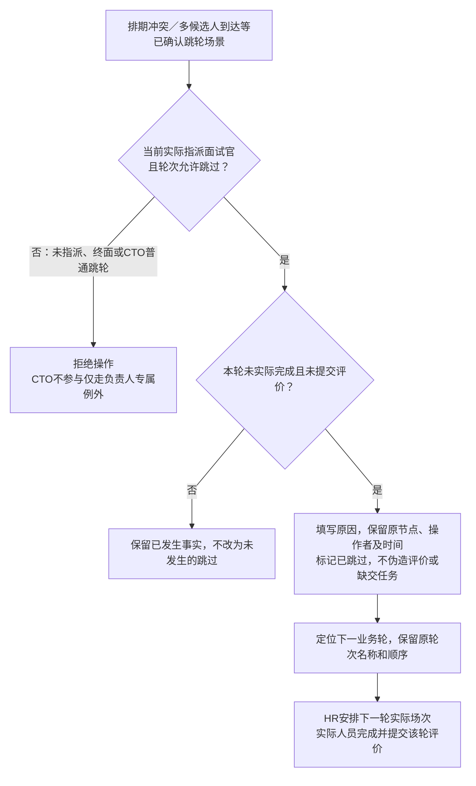

直接从二面开始仍须指定具备有效资格的实际面试官；无人时按[人员补充指派](#547-面试人员缺失与重新指派)处理。各职级实际终面定义见 [职级流程](#549-按职级配置的现行招聘流程矩阵)，CTO不参与另见[最终评价承接](#evaluation-progression)。

#### 5.4.13 取消／未到场后的替代场次与同场换人

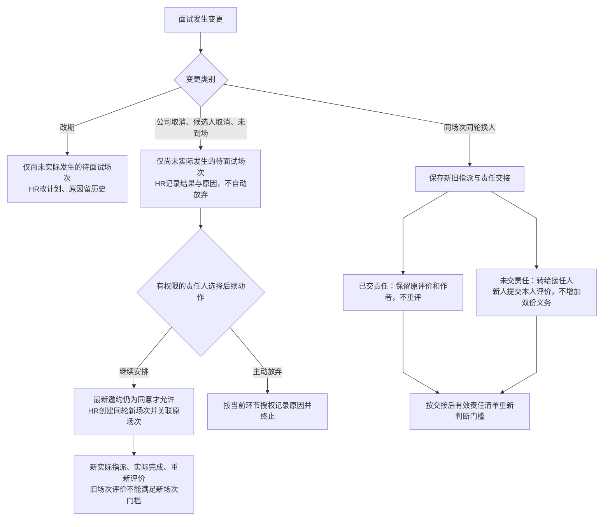

改期、取消／未到场不覆盖已发生事实；误点开始先按计划与实际场次规则限定条件纠错。最新邀约非同意禁止新建／替代，但不撤销已有场次。详见[场次字段](#fields-session)。

#### 5.4.14 面试人员缺失、账号失效与任务转交

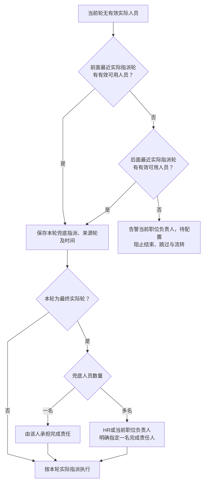

来源只取有效实际指派，不取可选名单；停用账号、已撤销角色和无效指派不作为来源。负责人不自动成为面试官。职位负责人变更按 [责任约束](#responsibility-rules)、轮次换人按[人员交接](#547-面试人员缺失与重新指派)；历史操作者不改写，解除指派后的访问按当前授权判断。HR负责人解除及重新指定见[职位详情责任操作](#job-detail-page)。

#### 5.4.15 单场开始主链路与整体阶段

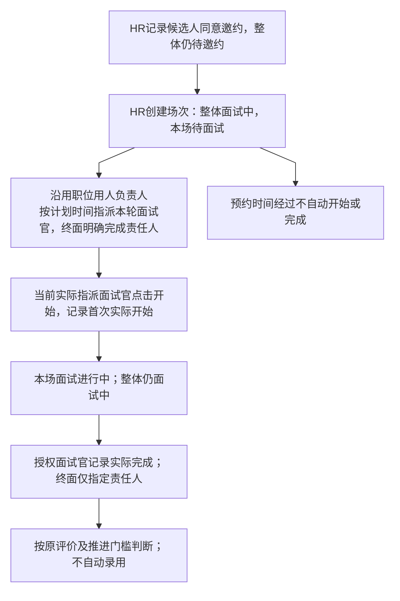

#### 5.4.16 异常处理与验收摘要

| 场景 | 触发、责任动作与数据去向 | 规则依据 |
| --- | --- | --- |
| 缺配置／本轮无人 | 无匹配流程先补配置；无人按[有效实际人员补充指派](#547-面试人员缺失与重新指派)，无有效来源则负责人告警，保留安排但阻止开始／完成／跳过及流转 | [配置资格](#545-面试流程配置页)及[责任交接](#547-面试人员缺失与重新指派) |
| 一面跳过及直接二面 | 当前轮授权参与人保留跳过原因；下一轮实际人员独立完成和评价 | [当前轮次操作与流转](#546-当前轮次交互) |
| 取消／未到场与替代 | HR保留原场次、新建同轮关联场次；新场次重新评价，不自动放弃 | [评价结果与CTO不参与反馈](#558-评价结果与cto不参与的页面反馈) |
| 改期与同场换人 | 改期保留时间历史；同场换人保留已交作者、交接未交责任，不重写旧证据 | [配置资格](#545-面试流程配置页)及[责任交接](#547-面试人员缺失与重新指派) |

### 5.5 评价填写／编辑弹窗与候选人详情决策区

**使用者与用途**：实际指派面试官提交本人评价，当前职位负责人按授权补充修改，HR记录沟通并确认最终招聘结果。

**入口**：场次评价表／历史版本、候选人详情HR沟通与决策区。评价提交、修改、查看与下载分别授权；终面完成与有效评价门槛共同决定待决策，不由计划时间或人工推进替代。

#### 5.5.1 候选人详情页：评价查看权限

评价按评价查看权限及其当前范围展示。预置初始配置中HR为全部数据，用人负责人在负责职位内查看；本人实际指派范围查看其他面试官评价仍须有效指派、同部门及同职位条件。管理员调整全部数据／本部门范围后按新范围查看，不沿用角色名称限制。评价查看不赋予提交、修改或下载权限；填写／编辑弹窗和招聘决策区分别定义操作资格。

<a id="evaluation-form"></a>

#### 5.5.2 评价填写与编辑弹窗

| 按钮名称 | 所在位置 | 操作权限 | 前置条件 | 点击行为 | 确认要求 | 成功结果 | 异常反馈 |
| --- | --- | --- | --- | --- | --- | --- | --- |
| 提交 | 填写／编辑评价弹窗底部 | 具备本人评价提交权限的用户且满足本场有效实际指派条件 | 目标在该权限配置范围内；面试已实际发生，本人有效评价责任尚未提交；未来轮及未发生／已跳过场次不开放；历史补交须当前有效授权 | 提交填写评价弹窗中的本人评价 | 确认实际面试已发生及本次结论 | 保存本人评价后关闭弹窗，刷新场次评价、版本及[业务结果](#evaluation-progression)；漏点开始不阻止提交 | HR全局可见不可代交；历史补交仍需当前授权；失败保留合法输入，附件失败不产生有效半份评价 |
| 保存 | 填写／编辑评价弹窗底部 | 具备负责职位评价修改权限的用户且为当前职位用人负责人 | 目标在该权限配置范围内；只能修改本人负责职位的评价，修改原因必填并保留原作者及版本 | 保存当前负责人对评价的修改及原因 | 无需额外确认 | 保存修改原因及前后版本，关闭弹窗并刷新评价及业务结果 | 本人作者、HR或其他职位负责人无此修改权；失败保留合法输入，前轮待定结果见[迟交待定处理](#late-evaluation) |
| 取消 | 填写／编辑评价弹窗底部 | 当前弹窗用户 | 无额外业务条件 | 关闭当前表单，按其返回规则处理未保存内容 | 无需额外确认 | 关闭弹窗，返回原场次／评价区，不保存 | 不保存跨会话草稿 |
| 填写评价 | 候选人详情页／当前或历史轮评价区 | 具备本人评价提交权限的用户且满足本场有效实际指派条件 | 目标在该权限配置范围内；面试实际发生，本人责任未交；历史补交须当前授权 | 打开本人评价弹窗，带入只读场次、轮次、本人及模板；评价内容无默认 | 无需额外确认 | 展示本人输入及提交／取消，不提前保存评价 | 未来轮、未发生或已跳过场次不开放；HR不可代交 |
| 修改评价 | 候选人详情页／逐轮评价区 | 具备负责职位评价修改权限的用户且为当前职位用人负责人 | 目标在该权限配置范围内；目标属于本人负责职位 | 打开评价编辑弹窗，回填当前内容，展示原作者及版本 | 无需额外确认 | 业务关联和作者只读，修改原因必填 | 原作者身份、HR或其他职位负责人不能单凭身份修改 |
| 查看版本 | 候选人详情页／逐轮评价区 | 具备评价查看权限的用户 | 目标在该权限配置范围内；有该份评价或历史版本查看权 | 打开只读评价及版本抽屉 | 无需额外确认 | 展示所选版本、作者及变更证据；关闭回原评价区 | 无下载入口；历史作者不保留当前访问权 |

<a id="candidate-decision-panel"></a>

#### 5.5.3 候选人详情页：评价结果与招聘决策区

| 区域 | 展示内容 |
| --- | --- |
| 评价结果区 | 逐轮结论、有效责任缺交、最终实际轮及承接依据 |
| HR沟通区 | 当前沟通结果、备注及历次记录 |
| 招聘决策区 | 当前招聘结果及录用未满足的具体条件 |
| 弹窗反馈 | 成功关闭弹窗并刷新本区及整体阶段；失败保留输入；取消返回原区，不保存 |

| 按钮名称 | 所在位置 | 操作权限 | 前置条件 | 点击行为 | 确认要求 | 成功结果 | 异常反馈 |
| --- | --- | --- | --- | --- | --- | --- | --- |
| CTO不参与 | 候选人详情页／评价结果区 | 具备CTO不参与确认权限的用户且为当前职位用人负责人 | 目标在该权限配置范围内；目标为本人负责职位的未实际完成CTO节点；填写原因，由前一有效实际业务轮承担最终评价判定 | 打开原因及最终评价承接确认弹窗 | 原因确认 | 保留节点，反馈承接及等待结果 | 普通面试官、仅有招聘事实维护权限无入口；无有效前轮或CTO已完成不能绕过 |
| 记录沟通结果 | 候选人详情页／HR沟通区 | 具备HR沟通记录权限的用户 | 目标在该权限配置范围内；候选人已进入待决策及HR沟通节点；沟通结果、备注必填 | 打开HR沟通结果及备注弹窗 | 无需额外确认 | 保存沟通结果及历史，不改变候选人阶段；“待跟进”“不再继续”不自动终止 | 缺结果或备注拒绝保存；HR沟通未记录不阻止符合条件的录用 |
| 确认录用 | 候选人详情页／招聘决策区 | 具备录用确认权限的用户 | 目标在该权限配置范围内；候选人为待决策，最终实际轮已完成且有效评价责任清单齐全、结论通过；已在外部确认可入职 | 打开外部可入职事实确认及录用二次确认弹窗 | 确认已完成对应渠道的外部可入职确认，再展示目标候选人与录用后果进行二次确认 | 成功显示录用、停止活动待办 | 最终实际轮未完成、有效评价缺交或未通过时禁用，并显示未满足的具体条件；前轮缺交／迟交待定不阻断；未实际确认可入职时不能录用 |

#### 5.5.4 评价与招聘决策字段

- **共性**：文本、附件、字典和错误反馈引用[公共字段规范](公共规范/字段与表单校验规范.md)，审计及保留引用[公共治理规范](公共规范/权限与数据治理规范.md)。

<a id="5541-本人评价字段"></a>

##### 5.5.4.1 本人评价字段

| 字段名称 | 业务含义 | 数据类型 | 控件类型 | 取值来源 | 默认值 | 必填条件 | 校验规则 | 修改与历史 |
| --- | --- | --- | --- | --- | --- | --- | --- | --- |
| 应聘记录／场次／轮次 | 本人评价所属业务 | 业务关联 | 只读 | 评价入口带入场次、轮次及快照模板 | 带入当前关联 | 是 | 不可手改别人的场次，须实际发生及当前有效授权 | 每实际场次每有效责任独立评价 |
| 评价结论 | 本次实际判断 | 字典关联 | 单选下拉框 | 面试结论字典：通过、不通过、待定／需补充 | 无 | 是 | 保持业务语义；不通过淘汰未终止流程 | 待定按当前轮／迟交前轮分别处理，不因字典更名改流转 |
| 是否推荐 | 个人推荐意见 | 字典关联 | 单选下拉框 | 推荐结果字典：推荐、不推荐、待补充 | 无 | 是 | 不强制与评价结论对应 | 不单凭推荐值改结论或职级 |
| 基础能力 | 本轮具体观察 | 备注 | 多行文本框 | 本人输入 | 无 | 是 | 公共备注校验；未观察写“本轮未观察” | 不复制前轮，不计分；随评价版本留存 |
| 项目经验 | 本轮具体观察 | 备注 | 多行文本框 | 本人输入 | 无 | 是 | 公共备注校验；未观察写“本轮未观察” | 不复制前轮，不计分；随评价版本留存 |
| 技术栈 | 本轮具体观察 | 备注 | 多行文本框 | 本人输入 | 无 | 是 | 公共备注校验；未观察写“本轮未观察” | 不复制前轮，不计分；随评价版本留存 |
| 工程化 | 本轮具体观察 | 备注 | 多行文本框 | 本人输入 | 无 | 是 | 公共备注校验；未观察写“本轮未观察” | 不复制前轮，不计分；随评价版本留存 |
| 沟通能力 | 本轮具体观察 | 备注 | 多行文本框 | 本人输入 | 无 | 是 | 公共备注校验；未观察写“本轮未观察” | 不复制前轮，不计分；随评价版本留存 |
| 契合度 | 本轮具体观察 | 备注 | 多行文本框 | 本人输入 | 无 | 是 | 公共备注校验；未观察写“本轮未观察” | 不复制前轮，不计分；随评价版本留存 |
| AI实践能力 | 本轮具体观察 | 备注 | 多行文本框 | 本人输入 | 无 | 是 | 公共备注校验；未观察写“本轮未观察” | 不复制前轮，不计分；随评价版本留存 |
| 综合说明 | 补充依据 | 备注 | 多行文本框 | 本人输入 | 无 | 一般可选；风险含其他时是 | 选择其他须具体描述 | 随版本保留 |
| 建议职级 | 个人建议 | 字典关联 | 单选下拉框 | 启用的具体面试职级 | 无 | 否 | 不自动定级 | 不改变原安排职级、快照或录用门槛 |
| 风险项 | 实际观察风险 | 字典集合 | 多选框 | 风险字典：无、技术能力、经验匹配、沟通协作、稳定性、薪资／到岗时间、其他 | 无 | 是 | 无与其他选项互斥；其他须综合说明 | 不新增薪资字段，随版本保留 |
| 评价附件 | 本份评价证据 | 文件集合 | 文件上传控件 | 本人提供PDF、DOC、DOCX，多份逐个上传 | 无 | 否 | 每份沿公共简历附件格式、大小及安全校验；不接受图片或可执行内容 | 仅本份评价，随版本保留；HR及作者不凭身份获得下载权 |
| 评价作者／首次提交时间 | 真实提交证据 | 人员／日期时间 | 只读 | 本人首次提交成功事件 | 无 | 提交成功后生成 | 不可代交，不建跨会话草稿 | 本人提交后不可修改，原作者不变 |
| 修改原因 | 负责人更正依据 | 备注 | 多行文本框 | 当前职位用人负责人输入 | 无 | 修改评价是 | 仍须完整有效评价 | 保存原、新版本和实际修改人／时间；无负责职位评价修改权限或无用人负责人指派均不能修改 |
| 评价版本／修改人／时间 | 版本历史 | 版本／人员／日期时间 | 只读 | 系统成功修改事件 | 无 | 修改后生成 | 不覆盖原作者 | 保留所有前后版本 |

业务轮实际已发生后才能提交有效评价，不把未来轮或未发生／已跳过场次当本人评价。是否点过开始不作为实际发生的替代或硬门槛；终止后既有历史补交／修改仅保留证据，不恢复结果、任务或流程。

<a id="5542-hr沟通与最终决策字段"></a>

##### 5.5.4.2 HR沟通与最终决策字段

| 字段名称 | 业务含义 | 数据类型 | 控件类型 | 取值来源 | 默认值 | 必填条件 | 校验规则 | 修改与历史 |
| --- | --- | --- | --- | --- | --- | --- | --- | --- |
| HR沟通结果 | 沟通实际结果 | 枚举 | 单选下拉框 | 已沟通、待跟进、不再继续 | 无 | 每次提交是 | 不产生结构化评价，不自动淘汰或阻断待决策 | 留历次记录 |
| HR沟通备注 | 本次沟通依据 | 备注 | 多行文本框 | HR输入 | 无 | 每次提交是 | 公共备注；本期不含薪资、Offer及入职办理 | 保存实际操作人和时间 |
| 当前招聘结果 | 终止决定 | 阶段枚举 | 只读 | 合法录用、淘汰、放弃动作 | 原当前阶段 | 有结果时生成 | 不自由编辑或恢复终止状态 | 系统不通过淘汰不另等人工审批 |
| 外部可入职确认 | 录用外部前提 | 布尔事实确认 | 确认勾选框 | HR与候选人实际确认可入职意愿；Boss在Boss确认，内推在系统外确认 | 未确认 | 录用是 | 最终实际轮完成且评价齐全通过、当前待决策，再二次确认目标及后果 | 记录HR和时刻，备注可选；不新增前轮缺交、薪酬、合同、入职日门槛 |
| 淘汰／放弃原因 | 人工终止依据 | 字典关联 | 单选下拉框 | 对应淘汰原因或放弃原因字典 | 无 | 人工终止是 | 按当前阶段及环节授权 | 系统不通过淘汰关联评价证据，不伪造手工原因 |
| 终止备注 | 具体说明 | 备注 | 多行文本框 | 当前环节有权操作人 | 无 | 原因其他时是，其余可选 | 公共备注校验 | 随终止证据保留 |
| 决策操作人／时间、触发证据 | 终止追溯 | 人员／日期时间／事件关联 | 只读 | 实际动作或系统判定 | 无 | 终止后生成 | 人工和系统触发区分 | 历史评价变更不切换终止结果 |
| 终止后纠错说明 | 非评价结果纠错依据 | 备注 | 多行文本框 | 有权HR输入 | 无 | 追加时是 | 仅追加说明，评价修改另走负责人授权 | 不恢复阶段、任务及流程 |

#### 5.5.5 七项评价维度填写说明

评价字段的默认、必填、互斥和修改要求统一见[本人评价字段](#5541-本人评价字段)；填写与修改入口见[评价填写／编辑弹窗](#evaluation-form)。各轮使用同一七维度文字框架，以下示例帮助面试官理解填写内容。

##### 5.5.5.1 七项维度与脱敏示例

以下为七项评价维度的脱敏填写示例。示例是观察结论，不是统一标准答案、默认值或自动判级规则；示例不包含真实候选人身份信息。

| 维度 | 填写内容 | 现行评价的脱敏示例 |
| --- | --- | --- |
| 基础能力 | 基础知识及完成岗位任务的能力 | 基础中等，能满足基本开发 |
| 项目经验 | 项目实践、实际职责及交付经验 | 项目经验中等，能满足基本开发 |
| 技术栈 | 岗位相关技术、原理理解及使用经验 | React基础及其原理理解中等 |
| 工程化 | 基础建设、开发流程及产研落地能力 | 对基础建设具有主动性，具备产研落地能力 |
| 沟通能力 | 表达、理解及协作中的具体观察 | 表达及理解力中上 |
| 契合度 | 与岗位职责和团队工作方式的匹配依据 | 中等 |
| AI实践能力 | AI工具实际使用方式及实践深度 | AI工具仅限使用 |

各轮默认使用同一七维度框架，原“基础／复核／核心能力／综合／深度／战略评价”名称可作为轮次模板名称保留，不再代表六套不同的两维度字段。具体职级和轮次影响关注重点，不自动填入评价结论。MVP默认七项均需有文字判断；本轮未覆盖的维度可明确填写“本轮未观察”，不强迫面试官猜测或用上一轮结果代填。每项按公共备注字段上限校验，可另加综合说明。

P3-2仅为建议职级示例，系统不自动定级；建议职级不改变职位指派、面试轮次或既有终面门槛。各轮建议职级可以不同，分别保存。

评价对业务阶段的影响见评价结果与待决策准入，HR沟通与最终决策字段见[招聘决策字段](#5542-hr沟通与最终决策字段)。

#### 5.5.6 多轮面试与评价归属

**业务价值**：保留不同轮次、不同人员的独立判断，支持职位负责人和 HR追溯招聘依据。**目标用户**：本轮面试官、职位用人负责人及有权限的 HR成员。**成功指标**：各轮评价可定位到具体场次、轮次及评价人，按 M-006 验证可追溯性。

- 候选人有多轮业务面试，每轮可以有一个或多个实际面试场次；取消后的替代面试是新场次，关联原场次。
- 每个需要评价的实际场次中，每名被指派面试官分别提交本人评价；同一人参与两轮产生两份评价，同轮两人分别产生两份评价。评价展示场次、轮次、评价人、评价模板快照、提交时间、状态和修改版本。
- 不用一个候选人级评价字段覆盖多轮评价；负责人修改某份评价不改变其他轮次或其他人员的评价与原提交人。
- 候选人详情按流程顺序展示各轮面试及独立评价，再展示 HR沟通结果；待评价按“场次＋轮次＋评价人”列出，已提交前轮评价不会因下一轮开始而丢失。
- HR沟通由有权限的 HR成员记录结果和必要备注，保留实际操作人及时间；不生成结构化面试评价，不直接修改其他人员评价或代替最终录用确认。
- **终面为最后一轮业务面试**：P3-2／P3-3 的负责人二面、P4／P5 的 CTO三面均为对应流程的终面；HR沟通不是终面。P2／P3-1 主面试官二面为终面，即使跳过一面也不改变该轮身份。
- **待决策门槛仍仅检查终面**：终面明确完成且该场终面换人后的有效评价责任清单齐全且通过（CTO不参与按 最终评价承接 承接）；前轮缺交评价保留待办，不阻断进入待决策，也不新增安排下一轮前必须评价齐全的限制。不得把 HR沟通当作终面完成动作或新增阻断条件。
- 具体职级仅在首次面试安排时选择，匹配完整轮次流程并保存快照后按轮次安排；不得因每轮独立选模板丢失前轮、无记录删除流程环节或无记录绕过 CTO面，负责人不参与例外按 评价流转与最终承接规则 留痕；一面跳过按 [跳过规则](#5410-一面跳过与直接从二面开始) 保留例外记录。已创建场次及评价快照不随后续模板修改变化。

<a id="evaluation-progression"></a>

#### 5.5.7 评价结果处理与待决策准入

实际业务轮结束后，存在通过反馈且无不通过／待定反馈才自动激活下一轮待安排；非终面缺交不阻断，合法跳过非终面另按例外执行。已提交待定保持当前节点，由有评价修改权限的当前职位负责人记录补充依据、更新评价版本，确认通过后再判断流转。任一轮有效评价不通过（包括前轮迟交）直接将尚未终止的流程置为淘汰，停止后续业务面试和相关待办／提醒，不再等待终面补评；修改历史评价不恢复终止状态。多人结论冲突时不通过优先。

CTO无时间参与时，仅当前职位用人负责人可以对该候选人点击“CTO不参与”并填写原因；保留原节点、原指派和变更快照。前一有效实际业务轮成为最终评价承接轮：必须已实际完成、有明确有效责任人、换人后的有效评价责任清单齐全且通过。以原评价版本建立引用，不复制或伪造CTO评价。缺评价则提醒该轮当前缺交责任人；没有有效前轮则警告负责人并阻止流转。满足条件自动激活HR沟通并进入待决策；未执行CTO待办停止。CTO已实际完成后不能用此操作抹去历史。

同场次同轮换人复用已提交评价、未交责任交接；取消／未到场后的替代面试属于新实际场次，重新完成并评价。面试发现职级不匹配仅记录建议职级及依据，不直接修改原安排职级或后续流程。

- 最终实际业务轮完成、有效评价责任清单齐全且通过后自动进入HR沟通节点，候选人阶段为待决策；HR记录沟通结果并执行录用／淘汰／放弃，不设“手动推进到待决策”。HR沟通仍不产生结构化评价。

<a id="558-评价结果与cto不参与的页面反馈"></a>

#### 5.5.8 评价结果与CTO不参与的页面反馈

| 场景 | 当前操作与结果 |
| --- | --- |
| 任一有效评价不通过 | 自动淘汰，停止后续场次及待办／提醒；不再补齐终面，保留原证据 |
| 实际轮结束且存在通过反馈，无不通过／待定 | 非终面自动到下一业务轮，缺交待办保留；终面还须有效评价责任齐全 |
| 已交评价待定需补充，或无通过反馈 | 保持当前节点，提示补充反馈；结束动作本身不代表通过 |
| 同场次换人 | 已交评价复用，不换作者；未交责任接任，不重复增加评价任务 |
| 取消／未到场后的替代场次 | 新实际面试，重新评价；旧评价不能直接满足新场次门槛 |
| 面试发现职级差异 | 只填写评价建议职级和说明，不修改当前流程快照 |
| CTO无时间，当前职位用人负责人 | 点击“CTO不参与”，填写原因并确认前一有效实际轮；不是普通跳轮按钮，不能批量修改标准模板 |
| 前轮承接最终评价 | 展示原场次、轮次、作者及评价版本引用，检查实际完成、有效责任人、清单齐全及通过；满足后自动进入HR节点，否则保留等待或配置警告 |

CTO不参与后原节点显示“负责人确认不参与，由第N轮承接最终评价”，原已安排CTO场次及变更历史保留，未执行部分停止待办；若CTO已实际完成则不能用不参与操作抹去历史。最终评价承接仅引用有效实际前轮，不能以跳过轮次的空评价、取消场次或旧替代场次评价流转。承接后缺评价消息改发前轮有效责任人，不为未执行CTO重复发消息；已完成通过后由HR记录沟通结果及确认录用。

首次安排固定岗位分类、职级与完整流程快照，后续仅选择该快照的轮次；CTO不参与及人员变更记录为候选人流程变更快照，不重写原始模板。已终止状态不因修改评价或配置自动恢复。

<a id="late-evaluation"></a>

#### 5.5.9 前轮补交待定评价的处理

前轮已合法结束并进入后轮后，其迟交／授权修改为待定不暂停后续安排或结束、不回退阶段、不取消场次，不新增待决策或录用门槛。详情与当前职位负责人工作台显示待补充项，负责人按原权限修改，保留作者、依据和版本；HR不获得评价修改权，不新增通知或提醒频率。

当前实际轮或CTO承接最终评价轮待定仍阻断该轮通过；迟交有效不通过仍淘汰尚未终止流程。已终止流程不因历史评价变更恢复或切换终止结果，活动待办停止，证据保留。历史补交仍需当前有效授权。

#### 5.5.10 确认CTO不参与及最终评价轮

入口：具备CTO不参与确认权限且被有效指派为当前职位用人负责人的用户，在该候选人CTO尚未实际完成时操作；无CTO不参与确认权限或无用人负责人指派的用户无此专属入口。

```text
CTO不参与确认
├─ 目标候选人与职位
├─ 原CTO节点及指派：保留原始事实
├─ 变更原因：填写后确认
├─ 最终评价承接信息
│  ├─ 前一有效实际业务轮、实际场次与完成情况
│  ├─ 明确有效责任人与当前评价责任清单
│  └─ 原评价作者／版本及通过、待定、缺交情况
└─ 结果提示：可自动待决策／等待完成或评价／配置警告
```

- 无有效前轮、只有跳过轮或取消场次时，按[评价结果与最终评价轮](#evaluation-progression)告警并阻止缺少实际面试或有效评价的流程推进，不提供手工勾选“已通过”替代事实的入口。
- 原轮实际完成、有效责任明确、评价清单齐全且通过后自动待决策；缺交显示承接轮当前缺交责任，待定按既有评价修改规则处理，不通过按[评价结果与最终评价轮](#evaluation-progression)自动淘汰。
- 已实际完成的CTO轮不能通过不参与操作抹去历史；变更仅作用于本候选人，不批量改标准模板。
- 保留原节点和候选人流程变更快照，引用原评价版本，不复制成CTO评价；原未执行CTO任务停止，不重复发送缺交消息。

确认成功不等于录用，后续仍由HR按既有流程确认。

#### 5.5.11 评价不通过、待定、缺交与通过门槛

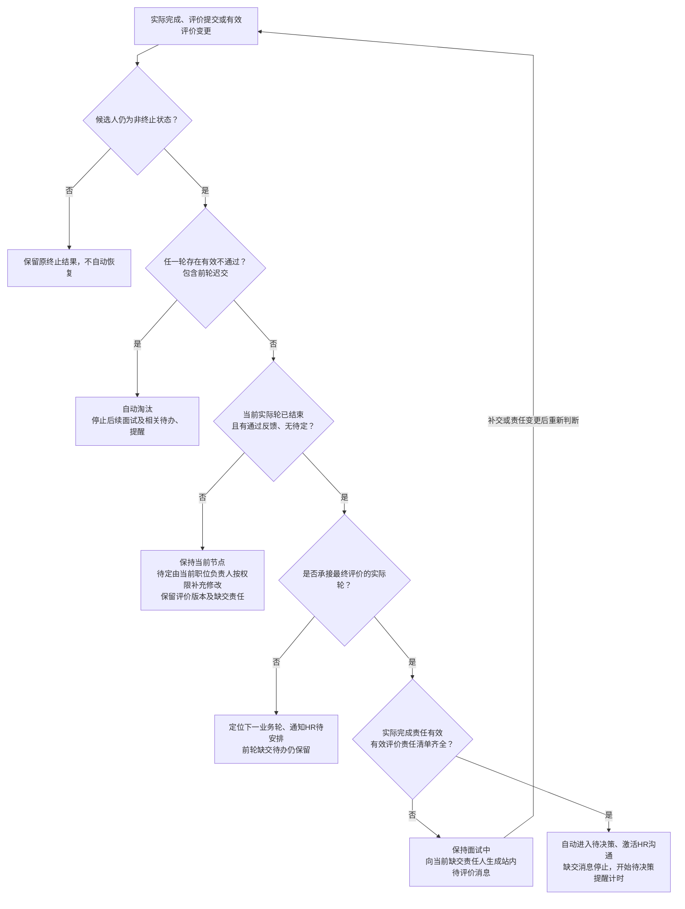

此图适用于实际面试，合法跳过见[跳过链路图](#5412-一面跳过与非终面合法跳过)。终面缺交消息频率见[通知触发与频率](#564-通知触发条件接收人与重复发送控制)；进入待决策后的长期未推进提醒按[工作台与提醒](#workbench)执行，两类提醒分别验收。评价通过不自动录用，HR沟通结果不额外阻断进入待决策。

#### 5.5.12 前轮待定评价判定流程

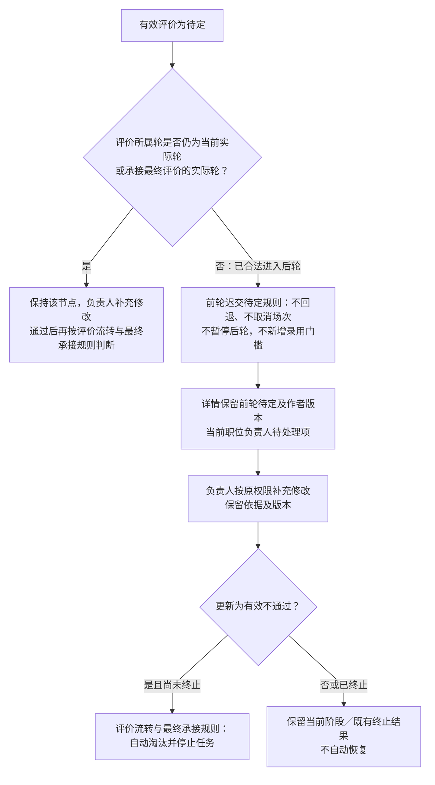

该分支按[前轮迟交处理](#late-evaluation)判断；不把前轮待定显示为已通过。终止后停止活动待办，历史证据保留，不新增终止后补交权。

#### 5.5.13 CTO不参与时的最终评价判定

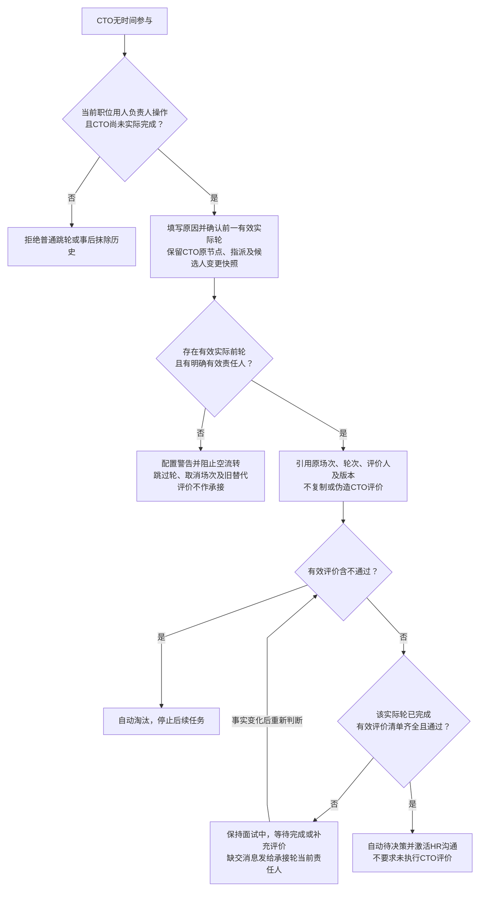

变更只作用于该候选人流程，标准模板和原始快照保留；CTO未执行部分停止待办，不产生重复缺交消息。CTO正常参加则走标准终面完成与评价门槛。进入待决策不等于录用，后续仍由HR完成外部确认及二次确认。

#### 5.5.14 异常处理与验收摘要

| 场景 | 触发、责任动作与数据去向 | 规则依据 |
| --- | --- | --- |
| 已结束但无通过／有待定 | 留在当前节点，当前职位负责人按权限修改评价并保留版本；不凭结束按钮推进 | [评价结果与CTO不参与反馈](#558-评价结果与cto不参与的页面反馈) |
| 前轮迟交待定 | 已合法进入后轮后不回退或暂停，不新增录用门槛；详情保留事实，当前职位负责人补充修改；当前实际轮／最终承接轮待定仍阻断该轮 | [前轮迟交](#late-evaluation) |
| 前轮缺交／迟交不通过 | 正常通过时缺交待办保留，可继续下一轮；迟交有效不通过终止尚未终止流程 | [当前轮操作](#546-当前轮次交互)及[最终承接](#558-评价结果与cto不参与的页面反馈) |
| 终面缺交与重判 | 实际完成后仍面试中；有效清单补齐且通过后自动待决策，重复处理只流转一次 | [人员缺失与责任交接](#547-面试人员缺失与重新指派) |
| CTO不参与 | 当前职位负责人确认，前一有效实际轮承接；无有效前轮阻断，缺评价等待；保留引用与快照 | [最终评价承接](#evaluation-progression)、[评价结果与CTO不参与反馈](#558-评价结果与cto不参与的页面反馈) |
| 面试发现职级差异 | 实际评价人只记录建议职级，原安排职级和流程快照不变 | [评价结果与CTO不参与反馈](#558-评价结果与cto不参与的页面反馈) |

<a id="workbench"></a>

### 5.6 工作台页与站内提醒

**使用者与用途**：HR、负责人及实际面试官聚合各自授权任务，区分待办、逾期与消息，避免已读被误认为完成。

**入口**：工作台任务卡、站内消息、授权业务详情。当前权限决定可见信息与可执行动作，点击消息或查看任务不完成业务。

业务触发、逾期和解除按下方规则执行；平台聚合、已读、字典及审计字段见[基础资料管理PRD：工作台与站内消息](基础资料管理PRD.md#workbench-messages)，平台保存聚合与投递信息，招聘提供任务事实。M-004统计口径见[指标定义](指标与试点基线.md#五指标核对与已确认统计口径)。

| 角色 | 工作台重点 |
| --- | --- |
| HR成员 | 全局招聘、待处理评价和逾期面试；职位 HR负责人负责跟进该职位的长期未推进候选人 |
| 职位用人负责人 | 本人负责职位的候选人、待初筛和待决策事项；被指派面试的待评价单独聚合 |
| 面试官 | 自己的面试、待评价事项和评价历史 |

工作台支持直接进入候选人详情、记录邀约、安排面试、补交评价和处理逾期事项。

长期未推进提醒仅对已实际面试并进入待决策的候选人启动；生成时点、收件人、频率及停止条件见[通知规则](#564-通知触发条件接收人与重复发送控制)。

<a id="tasks"></a>

#### 5.6.1 工作台页的招聘任务展示

登录后工作台或导航→工作台。默认显示待处理招聘任务；同人多角色对同一任务只显示一行。任务的生成、责任和完成条件见下一节。

##### 5.6.1.1 招聘任务筛选项

| 字段名称 | 数据类型 | 控件类型 | 取值来源 | 默认值 | 筛选规则 |
| --- | --- | --- | --- | --- | --- |
| 任务类型 | 枚举 | 单选下拉框 | 下方任务生成表中的招聘任务类型 | 全部 | 按任务类型精确筛选，不用候选人阶段替代任务类型 |
| 职位 | 职位关联 | 可搜索的单选下拉框 | 当前授权任务关联的职位→名称及部门 | 全部 | 按职位关联精确匹配；包含有未完任务的已关闭职位 |
| 责任范围 | 枚举 | 单选下拉框 | 当前角色及有效责任指派 | 本人负责 | 可选本人负责／当前授权范围，按角色各项业务权限的当前范围过滤；不按HR或面试官名称固定全公司／本人范围；仅平台权限无招聘任务 |
| 逾期 | 枚举 | 单选下拉框 | 任务当前逾期判定 | 全部 | 选项为全部／已逾期／未逾期；无明确逾期截止的任务不伪造逾期标识 |

切换责任范围不改变业务授权。

##### 5.6.1.2 工作台按钮

| 按钮名称 | 所在位置 | 操作权限 | 前置条件 | 点击行为 | 确认要求 | 成功结果 | 异常反馈 |
| --- | --- | --- | --- | --- | --- | --- | --- |
| 查询 | 工作台页／筛选区 | 具有招聘任务查看权的当前用户 | 筛选范围不超出当前授权 | 应用当前筛选条件 | 无需额外确认 | 展示匹配的待处理任务 | 失败保留条件，不显示为无任务 |
| 重置 | 工作台页／筛选区 | 具有招聘任务查看权的当前用户 | 无额外业务条件 | 恢复本页默认筛选条件 | 无需额外确认 | 刷新当前授权待处理任务 | 不改变业务事实、责任或起点 |
| 处理 | 工作台页／任务记录区 | 当前具备目标业务访问权的用户 | 任务未完成或取消且目标可访问 | 按任务类型进入对应业务区域 | 无需额外确认 | 目标页按当前资格提供实际业务动作 | 可见不等于可执行目标动作；失权拒绝并刷新任务 |

##### 5.6.1.3 任务列表字段

| 字段名称 | 数据类型 | 取值来源 | 展示规则 | 空值展示 | 交互说明 |
| --- | --- | --- | --- | --- | --- |
| 任务类型 | 文本 | 业务事件生成的任务类型 | 按下方任务生成表显示具体任务类型 | — | 只读；消息已读不改变任务结果 |
| 候选人／业务对象 | 文本 | 任务关联的应聘记录或职位 | 候选人任务显示姓名；配置任务显示职位名 | —，不伪造候选人 | 只读；进入目标使用“处理” |
| 职位 | 文本 | 任务关联职位→职位名称 | 显示任务关联职位名称 | — | 只读；关联存在不等于有处理权 |
| 当前责任人 | 人员名称 | 当前有效责任指派 | 显示当前有效责任人，不把原人继续显示为有效人 | 无人或资格失效显示“待重新指派” | 只读 |
| 计时起点 | 日期时间 | 任务首次生成对应的业务时刻 | 按任务生成事实显示原业务起点和公共业务时区 | —，不补当前时间 | 只读；已读及换人不重置 |
| 任务提示 | 状态标识 | 逾期判定、人员资格及配置缺口 | 分别显示适用的逾期、等待配置标识；可同时存在 | 无提示时显示“—” | 只读；逾期口径见下方规则 |
| 操作 | 按钮 | 任务目标及当前处理授权 | 显示“处理”；目标页按实际资格开放动作 | 无目标处理资格时不开放越权动作 | 跳转下表对应区域，无手工完成任务按钮 |

##### 5.6.1.4 任务排序与跳转

| 项目 | 页面要求 |
| --- | --- |
| 默认排序 | 逾期任务优先，同组按原计时起点升序 |
| 计数口径 | 筛选后去重的任务数；同候选人不同任务分别计数，同任务多角色只计一次 |
| 处理结果 | 已完成任务移出待处理列表；任务完成／取消由业务事件决定，消息已读不完成任务 |
| 空态文案 | 无待办：“暂无待处理事项”；筛选无结果：“暂无符合条件的任务” |
| 消息入口 | 打开本人站内消息列表，字段及阅读行为见基础资料管理PRD |

| 任务类型 | “处理”跳转目标 |
| --- | --- |
| 待筛选 | 候选人详情页／资料推荐区 |
| 待初筛／待补充 | 候选人详情页／初筛区 |
| 待邀约处理 | 候选人详情页／邀约区 |
| 待安排下一轮、待面试／面试进行中 | 候选人详情页／当前轮场次区 |
| 待评价、负责人补充待定 | 候选人详情页／对应轮次评价区；由本人填写或当前负责人修改入口处理 |
| 待决策 | 候选人详情页／HR沟通及招聘决策区 |
| 无人／失效责任配置 | 面试人员缺失进入候选人详情场次指派区；HR负责人失效进入职位详情责任区，管理员使用授权平台责任配置入口 |

任务可见不等于可处理；跳转后仍按目标页资格显示按钮。权限失效时不继续显示原任务或敏感详情。

#### 5.6.2 任务生成、负责人及完成条件

| 任务 | 生成事实／原起点 | 当前责任及可见范围 | 完成／取消证据 |
| --- | --- | --- | --- |
| 待筛选 | 应聘录入成功，导入时刻 | 职位HR负责人主责，具备资料推荐或相应阶段处理权限且范围覆盖的用户可处理；无人显示待配置，不虚构人员 | 推荐初筛或合法终止／软删除；查看不完成 |
| 待初筛／待补充 | 进入初筛，阶段进入时刻 | 当前用人负责人，具备相应范围查看权的用户可查看，但不能替代负责人初筛 | 推荐／不推荐／合法终止完成；待补充说明只算有效处理不完成任务，起点不重置 |
| 待邀约处理 | 进入待邀约，阶段进入时刻 | 职位HR负责人主责，其他HR可处理 | 候选人同意后创建场次或合法终止；邀约中／拒绝／失联是处理记录，不自动完成整个流程 |
| 待安排下一轮 | 实际完成且评价通过条件满足，或合法跳过后定位下一轮的事件时刻 | 职位HR负责人安排，当前用人负责人配置实际人员 | 创建合法当前场次；终止／合法跳过取消或定位后续，不造无时间场次 |
| 待面试／面试进行中 | 有效场次创建，预约计划为排期依据 | 本场当前有效实际面试官，HR全局和负责人负责范围查看 | 实际完成或合法取消／未到场／跳过／终止解除；开始只更新状态不算完成 |
| 待评价 | 已实际完成但对应有效评价责任未交，起点为实际完成确认时间 | 该责任当前实际面试官，其他授权人可看缺交；不得代交 | 本人有效提交完成；终止／合法责任取消停止；已交后换人不重复，未交交接不重置起点 |
| 负责人补充待定 | 前轮已合法推进后迟交待定或授权改待定事件 | 当前职位用人负责人 | 修改补充后解除该项；终止取消。不暂停后轮或增加录用门槛 |
| 待决策 | 最终实际轮及评价门槛满足进入待决策 | 职位HR负责人和当前用人负责人，HR全局；动作按原阶段权限 | 录用／淘汰／放弃解除；HR沟通待跟进不另设阻断 |
| 无人／失效责任配置 | 原业务准入发现无人或指派失效 | 当前职位用人负责人配置；HR主责失效显示可由授权配置入口重指定 | 有效指派到位解除，不自动找人或因平台禁用泄露资料 |

任务可见不等于操作权，责任交接和人员禁用沿人员账号操作规则及用人负责人接任规则；新的有效责任人接原起点，原关系失权。不同任务类型分别计数，不能把“候选人数”等同“任务数”，同人多角色同一任务入口去重。

#### 5.6.3 逾期判定与解除条件

面试逾期唯一口径：当前有效场次处于待面试／面试进行中，当前业务时刻严格晚于计划结束时间，且候选人未终止；等于结束时刻不标逾期。这是未记录实际完成／合法取消结果的异常，不证明真实面试仍在发生。

解除：实际完成、合法取消／未到场／跳过、流程终止；待面试合法改期后按新计划判断。换人、消息已读、补录开始不解除；不自动完成、淘汰、放弃或刷新阶段。无计划结束的历史异常展示“计划资料缺失待核实”，不猜结束时间。

评价逾期按实际完成后第1个后续工作日同一时刻且责任未交展示，工作日历引用公共规范，等于截止时刻不算逾期；不是自动淘汰或推进门槛。M-004及时处理观察和每3工作日长期未推进提醒分别按指标／原提醒规则，不混成统一任务SLA。

<a id="564-通知触发条件接收人与重复发送控制"></a>

#### 5.6.4 通知触发条件、接收人与重复发送控制

| 类型 | 触发与频率 | 接收人／去重与停止 |
| --- | --- | --- |
| 终面缺评价 | 终面实际完成缺交立即一次，工作日每日一次，沿场次责任与历史处理规则 | 仍欠有效责任的当前实际面试官；每场每收件人每日最多一条，补交／终止／任务取消停止，换人不重置截止 |
| 待决策长期未推进 | 待决策进入后每3后续工作日同一时刻，沿原基线 | 职位HR负责人及当前用人负责人；同候选人每人当日最多一条，同人兼两责任只一条；有效人员变更用当前人不重置起点，录用／淘汰／放弃停止 |
| 面试逾期 | 场次首次满足逾期发一次，本期不新增周期催促 | 当前有效实际面试官及职位HR负责人；同场同收件人在该逾期发生事件去重，同人多身份一条。合法改期解除后再次到期是新逾期事件；开始／换人／已读不重置事件，不补发给新接任人，接任人在工作台查看 |
| 整个流程无人配置 | 无有效实际人员且无法从其他轮兜底时告警，不设周期推送 | 当前用人负责人；同一配置缺口未解除时只生成一个告警，解除后新缺口为新事件 |

消息只发仍有效、有对应业务访问资格的收件人，无人或失效不发给平台管理员代替；任务继续在授权工作台显示待配置。生成前复核状态／责任，业务已解除不补发过期消息；失败重试按同一应发项去重，发送证据须实际测试验证。旧消息只保留历史，已读不停止应发后续周期。

上述逾期面试一次性通知细化已有“逾期面试提醒”，不改变终面评价每日或待决策3工作日周期；不接飞书、短信、邮件。对轮间等待不定义新的逾期催促频率。

#### 5.6.5 页面与验收

工作台卡片显示任务类别、职位／候选人安全必要信息、当前责任、预约或原起点、逾期／待配置原因及授权入口。全部数据查看或任务聚合不能代提交评价，负责人事项不意味着参与实际场次；失权即复核隐藏资料。

系统应按各类提醒的触发条件、接收人和去重规则发送消息，避免漏发、错发及重复发送。消息已读仅表示用户已查看，不代表待办已完成。

#### 5.6.6 任务、消息与指标分别使用业务事件

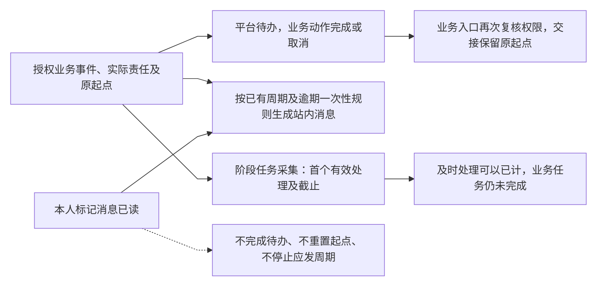

工作台与消息展示见基础资料管理PRD，招聘任务的触发与解除按本节定义执行。逾期严格晚于计划结束，不自动改阶段；M-004统计不生成新通知或业务时限门槛。

消息内容只显示收件人有权获知的职位、轮次和待评价入口，完整任务与评价在业务页面按当前授权查看。

#### 5.6.7 工作台处理反馈与验收摘要

卡片进入后使用对应业务按钮执行动作，成功后刷新任务及责任；状态或授权失效时显示安全提示，不允许通过旧消息继续越权。消息已读不解除逾期或待评价。正常案例：本人提交有效缺交评价后该责任任务解除；反例：仅打开或标记消息已读，任务仍在。

<a id="shared-exceptions"></a>

## 6 共用异常

### 6.1 招聘责任失效与任务交接

| 失效关系 | 页面提示与处理入口 | 对未完成任务及历史的影响 |
| --- | --- | --- |
| 职位HR负责人解除或资格失效 | 职位责任区显示“HR负责人未指定”或资格失效；HR或管理员从各自授权配置入口重新指定 | 其他用户的有效业务配置继续适用；指定后由新有效责任人承接后续提醒，原起点及历史操作人不变 |
| 职位用人负责人资格失效 | 职位责任区显示当前资格失效；HR通过“更换用人负责人”指定接任者 | 接任者处理初筛、前轮待定等负责人事项，不自动接任实际面试和本人评价责任 |
| 场次参与人账号、角色或指派失效 | 场次卡片及负责人工作台显示待重新指派；当前用人负责人从“指派／换人”处理 | 已交评价及原作者保留，未交责任转接；原参与人不凭历史身份继续操作，任务起点不重置 |

人员管理动作本身不自动转移招聘责任。具体交接见[负责人接任](#更换职位用人负责人)与[面试人员重新指派](#547-面试人员缺失与重新指派)。过期页面、权限拒绝、并发及附件失败按[共享规范](#shared-rules)执行。

### 6.2 主动终止、软删除与恢复

候选人放弃／人工淘汰按阶段及当前环节责任授权；评价不通过淘汰为系统结果，不提供手动推进或忽略警告。候选人仅待筛选且无推荐／邀约／面试／评价历史时可软删除；进入流程后即使终止也不可删除。职位无进行中流程才可软删除，存在活动流程则拒绝。管理员恢复软删除记录不恢复候选人终止阶段，也不自动获得内容查看权限。

#### 6.2.1 页面操作归属

候选人淘汰／放弃在[详情筛选与邀约区](#candidate-screen-panel)按当前阶段授权执行；候选人删除在[候选人列表页](#candidate-list-page)，职位删除在[职位列表页](#job-list-page)，软删除恢复在平台回收列表页。

#### 6.2.2 异常处理与验收摘要

| 场景 | 触发、责任动作与数据去向 | 规则依据 |
| --- | --- | --- |
| 主动淘汰／放弃与录用 | 当前环节授权人主动终止并记录原因；HR仅在待决策外部确认后二次确认录用 | [阶段流转](#stages)、[操作权限](#permissions) |
| 软删除与恢复 | 候选人仅未进入流程可删除；职位无进行中流程才可删除；管理员恢复不恢复候选人终止阶段 | [操作权限](#permissions)、删除准入 |

<a id="data-dependencies"></a>

## 7 数据与依赖

### 7.1 来源、对象关系与历史

飞书负责招聘需求审批、发布及关闭事实，HR人工登记发布信息和同步状态；Boss直聘提供其渠道的简历及外部联系事实，HR记录真实凭证或缺失原因；内推仅记录渠道，沿用HR筛选起点及招聘主链，HR从公司认可的内部渠道接收简历，并在系统外与候选人确认邀约及可入职意愿，见[内推流程](#source-evidence-rules)。

HRM保存内部应聘、实际场次、评价及招聘结果；外部事实由HR记录。一个飞书申请对应一个职位；跨职位独立应聘；模板快照、场次替代关系、简历版本、评价版本及历史作者按各功能规则保存。

#### 7.1.1 待办与历史证据的数据去向

```mermaid
%%{init: {"flowchart":{"curve":"linear","nodeSpacing":30,"rankSpacing":45,"diagramPadding":16,"wrappingWidth":200},"sequence":{"mirrorActors":false,"actorMargin":45,"messageMargin":30,"noteMargin":12,"wrap":false},"er":{"diagramPadding":16,"minEntityWidth":130,"minEntityHeight":45}}}%%
flowchart TB
    Facts["招聘业务事实<br/>当前阶段、场次责任及有效评价"] -->|待安排、缺评价、待决策| Platform["平台工作台与站内通知"]
    End["录用／淘汰／放弃"] -->|停止活动任务及提醒| Platform
    Candidate["应聘资料"] -->|导入、变更、合并关系| History["审计与历史证据"]
    Session["面试场次"] -->|原场次、替代关系、指派及快照变更| History
    Evaluation["逐人评价"] -->|原作者、内容及修改版本| History
    Decision["招聘决策"] -->|操作人、时间、原因及状态变化| History
```

最终实际轮通常为配置终面；负责人确认 CTO不参与时，按[最终评价承接](#evaluation-progression)引用前一有效实际轮承接最终评价。图中“下一轮待安排”不等于自动创建面试场次。建议职级只作为评价信息，不改变原流程快照。手动淘汰／放弃仍按当前阶段责任人授权，录用由HR在待决策完成对应渠道的外部确认后二次确认。

#### 7.1.2 招聘数据保留、删除与恢复

软删除、恢复原因、审计追加保存、禁用后的访问及历史关联规则统一引用[公共权限与数据治理规范](公共规范/权限与数据治理规范.md)第2、5、6节。

所有候选人简历按[数据生命周期](公共规范/权限与数据治理规范.md#五软删除与数据生命周期)永久保留，HR在当前授权范围内参考历史资料；本期不新增人才库页面。候选人、评价及招聘过程记录本期不设置自动清理任务。删除准入和管理员恢复范围按[操作权限](#permissions)及场次责任与历史处理规则执行，恢复不改变已终止候选人阶段；本期禁止批量导出。

#### 7.1.3 字典

职位类型、办公方式、招聘角色、面试职级、候选人来源渠道、面试结论、推荐结果、风险项、淘汰原因和候选人放弃原因均为可维护字典。候选人放弃原因至少包括公司取消、候选人取消、未到场、已接受其他机会、不再求职、薪资原因、时间安排、失联、个人原因和其他。已被业务记录使用的选项只能停用，不能直接删除；历史编辑、换值及提交复核，见[字典停用值的历史编辑](基础资料管理PRD.md#dictionary-history)。

<a id="shared-rules"></a>

### 7.2 必读共享配套

下列规范适用于本模块的实现与验收，业务特有条件在对应功能章节定义。

| 配套 | 适用内容 |
| --- | --- |
| [字段与表单校验](公共规范/字段与表单校验规范.md#公共规则)、[通用交互](公共规范/字段与表单校验规范.md#通用交互要求)、[提交、并发与重试](公共规范/字段与表单校验规范.md#submit-validation) | 格式、附件、时间、失败反馈、并发及重试 |
| [授权判定](公共规范/权限与数据治理规范.md#32-授权判定与多角色合并)、[按钮机制](公共规范/权限与数据治理规范.md#34-按钮展示可用条件与提交校验) | 多角色完整授权、显示／禁用及提交复核 |
| [敏感访问](公共规范/权限与数据治理规范.md#四敏感数据访问)、[生命周期](公共规范/权限与数据治理规范.md#五软删除与数据生命周期)、[审计](公共规范/权限与数据治理规范.md#六审计基线) | 内容及附件访问、软删除／恢复、操作证据 |
| [指标定义](指标与试点基线.md#二核心指标)、[统计口径](指标与试点基线.md#五指标核对与已确认统计口径) | 阶段任务复算与消息核对口径；试点采集安排仅供产品及业务负责人使用 |

### 7.3 按实施职责阅读的平台需求

| 承接能力 | 必须阅读的定义 |
| --- | --- |
| 内部人员、账号及角色 | [基础资料管理PRD：人员与账号](基础资料管理PRD.md#person-management)及其公共治理引用 |
| 部门 | [基础资料管理PRD：部门管理](基础资料管理PRD.md#department-management) |
| 工作台及站内消息 | [基础资料管理PRD：工作台与站内消息](基础资料管理PRD.md#workbench-messages)；招聘业务触发由本PRD第5.6节定义 |
| 字典 | [基础资料管理PRD：字典管理](基础资料管理PRD.md#dictionary-management) |
| 审计及回收 | [基础资料管理PRD：审计与回收](基础资料管理PRD.md#audit-recycle)及公共治理规范 |

| 页面／内容或操作 | 可执行角色／责任身份 | 数据范围或责任指派 | 业务条件与限制 |
| --- | --- | --- | --- |
| 平台账号、部门、角色、字典／管理；审计／查询 | 系统管理员 | 平台配置及授权审计范围 | 不因此获得招聘业务内容访问权 |

#### 平台回收列表页的招聘记录恢复

| 按钮名称 | 所在位置 | 操作权限 | 前置条件 | 点击行为 | 确认要求 | 成功结果 | 异常反馈 |
| --- | --- | --- | --- | --- | --- | --- | --- |
| 恢复 | 平台回收列表记录区 | 具备招聘职位恢复或候选人恢复权限的用户 | 目标在该权限配置范围内；[操作权限](#permissions)及公共规范 | 打开软删除记录恢复原因确认弹窗 | 原因必填，确认目标及恢复影响后二次确认 | 恢复原关联并记录前后状态，从回收列表移出；不执行招聘重开或业务推进 | 不授予简历查看／下载，不恢复终止候选人阶段 |

### 7.4 实施依赖

人员与账号授权→职位及应聘资料→筛选邀约→场次与评价→招聘决策。每批接入工作台、消息及审计。HR录入真实Boss来源凭证；无法取得时填写缺失原因。招聘阶段及流转由本PRD第4、5章定义。

<a id="nonfunctional"></a>

## 8 非功能要求

### 8.1 招聘业务实现约束

预约时刻不能自动生成实际开始或完成事实。已有候选人的招聘阶段及流程快照不随模板编辑、职位资料更正或关闭招聘而改变。

### 8.2 运行与可用性要求

| 要求 | 当前定义及验证责任 |
| --- | --- |
| 权限与敏感访问 | 按第3、5章业务授权及公共规范验证，越权阻断门槛为100%；评价查看、修改和附件访问分别验证 |
| 附件及消息可靠性 | 上传失败不切换当前简历；通知复核当前授权、按应发项去重，失败重试不重复发送 |
| 页面可用性 | 页面反馈、浅深主题及辅助技术可用性按实际场景验收 |
| 容量、响应及上传 | 按[运行容量与备份恢复基线](公共规范/权限与数据治理规范.md#runtime-baseline)验证列表查询、评价保存及简历上传，完整步骤见验收附件 |
| 备份及恢复 | 按同一运行基线验证业务数据、附件、权限、历史及审计的一致恢复 |

<a id="acceptance-delivery"></a>

## 9 验收与交付

### 9.1 核心验收标准

1. 按职级得到相应轮次及本轮可选名单，名单成员未实际指派时无法访问候选人。
2. 非当前参与人不能结束或跳过；普通面试官无终面及 CTO跳轮权限；负责人 CTO不参与操作另按[CTO不参与规则](#558-评价结果与cto不参与的页面反馈)验收。
3. 非终面实际结束且有通过反馈、无不通过或待定，或合法跳过后，只推进一次，定位下一轮并生成待安排事项，不要求前轮评价齐全。
4. 最终实际业务轮完成但有效责任清单有缺评价时停留面试中；补齐并通过后自动进入HR沟通及待决策，HR沟通未记录不阻断。
5. 七项维度逐项保存文字观察，空白不能提交，“本轮未观察”可以提交；无数值评分或总分，建议职级不自动改变流程。每轮每人评价独立；仅有非评价资料修改权限不能修改评价、删除历史或以结果修改绕过终面门槛。
6. 人员改派与配置修改不改变旧快照；解除指派后原参与人失去该关系下的历史访问，当前HR及当前职位负责人仍按范围查看。

### 9.2 权限验收要求

按钮级场景见[招聘管理验收附件](招聘管理验收附件.md#tests)，对应第5章各页面的资格、业务条件及结果执行。

详细验收步骤见[招聘管理测试场景](招聘管理验收附件.md#tests)。至少覆盖管理员无业务角色、角色正确但记录越界、未被指派、状态不允许、查看但不能下载、多角色授权完整性，以及负责人或指派变更后的当前授权校验。通用审计字段和拒绝反馈遵循公共规范；本模块额外验证评价修改与面试结果修改互不替代、职位关闭不阻止已有候选人授权流程、恢复软删除不恢复终止候选人阶段。

### 9.3 验收资料与验证边界

各功能包含验收摘要；完整步骤、追踪编号与预期在[招聘管理验收附件](招聘管理验收附件.md#tests)，需求覆盖见该附件的追踪部分。先核对本文当前规则，再执行正常、条件不足、授权拒绝及适用异常场景；设计场景不等于测试通过。

### 9.4 第一阶段：基础能力

完成独立账号、首次改密、用户和部门、角色、字典、基础权限、审计框架和软删除能力。

### 9.5 第二阶段：招聘闭环

完成职位建档、职位关闭/恢复、候选人导入、重复提示、候选人阶段、邀约状态、面试模板、面试安排、评价和录用决策。

### 9.6 第三阶段：工作台与试点

完成角色工作台、待评价和逾期面试、长期未推进提醒、权限验收和技术部前端招聘试点。试点通过后再决定是否扩展到其他团队。

### 9.7 发布门槛

- 关键业务流程可从职位建档走到录用、淘汰或候选人放弃；Boss渠道录用前，HR须与候选人在Boss直聘确认可入职；内推由HR在系统外与候选人确认可入职意愿后，在HRM二次确认录用。
- 第3、5章的角色权限和简历下载条件通过正向及越权用例。
- 候选人阶段不可回退，终止状态不可恢复。
- 重复候选人、关闭职位、面试完成、公司取消、候选人取消、未到场、替代面试和长期未推进提醒规则通过验收。
- 审计记录能够还原关键数据操作，且不能通过普通界面删除。

### 9.8 试点采集安排

| 事项 | 影响与落实时点 | 承接责任 |
| --- | --- | --- |
| 试点效果采集 | 真实基线、样本与负责人在试点开始前落实；不作为功能测试通过条件 | 产品与业务负责人，见《指标与试点基线》 |

### 9.9 试点使用验证

试点由HR、用人负责人和实际面试官分别执行完整业务任务：录入资料与跟进、初筛与责任指派、查看简历与提交评价。核对任务入口是否清晰、状态和结果是否可理解、失败后能否继续处理。

功能是否正确按验收场景判断；实际填写成本、角色协作和持续使用效果由产品及业务团队观察，详见《指标与试点基线》。

### 9.10 设计与实际使用验证

[可点击原型](prototype/index.html)用于页面导航及样例流程演示，功能及授权验收以本PRD与验收附件为依据。

视觉设计、真实操作验证和实现验收分别执行。原型演示不能替代服务端授权、并发处理和完整历史记录的验收。
