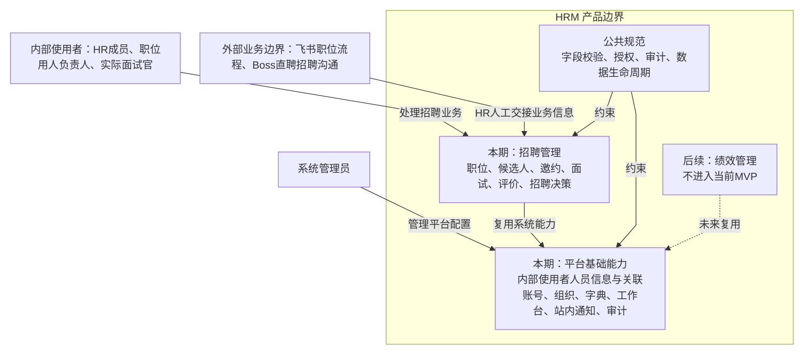
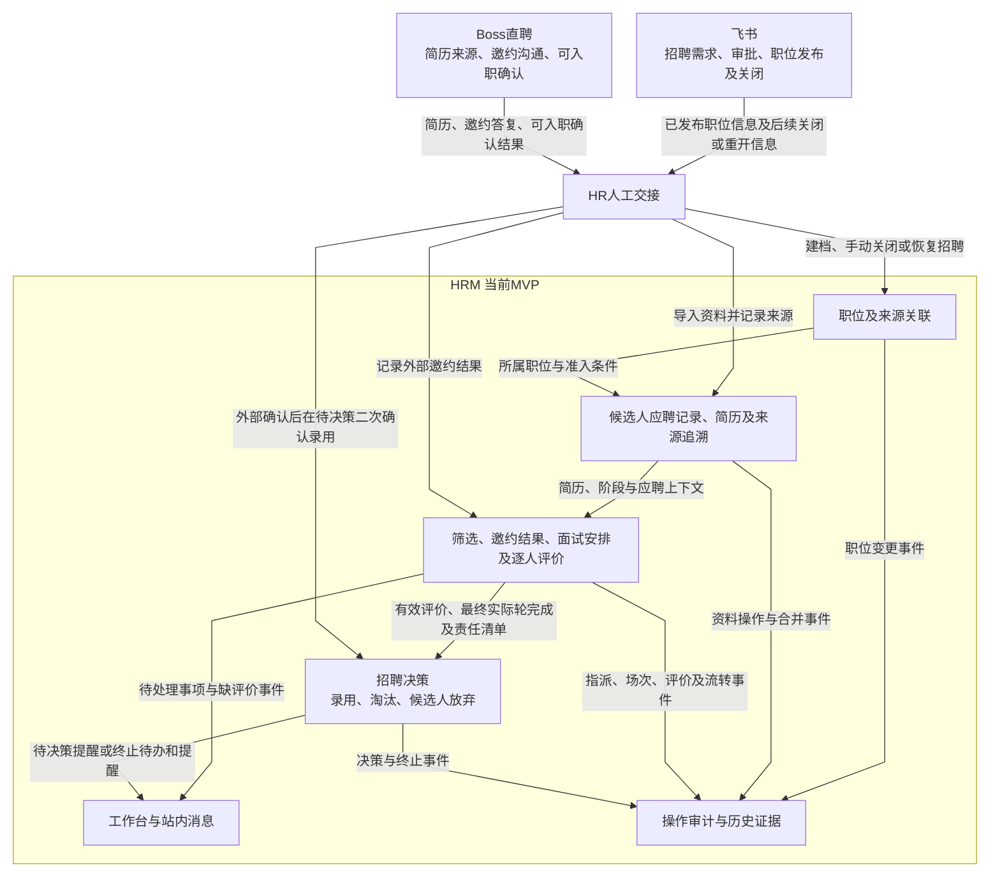

# pm-hrm 系统总 PRD（产品总览）

- **版本**：0.3；结构更新于2026-10-12。
- **定位**：项目总维度的产品需求入口，聚合系统目标、范围、架构、能力依赖和交付门槛。
- **当前阶段**：招聘管理MVP本期产品定义已收口，准备真实交接与技术实施；功能尚未实现验收。

## 一、文档与决策管理

已确认决策、公共规范和模块业务规则沿用原权威顺序。本文只维护全局信息，模块字段和状态不在此复制。业务负责人作范围与政策取舍，产品维护需求，研发与测试评审可执行性；具体人员及投入容量待确认，不虚构负责人姓名或完成日期。

当前本期定义按D-000至040收口；总览聚合系统边界、能力归属与验证依赖。文档复核、联合交接、实施验收与效果验证分别记录，具体进度见TODO。

### 1.1 权威归属与维护规则

| 内容 | 权威文档 | 模块文档如何使用 |
| --- | --- | --- |
| 系统定位和模块边界 | 本文档 | 作为整体背景，不重复展开模块细节 |
| 字段、表单和附件校验 | 公共规范 | 直接引用；模块只补充业务例外 |
| 权限、审计和数据生命周期 | 公共规范 | 直接引用；模块只补充数据范围和操作差异 |
| 模块流程和状态 | 模块范围说明 / PRD | 模块独立维护，并链接公共规范 |
| 用户故事和验收标准 | 模块用户故事 | 细化模块 PRD，不替代公共规范 |
| 已确认决策 | 产品决策记录 | 作为所有模块需求的约束来源 |
| 账号、组织、字典、工作台、通知和审计 | 平台基础能力边界 | 模块引用系统能力，不重复定义系统级职责 |
| 试点指标和基线 | 指标与试点基线 | 模块验收引用指标口径和通过门槛 |
| 需求到验收关系 | 验收与追踪 | 用户故事必须关联测试场景和发布门槛 |

同一规则出现冲突时，优先级为：已确认产品决策 > 公共规范 > 模块 PRD > 用户故事中的补充说明。发现冲突时应回写权威文档，并在决策记录中留下变更原因。


## 二、背景、目标与用户价值

项目解决招聘协作中候选人状态不透明、面试评价不及时、责任事项未推进的问题，问题来源和待验证假设见[产品发现记录](产品探索/产品发现记录.md)。这些问题已有业务讨论依据，改善幅度尚无真实试点证据。

业务目标是让HR、职位用人负责人和实际面试官完成可追溯的招聘闭环；项目目标是验证AI能主动完成产品定义、交接、验收和反馈，而非以文档数量证明成功。首批用户及场景为技术部前端招聘，依据D-003。

HR获得资料、安排与决策入口；负责人获得初筛、评价处理和责任视图；面试官获得明确场次及评价任务；管理员维护平台而不自动获得招聘内容权限。收益和质量按[指标基线](指标与试点基线.md)验证，不新增未经确认的效率目标。

## 三、范围与外部边界

HRM 是面向公司内部的人资管理系统，整体规划包含：

| 领域 | 当前状态 | 说明 |
| --- | --- | --- |
| 工作台 | 支撑能力 | 聚合不同角色的待办、逾期事项和招聘协作入口；后续扩展为统一工作入口。 |
| 招聘管理 | 当前 MVP | 从飞书职位发布完成后的职位建档，到候选人筛选、邀约、面试、评价和录用决策。 |
| 绩效管理 | 后续模块 | 当前只保留统一模板和后续扩展方向，不进入本期实现。 |

### 3.1 重新规划入口

[项目规划与阶段交付](项目规划与阶段交付.md)提出先补内部人员身份与账号关系，再按身份授权、招聘资料、面试协作、决策和试点推进。人员最小范围已按D-022确认，完整员工管理仍未纳入，也不改变录用止于招聘决策的边界。

## 四、人员身份、角色与责任

| 概念 | 当前定义与状态 | 维护归属 |
| --- | --- | --- |
| 内部人员 | 用户已明确HR和面试官首先是人员，同人可承担不同职责；稳定人员身份与一人一个账号按D-022确认；资料维护及账号行为按D-025，部门生命周期按D-024；负责人接任按D-026，尚待实现验收 | D-022已确认范围与一人一个账号；字段及操作细节见平台文档 |
| 账号 | 登录、改密、重置、禁用等已有规则；不能以账号状态代替完整员工任职生命周期 | 公共权限规范第2节；平台负责入口 |
| 角色 | HR成员、面试官、管理员等资格，可多角色；按完整授权结果合并 | 公共权限规范第3节及招聘授权矩阵 |
| 部门与员工岗位 | 部门表达组织归属，不自动授予职位权限；员工自身岗位与招聘职位不同，本期是否维护员工岗位未确认 | 平台组织；不提前新增岗位字段 |
| 招聘职位与业务指派 | 用人负责人按职位指定，面试参与与完成责任按场次维护；不是独立账号角色 | 招聘PRD及D-013、D-016、D-018 |
| 历史作者与当前授权 | 保留历史作者不表示保留访问权；当前操作按有效账号、角色、指派及业务条件判断 | 公共规范及招聘业务差异 |

D-022确认本期一人一份信息与一个关联账号，人员及账号一次创建；本期人员资料与部门／账号操作已按D-024／025定义，业务接任按D-026定义，实现验收未完成，不能被描述为人员管理已完成。F-01／02及T-01是相关基础功能交接前任务，见[TODO](TODO.md)及[人员字段与操作](平台基础能力/人员账号与角色字段定义.md)。具体人员操作权限按D-025执行，业务接任已按D-026定义，整体交接及实现仍须验证，不因此开启完整员工管理模块。

## 五、业务架构与全局数据流转

以下为产品业务视图，依据 D-000、D-001、D-002、D-010、D-019。模块内部正常及非常规链路见[招聘管理图示](模块/招聘管理/业务流程与数据流转图.md)。

### 5.1 业务架构图



实线表示当前业务关系，虚线表示后续方向。用人负责人是按职位指派的责任身份，实际面试官按场次指派；管理员平台权限不自动授予招聘业务访问权，详见公共规范与模块 PRD G.1。

### 5.2 全局数据流转图



| 数据或结果 | 权威归属与本期交接 |
| --- | --- |
| 招聘需求、审批、发布与关闭 | 飞书；HRM只人工登记职位和展示状态，不复制审批流程 |
| 简历来源与外部沟通 | Boss直聘；HR人工导入简历、记录邀约答复及可入职确认结果 |
| HRM职位、应聘记录、面试协作与招聘决策 | HRM；外部来源和内部业务状态分别记录 |
| 待办、站内消息及审计 | HRM平台能力；招聘模块提供业务事件与当前授权上下文 |

一期不接入飞书／Boss API、不做飞书日历同步，不向候选人或飞书发送消息。“录用”止于招聘决策，不流转为员工档案、Offer、薪酬或入职办理记录。绩效管理当前没有跨模块数据流契约。

## 六、公共规则与平台承载

公共规范负责共性规则，平台负责实现和提供使用入口，招聘负责业务参数、准入及触发。三者的具体归属见[能力落地映射](产品总览.md#capability-mapping)。

- 字段格式、附件安全、并发提交和错误反馈统一引用[字段规范](公共规范/字段与表单校验规范.md)。模块字段字典负责含义、来源、必填条件及可修改性。
- 操作权限、敏感信息、审计及生命周期统一引用[治理规范](公共规范/权限与数据治理规范.md)，模块维护适用范围及业务差异。
- 平台账号、组织、字典、工作台、站内消息和审计范围见[平台基础能力](平台基础能力/README.md)。业务待办结束事实与消息已读已按D-039定义，平台不由总览新增状态枚举。

## 七、模块需求与文档入口

```text
产品总览
├── 公共规范：所有模块共同遵循的规则
│   ├── 字段与表单校验规范
│   └── 权限与数据治理规范
├── 产品探索：假设、发现和已确认决策
├── 平台基础能力：HRM 全系统复用的账号、组织、字典、工作台、通知和审计能力
├── 指标与试点基线：试点指标口径、基线采集和通过门槛
├── 验收与追踪：需求、用户故事、测试场景和发布结果的追踪关系
└── 模块需求：各业务模块独立维护
    └── 招聘管理
        ├── 范围说明
        ├── 产品需求文档
        └── 用户故事
```

### 7.1 公共规范

- [字段与表单校验规范](公共规范/字段与表单校验规范.md)：必填、长度、格式、数值、附件、重复提交和通用错误处理。
- [权限与数据治理规范](公共规范/权限与数据治理规范.md)：账号、角色、数据范围、权限、审计、软删除和生命周期。

公共规范由系统级需求统一维护。模块文档只描述模块特有字段、业务规则和例外，不复制公共规则。

### 7.2 产品探索

- [产品发现记录](产品探索/产品发现记录.md)：关键假设、落地风险和验证优先级。
- [产品决策记录](产品探索/产品决策记录.md)：已确认的业务边界和后续方向。

### 7.3 招聘管理模块

- [范围说明](模块/招聘管理/范围说明.md)：模块边界、流程、状态、角色和 MVP 验收范围。
- [产品需求文档](模块/招聘管理/产品需求文档.md)：招聘管理模块的完整 PRD。
- [用户故事](模块/招聘管理/用户故事.md)：按角色和业务能力拆分的用户故事与验收标准。
- [业务流程与数据流转图](模块/招聘管理/业务流程与数据流转图.md)：模块数据、业务对象关系、角色协作、状态及非常规链路。

- [产品能力与模块落地映射](产品总览.md#capability-mapping)：信息所有权、平台与招聘职责、页面动作及交付状态。

### 7.4 平台基础能力

- [平台基础能力边界](平台基础能力/README.md)：账号、组织、字典、工作台、通知和审计的系统级职责、复用边界和当前实现范围。

### 7.5 指标与试点基线

- [指标与试点基线](指标与试点基线.md)：招聘 MVP 的试点指标口径、基线采集方式、目标和数据来源。

### 7.6 验收与追踪

- [验收与追踪](验收与追踪/README.md)：从产品目标到用户故事、测试场景和发布门槛的追踪入口。
- [招聘管理需求到验收追踪矩阵](验收与追踪/招聘管理需求到验收追踪矩阵.md)：当前招聘 MVP 的需求覆盖关系。
- [招聘管理测试场景](验收与追踪/招聘管理测试场景.md)：面向试点执行的关键验收场景。

## 八、质量与运行要求

| 要求 | 现有依据／状态 | 下一步与交接影响 |
| --- | --- | --- |
| 权限及敏感信息保护 | 公共规范与招聘操作矩阵已定义 | 对应功能验证正向和拒绝路径；M-007沿用100%门槛 |
| 并发、重试与历史一致性 | 公共校验、D-020及快照规则已有依据 | 验证重复操作不重复产生事实，不覆盖历史版本 |
| 响应体验与使用规模 | 尚无并发用户、数据规模或响应时限确认 | 产品准备试点使用规模，研发评估，再定义可测时限；正式交付前补齐相关要求 |
| 故障与恢复 | 软删除恢复已定义；服务故障、备份恢复目标及失败补偿尚未完整定义 | 区分业务恢复与系统恢复，技术设计／发布阶段明确验证方法和负责人 |
| 附件与消息 | 附件安全及已有提醒规则已定义 | 检查上传失败、错发漏发、访问拒绝；不因图示存在声明真实验证通过 |

未定义的运行参数保留缺口，不以任意数字代替容量评估；不在产品框架阶段建立数据库或接口契约。

## 九、阶段规划与交付依赖

P0至P5的成果、工作包、依赖和退出条件见[项目规划](项目规划与阶段交付.md)，执行清单见[TODO](TODO.md)。这两份文件分别负责阶段规划与执行状态，本文不复制日期和完整工作包。

逐组字段定义在对应功能技术设计前完成；待决策仅影响对应功能。人员基础、招聘资料、面试协作、决策及试点按依赖推进，共用校验、权限及审计随每批交付接入。

### 9.1 需求到交付流程

```text
产品发现 -> 假设验证 -> 需求澄清 -> 公共规范/模块 PRD
    -> 用户故事 -> 验收标准 -> 技术实现 -> 测试验证 -> 反馈迭代
```

AI 用于整理讨论、识别遗漏、建立文档关联、拆解用户故事和辅助验证；业务决策、权限边界、公共规则确认和最终验收由团队负责。

### 9.2 后续扩展方式

新增绩效管理或其他模块时，按以下顺序建立文档：

1. 先检查并复用公共规范。
2. 在 `模块/模块名称/` 下建立独立的范围说明、产品需求文档和用户故事。
3. 在本文档增加模块状态、跨模块关系和入口链接。
4. 只有发现跨模块共性规则时，才更新公共规范，并记录变更原因。

## 十、验收、试点与发布

需求设计依据见[追踪矩阵](验收与追踪/招聘管理需求到验收追踪矩阵.md)，可执行步骤见[测试场景](验收与追踪/招聘管理测试场景.md)，当前缺口见[产品输出审查](产品探索/历史记录/需求文档产品输出审查-2026-10-12.md)。现有编号覆盖不代表执行通过。

功能交接前确认其字段、状态、权限、异常和验收；实施后记录真实结果、缺陷与复测。模块发布门槛引用招聘PRD第8.5节，指标引用既有基线；发布责任、运行恢复及试点窗口需评审补齐。

首批试点按D-003进行技术部前端招聘，事前采集人工基线，按M-001至M-007核对时长、评价、状态、提醒、追溯及权限；M-004口径已按D-040定义，真实试点采集待执行。没有可比样本不宣称效率改善，未通过权限和闭环门槛不宣布可发布。后续范围按真实试点结果重新取舍。

**字段定义进度（2026-10-12）**：F-01至F-08本期产品定义收口；F-03的同一职位与来源更正见D-029，公共字典历史编辑见公共规范D-030；F-04按D-031至034收口，下一项F-05筛选与邀约，完整交接和实现验收仍待执行，详见[TODO](TODO.md)。


<a id="capability-mapping"></a>

## 能力归属与交付映射

- **更新日期**：2026-10-12。
- **用途**：说明现有MVP能力由谁维护、在哪里操作、产出什么业务事实以及如何验收。不是新增模块、菜单承诺、数据库模型或接口契约。
- **状态**：现有需求的交接索引；本期产品定义已收口，实现与真实交接验收待执行。权威顺序沿用产品决策、公共规范、模块PRD、用户故事。

**人员基础当前状态**：D-022已确认内部使用者范围、一人一份人员与一个账号、管理员统一维护及一次创建；部门O与账号S按D-024／025定义，招聘接任授权按D-026已定义，真实验收仍待完成。下表的账号组织归属不代表人员管理需求完整，详见[人员字段定义](平台基础能力/人员账号与角色字段定义.md)。

### 一、信息所有权

| 层级 | 唯一维护内容 | 其他层如何使用 |
| --- | --- | --- |
| 产品探索 | 已确认业务决策、假设及范围变化原因 | PRD、公共规范、故事和验收按决策同步 |
| 公共规范 | 字段格式、附件安全、错误处理、授权模型、审计和生命周期共性规则 | 平台与招聘引用；不维护平行规则副本 |
| 平台基础能力 | 共用能力的职责与入口：账号、组织、字典、工作台、站内消息、审计／回收 | 承载公共机制；不决定候选人阶段、面试结果或录用 |
| 招聘管理 | 职位、应聘记录、邀约、轮次快照、场次、评价、决策及业务触发条件 | 提供经授权的业务事实、任务来源和业务动作；复用平台机制 |
| 总览与本映射 | 系统边界、能力依赖、阅读入口、交付归属 | 聚合引用，不复制完整字段和状态规则 |
| 用户故事与验收 | 用户目标、具体操作、可执行验证与追踪 | 验证权威规则，不反向新增权限或门槛 |

公共规范中已经存在招聘专用数量、轮次、时长和简历参数。本轮不迁移这些已确认参数；后续整理应保留一个权威维护位置，并更新引用及验收，不能平台和招聘各复制一份。公共安全机制与业务参数必须分别标明适用范围。

### 二、平台能力落地

故事与测试编号均沿用[用户故事](模块/招聘管理/用户故事.md)及[测试场景](验收与追踪/招聘管理测试场景.md)，路径所在目录不代表产品所有权。

| 能力／目标角色 | 操作入口与输入→输出 | 与招聘的边界 | 故事／验收 | 当前交接状态 |
| --- | --- | --- | --- | --- |
| 账号组织／管理员、登录用户 | 用户、部门、角色管理及改密页；账号资料和角色配置→可用身份及当前授权条件 | 招聘仅维护职位负责人和场次指派；部门不能自动授予职位权限 | US-001、002；TS-AUTH-001、002、TS-JOB-002 | 规则已定义；账号表单和改密路径见平台交互基线，待实现验收 |
| 字典配置／管理员 | 配置页；字典选项与停用操作→可选值和历史值 | 平台负责机制，招聘负责分类及初始值；来源渠道及字典交互已按D-039定义 | US-601；TS-GOV-001 | 通用规则及新增／编辑／停用交互已定义，待实现验收 |
| 工作台／各业务用户 | 按当前权限聚合任务；业务待处理事实→入口、责任人及标识 | 业务完成由招聘动作决定；平台不能因展示或消息已读推进招聘阶段 | US-501；TS-WORK-001、TS-LATE-021 | 核心任务、逾期口径及待办展示已按D-039定义，待实现验收 |
| 站内消息／指定收件人 | 消息列表与业务跳转；招聘触发事实→站内消息 | 招聘定义触发、收件人和停止条件，平台承载投递、去重和已读；不接外部渠道 | US-502、404；TS-WORK-002、TS-MSG-018 | 现有提醒、已读与业务待办交互已按D-039定义，待实现验收 |
| 审计／回收／授权管理员 | 查询和恢复页；业务操作记录／恢复原因→审计证据及恢复结果 | 招聘决定可删记录；管理员恢复权限不授予简历访问，不恢复终止阶段 | US-602；TS-GOV-002、003、TS-DELETE-018 | 准入规则、查询范围及恢复确认交互已按D-039定义，待实现验收 |

### 三、招聘内部能力落地

以下是招聘模块内部责任划分，可共用职位详情和候选人详情，不要求新增九个顶级菜单。逐项业务规则以[PRD](模块/招聘管理/产品需求文档.md)、[最小配置](模块/招聘管理/面试流程与评价最小配置.md)及[关键交互](模块/招聘管理/页面交互与按钮权限.md#interaction)为准。

| 能力／目标角色 | 页面与业务动作 | 输入→输出事实 | 复用与隔离边界 | 故事／主要验收 | 当前交接状态 |
| --- | --- | --- | --- | --- | --- |
| 职位／HR | 职位列表、详情；建档、关闭、重开、负责人变更 | 飞书已发布信息→职位及招聘准入状态 | 复用组织、字典、审计；不建设飞书审批 | US-101、102；TS-JOB-001、002 | 字段及表单交互已按D-026至030定义，待实现验收 |
| 应聘资料／HR | 导入、候选人列表／详情、简历版本查看 | 姓名、联系方式、简历及职位→独立应聘记录 | 复用附件安全与授权；跨职位独立，非员工主档 | US-201、203；TS-CAND-001、TS-DUP-018 | 来源、联系方式、版本及职位边界已按D-031至034定义；真实来源样例待验证 |
| 重复处理／HR、职位用人负责人 | 重复对比、合并确认、初筛推荐拦截 | 强匹配及活动状态→提示、合法合并或拒绝推荐 | 业务判断由招聘负责，复用并发保护、错误反馈和审计 | US-202、301；TS-CAND-002、TS-DUP-020 | D-020及关键交互已定义；双活动流程合并不新增为本期要求 |
| 筛选邀约／HR、职位用人负责人 | 详情阶段区；资料推荐、初筛、记录邀约结果 | 筛选结论／外部沟通结果→阶段与安排准入 | 复用工作台；外部沟通仍在Boss，不新增HRM邀约发送 | US-301、302；TS-FLOW-001、002 | 筛选、邀约及结果更正边界已按D-036定义，待实现验收 |
| 流程配置／HR、职位用人负责人 | 模板页；岗位分类、职级、轮次、候选名单配置 | 模板→首次安排时的完整流程快照 | 复用字典及账号；模板名单不等于实际指派 | US-401；TS-READY-001、TS-INT-001 | 快照、配置与授权明确 |
| 场次安排／HR、实际面试参与人 | 详情当前轮区；安排、改期、取消、替代、换人、完成 | 计划安排及实际完成→独立场次、责任清单、时间事实 | 复用日历规则、账号和审计；替代场次不能沿用旧评价满足门槛 | US-402、404；TS-INT-002、004、TS-ALIGN-018、021 | 状态规则明确；安排字段、默认值及计划／实际边界已按D-037定义，待实现验收 |
| 评价／实际面试官、职位用人负责人 | 场次评价表和版本历史；提交、授权修改、处理前轮待定 | 有效责任人的逐人评价→结果、历史版本及轮次判断依据 | 复用附件授权、审计；HR无评价修改权，前轮待定按D-021处理 | US-403；TS-INT-003、TS-EVAL-007、TS-LATE-021 | 字段及核心异常明确 |
| 招聘决策／HR及当前授权人员 | 详情决策区；自动待决策、录用二次确认、主动终止 | 最终实际轮事实与外部可入职确认→招聘终止结果 | 不创建Offer、员工档案或薪资流程；引用评价事实，不复制评价主数据 | US-404；TS-DEC-001、002、003、TS-ALIGN-020、022 | 门槛与终止规则明确 |
| 招聘任务来源／当前责任人 | 详情动作和工作台入口 | 筛选、评价、待决策及前轮待定事实→责任事项与提醒需求 | 招聘定义业务触发／结束，平台负责聚合和消息状态 | US-501、502；TS-WORK-001、002、TS-MSG-018 | 触发、逾期面试及任务／消息展示已按D-039定义，待实现验收 |

### 四、交付顺序与验证依赖

1. **人员与资格先交接**：F-01／02已定义；由产品、研发及测试执行T-01五例真实走查，区分人员身份、账号可用性、角色和业务责任。
2. **按招聘依赖落实技术设计**：职位与应聘资料→筛选邀约→模板场次→评价决策；字段定义见招聘字段字典，公共校验不代替业务输入规则。
3. **待办和消息分别验收**：按D-039验证逾期时点、收件人、解除及展示，消息已读不完成业务；责任变更不重置任务起点，不新增提醒频率。
4. **排期与真实证据补齐**：获得研发／测试容量和试点窗口，执行实现测试与真实Boss来源样例验证。M-004按D-040采集；无样本不宣称效率改善。

责任分工：产品负责补齐业务字段与分支、维护权威位置并准备推荐方案；业务负责人只确认仍有选择空间的业务政策；设计确认页面反馈和操作路径；研发设计共用能力及模块接入；测试按追踪矩阵执行并记录真实结果。不得要求研发凭字段名或“逾期”两字自行决定业务政策。

## 版本与变更记录

| 版本／日期 | 变更及阅读影响 | 决策／验收影响 |
| --- | --- | --- |
| 0.3／2026-10-12 | 吸收能力归属与落地映射；系统边界、平台／模块责任及交付入口在同一总览阅读。 | 本次仅信息架构整理，不变业务决策、权限或验收预期；实现测试状态不变。 |
