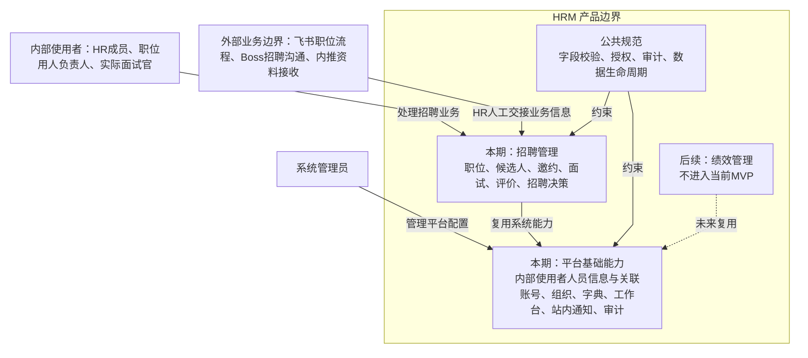
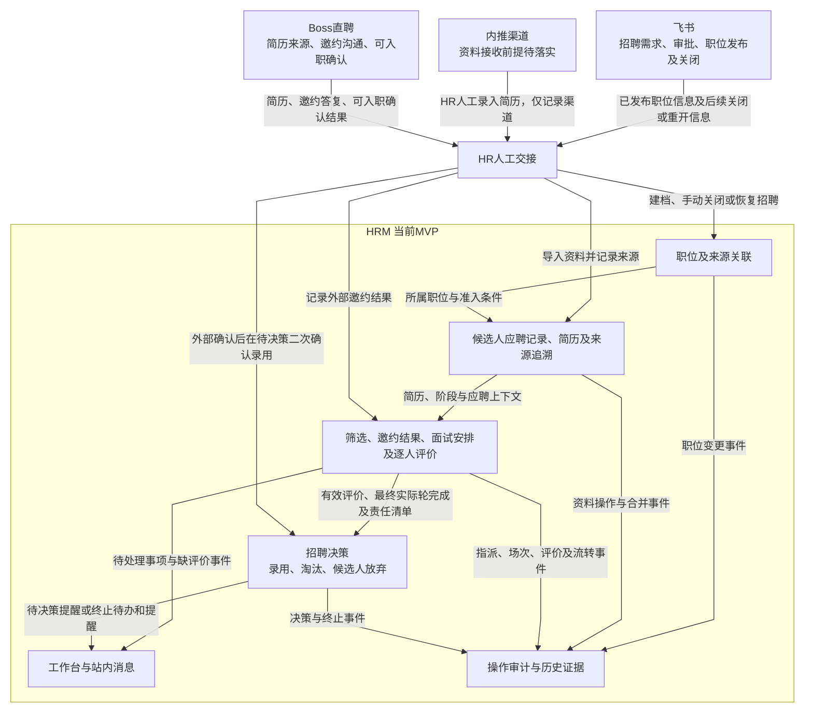

# pm-hrm 项目产品总览

## 项目定位与资料用途

本项目由产品角色与AI围绕HRM业务诉求，逐步探索、讨论、确认并形成产品版本。本文件聚合项目目标、当前范围、协作进度、决策、需求与交付入口，供产品负责人和项目协作者使用。

面向研发、测试、设计及其他非产品角色的成果由[输出目录](../output/README.md)提供，其中[产品项目总览](../output/产品项目总览.md)表达当前产品的目标、范围、架构和依赖，不要求阅读本项目的确认历史。

## 当前进度与内部入口

本期招聘MVP产品定义已收口；联合宣讲／交接、容量排期、实现验收与真实试点仍待执行。

| 项目资料 | 用途 |
| --- | --- |
| [探索与决策](产品探索/README.md) | 诉求、证据、假设、方案取舍及确认依据 |
| [TODO](TODO.md) | 当前任务、完成状态及后续执行 |
| [项目规划](项目规划与阶段交付.md) | 能力依赖、批次、资源与试点安排 |
| [需求维护入口](README.md) | 公共、平台、模块及验收权威正文 |
| [质量检查](产品经理工作与需求质量检查.md) | 工作方法、维护职责及文档检查证据 |
| [输出目录](../output/README.md) | 面向非产品角色的交付与宣讲资料 |

## 维护与输出关系

产品总览维护项目聚合信息；下方业务定义负责系统范围、模块状态、架构、数据权威及跨能力依赖。模块细节、公共规则和平台能力仍在原权威位置维护。

输出目录由 `python3 scripts/export_product_delivery.py` 从权威正文生成。修改当前规则后重新生成输出，交接时记录Git提交和文档版本；输出不另行维护业务政策。讨论、TODO、工作方法和阶段确认过程不导入交付正文。

同一规则出现冲突时，按已确认决策、公共规范、模块范围／PRD、用户故事顺序核对；新业务选择返回确认过程。文档生成不代表联合交接或实现验收已完成。

## 当前产品定义与系统视图

<!-- delivery:overview:start -->
- **版本／日期**：0.10／2026-10-13。
- **适用范围**：招聘管理MVP，技术部前端招聘试点。
- **状态**：需求基线，待研发／测试联合交接。

## 一、业务目标与用户价值

HRM集中管理职位发布后的招聘协作，解决候选人状态不透明、面试评价不及时、责任事项未推进的问题。本期覆盖职位建档至录用、淘汰或候选人放弃的完整闭环。

| 使用者 | 主要任务与价值 |
| --- | --- |
| HR成员 | 维护职位与应聘资料、记录邀约、安排面试、确认招聘结果，集中跟进候选人 |
| 职位用人负责人 | 完成初筛、配置流程与实际面试人员、处理评价及招聘决策事项 |
| 实际面试官 | 查看授权资料、参加具体场次并提交本人评价 |
| 系统管理员 | 管理内部人员、账号、部门、字典、审计与回收；平台角色本身不授予招聘内容访问权 |

## 二、本期范围与外部边界

| 领域 | 本期范围 |
| --- | --- |
| 招聘管理 | 职位、应聘资料、筛选、邀约、面试流程、场次、评价与招聘决策 |
| 支撑能力 | 内部人员及账号、部门、角色、字典、工作台、站内消息、审计及软删除恢复 |
| 后续范围 | 绩效、完整员工档案、Offer、合同、薪酬与入职办理，本期不实施 |

| 外部系统／来源渠道 | 业务职责与交接方式 |
| --- | --- |
| 飞书 | 招聘需求、审批、职位发布和关闭／重开；HR人工登记已发布职位并同步后续状态 |
| 内推 | HR人工录入内推简历，仅记录来源渠道；资料接收前提与后续确认方式待落实 |
| Boss直聘 | 简历取得、邀约沟通与可入职确认；HR人工导入资料、记录答复和确认结果 |
| HRM | 保存职位、应聘记录、面试协作与招聘结果，并生成业务待办、站内消息和审计 |

本期不接飞书／Boss API、不做日历同步、不向候选人或外部平台发送通知。录用结果止于招聘决策，不自动创建员工、Offer或入职记录。

## 三、人员身份、角色与责任

| 概念 | 产品定义 |
| --- | --- |
| 内部人员与账号 | 实际使用系统的内部人员一人一份信息、一个关联账号，由管理员一次创建 |
| 角色 | HR成员、面试官、系统管理员；同人可拥有多个角色，操作须完整满足相应角色的授权条件 |
| 部门 | 人员与职位的组织归属；部门本身不授予招聘业务权限，本期不提供员工岗位管理 |
| 职位用人负责人 | 从启用且具备面试官资格的人员中按职位指定；不是独立账号角色 |
| 场次指派 | 每场面试单独指定实际参与人和适用的完成责任人，职位负责人不自动成为实际面试官 |
| 历史作者 | 姓名、邮箱、角色或责任变化不改写历史作者；保留历史记录不表示保留当前访问权 |

账号可用性、角色资格与业务责任分别判断。账号禁用阻断访问，责任交接不改变候选人阶段、实际场次或历史评价。

## 四、业务架构与全局数据流转

### 4.1 业务架构图

本期由平台提供身份与通用支撑能力，由招聘管理完成业务闭环；绩效为后续范围。

### 4.2 全局数据流转图

飞书保留招聘需求、审批、发布和关闭事实；Boss提供其渠道的简历来源及外部沟通事实；内推资料由HR人工录入并记录渠道，接收前提与确认方式尚待落实；HRM记录内部业务流程与结果。外部来源、内部状态及实际操作证据分别保留。

## 五、平台与招聘职责

| 能力 | 平台职责 | 招聘职责 |
| --- | --- | --- |
| 身份与授权 | 登录、账号状态、角色及当前访问校验 | 职位负责人和场次实际人员的指派及动作准入 |
| 工作台 | 按当前权限聚合任务、显示责任和入口 | 产生筛选、邀约、安排、评价、决策等待处理事实，业务动作完成或取消任务 |
| 站内消息 | 投递、去重、阅读状态及授权跳转 | 决定提醒触发、收件人、周期及停止条件；消息已读不等于任务完成 |
| 字典 | 选项管理、停用与历史显示 | 使用招聘所需分类与初始值 |
| 附件及审计 | 文件安全、访问校验、操作及版本证据 | 保存简历、评价等业务证据，执行各自查看／下载／修改边界 |
| 删除与恢复 | 授权回收入口、恢复及审计 | 判断业务删除准入；恢复记录不恢复已终止招聘流程 |

## 六、需求与验收文档

- [基础资料管理PRD](平台基础能力/基础资料管理产品需求文档.md)：人员、账号角色、部门、字典及登录、工作台消息、审计回收页面需求。

- [招聘管理PRD](模块/招聘管理/产品需求文档.md)：具体业务流程、字段、页面、按钮、配置与异常行为。
- [招聘管理验收附件](验收与追踪/招聘管理验收附件.md)：需求追踪、测试步骤和预期结果。

## 七、质量与运行要求

| 要求 | 验收要求与待落实条件 |
| --- | --- |
| 访问与敏感信息保护 | 正向操作及越权拒绝均需验证，权限阻断达到既定100%门槛 |
| 并发与重试 | 同时提交或失败重试不产生重复业务事实，不覆盖历史版本 |
| 附件与通知 | 验证上传失败处理、授权拒绝、消息错发漏发及去重 |
| 使用规模与响应 | 试点人数、数据规模和响应目标待业务与研发联合评估 |
| 故障与恢复 | 备份恢复目标、失败补偿及验证方式待技术设计明确；记录恢复与系统恢复分别处理 |
| 数据生命周期 | 正式发布前确认敏感数据保留期限、主动删除、归档与法律保留的规则及操作授权 |

## 八、验收、试点与发布

首批试点为技术部前端招聘。发布须验证从职位建档至招聘终止的闭环、状态与异常处理、权限阻断、提醒和历史可追溯性，具体条件见招聘PRD及验收附件。

试点效果关注登记与录入成本、评价和阶段事项处理及时性，以真实样本对比同类流程基线。提醒正确性、权限阻断和业务证据完整性按功能验收执行；效率改善与功能通过分别记录。

## 九、招聘能力地图

下表说明招聘业务能力及其边界；具体页面展示和操作要求在模块PRD中定义。

| 业务能力 | 业务边界与处理结果 | 需求位置 |
| --- | --- | --- |
| 职位管理 | 登记已发布职位，维护资料、负责人及招聘状态；一个飞书申请对应一个职位 | [职位管理](模块/招聘管理/产品需求文档.md#job-management) |
| 应聘资料 | 建立独立应聘记录，保存来源和简历版本，处理重复；不迁移跨职位流程 | [应聘资料](模块/招聘管理/产品需求文档.md#candidate-management) |
| 筛选与邀约 | 记录资料推荐、初筛及外部邀约答复，决定面试安排准入 | [筛选与邀约](模块/招聘管理/产品需求文档.md#fields-screen-invite) |
| 面试流程与场次 | 保存配置快照及实际指派、计划与实际时间，处理改期、取消、替代和完成 | [面试安排](模块/招聘管理/产品需求文档.md#fields-session) |
| 评价与招聘决策 | 保存逐人评价及版本，判断最终评价门槛，记录HR沟通和终止结果 | [评价与招聘决策](模块/招聘管理/产品需求文档.md#evaluation-progression) |
| 责任跟进 | 展示当前授权任务和提醒；阅读消息不完成任务、不推进阶段 | [工作台与提醒](模块/招聘管理/产品需求文档.md#tasks) |

实施依赖：人员与账号授权 → 职位及应聘资料 → 筛选邀约 → 场次与评价 → 招聘决策，各批次接入工作台、消息及审计。真实Boss凭证形式仍需样例核实；无法取得时使用已定义的缺失原因分支。
<!-- delivery:overview:end -->

## 内部交接与验收溯源映射

- **更新日期**：2026-10-12。
- **用途**：说明现有MVP能力由谁维护、在哪里操作、产出什么业务事实以及如何验收。不是新增模块、菜单承诺、数据库模型或接口契约。

### 平台能力落地

具体功能验收见[验收附件](验收与追踪/招聘管理验收附件.md)。

| 能力／目标角色 | 操作入口与输入→输出 | 与招聘的边界 | 故事／验收 | 当前交接状态 |
| --- | --- | --- | --- | --- |
| 账号组织／管理员、登录用户 | 用户、部门、角色管理及改密页；账号资料和角色配置→可用身份及当前授权条件 | 招聘仅维护职位负责人和场次指派；部门不能自动授予职位权限 | US-001、002；TS-AUTH-001、002、TS-JOB-002 | 规则已定义；账号表单和改密路径见平台交互基线，待实现验收 |
| 字典配置／管理员 | 配置页；字典选项与停用操作→可选值和历史值 | 平台负责机制，招聘负责分类及初始值；来源渠道及字典交互已按D-039定义 | US-601；TS-GOV-001 | 通用规则及新增／编辑／停用交互已定义，待实现验收 |
| 工作台／各业务用户 | 按当前权限聚合任务；业务待处理事实→入口、责任人及标识 | 业务完成由招聘动作决定；平台不能因展示或消息已读推进招聘阶段 | US-501；TS-WORK-001、TS-LATE-021 | 核心任务、逾期口径及待办展示已按D-039定义，待实现验收 |
| 站内消息／指定收件人 | 消息列表与业务跳转；招聘触发事实→站内消息 | 招聘定义触发、收件人和停止条件，平台承载投递、去重和已读；不接外部渠道 | US-502、404；TS-WORK-002、TS-MSG-018 | 现有提醒、已读与业务待办交互已按D-039定义，待实现验收 |
| 审计／回收／授权管理员 | 查询和恢复页；业务操作记录／恢复原因→审计证据及恢复结果 | 招聘决定可删记录；管理员恢复权限不授予简历访问，不恢复终止阶段 | US-602；TS-GOV-002、003、TS-DELETE-018 | 准入规则、查询范围及恢复确认交互已按D-039定义，待实现验收 |

### 招聘内部能力落地

以下是招聘模块内部责任划分，可共用职位详情和候选人详情，不要求新增九个顶级菜单。逐项业务规则以[PRD](模块/招聘管理/产品需求文档.md)、[最小配置](模块/招聘管理/产品需求文档.md#config)及[关键交互](模块/招聘管理/产品需求文档.md#interaction)为准。

| 能力／目标角色 | 页面与业务动作 | 输入→输出事实 | 复用与隔离边界 | 故事／主要验收 | 当前交接状态 |
| --- | --- | --- | --- | --- | --- |
| 职位／HR | 职位列表、详情；建档、关闭、重开、负责人变更 | 飞书已发布信息→职位及招聘准入状态 | 复用组织、字典、审计；不建设飞书审批 | US-101、102；TS-JOB-001、002 | 字段及表单交互已按D-026至030定义，待实现验收 |
| 应聘资料／HR | 导入、候选人列表／详情、简历版本查看 | 姓名、联系方式、简历及职位→独立应聘记录 | 复用附件安全与授权；跨职位独立，非员工主档 | US-201、203；TS-CAND-001、TS-DUP-018 | 来源、联系方式、版本及职位边界已按D-031至034定义；真实来源样例待验证 |
| 重复处理／HR、职位用人负责人 | 重复对比、合并确认、初筛推荐拦截 | 强匹配及活动状态→提示、合法合并或拒绝推荐 | 业务判断由招聘负责，复用并发保护、错误反馈和审计 | US-202、301；TS-CAND-002、TS-DUP-020 | D-020及关键交互已定义；双活动流程合并不新增为本期要求 |
| 筛选邀约／HR、职位用人负责人 | 详情阶段区；资料推荐、初筛、记录邀约结果 | 筛选结论／外部沟通结果→阶段与安排准入 | 复用工作台；外部沟通仍在Boss，不新增HRM邀约发送 | US-301、302；TS-FLOW-001、002 | 筛选、邀约及结果更正边界已按D-036定义，待实现验收 |
| 流程配置／HR、职位用人负责人 | 模板页；岗位分类、职级、轮次、候选名单配置 | 模板→首次安排时的完整流程快照 | 复用字典及账号；模板名单不等于实际指派 | US-401；TS-READY-001、TS-INT-001 | 快照、配置与授权明确 |
| 场次安排／HR、实际面试参与人 | 详情当前轮区；安排、改期、取消、替代、换人、完成 | 计划安排及实际完成→独立场次、责任清单、时间事实 | 复用日历规则、账号和审计；替代场次不能沿用旧评价满足门槛 | US-402、404；TS-INT-002、004、TS-ALIGN-018、021 | 状态规则明确；安排字段、默认值及计划／实际边界已按D-037定义，待实现验收 |
| 评价／实际面试官、职位用人负责人 | 场次评价表和版本历史；提交、授权修改、处理前轮待定 | 有效责任人的逐人评价→结果、历史版本及轮次判断依据 | 复用附件授权、审计；HR无评价修改权，前轮待定按D-021处理 | US-403；TS-INT-003、TS-EVAL-007、TS-LATE-021 | 字段及核心异常明确 |
| 招聘决策／HR及当前授权人员 | 详情决策区；自动待决策、录用二次确认、主动终止 | 最终实际轮事实与外部可入职确认→招聘终止结果 | 不创建Offer、员工档案或薪资流程；引用评价事实，不复制评价主数据 | US-404；TS-DEC-001、002、003、TS-ALIGN-020、022 | 门槛与终止规则明确 |
| 招聘任务来源／当前责任人 | 详情动作和工作台入口 | 筛选、评价、待决策及前轮待定事实→责任事项与提醒需求 | 招聘定义业务触发／结束，平台负责聚合和消息状态 | US-501、502；TS-WORK-001、002、TS-MSG-018 | 触发、逾期面试及任务／消息展示已按D-039定义，待实现验收 |

### 实施依赖

人员与账号授权 → 职位及应聘资料 → 筛选邀约 → 面试场次与评价 → 招聘决策。各批次接入工作台、通知与审计。

真实Boss来源形式仍需样例核实，缺失原因分支已定义；试点使用规模、响应和恢复目标需技术评估；正式发布前须落实公共治理规范规定的数据生命周期专项。具体运行要求见上文。
