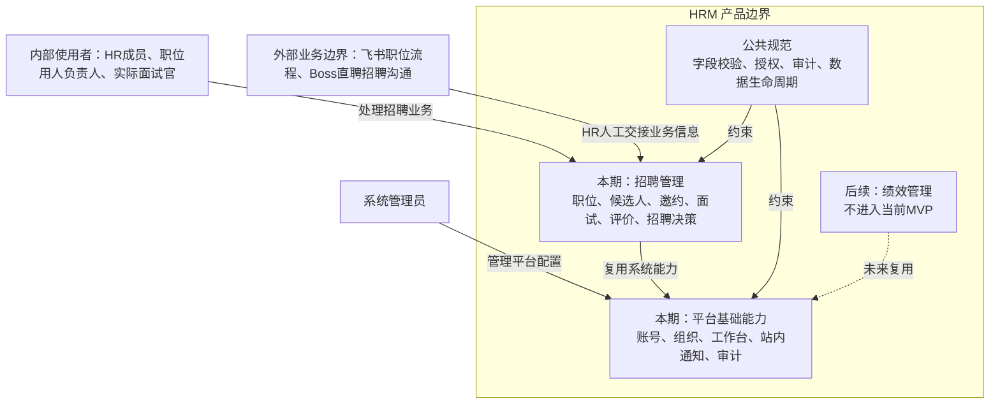
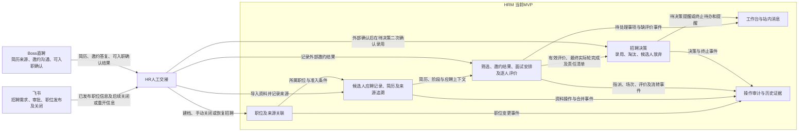

# pm-hrm HRM 人资管理系统产品需求总览

- **项目定位**：借助 AI 完成 HRM 人资管理系统从产品发现到可验收交付的需求闭环。
- **当前阶段**：招聘管理模块 MVP 需求细化。
- **文档状态**：整体框架已建立，模块需求和公共规范仍需持续评审。

## 一、整体产品边界

HRM 是面向公司内部的人资管理系统，整体规划包含：

| 领域 | 当前状态 | 说明 |
| --- | --- | --- |
| 工作台 | 支撑能力 | 聚合不同角色的待办、逾期事项和招聘协作入口；后续扩展为统一工作入口。 |
| 招聘管理 | 当前 MVP | 从飞书职位发布完成后的职位建档，到候选人筛选、邀约、面试、评价和录用决策。 |
| 绩效管理 | 后续模块 | 当前只保留统一模板和后续扩展方向，不进入本期实现。 |

### 1.1 重新规划入口

[项目规划与阶段交付](项目规划与阶段交付.md)提出先补内部人员身份与账号关系，再按身份授权、招聘资料、面试协作、决策和试点推进。人员最小范围属于待评审建议，当前不新增已确认员工管理模块，也不改变录用止于招聘决策的边界。

## 二、文档分层

```text
产品总览
├── 公共规范：所有模块共同遵循的规则
│   ├── 字段与表单校验规范
│   └── 权限与数据治理规范
├── 产品探索：假设、发现和已确认决策
├── 平台基础能力：HRM 全系统复用的账号、组织、工作台、通知和审计能力
├── 指标与试点基线：试点指标口径、基线采集和通过门槛
├── 验收与追踪：需求、用户故事、测试场景和发布结果的追踪关系
└── 模块需求：各业务模块独立维护
    └── 招聘管理
        ├── 范围说明
        ├── 产品需求文档
        └── 用户故事
```

### 2.1 公共规范

- [字段与表单校验规范](公共规范/字段与表单校验规范.md)：必填、长度、格式、数值、附件、重复提交和通用错误处理。
- [权限与数据治理规范](公共规范/权限与数据治理规范.md)：账号、角色、数据范围、权限、审计、软删除和生命周期。

公共规范由系统级需求统一维护。模块文档只描述模块特有字段、业务规则和例外，不复制公共规则。

### 2.2 产品探索

- [产品发现记录](产品探索/产品发现记录.md)：关键假设、落地风险和验证优先级。
- [产品决策记录](产品探索/产品决策记录.md)：已确认的业务边界和后续方向。

### 2.3 招聘管理模块

- [范围说明](模块/招聘管理/范围说明.md)：模块边界、流程、状态、角色和 MVP 验收范围。
- [产品需求文档](模块/招聘管理/产品需求文档.md)：招聘管理模块的完整 PRD。
- [用户故事](模块/招聘管理/用户故事.md)：按角色和业务能力拆分的用户故事与验收标准。
- [业务流程与数据流转图](模块/招聘管理/业务流程与数据流转图.md)：模块数据、业务对象关系、角色协作、状态及非常规链路。

- [产品能力与模块落地映射](产品能力与模块落地映射.md)：信息所有权、平台与招聘职责、页面动作及交付状态。

### 2.4 平台基础能力

- [平台基础能力边界](平台基础能力/README.md)：账号、组织、工作台、通知和审计的系统级职责、复用边界和当前实现范围。

### 2.5 指标与试点基线

- [指标与试点基线](指标与试点基线.md)：招聘 MVP 的试点指标口径、基线采集方式、目标和数据来源。

### 2.6 验收与追踪

- [验收与追踪](验收与追踪/README.md)：从产品目标到用户故事、测试场景和发布门槛的追踪入口。
- [招聘管理需求到验收追踪矩阵](验收与追踪/招聘管理需求到验收追踪矩阵.md)：当前招聘 MVP 的需求覆盖关系。
- [招聘管理测试场景](验收与追踪/招聘管理测试场景.md)：面向试点执行的关键验收场景。

## 三、业务架构与全局数据流转

以下为产品业务视图，依据 D-000、D-001、D-002、D-010、D-019。模块内部正常及非常规链路见[招聘管理图示](模块/招聘管理/业务流程与数据流转图.md)。

### 3.1 业务架构图



实线表示当前业务关系，虚线表示后续方向。用人负责人是按职位指派的责任身份，实际面试官按场次指派；管理员平台权限不自动授予招聘业务访问权，详见公共规范与模块 PRD G.1。

### 3.2 全局数据流转图



| 数据或结果 | 权威归属与本期交接 |
| --- | --- |
| 招聘需求、审批、发布与关闭 | 飞书；HRM只人工登记职位和展示状态，不复制审批流程 |
| 简历来源与外部沟通 | Boss直聘；HR人工导入简历、记录邀约答复及可入职确认结果 |
| HRM职位、应聘记录、面试协作与招聘决策 | HRM；外部来源和内部业务状态分别记录 |
| 待办、站内消息及审计 | HRM平台能力；招聘模块提供业务事件与当前授权上下文 |

一期不接入飞书／Boss API、不做飞书日历同步，不向候选人或飞书发送消息。“录用”止于招聘决策，不流转为员工档案、Offer、薪酬或入职办理记录。绩效管理当前没有跨模块数据流契约。

## 四、需求归属规则

| 内容 | 权威文档 | 模块文档如何使用 |
| --- | --- | --- |
| 系统定位和模块边界 | 本文档 | 作为整体背景，不重复展开模块细节 |
| 字段、表单和附件校验 | 公共规范 | 直接引用；模块只补充业务例外 |
| 权限、审计和数据生命周期 | 公共规范 | 直接引用；模块只补充数据范围和操作差异 |
| 模块流程和状态 | 模块范围说明 / PRD | 模块独立维护，并链接公共规范 |
| 用户故事和验收标准 | 模块用户故事 | 细化模块 PRD，不替代公共规范 |
| 已确认决策 | 产品决策记录 | 作为所有模块需求的约束来源 |
| 账号、组织、工作台、通知和审计 | 平台基础能力边界 | 模块引用系统能力，不重复定义系统级职责 |
| 试点指标和基线 | 指标与试点基线 | 模块验收引用指标口径和通过门槛 |
| 需求到验收关系 | 验收与追踪 | 用户故事必须关联测试场景和发布门槛 |

同一规则出现冲突时，优先级为：已确认产品决策 > 公共规范 > 模块 PRD > 用户故事中的补充说明。发现冲突时应回写权威文档，并在决策记录中留下变更原因。

## 五、AI 需求闭环

```text
产品发现 -> 假设验证 -> 需求澄清 -> 公共规范/模块 PRD
    -> 用户故事 -> 验收标准 -> 技术实现 -> 测试验证 -> 反馈迭代
```

AI 用于整理讨论、识别遗漏、建立文档关联、拆解用户故事和辅助验证；业务决策、权限边界、公共规则确认和最终验收由团队负责。

## 六、后续扩展方式

新增绩效管理或其他模块时，按以下顺序建立文档：

1. 先检查并复用公共规范。
2. 在 `模块/模块名称/` 下建立独立的范围说明、产品需求文档和用户故事。
3. 在本文档增加模块状态、跨模块关系和入口链接。
4. 只有发现跨模块共性规则时，才更新公共规范，并记录变更原因。
