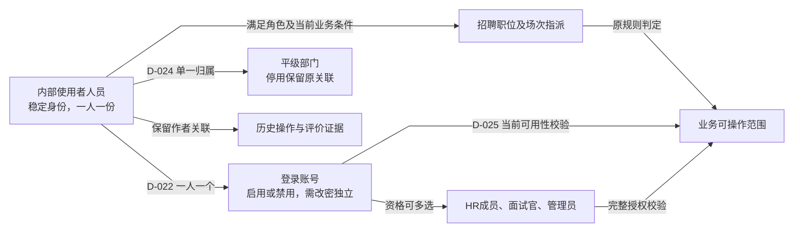

# 人员、账号与角色字段定义

- **面向读者／用途**：研发与测试；实现配套需求。

- **版本／日期**：0.5／2026-10-12。
- **状态**：人员、账号与部门规则按D-022至026定义，联合交接与实现验收待执行。不是数据库设计或接口契约。
- **目标角色与价值**：管理员统一维护招聘参与人的身份和资格，HR及面试官在同一人员身份下承担业务责任，避免重复身份和错误授权。
- **依据**：[公共字段规范](../公共规范/字段与表单校验规范.md)、[公共权限规范](../公共规范/权限与数据治理规范.md)、[招聘PRD](../模块/招聘管理/产品需求文档.md)、D-013、D-016及[项目规划](../项目规划与阶段交付.md)。通用校验和治理只引用，不在此重新定义数值或授权机制。

## 一、适用范围与证据状态

| 状态 | 含义 |
| --- | --- |
| 已有 | 现有权威文档明确；表中为字段应用索引，规则仍以引用来源为准 |
| 本期定义 | D-022确认的最小范围、人员账号关系及管理员统一维护 |
| 本期不纳入 | 完整员工岗位与任职生命周期不在D-022的最小内部使用者范围 |
| 待真实验证 | 字段政策已定义，但联合交接、实现测试或实际使用没有执行证据 |

**本期人员范围（D-022）**：仅维护HR、面试官、管理员等实际使用本系统的内部人员；一人一份人员身份，本期每人一个关联账号，人员和账号可在同一表单创建。角色可多选，职位及场次责任另行指派。暂不管理全体员工、不维护身份证／合同／薪资，也不建设无账号人员库。概念分开不意味着多建表或重复录入。

外部面试官若实际存在，须另评估人员范围、访问期限和授权，不纳入当前内部使用者范围。

## 二、对象关系与边界

人员表达“谁”，账号表达“如何登录”，角色表达“具备什么资格”，部门表达组织归属，招聘指派表达“负责哪项业务”。岗位分类是招聘流程配置输入，不是人员权限角色或员工自身岗位。

本期关系：一份人员身份关联一个账号，账号关联多个现有角色；人员经有效账号和角色可被指派多个招聘职位／场次。姓名或邮箱变更不生成新人、不替换历史作者；角色移除和账号禁用不删除历史业务证据。

**共性规则引用**：公共权限规范按D-022区分稳定人员引用与登录邮箱，分别定义人员、账号和登录用户；姓名或邮箱变化不得替换历史人员关联。邮箱更正权限和会话失效按D-025执行。

### 已确认概念关系图

该图表达产品关系，不表示数据库拆表；部门归属不直接授权业务操作，历史作者不保留访问权。

## 三、人员与组织字段

表中类型为业务类型，来源说明人工／系统产生，不预定数据库列名。人员资料管理权限引用公共规范第2.2节及D-025；已有账号配置管理权限仍按公共规范执行。

| 字段 | 含义／类型 | 来源、默认与必填 | 修改与业务校验 | 状态／关联入口 |
| --- | --- | --- | --- | --- |
| 人员身份引用 | 区分自然人的稳定标识；单值标识 | 系统生成，无人工默认；创建成功即存在 | 身份引用不可编辑；姓名和邮箱变更保持引用，不能按姓名自动合并人员 | 本期定义；人员详情、历史作者关联 |
| 姓名 | 人员显示名；文本 | 管理员输入，创建必填，无默认 | 使用公共姓名校验；管理员维护；按D-025修改并刷新资料，记录历史；同名允许，不能作为唯一身份 | 姓名必填已有，人员字段归属与管理员维护已确认，按D-025修改并刷新资料；US-001 |
| 邮箱 | 本期账号登录邮箱；文本 | 管理员输入，创建必填，无默认 | 格式及唯一比较引用公共规范；管理员按D-025确认前后值和原因后更正邮箱，禁止占用另一账号邮箱，不变更人员关联 | 创建／唯一已有，身份保持按D-022；更正按D-025使会话失效；US-001、002 |
| 所属部门 | 人员组织归属；单一部门关联 | 管理员选择，创建必填，无默认 | D-024确认每人一个部门，新关联选择启用部门；停用保留原关联与业务权限；创建仍必填，不提供无部门创建 | 必填已有，单部门及生命周期按D-024；US-001、002 |
| 员工岗位 | 自身任职岗位；本期不提供 | 无输入、无默认 | 暂无招聘参与人管理的必要使用证据；需要时再确认，不能复用招聘职位或岗位分类替代 | 本期不纳入，需新增范围证据才评审 |
| 人员任职状态 | 在职／离职等人事状态；本期不提供完整状态机 | 不提供员工生命周期表单 | 沿用现有离职用户不得登录约束；D-025在禁用原因中记录离职并阻断访问，不自行等同“禁用=离职” | 本期定义不建设完整员工流程；离职禁用原因按D-025 |

**部门定义已收口**：D-024采用稳定部门关联、必填且不重复的名称、启用／停用状态；本期平级列表，管理员创建、重命名、停用和启用，不删除；共性规则引用公共规范第2.1节，具体字段与交互见[组织与账号规则](#organization-account)第1节。人员及账号操作随后按D-025收口；F-01及F-02本期定义已收口，招聘接任授权按D-026定义，尚待实现验收。

## 四、账号与角色字段

| 字段 | 含义／类型 | 来源、默认与必填 | 修改、校验与权限依据 | 状态／入口 |
| --- | --- | --- | --- | --- |
| 关联人员 | 账号对应的人员身份；单一关联 | 按D-022随创建表单关联，必有，无人工默认 | 同一人的身份与账号关系不能被角色维护改绑另一人；管理员新增角色应使用已有人员 | 本期定义；账号详情 |
| 登录邮箱 | 使用第三节邮箱，不另存一份“人员邮箱”供本期独立修改 | 同一输入，一次校验 | 唯一性按公共规则；变更使当前会话失效，不自动重置密码或解除禁用，按D-025 | 登录已有；不重复录入已确认，变更按D-025 |
| 初始／重置密码 | 认证输入；秘密文本 | 管理员创建／重置时设置，必填，无固定默认 | 完全引用公共密码规则和首次改密流程，不是人员可见资料；不得在详情或日志回显 | 已有；US-001 |
| 下次登录需改密 | 是否必须先改密；布尔业务条件 | 创建／重置后系统设置，修改成功后解除 | 不提供普通编辑开关；条件与改密行为引用公共规范第2节 | 已有条件的字段表达；US-001 |
| 账号可用性 | 可登录或已禁用；状态条件 | 由管理员管理动作产生 | 禁用后禁止登录及访问；重新启用引用公共用户恢复能力。禁用账号允许配置角色但不解除禁用，按D-025 | D-025明确启用／禁用，创建默认启用且需改密；US-002 |
| 角色集合 | HR成员、面试官、管理员等现有资格；多选关联 | 管理员创建／配置，创建至少一个；不默认赋予角色 | 按公共规范完整授权合并；不增加用人负责人同名角色；移除后按当前资格校验 | 已有；US-001、002 |
| 创建／变更证据 | 操作人、时间、对象及前后变更；审计关联 | 系统记录，无人工编辑 | 统一引用公共审计字段和追加保存机制，不复制审计模型，不包含密码 | 已有；审计查询 |

本期使用现有角色集合，不增加“自定义角色权限编辑器”。角色名称是显示值，角色授权由公共及模块权限矩阵确定，不能仅更名就改变授权。

## 五、招聘责任指派字段引用

本节只整理接入关系，业务字段和权限仍由招聘PRD、配置及D-018维护，具体字段见招聘字段字典。

| 业务字段 | 输入／条件 | 变更与输出 | 权威位置／故事 |
| --- | --- | --- | --- |
| 职位HR负责人 | 职位必填一名主责，具备HR成员资格 | 解除及重新指定影响后续任务与提醒；保留原操作证据，不删除人员 | PRD B、A、G；US-101、002 |
| 职位用人负责人 | 职位必填一名，具备面试官资格 | 仅负责职位权限；资格移除后未完成任务待重新指派 | PRD B、G.3；D-013／016；US-101、002 |
| 模板候选人员名单 | 轮次配置中的候选人员集合 | 不等于实际参加或评价责任，不自动产生场次访问权 | 最小配置、PRD E；US-401 |
| 场次实际参与人 | 具体场次／轮次的实际指派 | 同场换人和替代新场次采用不同责任及评价处理；无有效参与人按既有规则阻止流转 | PRD E、D-018；US-402 |
| 终面完成责任人 | 终面指定一名有效实际责任面试官 | 该人执行实际完成；不能由账号管理员代为完成 | 最小配置、PRD G.1；US-402、404 |
| 有效评价责任清单 | 由实际指派及合法换人确定，不由角色全局名单直接产生 | 保留已交作者，未交转接按D-018；前轮待定按D-021，不新增录用阻断 | PRD E；US-403、404 |

选人时使用当前有效账号与资格判断，历史姓名／部门／角色仅用于追溯。禁用后指派资格失效；平台仅提供检查责任通用提示，业务交接仍在原授权入口；不能静默把其他人员设为责任人。

## 六、权限与生命周期

人员基础资料查看、维护、邮箱更正、账号启用／禁用、重置与角色维护权限按[公共治理规范](../公共规范/权限与数据治理规范.md)第2.2节及D-025执行。平台页不展示管理员无权访问的招聘业务详情；普通HR和面试官在授权招聘入口使用必要人员显示信息，不因此获得人员资料管理权。

本期不提供人员删除／恢复、下载／导出或自助资料编辑；账号启用不是人员恢复或员工复职。资料保留期限沿公共规范，不能自行承诺永久保留；敏感字段及秘密不写普通日志。

## 七、页面、动作与交接案例

推荐入口“人员与组织”，列表显示姓名、邮箱、部门、角色、账号可用性；详情分为基础信息、账号、角色及业务责任摘要。责任摘要必须经过招聘授权校验，管理员没有业务角色时不能通过摘要查看候选人或评价；D-025采用检查未完成责任通用提示，不显示越权任务内容。

创建时一张表单填写姓名、邮箱、部门、角色和临时密码；成功后显示一份人员及关联账号。邮箱冲突保留合法输入并拒绝重复创建；同名不自动合并。禁用／角色移除先展示影响提示，再按既有规则生效；提示不是拒绝生效的新门槛。业务责任通过现有职位及场次操作交接，不在人员页另建隐式转移机制。

| 案例 | 操作与期望 | 依据与真实验证依赖 |
| --- | --- | --- |
| C-01 同人多角色 | 对已存在人员增加面试官资格，仍为同一身份；HR全局可见不允许未指派提交评价 | 授权已有；复用人员关系按D-022；关联US-002、TS-AUTH-001 |
| C-02 改邮箱 | 管理员更正邮箱，姓名及历史作者关联不变；占用邮箱拒绝且保留原值 | 身份稳定按D-022；D-025使旧会话失效，新邮箱用于重新登录，不能用新账号迁移历史替代 |
| C-03 移除面试官角色 | 下一次操作按新资格拒绝；原评价作者不变，负责人资格失效及未完成责任待重新指派 | 公共规范与PRD G.3已有；平台通用提示按D-025，业务指派入口已定义，联合走查核实实际理解与实现 |
| C-04 禁用账号 | 禁止登录／访问，历史不删除，不默认为完成、取消面试或员工离职办理 | D-025禁用理由、会话失效和通用提示已确认；业务交接按现有授权 |
| C-05 替换职位负责人 | HR按D-026接任用人负责人，新负责人按当前范围操作，不转实际场次或评价责任；原负责人不凭历史关系继续访问 | D-026及TS-OWNER-026；HR负责人另按TS-JOB-002执行，不额外迁移角色或人员身份 |

五例为需求走查，未执行实现测试；账号变更及管理员保护已关联TS-ACCOUNT-025／TS-ADMIN-025，均待执行。联合验证判据为五例预期唯一、人员引用一致、无跨角色越权及历史作者丢失，不替代已有M-007门槛。

## 八、收口状态与剩余依赖

人员、账号、部门及责任接入规则已定义。五例联合交接与实现验收待执行，具体进度见TODO；部门及账号详细动作见下节，验收入口为TS-PERSON-022、TS-ROLE-022、TS-ORG-024、TS-ACCOUNT-025及TS-ADMIN-025。

## 组织与账号字段及操作

- **日期／状态**：2026-10-12，部门与账号规则依据D-024／025。D-022人员范围及D-023按钮规则继续有效。
- **用途**：定义部门与账号的字段、管理动作和结果；共性规则引用公共规范，招聘责任操作由招聘文档维护。
- **依据**：[人员字段定义](人员账号与角色字段定义.md)、[平台按钮矩阵](人员账号按钮权限矩阵.md)、[公共治理规范](../公共规范/权限与数据治理规范.md)。授权以公共规范及平台按钮矩阵为准。

### 一、部门字段与操作（D-024）

本期部门仅作为人员和职位归属、选择与检索的基础信息，采用平级部门列表，每人一个所属部门。本期不提供部门层级、跨部门兼职或部门负责人授权。

| 字段 | 业务定义与来源 | 默认／必填／校验 | 修改及历史 |
| --- | --- | --- | --- |
| 部门身份引用 | 系统产生的稳定单值关联 | 保存成功即有，无人工默认 | 不可编辑；重命名不新建部门，人员／职位引用保持 |
| 部门名称 | 管理员输入的显示名称 | 必填，无默认，引用公共单行文本；去首尾空白后在所有保留部门中不重复 | 管理员可改，不能占用已有部门名称；变更审计，不重写原业务证据 |
| 部门状态 | 启用／停用，管理员动作产生 | 创建默认启用 | 停用不删除历史；可重新启用 |

#### 动作与状态

- 管理员可查看、创建、修改、停用及重新启用部门；本期不提供删除／恢复部门入口，以免破坏人员和职位历史关联。
- 新人员及新职位必须选择启用部门；已关联停用部门的人员和职位保留归属且可继续原有授权业务，不因停用而禁用账号、关闭职位或终止招聘。
- 停用前显示影响提示并二次确认。可停用正在使用部门，不要求先清空关联；重新指派部门时只能选择启用部门，不能静默批量迁移。
- 既有记录编辑其他字段时，保留原停用部门合法；不能因保存其他字段要求重新选择部门。新关联和原值保持是不同校验场景。
- 空列表引导管理员建部门；普通用户无配置入口。部门选择只表达归属，不能改变招聘授权逻辑。

关联人员与职位部门选择、US-001／002／101及部门按钮矩阵；共性规则引用公共规范第2.1节。

**交接案例（待真实执行）**：新部门创建并被人员、职位引用→停用→原人员继续处理原面试→新人员／职位不能选择该部门→管理员重命名／启用。每一步核对关联、授权及历史；任何停用导致自动退出招聘或历史丢失均不符合D-024。

### 二、账号状态与变更（D-025）

账号可用性与需改密条件分开，避免“待改密”被实现为一种离职或禁用状态。动作如下：

| 动作／状态 | 准入与输入 | 结果及反馈 | 历史和任务影响 |
| --- | --- | --- | --- |
| 创建 | 管理员按D-022一次创建；部门、角色及密码合法 | 账号默认启用，需改密=true；首次认证只能改密，成功后可用 | 无重复人员或账号，遵循公共审计 |
| 禁用 | 管理员确认目标及原因；原因引用公共备注校验 | 账号改为禁用，当前会话失去访问能力，不能继续提交 | 不取消场次、不改变候选人阶段、不删除原作者；未完成责任按现有指派规则人工处理 |
| 重新启用 | 管理员确认已禁用目标 | 改为启用，保留当前角色和需改密标记，旧会话不恢复，重新登录 | 不自动恢复已交接指派、不恢复终止流程，不表示员工复职 |
| 重置密码 | 管理员设置合法临时密码，启用及禁用账号均可执行 | 设置需改密=true，使已有会话失效；不将禁用账号顺带启用 | 保留身份、角色和历史；改密后仍需账号启用才可进入业务 |
| 更正登录邮箱 | 管理员输入合法且未占用邮箱，确认新旧值及原因；可对启用／禁用账号操作 | 人员及账号不变，邮箱更正使会话失效，旧邮箱不能登录；不自动重置密码或解除禁用 | 保留稳定身份与历史；通知不新增外部渠道 |
| 修改姓名／部门／角色 | 管理员；角色仍至少一个，部门按本节部门规则 | 字段保存后按当前资格判断；角色增删不创建新人员 | 不重写历史作者，不自动转移责任；部门变更不新增职位访问权 |

#### 管理连续性与离职约束

- 不允许管理员禁用自己；也不允许禁用或移除最后一个启用管理员的管理员角色。其他管理员可处理目标账号，结果说明不能让平台失去可管理账号。
- 仍保留角色为至少一个；禁用账号可先配置角色以准备重新启用，但角色保存不能解除禁用。
- 离职不建设独立人事流程，建议管理员在禁用原因中记录“离职”，先立即阻断访问，再人工交接未完成责任；重新启用是否符合人员实际资格由管理员核实，不自动认定复职。
- 本期由管理员维护人员基础资料；其他角色无全公司人员详情与资料编辑入口，但可按原招聘授权查看所需人员显示名及指派信息。人员基础页不显示越权候选人或评价内容。
- 不提供人员物理删除、人员恢复、资料下载／批量导出、自助资料编辑；账号启用不等于人员恢复。资料期限仍按公共规则，不自行承诺永久保留。

账号变更关联PB-03至PB-07、US-001／002及账号管理场景；共性认证与生命周期规则引用公共规范第2.2节。

### 三、交接提示方案（不新增业务数据授权）

账号禁用或移除资格后，管理员看到“请由业务负责人检查未完成责任”的通用提示；不在平台页列出无权访问的候选人、评价或任务详情。HR及当前负责人在原授权工作台／职位／场次入口定位待重新指派责任，沿用既有HR负责人变更和面试换人规则。

提示不新增通知频率，不强制先完成交接才允许禁用，也不自动找替代人员。无有效负责人时，已有配置告警和无法推进约束继续有效；用人负责人接任按D-026由HR执行，管理员平台角色不取得业务权限。

### 四、五个案例的当前判定

| 案例 | 已确认部分 | 操作依据 |
| --- | --- | --- |
| 同人多角色 | D-022身份复用与完整授权合并已有 | 角色保存及至少一个角色沿用已有故事；禁用账号配置是否允许按D-025确认 |
| 改邮箱 | 稳定人员关联及唯一校验已有 | 更正入口、原因、会话失效及不重置密码按D-025确认 |
| 移除面试官角色 | 当前授权失效、历史作者保留、责任待指派已有 | 最后管理员保护与角色保存提示按D-025确认；业务交接依原规则 |
| 禁用账号 | 禁止访问、历史不删已有 | 创建默认状态、会话与启用结果、禁用原因及自身保护按D-025确认 |
| 替换负责人 | HR负责人合法解除／重新指定有TS-JOB-002；原负责人无历史访问特权 | 按D-026由HR执行接任、接任人具备面试官资格且账号启用、原因必填；不增加管理员业务授权 |

五例用于交接验证；尚无正式研发／测试签署或实现执行结果。

### 五、规则与验收关联

人员／账号规则关联US-001／002，部门选择关联US-101；具体动作见平台按钮矩阵。验收入口为TS-PERSON-022、TS-ROLE-022、TS-ORG-024、TS-ACCOUNT-025及TS-ADMIN-025。招聘接任依D-026及招聘字段／操作定义执行。

五例联合交接与实现验收待执行，进度由TODO维护。

## 版本与变更记录

| 版本／日期 | 变更及阅读影响 | 决策／验收影响 |
| --- | --- | --- |
| 0.4／2026-10-12 | 吸收已确认组织／账号提案的字段、动作和案例；确认过程由D-024至026追溯，共性规则仍归公共规范。 | 本次仅信息架构整理，不变业务决策、权限或验收预期；实现测试状态不变。 |
| 0.5／2026-10-12 | 精简方案代号、确认过程及重复收口说明，保留操作、案例、授权与执行依赖。 | 仅阅读整理，不变D-022至026及验收预期。 |
