# 招聘管理业务流程与数据流转图

- **版本／日期**：0.4／2026-10-12。
- **用途**：研发、测试与产品共同理解业务输入输出、角色交接及正常／非常规链路。
- **范围**：现有招聘 MVP 的图示表达，依据[产品决策 D-001 至 D-040](../../产品探索/产品决策记录.md)，重点采用 D-018、D-019、D-020、D-021 的最新口径，不新增业务功能。
- **权威依据**：[范围说明](范围说明.md)、[PRD](产品需求文档.md)、[面试流程与评价最小配置](面试流程与评价最小配置.md)。公共校验、授权、审计与生命周期分别引用[字段规范](../../公共规范/字段与表单校验规范.md)和[权限与数据治理规范](../../公共规范/权限与数据治理规范.md)。
- **阅读方式**：先看系统级[业务架构与全局数据流](../../产品总览.md)，再读本文件的数据流、对象关系、泳道和状态，最后对照异常子图与验收索引。

图中的箭头表示业务数据传递或条件成立后的动作。角色泳道表示责任交接，不替代 PRD G.1 授权判断。业务对象表示需求概念，不定义数据库表、接口或存储结构。成功指标引用[指标与试点基线](../../指标与试点基线.md)，验收引用现有[测试场景](../../验收与追踪/招聘管理测试场景.md)，本文件不另设指标口径。

## 图型选择与阅读索引

| 要回答的问题 | 表达类型 | 本文位置 |
| --- | --- | --- |
| 数据来自哪里，经过哪些业务处理，产出什么？ | 数据流图，箭头标注数据与条件 | 第一节 |
| 哪些对象关联，一份还是多份，历史保留在哪里？ | 概念关系图 | 第二节 |
| 谁在哪个阶段执行，交给谁，携带什么信息？ | 角色协作时序泳道＋阶段责任对照 | 第三节 |
| 哪些状态能转换，满足什么条件？ | 状态图＋独立状态对照 | 第四节 |
| 异常触发后如何判断、等待、终止或继续？ | 条件分支流程图 | 第五至七节及专项子图 |

不同图型各自回答一个问题；同一业务规则只在权威正文维护，图示引用并随其同步。

## 一、模块数据流转

### 1.1 招聘业务数据主链

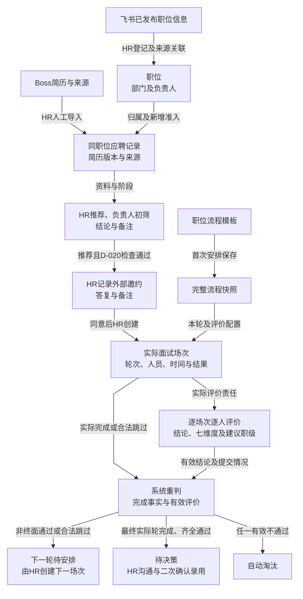

下一轮的待安排事项不自动创建场次，HR沿主链场次安排入口继续执行。手动淘汰／放弃仍按当前阶段责任授权。

### 1.2 待办与历史证据的数据去向

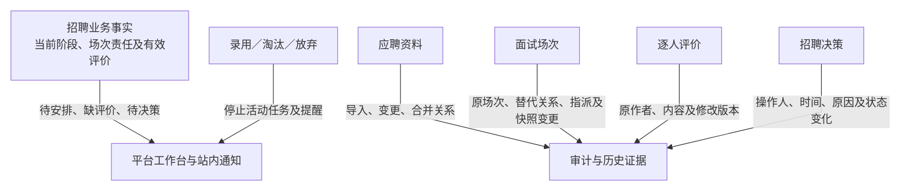

最终实际轮通常为配置终面；负责人确认 CTO不参与时，按第六节引用前一有效实际轮承接最终评价。图中“下一轮待安排”不等于自动创建面试场次。建议职级只作为评价信息，不改变原流程快照。手动淘汰／放弃仍按当前阶段责任人授权，录用由 HR在待决策完成外部确认后二次确认。

## 二、业务对象关系

本图采用概念关系图：`||`表示一份，`o{`表示零至多份，`o|`表示零或一份。描述业务关联与多值性，字段与修改准入见[字段字典](字段字典.md)，不作为数据库设计。

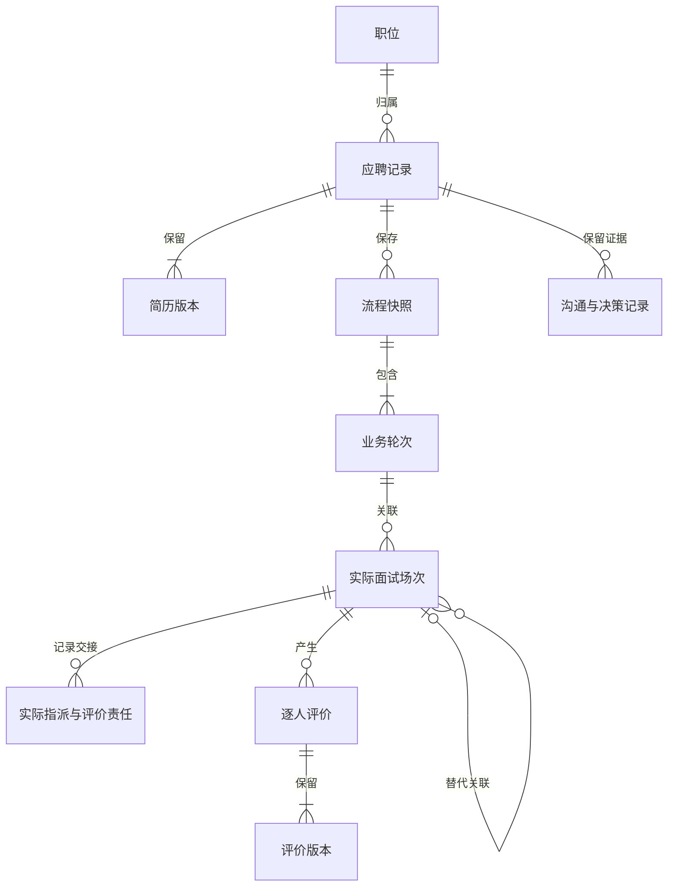

同一人在不同职位分别建立应聘记录和流程，不跨职位合并。同职位合法合并另保留主／旧记录关系，不销毁旧证据。图中简历版本包括保留的旧版本；当前简历只有一个引用，上传成功后自动设为当前。实际参与人不等于模板可选名单；评价责任换人规则见第5.3节，不用关系线推导重复评价义务。历史保留不代表原参与人持续有权访问。

## 三、角色协作时序泳道

从上往下阅读阶段推进；每条竖线是一类责任主体，横向箭头标明交接的数据或动作。HRM泳道中的校验和自动判断为系统动作。此图展示正常通过路径，评价与结束可分别发生；异常见第五至七节。

### 建档与初筛

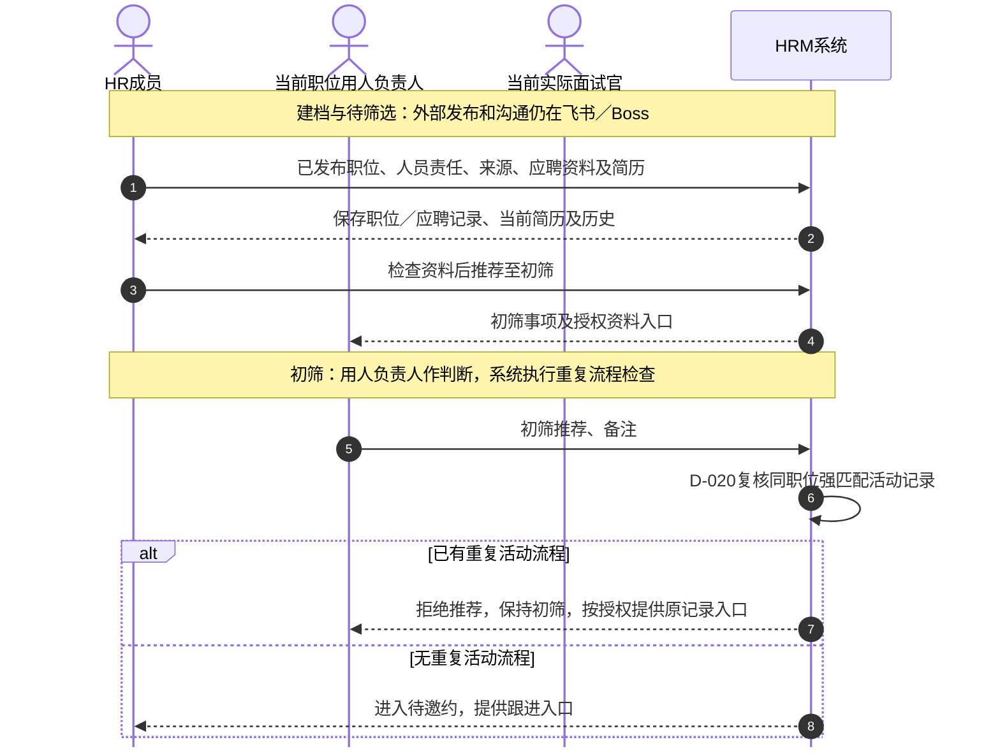

### 邀约与场次安排

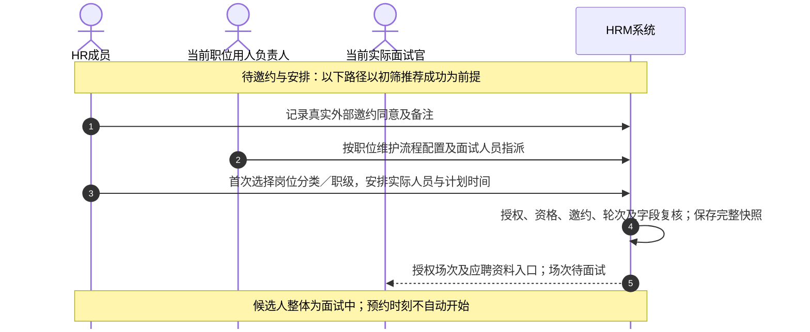

### 面试评价与招聘决策

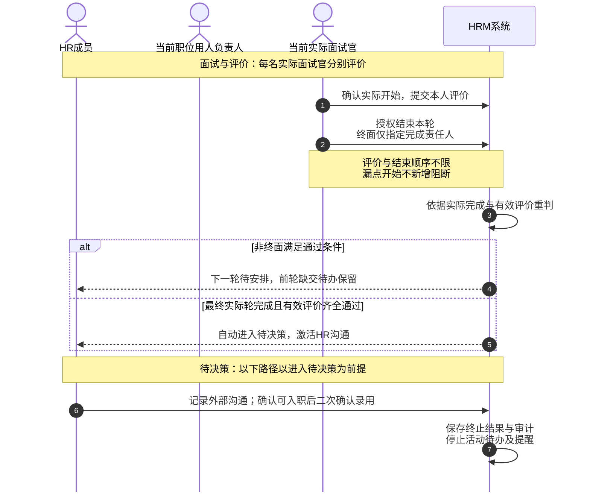

角色表示操作时的有效责任身份，同一个人可能兼任多条泳道。负责人没有实际场次指派时不能点击开始或替他人提交评价；HR安排时引用既有指派，不因此新增指派权。所有动作须复核PRD G.1授权，系统反馈箭头表示业务入口／状态结果，不承诺新增站内通知。

### 3.1 阶段、角色与数据使用对照

此表是阅读索引，授权仍以[PRD G.1](产品需求文档.md)及[按钮矩阵](页面交互与按钮权限.md#buttons)为准。“系统产出”不表示对所有角色可见。

| 阶段 | HR成员使用／产出 | 当前职位用人负责人使用／产出 | 当前实际面试官使用／产出 | 系统使用／产出 |
| --- | --- | --- | --- | --- |
| 待筛选 | 导入及维护应聘资料、来源、简历；检查后推荐 | 按负责职位查看资料，不代HR维护基础资料 | 仅有部门或角色不获得该候选人访问权 | 保存应聘记录、版本与阶段历史，提示重复 |
| 初筛 | 查看处理进度；按既有权限记录放弃 | 阅读资料，填写初筛结论和备注 | 无初筛职责；另有业务身份时按该身份执行 | 推荐时检查重复活动流程；产生待邀约或保留初筛 |
| 待邀约 | 使用联系方式外部沟通，记录邀约结果；同意后安排 | 维护负责职位流程及人员指派 | 获得有效实际指派后按范围查看资料 | 保存安排与首次快照；创建场次后整体面试中 |
| 面试中 | 维护计划及非评价事实；查看评价，不凭HR角色修改或下载评价 | 按职位查看、授权修改评价；处理前轮待定 | 按实际指派阅读资料；记录开始、本人评价和授权完成 | 保存实际证据及有效责任，判断下一轮、待决策或淘汰 |
| 待决策 | 使用最终轮事实，记录沟通并二次确认录用 | 按授权查看证据及处理事项，不代HR录用 | 按当前授权查看；历史作者身份不自动保留访问权 | 维护提醒、状态与审计；终止后停止活动任务 |

简历查看与下载、评价查看与修改是不同授权。HR可按既有权限下载非评价资料；负责人和面试官查看简历不获得下载权，HR查看评价不获得修改及下载权。平台管理员仅有平台角色时不获得招聘数据权限。阶段表只说明该阶段的典型职责，不扩大其他阶段依法存在的查看权。

## 四、候选人阶段与独立状态

### 4.1 候选人阶段

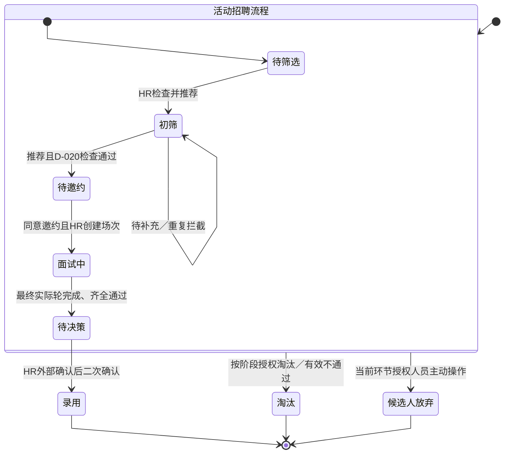

图中活动流程的公共终止出口用于合并重复连线，不表示任意角色可在任意阶段操作。待筛选／待邀约由HR主动淘汰，初筛由用人负责人不推荐；面试中／待决策的有效不通过按D-019自动淘汰，手动终止仍按阶段授权。有效不通过只适用于已经产生有效评价的流程。

终止状态不回退；修改历史评价、恢复软删除或重开职位不恢复终止流程。阶段动作的逐项角色以 PRD D、G.1 为准。

### 4.2 邀约、轮次、场次分别表达

| 状态维度 | 取值／节点 | 对候选人阶段的影响 |
| --- | --- | --- |
| 邀约 | 待邀约、邀约中、同意、拒绝、失联 | 同意是创建面试前置条件；拒绝／失联不自动放弃或淘汰 |
| 业务轮次展示 | 未开始、待面试、面试进行中、已结束待评价、评价已齐、已跳过 | 完成、评价及跳过按第五／六节决定是否推进，不凭节点名称直接改阶段 |
| 面试场次 | 待面试、面试进行中、已完成、公司取消、候选人取消、未到场 | 取消／未到场保留场次结果，可创建同轮替代场次，不自动终止候选人 |

邀约再联系与更正已按D-036定义，见[筛选邀约字段](字段字典.md#fields-screen-invite)及文末D-036／037子图；最新非同意阻断新建或替代场次，但不取消已存在场次、不回退整体阶段。

## 五、非常规面试链路

### 5.1 评价不通过、待定、缺交与通过门槛

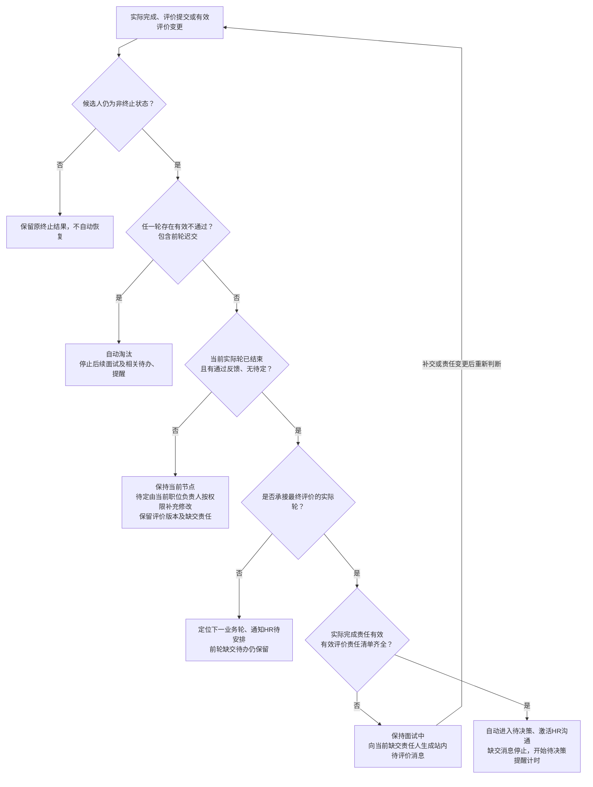

此图适用于实际面试，合法跳过走下一子图。终面缺交消息频率见最小配置第6节；进入待决策后的长期未推进提醒按 PRD F 执行，两类提醒分别验收。评价通过不自动录用，HR沟通结果不额外阻断进入待决策。

### 5.1.1 前轮迟交待定

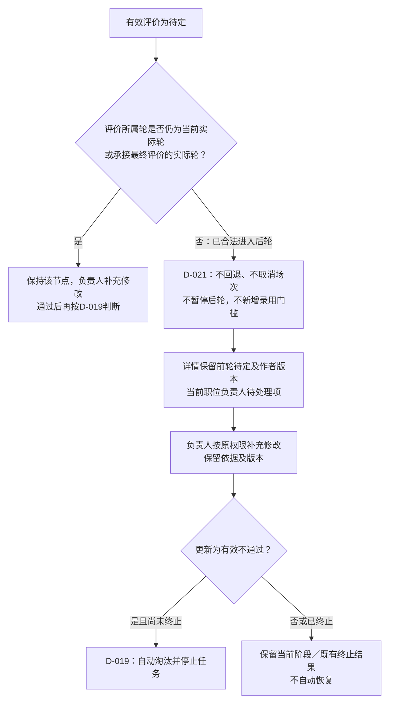

该分支依据D-021、PRD E.5及TS-LATE-021；不把前轮待定显示为已通过。终止后停止活动待办，历史证据保留，不新增终止后补交权。

### 5.2 一面跳过与非终面合法跳过

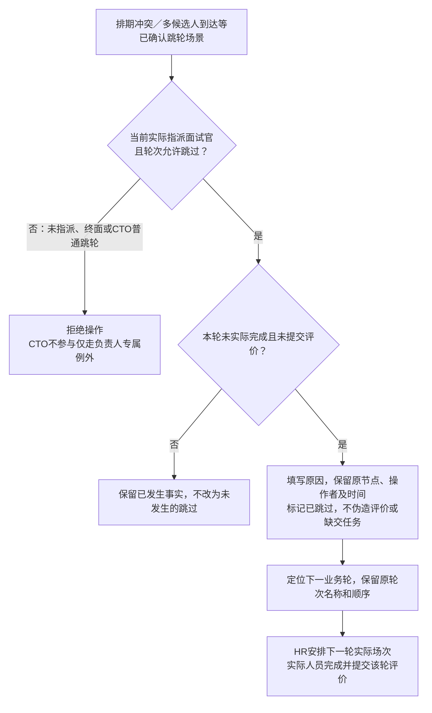

一面直接从二面开始的人员指派及无人兜底仍受 D-016、D-018 限制，不因“直接开始”免除授权。各职级实际终面定义见 PRD E.1，CTO不参与另见第六节。

### 5.3 取消／未到场后的替代场次与同场换人

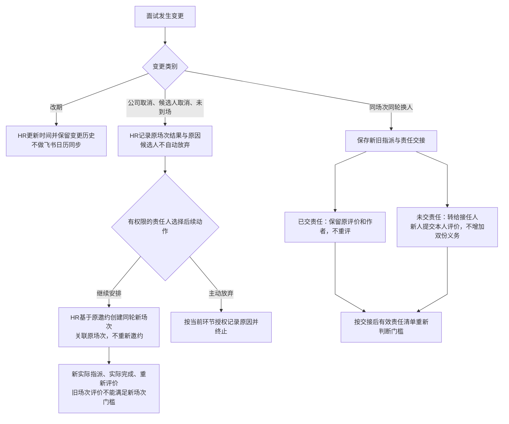

### 5.4 本轮无人、账号无效与责任交接

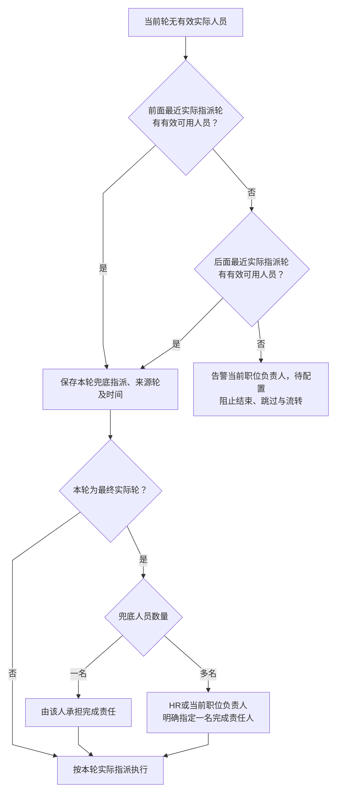

来源只取有效实际指派，不取可选名单；停用账号、已撤销角色和无效指派不作为来源。负责人不自动成为面试官。职位负责人变更按 PRD G.3、轮次换人按第五节交接；历史操作者不改写，解除指派后的访问按当前授权判断。HR负责人解除及重新指定按 TS-JOB-002 验收，一期不增设账号禁用专属业务流程。

## 六、CTO不参与与最终评价承接

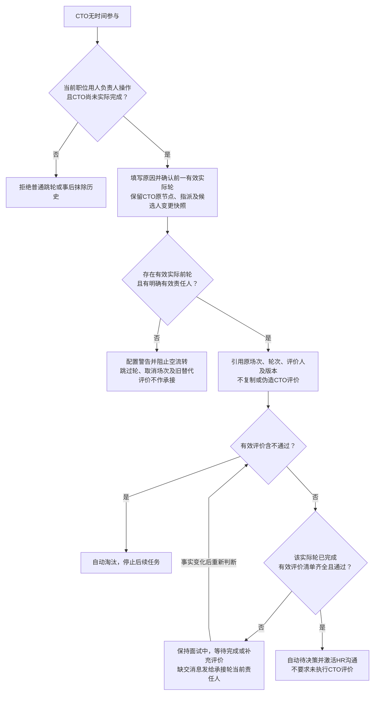

变更只作用于该候选人流程，标准模板和原始快照保留；CTO未执行部分停止待办，不产生重复缺交消息。CTO正常参加则走标准终面完成与评价门槛。进入待决策不等于录用，后续仍由HR完成外部确认及二次确认。

## 七、其他异常入口与验收索引

下表补充跨越多个图示的异常入口。链接指向现有测试文档；编号可在该文档检索，对应 PRD／配置章节为业务规则入口。

| 链路 | 触发、责任动作与数据去向 | 规则依据 | 验收场景 |
| --- | --- | --- | --- |
| 初筛重复推荐拦截 | 服务端检查同职位待邀约／面试中／待决策强匹配记录，有则保持初筛；同时推荐最多一条成功 | D-020；PRD重复流程准入 | TS-DUP-020 |
| 初筛待补充／不推荐 | 用人负责人待补充时停留初筛；不通过进入淘汰，保留结果和原因 | D-002；PRD D | TS-FLOW-001 |
| 邀约拒绝／失联 | HR记录结果与备注，不允许创建面试；只有当前环节授权责任人主动终止才改变候选人终止状态 | D-005、D-012；PRD D | TS-FLOW-002 |
| 职位关闭／重开 | HR依据飞书结果手动更新；关闭阻止新增，应聘记录原有流程继续；重开复用原职位 | D-001；PRD B | TS-JOB-001 |
| 同职位重复／合并 | HR判断并确认主记录和当前简历版本，旧简历、评价和历史以合并关系保留；跨职位独立处理 | D-011、D-018；PRD C | TS-CAND-002、TS-DUP-018 |
| 判重时间边界 | 未面试不应用一年期限；实际面试后以最近实际结束时间起算一年，不用计划时间替代 | D-018；PRD C | TS-DUP-018 |
| 缺配置／本轮无人 | 无匹配流程先补配置；无人按第5.4节兜底，无有效来源则负责人告警并阻断 | D-008、D-018；配置第2、6节 | TS-INT-001、TS-READY-001、TS-ALIGN-018 |
| 一面跳过及直接二面 | 当前轮授权参与人保留跳过原因；下一轮实际人员独立完成和评价 | D-015、D-016；配置第4节 | TS-INT-006、TS-READY-001 |
| 取消／未到场与替代 | HR保留原场次、新建同轮关联场次；新场次重新评价，不自动放弃 | D-012、D-019；配置第7节 | TS-INT-004、TS-ALIGN-021 |
| 改期与同场换人 | 改期保留时间历史；同场换人保留已交作者、交接未交责任，不重写旧证据 | D-016、D-018；配置第2、6节 | TS-INT-002、TS-ALIGN-018、TS-ALIGN-021 |
| 已结束但无通过／有待定 | 留在当前节点，当前职位负责人按权限修改评价并保留版本；不凭结束按钮推进 | D-019；配置第7节 | TS-ALIGN-020 |
| 前轮迟交待定 | 已合法进入后轮后不回退或暂停，不新增录用门槛；详情保留事实，当前职位负责人补充修改；当前实际轮／最终承接轮待定仍阻断该轮 | D-021；PRD E.5 | TS-LATE-021 |
| 前轮缺交／迟交不通过 | 正常通过时缺交待办保留，可继续下一轮；迟交有效不通过终止尚未终止流程 | D-018、D-019；配置第4、7节 | TS-DEC-003、TS-ALIGN-020 |
| 终面缺交与重判 | 实际完成后仍面试中；有效清单补齐且通过后自动待决策，重复处理只流转一次 | D-018、D-019；配置第6节 | TS-DEC-001、TS-MSG-018、TS-ALIGN-020 |
| CTO不参与 | 当前职位负责人确认，前一有效实际轮承接；无有效前轮阻断，缺评价等待；保留引用与快照 | D-019；PRD E.4、配置第7节 | TS-ALIGN-022 |
| 面试发现职级差异 | 实际评价人只记录建议职级，原安排职级和流程快照不变 | D-019；配置第7节 | TS-ALIGN-021 |
| 主动淘汰／放弃与录用 | 当前环节授权人主动终止并记录原因；HR仅在待决策外部确认后二次确认录用 | D-011、D-012、D-019；PRD D、G.1 | TS-FLOW-001、TS-DEC-002 |
| 负责人变更／解除角色 | 当前责任关系更新，未完成任务待重新指派，历史操作人保留；不以历史身份继续授权 | D-013、D-016；PRD G.3 | TS-JOB-002、TS-AUTH-002、TS-READY-002 |
| 软删除与恢复 | 候选人仅未进入流程可删除；职位无进行中流程才可删除；管理员恢复不恢复候选人终止阶段 | D-018；PRD G.1、文末删除准入 | TS-DELETE-018、TS-GOV-002 |
| 权限拒绝／失效账号／越界 | 使用公共授权与错误处理，不产生未授权业务变化，不新增平行权限规则 | 公共规范；PRD G.1、G.4 | TS-AUTH-001、TS-AUTH-002、TS-GOV-003 |
| 校验失败／重复提交／并发过期／附件失败 | 直接引用公共字段规范的公共规则、通用交互及追加验收，不在模块复制通用失败机制 | 公共字段规范 | TS-READY-003；该场景引用的公共规则逐条验证 |

## 八、图示维护与评审

1. 正常与异常链路必须同时评审；图中每个阻断、等待、终止与恢复入口对照第七节验收，不能只走录用路径。
2. 需求或决策变更时，同步相关图、规则引用和验收索引；出现冲突先更新权威规则，再改图，不通过图示隐含扩大授权。
3. 新增尚未确认的分支先标待决策，不画成可执行动作；外部API、员工档案、Offer、入职和绩效数据流仍不进入当前MVP。

## 职位责任与来源补充（D-026／027）

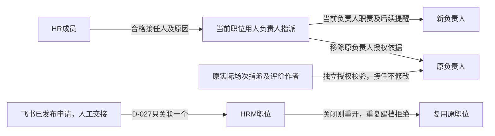

接任不重置任务起点、不修改完成责任或历史快照；平台管理员无HR业务角色不能接任。相同来源重复拒绝，异形链接同申请由HR核实，不宣称有外部API身份校验。验收见TS-OWNER-026、TS-SOURCE-027，均待执行。

## 职位字段更正链路（D-028）

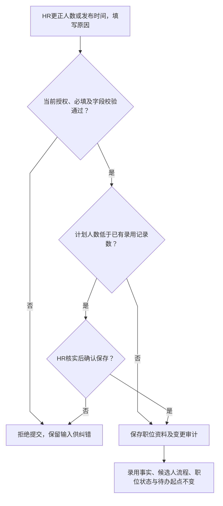

未来发布时间在字段校验时拒绝；办公方式只统一标签并沿用原值。状态动作及负责人接任分别走既有独立链路。提交复核当前事实，校验与审计的共性机制引用公共规范。

## 同一职位资料与来源纠错（D-029／030）

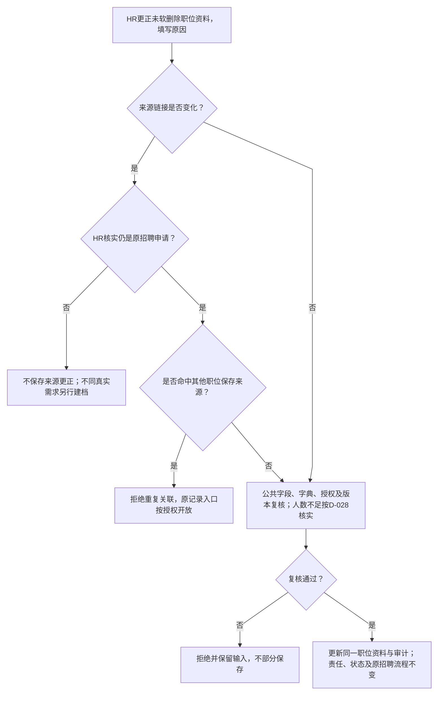

异形链接由HR在飞书人工核实，本图不表示自动外部身份校验；公共字典机制只引用公共字段规范D-030。

## 候选人导入、版本与误建（D-031至034）

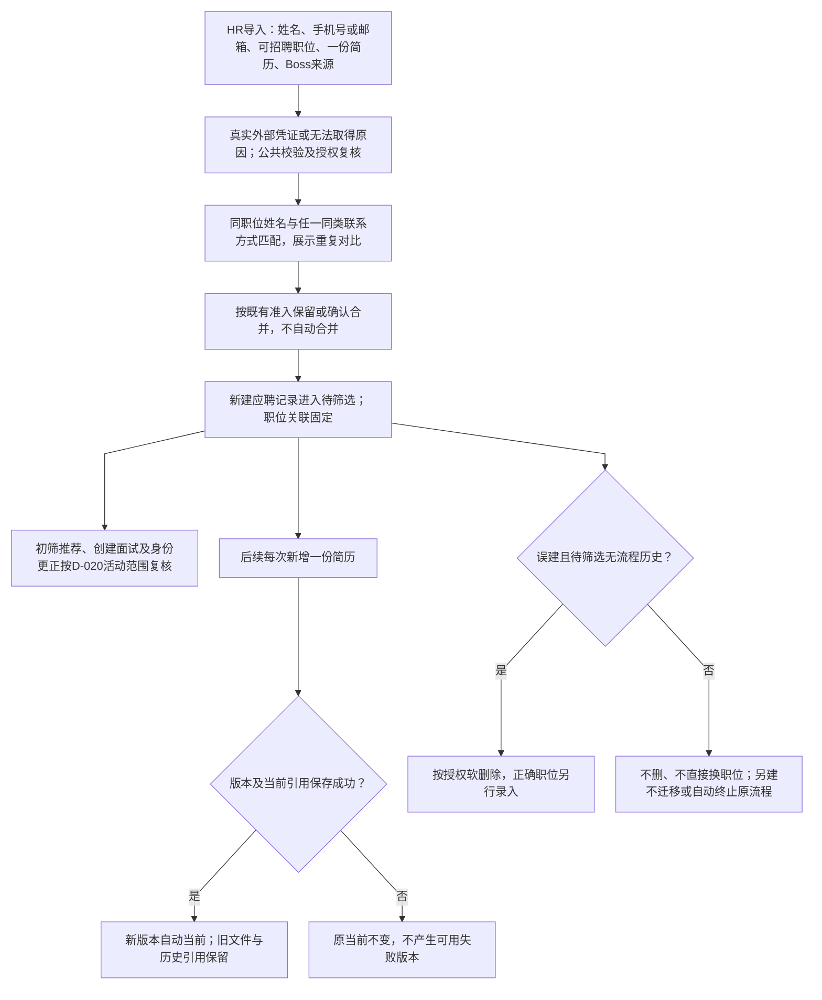

图中强匹配按D-032，两条活动流程不拼接；来源缺失原因不等于外部授权状态。上传当前更新与流程历史分别保留；下载按既有HR授权。其他校验失败与过期版本拒绝引用公共规范，不把图中顺序当正式接口事务设计。

## 单场开始主链路与整体阶段（D-035）

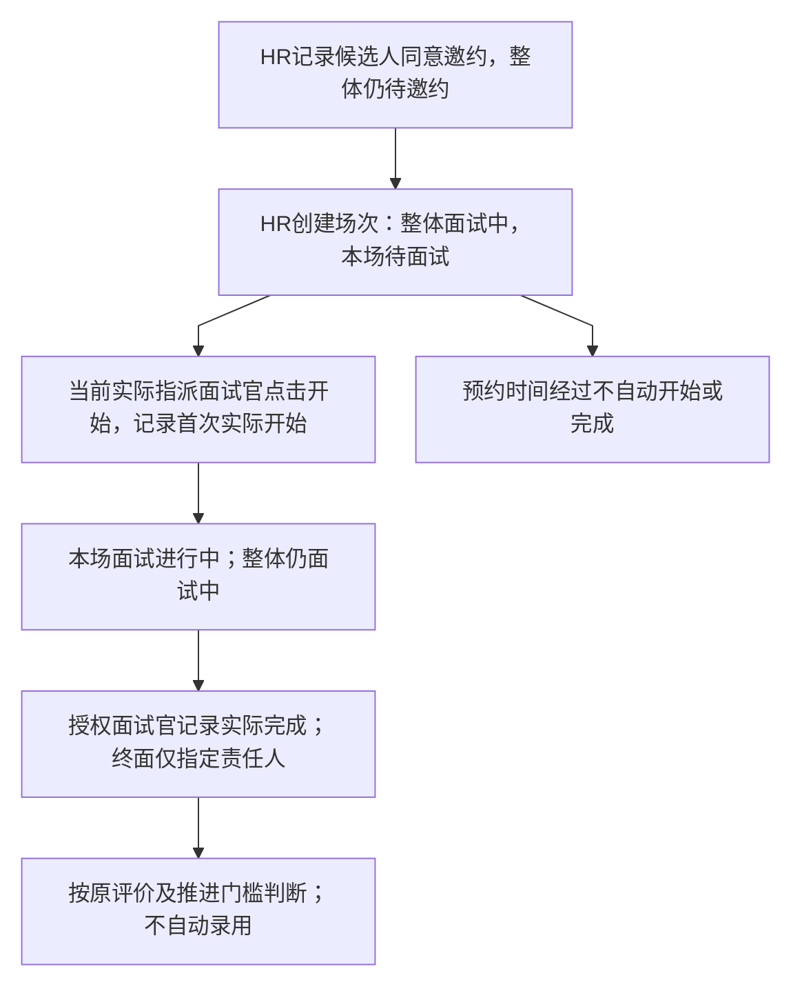

图为正常开始主链路，不新增“点开始是评价或完成必备条件”的门槛。轮间等待时整体仍面试中，场次／轮次等待分别展示；多人开始只保存首次证据，取消／未到场、终止及未来轮不允许开始。漏点开始补录及误点作废按D-037与[场次字段](字段字典.md#fields-session)执行，不用预约时刻推算实际开始。

## 邀约再联系、记录纠错与场次事实（D-036／037）

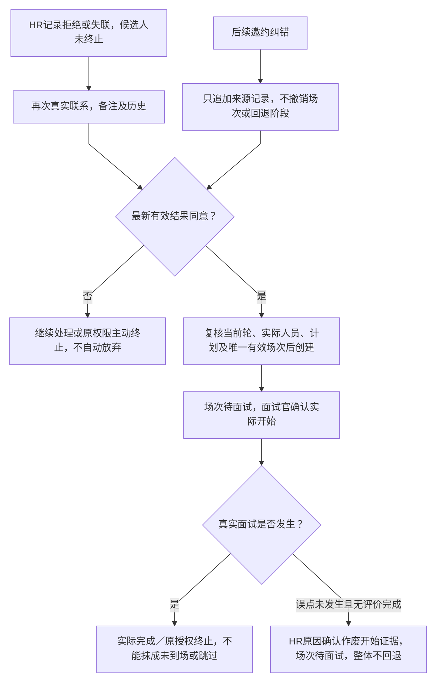

最新非同意阻断新或替代场次，不撤销历史实际事实；漏点开始不阻断既有评价／完成，补录与原操作者分别保留。开始时钟不自动推断真实发生。

## 任务、消息与指标分别使用业务事件（D-039／040）

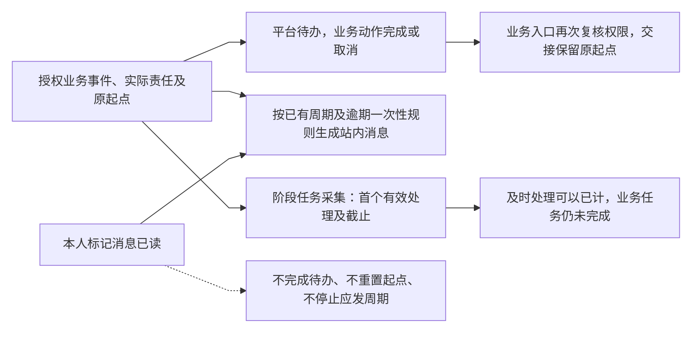

共性字段、阅读、字典及审计维护于平台／公共文档，招聘仅提供触发与解除。逾期严格晚于计划结束，不自动改阶段；M-004统计不生成新通知或业务时限门槛。

## 版本与变更记录

| 版本／日期 | 变更与阅读影响 | 规则／验证影响 |
| --- | --- | --- |
| 0.3／2026-10-12 | 对象流程图改为概念关系图；角色分组流程改为按阶段展开的时序泳道，补阶段／角色／数据使用索引和图型选择表；更新D-036／037当前说明 | 沿用已确认决策，不新增授权、通知或状态门槛；21张Mermaid语法及314处本地引用／锚点检查通过；未验证最终渲染布局，真实交接理解仍待评审 |

| 0.3／2026-10-12 | 统一中性蓝灰样式；角色时序分三段，主数据流与证据流分开；概念关系只显示中文业务对象，去除伪字段 | 表达调整，不变业务规则；24张图Chrome实际渲染及Mermaid语法通过，整体浏览与重点图检查完成；引用及diff通过，证据见TODO |

| 0.4／2026-10-12 | 修复深色阅读器中浅色固定底纹与浅色文字冲突：删除时序rect背景，去掉全部图示强制主题与颜色，保留布局及阶段说明 | 浅色／深色分别渲染复核；业务与授权不变 |
