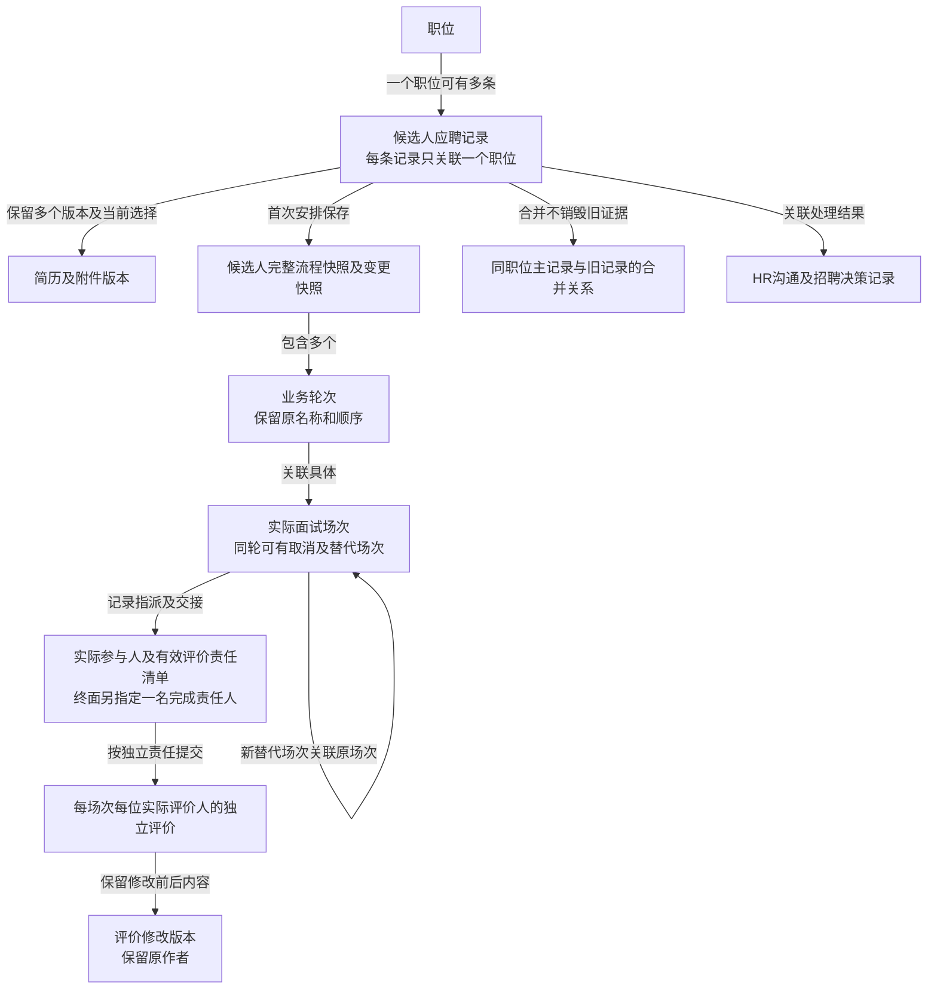
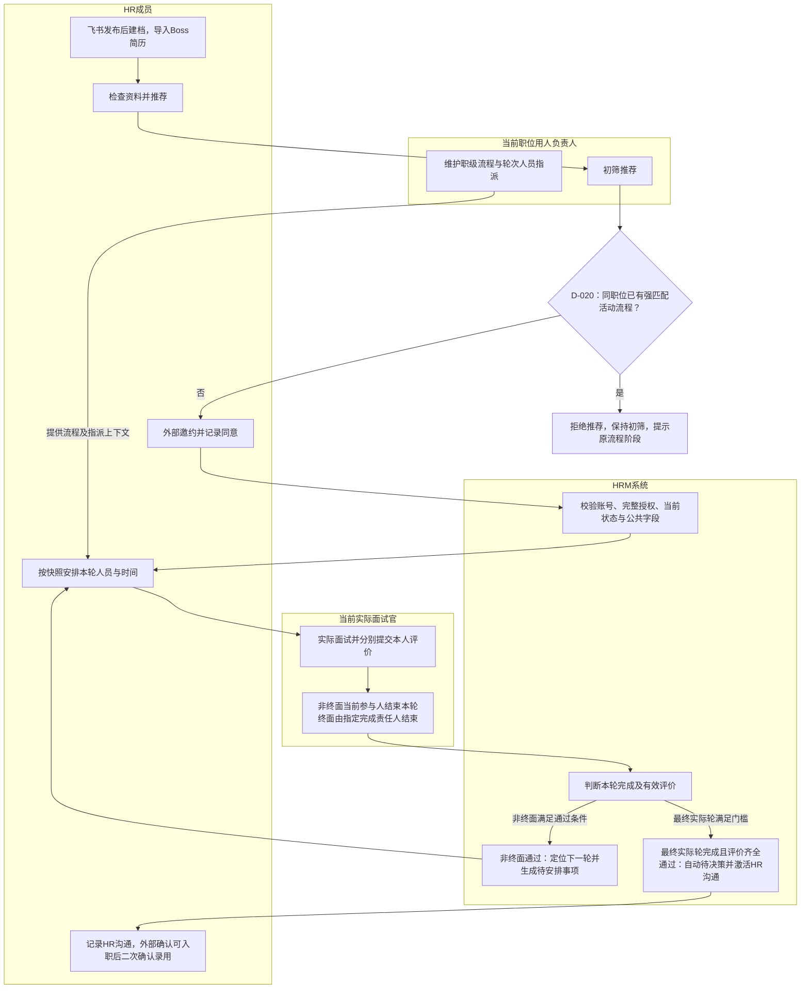
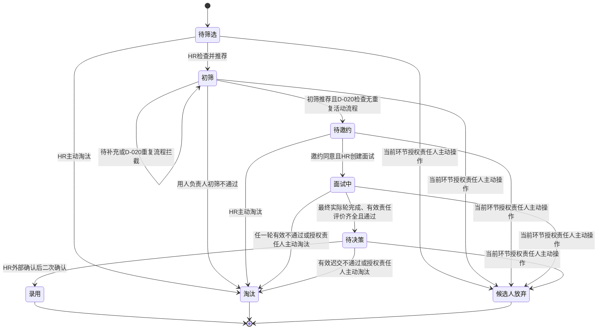
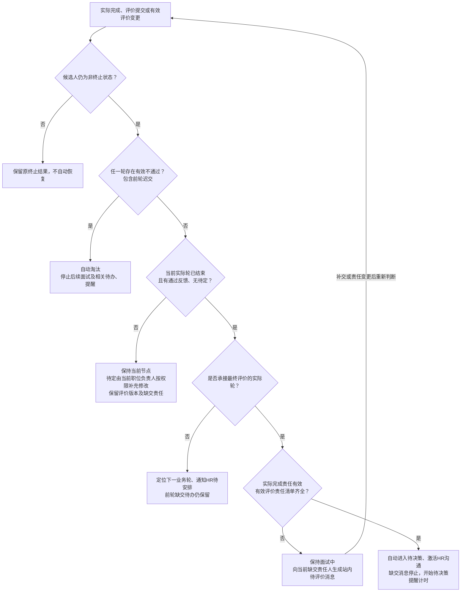
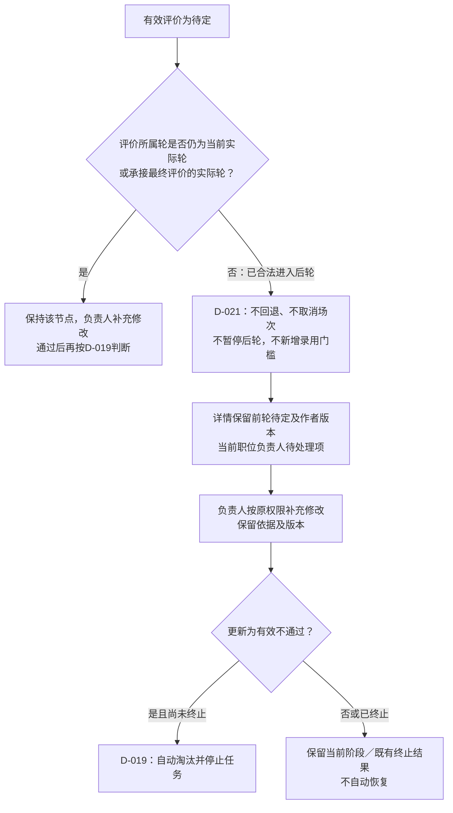
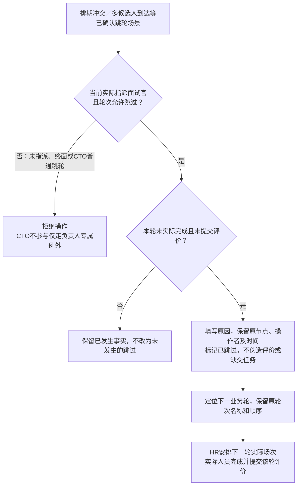
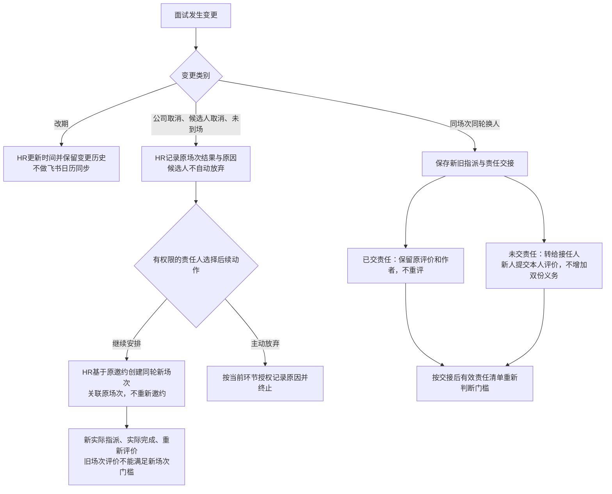
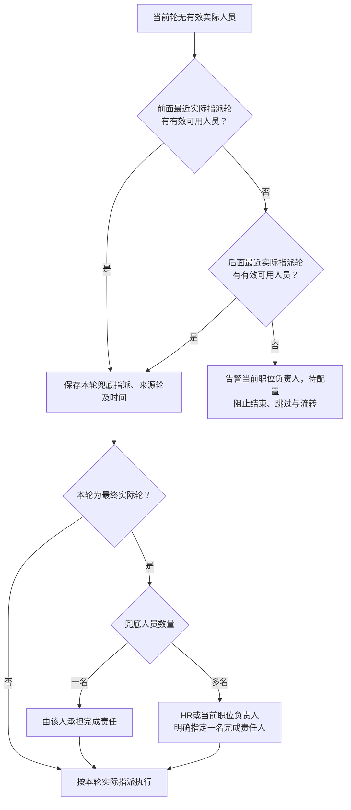
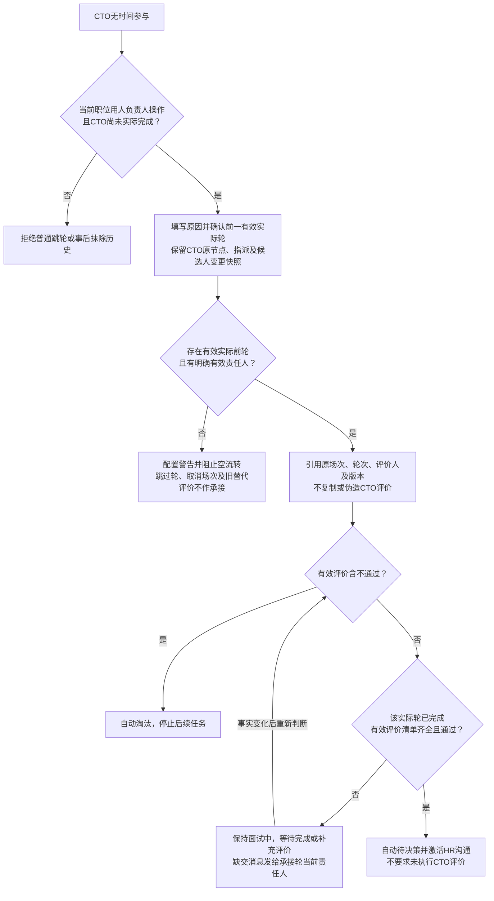

# 招聘管理业务流程与数据流转图

- **日期**：2026-10-10。
- **用途**：研发、测试与产品共同理解业务输入输出、角色交接及正常／非常规链路。
- **范围**：现有招聘 MVP 的图示表达，依据[产品决策 D-001 至 D-021](../../产品探索/产品决策记录.md)，重点采用 D-018、D-019、D-020、D-021 的最新口径，不新增业务功能。
- **权威依据**：[范围说明](范围说明.md)、[PRD](产品需求文档.md)、[面试流程与评价最小配置](面试流程与评价最小配置.md)。公共校验、授权、审计与生命周期分别引用[字段规范](../../公共规范/字段与表单校验规范.md)和[权限与数据治理规范](../../公共规范/权限与数据治理规范.md)。
- **阅读方式**：先看系统级[业务架构与全局数据流](../../产品总览.md)，再读本文件的数据流、对象关系、泳道和状态，最后对照异常子图与验收索引。

图中的箭头表示业务数据传递或条件成立后的动作。角色泳道表示责任交接，不替代 PRD G.1 授权判断。业务对象表示需求概念，不定义数据库表、接口或存储结构。成功指标引用[指标与试点基线](../../指标与试点基线.md)，验收引用现有[测试场景](../../验收与追踪/招聘管理测试场景.md)，本文件不另设指标口径。

## 一、模块数据流转

```mermaid
flowchart LR
    SourceJob["飞书已发布职位信息"]
    SourceCV["Boss直聘简历与来源信息"]
    Job["HR人工建档<br/>职位、部门、HR负责人、用人负责人"]
    Candidate["HR人工导入<br/>同职位应聘记录、简历版本、来源追溯"]
    Screening["HR推荐及用人负责人初筛<br/>结果、备注、阶段历史"]
    Invite["HR记录外部邀约<br/>答复状态、备注"]
    Template["按职位、岗位分类及职级配置的流程模板"]
    Snapshot["首次安排的完整流程快照"]
    Session["具体面试场次<br/>轮次、人员、时间、完成责任与结果"]
    Evaluation["逐场次逐人评价<br/>结论、七项文字维度、建议职级及版本"]
    Gate["系统判断推进或终止<br/>当前阶段、有效评价、完成及责任清单"]
    Decision["招聘结果<br/>HR沟通记录及录用／淘汰／放弃"]
    Platform["平台工作台与站内通知"]
    History["审计与历史证据"]
    SourceJob -->|HR登记职位及来源关联| Job
    SourceCV -->|HR导入资料| Candidate
    Job -->|职位归属与可招聘准入| Candidate
    Candidate -->|资料及当前阶段| Screening
    Screening -->|初筛推荐且D-020检查通过后进入待邀约| Invite
    Template -->|首次安排时选定并保存| Snapshot
    Invite -->|同意后HR创建面试| Session
    Snapshot -->|本轮配置及评价模板| Session
    Session -->|场次、轮次、实际评价责任| Evaluation
    Session -->|实际完成或合法跳过事件| Gate
    Evaluation -->|有效结论及责任提交情况| Gate
    Gate -->|非终面满足通过条件或合法跳过：下一轮待安排| Session
    Gate -->|最终实际轮完成、评价齐全且通过：待决策| Decision
    Gate -->|任一有效不通过：淘汰| Decision
    Gate -->|待安排、缺评价、待决策或停止任务| Platform
    Candidate -->|导入、资料变更与合并关系| History
    Session -->|原场次、替代关系、指派及配置变更| History
    Evaluation -->|原作者、内容与修改版本| History
    Decision -->|操作者、时间、原因及状态变化| History
```

最终实际轮通常为配置终面；负责人确认 CTO不参与时，按第六节引用前一有效实际轮承接最终评价。图中“下一轮待安排”不等于自动创建面试场次。建议职级只作为评价信息，不改变原流程快照。手动淘汰／放弃仍按当前阶段责任人授权，录用由 HR在待决策完成外部确认后二次确认。

## 二、业务对象关系

同一人在不同职位分别建立应聘记录和流程，不跨职位合并。可选面试官名单属于配置，实际参与人属于具体场次；名单不自动授予访问权。同场换人的评价复用与新替代场次的重新评价见第五节。历史证据的保存不意味着原参与人持续拥有访问权，当前授权按 PRD G.1 判定。

## 三、正常业务协作泳道

本图只展示通过路径，评价与结束动作可分别发生，系统在相关事实变化后重新判断门槛；异常、不通过、缺交及跳轮见后续图。所有泳道动作均受 PRD G.1 约束。H4不能从未来未开始轮提前提交评价或结束；终面评价提交不替代完成责任人的结束动作。

## 四、候选人阶段与独立状态

### 4.1 候选人阶段

终止状态不回退；修改历史评价、恢复软删除或重开职位不恢复终止流程。阶段动作的逐项角色以 PRD D、G.1 为准。

### 4.2 邀约、轮次、场次分别表达

| 状态维度 | 取值／节点 | 对候选人阶段的影响 |
| --- | --- | --- |
| 邀约 | 待邀约、邀约中、同意、拒绝、失联 | 同意是创建面试前置条件；拒绝／失联不自动放弃或淘汰 |
| 业务轮次 | 未开始、待面试、已结束待评价、评价已齐、已跳过 | 完成、评价及跳过按第五／六节决定是否推进，不凭节点名称直接改阶段 |
| 面试场次 | 待面试、已完成、公司取消、候选人取消、未到场 | 取消／未到场保留场次结果，可创建同轮替代场次，不自动终止候选人 |

邀约只表达已确认结果及准入条件，现有决策没有定义全部结果之间的转换矩阵，本文件不自行补画任意回退或重新邀约箭头。若后续建设邀约重开交互，需要先补充决策和验收。

## 五、非常规面试链路

### 5.1 评价不通过、待定、缺交与通过门槛

此图适用于实际面试，合法跳过走下一子图。终面缺交消息频率见最小配置第6节；进入待决策后的长期未推进提醒按 PRD F 执行，两类提醒分别验收。评价通过不自动录用，HR沟通结果不额外阻断进入待决策。

### 5.1.1 前轮迟交待定

该分支依据D-021、PRD E.5及TS-LATE-021；不把前轮待定显示为已通过。终止后停止活动待办，历史证据保留，不新增终止后补交权。

### 5.2 一面跳过与非终面合法跳过

一面直接从二面开始的人员指派及无人兜底仍受 D-016、D-018 限制，不因“直接开始”免除授权。各职级实际终面定义见 PRD E.1，CTO不参与另见第六节。

### 5.3 取消／未到场后的替代场次与同场换人

### 5.4 本轮无人、账号无效与责任交接

来源只取有效实际指派，不取可选名单；停用账号、已撤销角色和无效指派不作为来源。负责人不自动成为面试官。职位负责人变更按 PRD G.3、轮次换人按第五节交接；历史操作者不改写，解除指派后的访问按当前授权判断。HR负责人解除及重新指定按 TS-JOB-002 验收，一期不增设账号禁用专属业务流程。

## 六、CTO不参与与最终评价承接

变更只作用于该候选人流程，标准模板和原始快照保留；CTO未执行部分停止待办，不产生重复缺交消息。CTO正常参加则走标准终面完成与评价门槛。进入待决策不等于录用，后续仍由HR完成外部确认及二次确认。

## 七、其他异常入口与验收索引

下表补充跨越多个图示的异常入口。链接指向现有测试文档；编号可在该文档检索，对应 PRD／配置章节为业务规则入口。

| 链路 | 触发、责任动作与数据去向 | 规则依据 | 验收场景 |
| --- | --- | --- | --- |
| 初筛重复推荐拦截 | 服务端检查同职位待邀约／面试中／待决策强匹配记录，有则保持初筛；同时推荐最多一条成功 | D-020；PRD重复流程准入 | TS-DUP-020 |
| 初筛待补充／不推荐 | 用人负责人待补充时停留初筛；不通过进入淘汰，保留结果和原因 | D-002；PRD D | TS-FLOW-001 |
| 邀约拒绝／失联 | HR记录结果与备注，不允许创建面试；只有当前环节授权责任人主动终止才改变候选人终止状态 | D-005、D-012；PRD D | TS-FLOW-002 |
| 职位关闭／重开 | HR依据飞书结果手动更新；关闭阻止新增，应聘记录原有流程继续；重开复用原职位 | D-001；PRD B | TS-JOB-001 |
| 同职位重复／合并 | HR判断并确认主记录和当前简历版本，旧简历、评价和历史以合并关系保留；跨职位独立处理 | D-011、D-018；PRD C | TS-CAND-002、TS-DUP-018 |
| 判重时间边界 | 未面试不应用一年期限；实际面试后以最近实际结束时间起算一年，不用计划时间替代 | D-018；PRD C | TS-DUP-018 |
| 缺配置／本轮无人 | 无匹配流程先补配置；无人按第5.4节兜底，无有效来源则负责人告警并阻断 | D-008、D-018；配置第2、6节 | TS-INT-001、TS-READY-001、TS-ALIGN-018 |
| 一面跳过及直接二面 | 当前轮授权参与人保留跳过原因；下一轮实际人员独立完成和评价 | D-015、D-016；配置第4节 | TS-INT-006、TS-READY-001 |
| 取消／未到场与替代 | HR保留原场次、新建同轮关联场次；新场次重新评价，不自动放弃 | D-012、D-019；配置第7节 | TS-INT-004、TS-ALIGN-021 |
| 改期与同场换人 | 改期保留时间历史；同场换人保留已交作者、交接未交责任，不重写旧证据 | D-016、D-018；配置第2、6节 | TS-INT-002、TS-ALIGN-018、TS-ALIGN-021 |
| 已结束但无通过／有待定 | 留在当前节点，当前职位负责人按权限修改评价并保留版本；不凭结束按钮推进 | D-019；配置第7节 | TS-ALIGN-020 |
| 前轮迟交待定 | 已合法进入后轮后不回退或暂停，不新增录用门槛；详情保留事实，当前职位负责人补充修改；当前实际轮／最终承接轮待定仍阻断该轮 | D-021；PRD E.5 | TS-LATE-021 |
| 前轮缺交／迟交不通过 | 正常通过时缺交待办保留，可继续下一轮；迟交有效不通过终止尚未终止流程 | D-018、D-019；配置第4、7节 | TS-DEC-003、TS-ALIGN-020 |
| 终面缺交与重判 | 实际完成后仍面试中；有效清单补齐且通过后自动待决策，重复处理只流转一次 | D-018、D-019；配置第6节 | TS-DEC-001、TS-MSG-018、TS-ALIGN-020 |
| CTO不参与 | 当前职位负责人确认，前一有效实际轮承接；无有效前轮阻断，缺评价等待；保留引用与快照 | D-019；PRD E.4、配置第7节 | TS-ALIGN-022 |
| 面试发现职级差异 | 实际评价人只记录建议职级，原安排职级和流程快照不变 | D-019；配置第7节 | TS-ALIGN-021 |
| 主动淘汰／放弃与录用 | 当前环节授权人主动终止并记录原因；HR仅在待决策外部确认后二次确认录用 | D-011、D-012、D-019；PRD D、G.1 | TS-FLOW-001、TS-DEC-002 |
| 负责人变更／解除角色 | 当前责任关系更新，未完成任务待重新指派，历史操作人保留；不以历史身份继续授权 | D-013、D-016；PRD G.3 | TS-JOB-002、TS-AUTH-002、TS-READY-002 |
| 软删除与恢复 | 候选人仅未进入流程可删除；职位无进行中流程才可删除；管理员恢复不恢复候选人终止阶段 | D-018；PRD G.1、文末删除准入 | TS-DELETE-018、TS-GOV-002 |
| 权限拒绝／失效账号／越界 | 使用公共授权与错误处理，不产生未授权业务变化，不新增平行权限规则 | 公共规范；PRD G.1、G.4 | TS-AUTH-001、TS-AUTH-002、TS-GOV-003 |
| 校验失败／重复提交／并发过期／附件失败 | 直接引用公共字段规范的公共规则、通用交互及追加验收，不在模块复制通用失败机制 | 公共字段规范 | TS-READY-003；该场景引用的公共规则逐条验证 |

## 八、图示维护与评审

1. 正常与异常链路必须同时评审；图中每个阻断、等待、终止与恢复入口对照第七节验收，不能只走录用路径。
2. 需求或决策变更时，同步相关图、规则引用和验收索引；出现冲突先更新权威规则，再改图，不通过图示隐含扩大授权。
3. 新增尚未确认的分支先标待决策，不画成可执行动作；外部API、员工档案、Offer、入职和绩效数据流仍不进入当前MVP。
