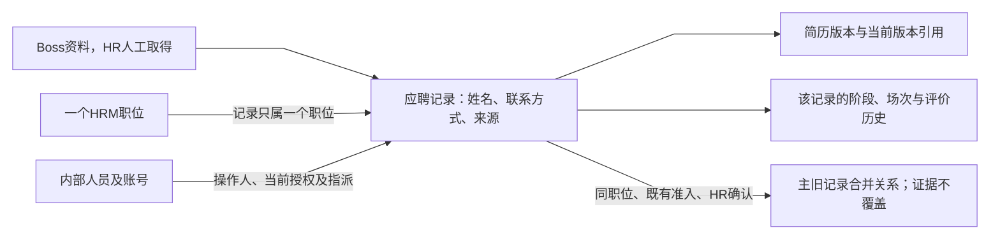

# 字段字典

- **版本**：0.1，2026-10-12。
- **状态**：本期产品定义已收口，实施及真实验收待执行。
- **用途**：招聘PRD附录，按对象／动作阅读；公共规范和已确认决策保持各自权威。

## 阅读索引

- [职位字段与更正规则](#fields-job)
- [候选人与简历字段](#fields-candidate)
- [筛选与邀约字段](#fields-screen-invite)
- [模板与面试场次字段](#fields-session)
- [评价与招聘决策字段](#fields-evaluation)

## 职位字段与更正规则

- **日期／状态**：2026-10-12；F-03本期产品定义已收口；字段、操作、历史与正式验收追踪已关联，尚未执行实现验收。
- **用户与价值**：HR人工登记飞书已发布职位，为应聘记录提供来源、归属、负责人及新增准入；用人负责人按职位承担业务责任。
- **权威依据**：[PRD B、G.1](产品需求文档.md)、[范围说明](范围说明.md)、D-001、D-013、D-016、D-018、D-022、D-026至D-030。类型为业务表达，不预定数据库或接口。

### 一、输入字段

通用长度、链接、数值、时间、选项校验引用[公共字段规范](../../公共规范/字段与表单校验规范.md)，权限和审计引用[公共治理规范](../../公共规范/权限与数据治理规范.md)。无默认值代表HR需输入或选择，不能自动替其确认飞书事实。

| 字段 | 业务含义／类型 | 来源、默认、必填 | 业务校验／关系 | 修改与历史 |
| --- | --- | --- | --- | --- |
| 职位名称 | 正在招聘的职位名称；单行文本 | HR按已发布职位输入；无默认，必填 | 不是人员自身岗位、权限角色或模板岗位分类；名称相同不等于同职位 | D-029由HR更正同一招聘需求的名称，填写原因；不同需求另行建档 |
| 所属部门 | 职位组织归属；部门关联 | HR选择；无默认，必填 | 部门不授予职位权限；D-024新关联只能用启用部门；停用保留既有归属，编辑其他字段可保留原值 | 不改变负责人指派即不能改变其授权范围；部门重命名不应冒充新职位 |
| 招聘人数 | 招聘计划人数；正整数 | HR输入；无默认，必填 | 上限与格式引用公共规范；不是已录用人数或实时剩余名额 | 已有HR业务维护范围；D-028更正原因必填；低于已有录用记录数提示核实，确认后可保存，不自动关闭或终止流程 |
| 用人负责人 | 对本职位负责的人员；单一人员指派 | HR建档时选择；无默认，必填一人 | 具备面试官角色；不是部门负责人，不自动参加实际面试；按当前账号与资格校验 | D-026由HR一次替换，启用账号及面试官资格、原因必备；原资格失效显示并由HR接任；历史作者不变 |
| HR负责人 | 主责HR；单一人员指派 | HR建档选择；无默认，必填一人 | 具备HR成员角色；全公司HR查看权限不要求被逐职位指派 | HR成员或管理员可解除／重新指定；原因、操作人及时间留存，不改原历史；解除到再指定期间显示“HR负责人未指定”，不自动指定替代人；不影响既有全公司HR权限 |
| 职位类型 | 职位分类；单个字典值 | HR选择；无默认，必填 | 使用对应启用字典，初始值引用范围说明；历史停用值不能用于新选择 | D-029同一职位更正需原因；原停用值保留按公共规范D-030，换值只用启用项 |
| 办公方式 | 职位办公方式；单个字典值 | HR选择；无默认，必填 | 既有初始值为现场办公、远程、混合办公，尚非城市／地址。不能自行增加地址字段或将办公方式当具体面试地点 | D-028已改为“办公方式”，沿用原值；资料更正记录原因与历史 |
| 飞书审批申请链接 | 外部职位来源凭证及追溯入口；链接 | HR输入；无默认，必填 | 已发布事实来自飞书，HRM不通过链接自动验证审批或同步；D-027同一申请不重复关联，重复反馈按授权展示 | D-027一申请一职位；D-029由HR核实原申请并填写原因后纠错，旧新值留审计，链接不代替外部身份核实 |
| 发布时间 | 外部职位发布时间；日期时间 | HR按飞书事实录入；无默认，必填 | 使用公共时区及格式，不是HRM建档时间；不自动取当前时间代替 | D-028创建及更正均不得晚于当前业务时刻；HR更正需原因，系统建档时间、候选人阶段和待办计时不变 |

### 二、系统结果、动作与历史

| 字段／事实 | 含义及生成 | 修改与使用条件 | 依据 |
| --- | --- | --- | --- |
| 职位记录引用 | 系统在建档成功后产生稳定关联，供应聘记录使用 | 不因改名、重开或负责人更换替换既有引用；具体标识展示方式由交互决定 | D-001复用原职位及模块对象关系 |
| 招聘状态 | 可招聘／已关闭；初始可招聘 | HR人工按飞书关闭／重开操作；关闭仅阻断新候选人，原流程继续；不自动根据招聘人数关闭 | PRD B、US-101／102 |
| 关闭／重开原因及操作证据 | 状态动作的原因、实际操作人、时间及变化 | 非自由修改状态字段；由关闭／重开动作产生，恢复招聘与软删除恢复不同 | TS-JOB-001、PRD G.1 |
| 建档与变更审计 | 按公共审计记录操作者、时间、对象、结果和必要摘要 | 时间系统产生，不用发布时间替代；不允许无痕修改历史 | 公共规范第6节 |
| 负责人变更历史 | 记录解除、指定及原因，保留当时人员关联 | 责任变更影响后续操作／任务／提醒，不改原操作作者；指派人员引用D-022同一身份 | PRD B、G.3、TS-JOB-002 |
| 软删除状态及恢复 | 通过已授权删除／恢复动作产生 | 无进行中流程才可软删；不级联销毁历史；管理员授权恢复，不代替招聘重开 | D-018、TS-DELETE-018 |
| 候选人阶段概览 | 从本职位应聘记录聚合的展示结果 | 不作为可手填字段；概览不扩大数据授权 | 范围说明职位列表、公共授权规则 |

### 三、页面与操作映射

创建页提供九项业务输入；创建与保存条件按US-101及公共规范。详情区分外部发布时间、内部建档证据、状态与负责人；不把所有字段都提供成可直接编辑的状态输入框。

HR可查看／维护职位资料，负责人及面试官按PRD授权查看。管理员仅通过已有授权的负责人配置／回收入口操作，不因平台管理权限进入招聘敏感详情。查看、修改、删除、恢复及附件下载分别判断，字段表不额外授权。

按钮映射见[RB-01至04、RB-23／24](页面交互与按钮权限.md#buttons)；故事为US-101／102及US-002责任变更；验收引用TS-JOB-001、TS-JOB-002、TS-DELETE-018和TS-BTN-023。补充验收TS-JOB-028、TS-JOB-029、TS-DICT-030及对应追踪；场景均待实际执行。

### 四、定义收口与规则归属

D-026定义用人负责人接任，D-027定义一申请一职位，D-028定义人数、发布时间及办公方式，D-029定义同一职位资料与来源纠错，D-030的公共字典编辑规则只在公共规范维护。本期职位字段无待确认业务政策；图示、按钮、故事及场景已同步。下方为确认方案及案例，不代表实现验收通过。

### 五、业务操作与验收案例

#### 5.1 用人负责人接任（D-026）

由具备HR成员角色的用户在职位配置入口更换用人负责人；新负责人须账号启用且具备面试官角色，填写变更原因，原／新人员、操作人和时间留审计。一次提交从原负责人切换到新负责人，不主动保存空负责人；原负责人禁用或资格被移除时，保留历史指派并显示当前资格失效，HR在同一入口指定接任人。

原负责人资格有效时不要求其额外审批，以免无法处理离职／无法响应的接任；管理员只有同时具备HR业务角色才能执行本方案。现有HR负责人由管理员维护的权限不扩展成管理员可修改用人负责人或查看候选人。

接任结果：新负责人按当前职位范围查看资料、处理未完成初筛、前轮待定及负责人事项，后续长期提醒使用当前有效负责人。未完成业务任务的起点不重置。原负责人失去基于该职位负责人身份的权限；若仍另有实际面试指派，则仍按该独立关系操作。接任不改模板快照、场次实际参与人、完成责任人、评价作者或已交评价，不自动让接任人参加面试或代交评价。

职位已关闭也可接任以继续原有流程；软删除职位不在普通入口更换，先按授权恢复处理。提交时校验当前资格与记录版本；过期页面拒绝覆盖，不将两个接任操作顺序不明地叠加。

**理由**：HR已有职位建档和资料维护职责，接任执行人已按D-026明确为HR；该操作，以便处理负责人失效，同时保持平台权限与业务访问分离。该方案按D-026确认，已修改PRD G.1及按钮授权，不能从全局查看直接推导。

#### 5.2 职位资料更正规则（D-027至030已确认）

D-029由HR在同一招聘需求的现有职位更正资料，填写原因并留存历史；部门按D-024，字典选择与历史编辑引用公共规范D-030。负责人变更独立使用责任操作，招聘状态独立使用关闭／重开按钮，不并入普通编辑。

- 名称、部门、类型和办公方式可按同一职位的外部真实信息更正；不能把已有职位改造成另一招聘需求或自动迁移候选人。
- **D-028已确认**：招聘人数沿公共正整数范围，允许计划调整但不触发自动关闭、淘汰或新增录用限制；低于已有录用数量时提示“计划人数低于已有录用记录，请核实”，允许确认后保存，不修改已录用事实。本期不新增人数审批流。
- **D-028已确认**：发布时间是飞书已发生的发布事实，创建及更正不得晚于当前业务时刻，HR更正原因必填；更正不改HRM建档时间、候选人阶段或任务起点。
- 来源链接仅可更正为同一实际职位的来源凭证；不自动抓取验证飞书。更正说明由HR确认仍为同一职位；换招聘需求应新建真实职位，不在旧记录替换历史。
- **D-028已确认**：“工作地点”本期统一显示为“办公方式”，沿用现场办公／远程／混合办公，不新增城市、办公地址或面试地点字段。

**来源关系已收口（D-027）**：每个飞书申请只对应一个职位。建档或更正来源时，发现其他职位已关联同一申请则拒绝；当前职位自身不构成重复。授权允许才提供原职位入口。同一职位复用，关闭后重开；软删除记录使用授权恢复，不新建替代。并发同来源建档不能产生第二条关联，不因重试新增记录。

本期人工交接，无飞书API；相同保存链接执行重复检查，异形链接是否同一申请须HR核实，不能以URL字符串验证承诺所有外部数据均不重复。来源纠错按第6节D-029执行，格式沿公共规范；不推导额外API或自动异形链接识别。

**理由与影响**：容纳人工录入更正与真实计划变化，不把招聘人数当未确认的自动决策门槛；来源已按用户选择一申请一职位，不支持共享申请建第二个职位。方案J影响字段表、字典显示标签、US-101／102、编辑与建档按钮及对应验收；资料更正按D-029保持HR业务授权；来源重复按D-027拒绝提交。

#### 5.3 交接案例与验收（待执行）

| 案例 | 预期及确认依据 | 应同步位置 |
| --- | --- | --- |
| 负责人从甲接任为乙，甲另有一场实际指派 | 甲失去负责人权限，仍可按实际场次资格参与；乙只接负责人职责，不接甲本人评价责任 | F-02、PRD G.1、按钮矩阵、接任验收 |
| 原负责人禁用，职位已关闭 | HR可指定合格接任者；原候选人继续，新候选人仍被关闭限制 | PRD B、G.3、任务显示及场景 |
| HR修改人数低于已录用数 | D-028核实提示后更正计划，既有录用及其他活动流程不自动变化 | 字段与编辑表单、计划更正验收 |
| 已发布职位填未来发布时间 | D-028拒绝并保留输入供纠错，不用当前时间静默替换外部事实 | 字段表与建档／编辑验收 |
| 链接相同且HR确认同一职位 | 引导原记录，不提交第二个职位；关闭则依既有流程重开 | 重复提示与US-101 |
| 链接相同并尝试声称不同职位继续建档 | D-027仍拒绝，一申请只一个职位，无继续绕过入口 | 来源对比及TS-SOURCE-027 |

D-026至030及对应正式验收追踪已形成；字段定义完成不代表实现测试通过。

### 六、资料与来源更正（K1／K2按D-029确认，K3按D-030归公共规范）

本节定义资料与来源更正边界；人数、时间、授权及申请唯一关系沿D-026至030。

#### K1：来源链接纠错，不更换真实招聘需求

- HR在职位资料编辑中更正来源链接，填写原因并明确确认“新链接仍对应本职位原有的招聘申请”；显示旧、新链接供对比，按公共审计留存变化。
- 允许修正误粘贴、失效分享入口或同一申请的另一有效入口；本期由HR在飞书人工核实，不接API，不自动判断链接可访问或审批完成。沿公共链接格式和D-027已保存来源重复检测，不随意删URL参数以免破坏申请身份。
- 新链接命中其他职位保存的来源时拒绝，不允许通过确认绕过；不同形式指向同一申请仍需人工核实，URL检查不等于外部身份校验。
- 如核实是另一项真实招聘需求，不在原职位换申请：为另一份已发布申请另行建档；原候选人、实际面试、评价和任务不迁移。旧职位状态需要变更时另走关闭动作。
- 纠正此前误贴的链接不将旧链接声明为本职位的真实申请；旧值仅保留为审计证据，新值作为当前来源。不自动合并两个职位或迁移候选人；若两条现有职位实际对应同一申请，应先人工核实处置，不提供重复关联绕过。

**价值／影响**：容纳人工输入错误，保持职位身份与一申请一职位；影响来源编辑确认、重复反馈和审计，保留手工核实的能力边界。

#### K2：同一职位可更正资料，责任与状态独立

- HR可更正名称、所属部门、职位类型及办公方式，填写原因；只允许反映同一招聘需求的纠错或真实资料更新，不允许把原职位改作另一招聘需求。
- 修改部门只调整职位归属，不调整人员自身部门、用人负责人／HR负责人、实际面试指派及数据权限。新增部门选择和保留停用部门沿D-024；不因部门变化推导流程模板或权限变化。
- 可招聘和已关闭的未软删除职位均可更正，关闭职位仍不能新增候选人；软删除职位先走既有授权恢复。查看权不产生编辑权，平台管理员无HR业务角色不能执行。
- 人数、发布时间沿D-028；负责人沿各自独立指派动作，状态沿关闭／重开动作。资料更正不改稳定职位引用、候选人阶段、实际场次、评价作者、快照或任务起点；并发及审计沿公共规范。

**价值／影响**：把HR既有业务维护权落到明确字段和状态，避免改部门隐含转权限或改名称替换真实职位。

#### K3：公共字典编辑引用

停用字典值保留、换值及提交状态复核统一引用[公共字段规范](../../公共规范/字段与表单校验规范.md)“字典停用值的历史编辑（D-030）”，模块不复制共性规则。职位类型、办公方式适用；部门按D-024，人员指派资格仍按各自责任规则。

#### 六例交接预期（已确认，验收未执行）

| 案例 | 已确认预期 | 正式覆盖 |
| --- | --- | --- |
| HR误贴链接，核实新链接才是该招聘需求原申请 | 原记录纠错，原因及旧新值留审计，不新建候选人或迁移流程 | 来源编辑及唯一关联 |
| 改成另一份真实招聘需求的申请链接 | 不通过原职位资料编辑替换真实需求，另行建档 | 职位身份边界 |
| 更正链接命中另一职位已保存来源 | 拒绝并按授权引导原记录，不能确认绕过 | D-027及编辑反馈 |
| 已关闭职位名称纠错或同一需求部门调整 | HR可更正，关闭状态与候选人、负责人、实际指派和授权不变 | 字段、按钮及审计 |
| 旧职位类型已停用，HR只更正名称 | 类型保留并标停用；新记录不能选该值 | 公共字典编辑 |
| 新选字典值提交前被管理员停用 | 拒绝新关联并提示重选，不保存半条修改 | 公共提交复核 |

**收口证据**：K1／K2／K3已形成D-029／030，字段、PRD、RB-01A、交互、流程图、故事及TS-JOB-029／TS-DICT-030与对应追踪同步；F-03本期产品定义完成，尚待实现、跨表单字典验收及真实用户交接评审。指标与业务价值沿US-101／102及既有追踪，不新增成功门槛。

## 候选人与简历字段

- **日期／状态**：2026-10-12；F-04本期产品定义已收口，D-031至034已确认；来源实际可取得性、实施及真实交接仍待验证。
- **目标角色／价值**：HR人工录入招聘资料，负责人及实际面试官在授权范围内查看完整证据，避免将候选人等同员工或内部登录人员。
- **依据**：PRD C、D、G.1；D-002、D-011、D-018、D-020、D-031至034及[公共字段规范](../../公共规范/字段与表单校验规范.md)。

### 一、业务输入

| 字段 | 含义／类型及来源 | 默认与必填 | 修改、准入及历史 |
| --- | --- | --- | --- |
| 候选人姓名 | 当前应聘人的显示姓名，HR从招聘资料录入；文本 | 无默认，必填 | 公共姓名校验；HR资料维护，同名不自动认定同人；判重与身份更正按D-020复核 |
| 手机号 | 联系候选人的电话；HR录入，单值 | 无默认；手机号／邮箱至少一项 | D-032各至多一个，公共电话标准化；同类匹配，不套账号唯一约束 |
| 邮箱 | 候选人联系邮箱；HR录入，单值 | 无默认；手机号／邮箱至少一项 | D-032公共邮箱格式／标准化；和电话不跨类型比较，身份更正复核活动重复 |
| 应聘职位 | 本次应聘归属，选择HRM职位；单一关联 | 从职位入口可带入，保存仍校验；必填一个 | 职位须可招聘；跨职位另建独立应聘记录，不跨职位合并；D-034建档后职位固定；误建按既有删除／另建处理，不迁移流程 |
| 简历附件 | HR从Boss取得并上传的简历证据 | 必填，无默认文件 | 类型、大小及安全检查只引用公共规范；新版本不得覆盖旧文件及历史关联；D-033上传成功自动设当前；HR既有选择及合并选择沿PRD C |
| 来源渠道 | 资料来源，HR录入并由字典承载 | 必填；D-031本期默认Boss直聘，初始来源值为Boss直聘，不开放其他渠道业务 | 不增加其他渠道范围；历史停用值保留及新关联复核引用公共规范D-030 |
| 来源凭证类型 | HR选择；外部ID／来源链接／无法取得 | 必选，无虚构默认 | D-031，按实际可取得情况选择，不等于候选人授权状态 |
| 外部来源凭证值 | HR填写真实ID或链接；文本 | 类型为ID／链接时必填，否则不要求 | 对应格式引用公共规范；不是内部应聘编号，不作唯一键或判重替代；HR补充／纠错留原因与历史 |
| 来源缺失原因 | HR说明无法取得外部凭证的原因；备注 | 类型为无法取得时必填；无默认 | D-031允许有原因录入并标识缺失；后续补充保留原缺失说明的历史 |

候选人不直接上传，不建设候选人登录账号、授权状态、告知或撤回流程；沿用已确认外部前置事实，不因此增加身份证或员工任职字段。

### 二、系统与历史事实

| 字段／对象 | 来源及业务用途 | 修改与治理依据 |
| --- | --- | --- |
| 应聘记录引用 | 成功录入后系统产生，关联一个职位及后续流程 | 不因姓名或联系方式更正替换引用；跨职位使用独立记录 |
| 导入人／导入时间 | 系统记录实际操作人及内部录入时间 | 不手工冒充外部简历时间，不无痕修改；审计引用公共规范 |
| 候选人阶段及历史 | 初始待筛选，随后按PRD D的授权动作及自动规则产生 | 不提供普通编辑下拉框绕过流转；终止不恢复 |
| 简历版本及当前使用版本 | 上传及HR选择产生版本／引用 | D-033每次一份，成功自动设当前，失败不切换；旧版本和引用保留，不新增总数上限 |
| 最近实际面试结束时间 | 从实际完成事实取得，供D-018一年历史判重 | 不由HR录入假结束日期；未实际面试不套一年期限 |
| 合并主旧关系／原因／操作者／时间 | HR确认合并后产生 | 同职位、保留证据，不能拼接两个活动流程；真实阶段冲突另评审 |
| 活动重复流程判断 | 初筛推荐、创建面试及身份更正时按D-020复核 | 排除本记录，待邀约／面试中／待决策强匹配活动记录拦截；跨职位独立 |
| 软删除及恢复证据 | 已授权业务动作产生 | 待筛选且无流程历史才可删除；进入流程不删，恢复不恢复终止阶段 |

### 三、权限、页面与验收

HR创建及维护非评价资料，下载非评价附件；负责人和面试官按PRD G.1查看，不据查看开放修改或下载。人员账号体系只提供操作人和参与人引用，不把候选人导入内部人员库。

导入页包括姓名、联系方式、职位、简历、来源渠道及D-031来源凭证类型／值或缺失原因；联系方式及版本按D-032／033定义，正式实现和完整交接仍待验证；详情区分当前简历与历史版本，姓名／联系方式更正触发活动重复复核。上传失败保留合法输入、无孤立附件；重复提示跳授权对比入口，不自动合并。

关联US-201／202／203、RB-04至06／22／23及TS-CAND-001／002、TS-DUP-018／020、TS-GOV-003、TS-DELETE-018。补充TS-SOURCE-031、TS-CONTACT-032、TS-RESUME-033、TS-POSITION-034，覆盖来源、多联系方式、版本及职位固定政策，不以原场景替代新增验收。

### 四、收口状态与证据边界

L1来源按D-031、L2联系方式按D-032、L3自动当前按D-033、L4职位固定按D-034确认，字段、页面、按钮、图示、故事及正式场景／追踪已关联。L3以用户选择替代原“默认不切换”的提案。

F-04本期产品定义完成；Boss实际ID／链接样例尚未验证，不能宣称平台一定提供稳定凭证。当前缺失原因录入已定义，样例验证不阻断已确认缺失分支。实现测试、版本预览视觉验证及整体交接另行执行，不因文档收口宣布模块已验收。

### 五、对象边界与字段使用

本期直接管理“应聘记录”：一份记录关联一个职位和一条招聘流程，同一人跨职位形成独立记录。候选人身份信息不是内部人员账号，不新建独立的跨职位候选人主档案，也不因同名或同一联系方式自动合并身份。系统应聘标识只用于内部关联，外部来源凭证只用于追溯。

#### 已确认事实与页面责任

| 信息 | 页面与生成责任 | 变更及使用 |
| --- | --- | --- |
| 姓名、联系方式 | HR导入／资料编辑；姓名与联系方式校验引用公共规范 | 不供候选人自行修改；更正不改变应聘记录引用，活动重复复核按D-020 |
| 应聘职位 | 从职位列表进入导入可带入，仍在提交校验可招聘 | D-034关联固定，误建沿既有删除／另建，不允许直接调岗 |
| 简历附件 | HR上传，提交前必须有合法简历 | 查看／下载分别授权，文件校验沿公共规范；版本具体动作见L3 |
| 来源渠道、外部凭证 | HR录入来源事实；本期Boss人工导入 | 不是飞书职位申请链接、会议链接或应聘编号；缺失策略按D-031，见L1 |
| 招聘目的 | 由本次招聘管理业务场景确定为招聘，不设置HR手填授权或撤回状态 | 追溯依据D-011；不扩展为员工档案或其他用途 |
| 导入人员、导入时间 | 成功保存时系统记录实际操作人及时间 | 当前编辑人不能覆盖原导入人；后续修改证据沿公共审计 |
| 阶段、最近实际完成时间 | 流程动作与实际完成事实产生 | 资料编辑不能直接修改，历史判重起点不采用录入或计划时间 |
| 版本引用、合并与软删除证据 | 按上传、HR选择、合法合并及删除动作产生 | 历史按D-018、PRD C保留；进入流程不可删，不拼接双活动流程 |

### 六、F-04已确认业务规则（D-031至034）

L1至L4均已确认，L3采用用户指定的自动当前。已有D-018／020的流程准入、期限及授权继续有效；多联系方式匹配按D-032细化。

#### L1：来源默认Boss，真实凭证按可取得情况记录（D-031已确认）

D-031确认本期导入来源渠道默认Boss直聘，沿已确认范围，不开放新增渠道业务。外部来源凭证由HR录入：选择“外部ID”或“来源链接”并填写真实值；确实无法取得时选择“无法取得”并填写原因，允许导入，详情明确标识来源凭证缺失。系统记录原导入人／时间和后续补充审计，不以内部编号、姓名或随意生成值冒充外部凭证。

ID按公共单行文本、链接按公共链接校验；不自动抓取Boss，不把凭证当候选人唯一键或判重替代。已有流程也可由HR纠正／补充同一候选人真实来源，原因留历史；不得借改来源迁移流程或变更为另一候选人。实际能否取得ID／链接仍需一个脱敏样例验证；方案不声明Boss一定提供稳定ID或永久链接。

**理由**：系统应诚实记录来源可追溯程度，避免因平台资料缺失强迫HR虚构数据。本期不要求外部凭证唯一，也不新增来源授权状态。

#### L2：手机号／邮箱分列及任一同类强匹配（D-032已确认）

D-032本期手机号、邮箱两个独立输入，各至多一个，至少填一项；标准化沿公共规范。仅比较同类字段，不将手机号和邮箱互相比较。相同标准化姓名且手机号或邮箱至少一项相同，视为强匹配；另一联系方式缺失或不同仍提示差异，但不取消强匹配。姓名不同而有联系方式相同继续由HR核实，只有姓名相同不判重。

导入提示与D-020活动流程复核共享该口径；范围仍同职位、排除当前记录，导入不自动合并，活动阶段与判重期限保持原规则。姓名／联系方式更正提交前使用更正后值复核，冲突则拒绝更正，保留原值及活动流程。不新增“强匹配忽略继续推荐”按钮。

**理由／变化**：避免“手机相同但补了邮箱”绕过活动流程拦截；这是用户已确认的多联系方式业务细化，D-018／020应用文字按D-032同步，不能仅以公共格式推定。

#### L3：每次一份，上传成功自动设为当前（D-033已确认）

首次成功上传一份简历后产生初始当前版本；后续每次新增一份，成功保存后自动设为当前，不再提供“上传但默认不设当前”的默认行为。HR仍可在已保存版本列表选择当前版本并留审计，合并时仍由HR明确选择。系统版本序号、时间不替代HR的合并选择，本轮不新增版本总数上限。

每个版本记录版本引用、文件名、文件类型／大小、上传人和上传时间；系统版本序号仅作显示，不作为外部简历日期。详情提供当前和历史预览入口，下载仍仅HR既有授权。切换只影响当前使用版本，不覆盖旧文件、旧评价、流程历史或既有版本引用；合并时仍由HR明确选当前版本。普通编辑不删除旧版本，失败不增加可用版本或切换引用；新增版本与自动当前引用须整体成功才生效。

**结果边界**：按用户选择简化后续上传操作；自动当前只更新当前引用，历史证据保留，不代表覆盖原简历或改写已完成流程。

#### L4：应聘职位固定，误建沿删除／另建（D-034已确认）

D-034不开放修改已保存记录的应聘职位。误选且待筛选、无推荐／邀约／面试／评价历史时，HR可按D-018软删除误建记录，在正确且可招聘职位重新录入；进入流程后按既有终止规则处理需要结束的原流程，为另一个职位另建独立记录，不自动终止旧流程、不迁移阶段、面试、评价或待办。

记录建立后职位固定，与同一候选人跨职位独立应聘兼容；不是不允许同一人参加另一职位。恢复误建记录仍保留其原职位，不因另建而修改审计关系。

**理由**：复用现有删除及跨职位独立记录规则，避免本期增设候选人转岗、历史搬迁和权限重算流程。

#### 八例走查（已确认预期，尚未实际执行）

| 案例 | 已确认预期／对应政策 |
| --- | --- |
| HR有Boss候选人ID或资料链接 | 保存真实凭证，不用应聘编号代替；L1 |
| 简历可取得，但HR无法取得ID或链接 | 填缺失原因可录入，详情如实标识，后续可补充；L1 |
| 同姓名同手机，邮箱从无变有或两条邮箱不同 | 同职位强匹配；已有活动流程仍按D-020阻止重复推进；L2 |
| 同姓名，A只有手机、B只有邮箱，无法建立同类匹配 | 不仅凭同名判重，不自动认定同人；L2 |
| 手机相同但姓名不同 | HR核实提示，不自动认定同人或合并；L2 |
| 后续简历上传成功 | 自动设新版本为当前，旧文件与历史引用保留；D-033 |
| 后续上传失败 | 原当前引用不变，无可用失败版本；D-033 |
| 误选职位后已推荐初筛 | 不可删、不可直接换职位；需要另一职位则另建独立记录；L4 |

#### 页面及按钮映射

导入页：姓名、手机号／邮箱、应聘职位、简历、Boss来源及真实凭证／缺失原因；成功仍进入待筛选。详情：当前资料、来源可追溯情况、版本列表及当前标记，流程证据沿既有授权。

RB-04导入、RB-05资料编辑／新增版本和当前选择、RB-06合并、RB-22下载、RB-23删除沿既有授权；D-031至034已同步正式动作及TS-SOURCE-031、TS-CONTACT-032、TS-RESUME-033、TS-POSITION-034与对应追踪。F-04仅勾选本期产品定义完成，不能将场景设计当作实现测试。

### 七、版本元数据、维护及验收索引

| 系统字段 | 业务含义／类型与生成 | 默认、修改及展示 |
| --- | --- | --- |
| 版本引用／序号 | 每次成功新增简历产生稳定引用及显示序号 | 不由HR输入，不当作BossID或外部简历日期；旧版本引用不因当前切换改变 |
| 文件名、类型、大小 | 文件上传结果的必要元数据 | 文件校验沿公共规范；列表展示供区分，不凭同文件名覆盖 |
| 上传人、上传时间 | 系统记录本次上传实际操作者及内部时间 | 原上传证据不修改；不是候选人编辑简历时间 |
| 当前简历引用 | 首次上传或后续成功上传自动更新，HR既有手动选择／合并选择也可产生 | 始终指向本应聘记录合法版本；新版本保存失败不切换，不删旧引用及历史证据 |
| 当前来源可追溯情况 | 从当前外部凭证类型和值展示为已记录ID／链接或凭证未取得 | 不手工编辑授权状态；后续补充可更新当前展示，缺失原因历史保留 |

正常创建、失败输入、身份更正冲突、上传成功／失败、授权拒绝及误建处理分别覆盖TS-SOURCE-031、TS-CONTACT-032、TS-RESUME-033、TS-POSITION-034；既有合并、下载、删除及流程范围继续引用TS-CAND-002、TS-GOV-003、TS-DELETE-018、TS-DUP-020。业务价值及指标沿US-201至203及原追踪，不新增自动身份识别、跨职位合并或录用门槛。

## 筛选与邀约字段

- **状态／依据**：2026-10-12；F-05本期产品定义收口。用户授权直接收口，规则记为D-036；沿D-020／032、PRD D及US-301／302，不创建数据库或接口。
- **用户与价值**：HR检查资料并记录外部邀约，当前用人负责人判断初筛；每次处理有事实和责任，避免邀约答复与招聘阶段混用。指标沿M-004／006／007。
- **共性**：字段长度、字典、时区、并发和错误反馈引用[公共字段规范](../../公共规范/字段与表单校验规范.md)，权限／历史引用[公共治理规范](../../公共规范/权限与数据治理规范.md)。

### 一、字段

| 字段 | 含义、来源／类型 | 默认／必填及校验 | 修改及历史 |
| --- | --- | --- | --- |
| 资料推荐记录 | HR检查后推荐进入初筛；应聘记录关联 | 推荐前阶段待筛选；系统记录，无自动推荐 | 实际HR操作人和时间留存，不提供撤回到待筛选 |
| 初筛结果 | 用人负责人选择；推荐／不推荐／待补充 | 初筛提交必填，无默认替用户决定；与PRD通过／不通过对应 | 待补充仍初筛；推荐执行D-020／032，失败不写成功结论；不推荐淘汰 |
| 初筛备注 | 本次判断或补充要求；备注 | 每次初筛提交必填；待补充写具体待补项 | 同一候选人保留历次判断、原人员和时间；不覆盖旧结论 |
| 初筛操作人／时间 | 系统记录实际人员及操作时刻 | 不手填 | 接任不改原作者；当前用人负责人可继续处理待补充 |
| 邀约状态 | HR回填平台处理结果；待邀约／邀约中／同意／拒绝／失联 | 进入待邀约初始为待邀约；变更必填，无自动同意 | 不是HR审批；只有最新有效同意才能创建新面试 |
| 邀约备注 | 外部联系结果、重试或纠错说明；备注 | 每次状态变更必填 | 保留旧新状态及备注，不追加候选人授权字段 |
| 邀约操作人／记录时间 | 系统实际HR身份与操作时间 | 系统产生 | 不冒充外部平台答复时间；本期不新增手填平台答复时间 |
| 当前有效记录及历史引用 | 系统关联最新成功初筛／邀约事件和旧事件 | 无手填；状态与备注整体成功才生效 | 失败不产生有效事件；重试不重复生成阶段或待办 |

### 二、动作与状态矩阵

| 当前事实 | 授权动作 | 结果及异常 |
| --- | --- | --- |
| 待筛选 | HR推荐 | 进入初筛，指向当前用人负责人；失效负责人显示待配置，不把HR当初筛责任人 |
| 初筛待补充 | 当前用人负责人再次判断 | 追加记录，仍可待补充或推荐／不推荐；资料补充由HR既有资料维护权处理，不新增退回阶段 |
| 初筛推荐但有同职位强匹配活动记录 | 拒绝本次推荐 | 保持初筛，不创建邀约与待办，不通过改备注绕过 |
| 邀约待邀约／邀约中 | HR回填实际结果 | 可直接记录同意／拒绝／失联，允许不经过邀约中；每次变更有备注 |
| 邀约拒绝／失联但候选人未终止 | HR再次联系 | 可记录邀约中或同意，保留前次历史；不按时钟自动终止 |
| 尚未创建场次且结果录错 | HR纠错 | 可把当前邀约状态更正为五种之一，备注说明，留旧新值；候选人阶段不回退 |
| 已创建场次后发现邀约记录错误 | HR纠正外部事实 | 只改邀约历史／当前结果，不取消场次、抹去实际面试或回退面试中；需要取消／放弃走独立合法动作；最新结果不是同意则不能创建新或替代场次 |
| 候选人已录用／淘汰／放弃 | 授权HR更正历史备注 | 仅追加说明，不重新打开邀约或恢复流程；已推进初筛结论同样不能改结论反向重放 |

状态重复保存不新建处理事件；确需补充同状态说明可追加备注历史，不重复阶段和任务。初筛推进后原结论为历史证据，当前负责人可追加纠错说明，不能借更正撤销阶段；候选人身份、资料及评价修改分别走原权限。

### 三、页面、权限与验收

候选人详情显示当前初筛／邀约结果与历次记录。HR推荐、当前负责人初筛、HR邀约按钮分别授权；无权隐藏，有权前置不足禁用并按公共规范提交复核。待补充显示要求和责任人，不当作流程终止；邀约重试显示前次结果，对拒绝／失联不显示自动放弃倒计时。

场次创建前复核最新同意；过期页面、终止流程及重复准入冲突拒绝并保留输入。成功刷新阶段／记录和待办，失败不部分写入。

关联US-301／302，RB-07／08／09／10，TS-SCREEN-036／TS-INVITE-036及TR-FLOW-036；原阶段、重复、终止场景继续有效。定义完成不等于实际外部沟通、实现测试或交接评审通过。

## 模板与面试场次字段

- **状态／依据**：2026-10-12；F-06本期产品定义收口，用户授权直接收口D-037。沿D-018／019／021／035及[最小配置](面试流程与评价最小配置.md)，不修改职级矩阵或终面权限。
- **用户与价值**：HR安排与维护计划，用人负责人实际指派，面试官记录事实；计划、实际、取消、替代及历史可分辨。指标沿M-003／006／007。
- **共性**：格式、长度、时间、附件、字典及并发引用[公共字段规范](../../公共规范/字段与表单校验规范.md)，授权和审计引用[公共治理规范](../../公共规范/权限与数据治理规范.md)。

### 一、模板与快照字段

| 字段 | 含义／类型、来源 | 默认、必填和校验 | 修改与历史 |
| --- | --- | --- | --- |
| 模板名称 | 文本，配置人输入 | 必填，无默认，公共单行文本 | HR全公司／负责人本人职位；模板编辑留历史 |
| 所属职位 | HRM职位关联 | 必填，配置入口带入且校验 | 模板不跨职位静默移动 |
| 招聘角色、职级组 | 字典关联，配置人选择 | 必填，无默认；按最小配置支持组，未知职级不能静默套模板 | 每职位每组合一个当前有效模板，旧版本留历史 |
| 轮次名称、序号 | 配置文本、正整数顺序 | 必填且顺序唯一，公共轮次范围；HR沟通独立环节 | 使用后改模板不重写候选人快照；不移除必经环节 |
| 环节类型、终面标记、可跳过 | 业务面试／HR沟通及业务规则标记 | 业务轮恰好一个终面且为最后业务轮；终面／CTO普通面试官不可跳过 | CTO例外沿D-019，不当作字典任选取消必经 |
| 默认时长、评价模板引用 | 模板分钟数及评价配置 | 业务轮必填，默认最小配置矩阵；HR沟通不要求评价模板 | 同一快照留对应配置版本，无自动重新匹配 |
| 本轮可选人员 | 启用面试官人员列表，可多选 | 允许空但警告，兜底按D-018；列表不授予实际权限 | 修改只作用于新流程，不变已有实际指派 |
| 模板版本、完整流程快照 | 系统生成稳定引用、配置版本及内容 | 首次安排保存完整快照；后续使用同一快照轮次 | 原始快照不改写，合法跳过／CTO不参与／换人追加变化证据 |

### 二、场次计划与实际字段

| 字段 | 含义／来源类型 | 默认、必填和校验 | 修改、授权及历史 |
| --- | --- | --- | --- |
| 应聘记录、快照轮次 | HR选择关联 | 必填；首次另选招聘角色及具体职级，后续快照固定；当前轮才能执行 | 不直接换候选人、职位或轮次；误建未发生场次取消后按原规则处理 |
| 计划开始时间 | HR录入日期时间 | 必填，无当前时刻替代；创建新场次不得早于提交时刻 | 只表示预约，待面试可改期，原因必填；历史旧值保留 |
| 计划时长 | HR输入分钟 | 必填，默认对应轮次；公共时长范围 | 待面试可调整，原因必填；不推算实际时长 |
| 计划结束时间 | 系统由开始加时长生成 | 只读；越日按公共业务时区展示 | 改计划刷新该值，不更改实际完成时间 |
| 会议链接 | HR录入预约入口，链接 | 可选；沿公共链接格式，无虚构默认 | 无链接可安排，联系手段沿外部流程；待面试可更正，留原因与历史，不当作飞书日历同步 |
| 实际面试参与人 | 用人负责人按本场指派，一人或多人 | 开始／完成需要有效实际人员；名单、负责人身份不是实际指派 | HR创建安排不新增直接换人权；无人员先按D-018配置／兜底，不生成可执行假场次 |
| 终面完成责任人 | 从本场实际参与人指定单一人员 | 终面必填一个有效人；非终面不新增独占结束责任人 | 权限沿原规则，人员替换保留已交、转未交；HR及负责人依既有终面责任配置规则处理 |
| 场次状态／结果 | 系统动作产生 | 初始待面试；进行中由实际面试官开始；完成／取消／未到场动作独立 | 不提供随意状态下拉，不按时间自动开始或完成 |
| 实际开始时间、开始操作人 | D-035系统记录首次开始确认时刻及人员 | 开始成功产生，不要求创建时填；漏点可空 | 不能用预约补造；补录／更正见第3节，原首次操作证据仍保留 |
| 实际完成时间、完成人 | 合法实际完成操作产生 | 系统记录完成确认时刻和实际人员；终面仅指定责任人 | 原完成证据不可直接覆盖；非评价结果更正追加审计，不把改时间当重放流转 |
| 结果备注／异常原因 | 执行动作人填写备注 | 取消、未到场、改期、跳过、补录及更正必填；普通完成可选说明 | 候选人放弃原因与场次异常分别记录；不自动终止候选人 |
| 原场次／替代关系 | HR创建替代场次关联 | 替代时必填原记录，同一候选人快照同轮；新人员、时间及评价 | 原记录不覆盖；同轮已有当前有效场次时不重复建替代，提交并发复核 |
| 创建人／时间、变更版本 | 系统记录 | 不手填，不因改期换人重置历史 | 公共审计、冲突及重试规则；替代新场次独立引用 |

当前轮同一候选人只有一个有效待面试／进行中场次；原场次取消或未到场后才可替代，不把已完成有效场次再创建替代以绕过评价。补排历史已发生面试不通过“过去时间创建新预约”冒充正常安排，本期不新增历史批量导入。

### 三、开始后与漏点开始的处理

| 情况 | 明确处理 |
| --- | --- |
| 待面试改期 | HR更改计划开始／时长，填写原因；已有指派及候选人阶段不变，新计划不得早于提交时刻 |
| 已进行中或已完成改期 | 不改本场预约来覆盖已发生事实；开始误操作先按下一行纠错，真实中断按结果备注与合法完成／终止处理，不新增暂停／恢复状态 |
| 开始误点，但实际未发生 | HR核实并填写原因，追加“开始记录作废”证据，原开始日志不删，本场回到待面试；这是场次事实纠错，不回退候选人阶段；已有评价或完成证据时禁止作废开始 |
| 漏点开始 | 不阻断既有本人评价／授权完成。HR或该场当前有效实际参与人可补录真实开始时间，原因必填；时间不晚于当前且有完成时不晚于实际完成。补录人／录入时间与实际开始分别展示，不能冒用原始开始操作人 |
| 更正开始时间 | HR或该场当前有效实际参与人填写原因追加更正；不得晚于当前／已有完成时刻。原值及原操作证据保留，不回退阶段、不重算提醒或评价截止 |
| 取消／未到场 | HR只能对尚未实际发生的待面试场次记录。已开始但未发生先纠错；实际已发生则完成或按当前环节合法终止，不能将事实抹成未到场 |
| 跳过 | 当前非终面实际面试官沿D-018／019，只限未实际发生且无评价／完成证据；进行中不能当未发生跳过；误点先合法纠错，不绕过终面／CTO限制 |
| 替代 | 沿原同意邀约创建新当前场次，旧取消／未到场证据保留；不复用旧评价，新场重新完成与评价 |
| 终止或资格失效 | 停止当前业务执行，证据保留；历史开始补录／纠错仅HR非评价资料维护，不能重新激活流程；已解除参与人无原关系编辑权 |

这不是新增“必须开始才能完成”的门槛，保持D-035；实际完成、前轮缺交、迟交待定、CTO承接仍沿原决策。面试已实际发生与尚未发生由有权操作人确认，系统不会从时钟推断；虚假补录按审计可追溯，不宣称自动核验真实线下面试。

### 四、页面与验收

安排页显示候选人、当前轮、快照与计划；人员配置独立授权，HR不能在自己的保存动作中夹带无权指派。当前场次卡片显示计划／实际两组时间和原记录、补录、纠错标记；完成责任人突出，开始不会授予终面完成权。

更正、作废开始、取消、未到场、替代均提示影响并保留原因；失败保留输入、不部分写入；已终止场次不出现业务恢复按钮。关联US-401／402，RB-10至17、RB-14B，TS-PLAN-037／TS-ACTUAL-037及TR-SESSION-037；原US-403／404与异常场景继续验证。

## 评价与招聘决策字段

- **状态／依据**：2026-10-12；F-07本期产品定义收口D-038，依用户授权；保留D-017至021及[最小配置](面试流程与评价最小配置.md)的七维度、责任清单与终面门槛。
- **用户／价值**：实际面试官独立评价、当前用人负责人处理授权修改、HR记录沟通和最终招聘决策；结果、作者及历史版本可追溯。指标M-003／006／007。
- **共性**：文本、附件、字典和错误反馈引用[公共字段规范](../../公共规范/字段与表单校验规范.md)，审计及保留引用[公共治理规范](../../公共规范/权限与数据治理规范.md)。

### 一、本人评价字段

| 字段 | 含义／来源、类型 | 默认／必填及校验 | 修改与历史 |
| --- | --- | --- | --- |
| 应聘记录、实际场次、快照轮次 | 系统从评价入口带入关联 | 必填，不可手改为别人的场次；当前实际参与人或有权历史补交 | 一实际场次每个有效责任独立本人评价，不按候选人总表覆盖 |
| 评价结论 | 本人选择，通过／不通过／待定需补充 | 必填，无默认；公共字典引用稳定业务含义 | 不通过自动淘汰未终止流程；待定规则按D-021；不能通过字典编辑制造新推进分支 |
| 是否推荐 | 推荐／不推荐／待补充 | 必填，无默认；不强制和结论对应 | 不单凭推荐值自动改变结论或职级 |
| 七项维度 | 基础能力、项目经验、技术栈、工程化、沟通、契合度、AI实践；七个文字字段 | 每项必填，备注格式；未观察明确写本轮未观察，无默认结论 | 不计算分数或总分，不复制其他轮结果 |
| 综合说明 | 本人补充；备注 | 可选，无默认 | 随版本留历史 |
| 建议职级 | 启用具体职级，单值关联 | 可选，无默认 | 不改安排职级、后续快照或录用门槛 |
| 风险项 | 字典多选 | 必填，无默认；无与其他风险互斥 | 选择其他时综合说明必填具体描述；不新增薪资字段 |
| 评价附件 | 可选PDF／DOC／DOCX证据，多份逐个上传 | 每份按公共简历附件同等格式／安全／大小限制；不接受图片或可执行文件作为新增格式 | 只属本份评价；查看沿评价授权，HR不得下载评价附件，本人也不凭作者身份获下载权；随评价版本留历史 |
| 评价作者、首次提交时间 | 系统记录实际本人和时间 | 提交生成，不可冒用；草稿本期不单独建设跨会话保存 | 空白提交失败不生成有效评价；已交不允许本人修改 |
| 版本、修改人／时刻、原因 | 当前用人负责人修改产生 | 修改原因必填，仍满足完整有效评价校验 | 保留原作者及所有版本，实际修改人独立显示；HR不能改评价 |

业务轮实际已发生后才能提交有效评价，不把未来轮或未发生／已跳过场次当本人评价。是否点过开始不作为实际发生的替代或硬门槛；终止后既有历史补交／修改仅保留证据，不恢复结果、任务或流程。

### 二、HR沟通与最终决策字段

| 字段 | 含义／来源、类型 | 默认与必填 | 修改及影响 |
| --- | --- | --- | --- |
| HR沟通结果 | 已沟通／待跟进／不再继续 | HR填写，提交必填，无默认 | 不生成评价、不自动淘汰或阻断待决策；修改留历史 |
| HR沟通备注 | 业务说明；备注 | 每次沟通记录必填 | 不填薪资、Offer或入职办理详情，本期只招聘闭环 |
| 当前招聘结果 | 候选人阶段动作产生录用／淘汰／放弃 | 不手填或随意下拉改状态 | 终止不可回退；不通过触发的系统淘汰不新增人工审批 |
| 录用确认 | HR二次确认已在Boss外部确认可入职 | 待决策且既有终面门槛满足才可操作；显式确认必需 | 记录HR身份／时刻，备注可选；无新增薪酬、合同、入职日期或前轮缺交门槛 |
| 淘汰／放弃原因、备注 | 当前阶段授权人选择字典原因及说明 | 原因必填；其他时具体备注必填；其他原因备注可选 | 系统评价不通过淘汰记录触发评价与结论，不要求手工伪造原因 |
| 决策操作人／时间、触发证据 | 实際授权动作或系统规则产生 | 系统生成，不手改 | 人工决策与系统触发分开，版本变更不改既有终止结果 |
| 终止后纠错说明 | HR维护非评价结果说明；评价修改另有授权 | 原因／说明必填 | 仅追加说明，不替换终止阶段或重新分发活动任务；不得把不通过改通过当自动恢复 |

### 三、页面、权限及验收

本人评价表显示场次及本人身份，提交前确认实际面试发生；当前用人负责人有修改入口并必须给原因，原作者与修改人同时可见。结论和风险等空状态不自动预填，以免虚假通过；版本列表只读原证据。评价附件查看与非评价简历下载分别鉴权。

待决策区显示终面完成与有效评价门槛、HR沟通和决策动作；HR沟通待跟进不另加录用阻断。录用二次确认展示目标与结果，淘汰／放弃提示不可恢复；失败和过期版本沿公共规范。

关联US-403／404、RB-17至21，TS-EVAL-038／TS-DECISION-038、TR-DECISION-038；D-019／021迟交、替代、CTO承接场景仍须执行。无真实测试证据不得标已验收。

## 版本与变更记录

| 版本／日期 | 变更及阅读影响 | 决策／验收影响 |
| --- | --- | --- |
| 0.1／2026-10-12 | 合并职位、候选人／简历、筛选／邀约、模板／场次、评价／决策五份字段定义；保留原规则、场景及决策关联，按稳定对象章节导航。 | 本次仅信息架构整理，不变业务决策、权限或验收预期；实现测试状态不变。 |
